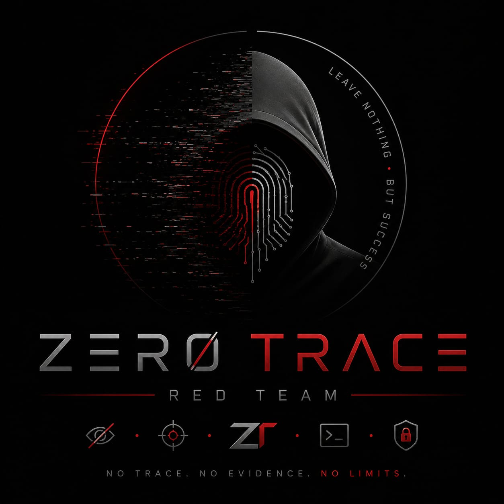

<div align="center">


<br>



# Zero Trace Imperium

### Enterprise Attack & Defense Cybersecurity Laboratory

[](LICENSE)


An enterprise-inspired cybersecurity laboratory that demonstrates the complete lifecycle of offensive and defensive security operations within an isolated VMware environment.

</div>

---

# Table of Contents

- Overview
- Project Goals
- Features
- Laboratory Architecture
- Technology Stack
- Repository Structure
- Project Workflow
- Assessment Phases
- Documentation
- Configuration Repository
- Reports
- Evidence Collection
- Security Architecture
- Security Assessment Methodology
- Security Framework Alignment
- Learning Outcomes
- Project Highlights
- Intended Audience
- Laboratory Safety
- Repository Navigation
- Future Roadmap
- Repository Statistics
- Project Timeline
- Documentation Quality
- Acknowledgements
- License
- Security Policy
- Contributing
- Changelog
- Author
- Project Information
- Disclaimer

---

# Overview

Zero Trace Imperium is an enterprise-inspired cybersecurity laboratory designed to simulate the complete lifecycle of a professional security assessment inside an isolated VMware environment.

The project demonstrates how enterprise infrastructure can be deployed, assessed, exploited, secured, monitored, verified, and restored using widely adopted offensive and defensive security technologies.

Unlike traditional penetration testing laboratories that focus primarily on offensive techniques, Zero Trace Imperium combines Red Team operations with Blue Team defensive controls to provide a comprehensive view of the cybersecurity lifecycle.

Every activity documented in this repository was performed inside an isolated virtual laboratory to ensure repeatability, safety, and consistency.

---

# Project Goals

The primary objectives of Zero Trace Imperium are to:

- Design an enterprise-inspired virtual infrastructure.
- Deploy a Linux-based web application environment.
- Demonstrate structured reconnaissance and enumeration.
- Perform controlled web application security assessments.
- Validate exploitation techniques in an isolated laboratory.
- Demonstrate privilege escalation concepts.
- Implement layered defensive controls.
- Deploy monitoring and detection mechanisms.
- Collect and analyze attacker activity.
- Verify the effectiveness of implemented mitigations.
- Restore the environment to a secure operational state.
- Produce enterprise-grade technical documentation.

---

# Features

- Enterprise-inspired laboratory architecture.
- Complete attack and defense lifecycle.
- Twelve structured assessment phases.
- Professional project documentation.
- Apache web server deployment.
- DVWA implementation.
- Network reconnaissance.
- Web application assessment.
- Privilege escalation demonstrations.
- Host firewall configuration with UFW.
- Intrusion prevention using Fail2Ban.
- Web Application Firewall deployment using ModSecurity.
- SSH Honeypot deployment using Cowrie.
- Network traffic analysis with Wireshark.
- Packet capture collection.
- Configuration repository.
- Assessment reports.
- Automation scripts.
- Repeatable laboratory deployment.

---

# Laboratory Architecture

<p align="center">

</p>

```text
                          VMware Workstation

                   Enterprise Laboratory Environment

                     VMware NAT Network (Isolated)

               +--------------------------------------+

               |                                      |

        Kali Linux                           Ubuntu Server

        Red Team                             Apache

                                              PHP

                                              MariaDB

                                              DVWA

                                              UFW

                                              Fail2Ban

                                              ModSecurity

                                              Cowrie

               |                                      |

               +----------------+---------------------+

                                |

                          Windows 11

                    Administrative Workstation
```

---


# Network Design

<p align="center">

</p>

The laboratory operates inside an isolated VMware NAT network. All virtual machines communicate exclusively within the virtual environment, ensuring safe and repeatable security assessments.

---

# Technology Stack

## Operating Systems

- Kali Linux
- Ubuntu Server
- Windows 11

---

## Infrastructure

- VMware Workstation Pro
- VMware Virtual Network Editor
- VMware NAT Networking

---

## Web Technologies

- Apache HTTP Server
- PHP
- MariaDB
- Damn Vulnerable Web Application (DVWA)

---

## Defensive Technologies

- UFW
- Fail2Ban
- ModSecurity
- OWASP Core Rule Set
- Cowrie Honeypot

---

## Assessment Tools

- Nmap
- Gobuster
- Nikto
- Burp Suite Community Edition
- Hydra
- SQLMap
- Metasploit Framework
- Netcat
- Wireshark

---

# Repository Structure

```text
zero-trace-imperium/
│
├── assets/
├── configs/
├── docs/
├── phases/
├── reports/
├── screenshots/
├── scripts/
│
├── README.md
├── LICENSE
├── CHANGELOG.md
├── SECURITY.md
└── CONTRIBUTING.md
```

---

# Project Workflow

<p align="center">

</p>

```text
Build
   │
   ▼
Reconnaissance
   │
   ▼
Attack
   │
   ▼
Exploit
   │
   ▼
Privilege Escalation
   │
   ▼
Post-Exploitation
   │
   ▼
Persistence
   │
   ▼
Defense
   │
   ▼
Detection & Monitoring
   │
   ▼
Honeypot
   │
   ▼
Verification
   │
   ▼
Cleanup & Recovery
```

---

# Assessment Phases

Zero Trace Imperium follows a structured methodology composed of twelve sequential phases. Each phase represents a critical stage in the lifecycle of a professional cybersecurity assessment.

| Phase | Description |
|--------|-------------|
| Phase 01 | Build |
| Phase 02 | Reconnaissance |
| Phase 03 | Attack |
| Phase 04 | Exploit |
| Phase 05 | Privilege Escalation |
| Phase 06 | Post-Exploitation |
| Phase 07 | Persistence |
| Phase 08 | Defense |
| Phase 09 | Detection and Monitoring |
| Phase 10 | Honeypot |
| Phase 11 | Verification |
| Phase 12 | Cleanup and Recovery |

Each phase is documented individually inside the `phases/` directory, including objectives, methodology, implementation, evidence, findings, verification, and references.

---

# Project Documentation

The repository follows an organized documentation structure that separates implementation details, evidence, reports, configurations, and supporting resources.

| Directory | Description |
|-----------|-------------|
| `docs/` | Project documentation and reference material |
| `phases/` | Phase-by-phase technical documentation |
| `configs/` | Configuration files used throughout the laboratory |
| `reports/` | Security assessment reports |
| `screenshots/` | Visual evidence collected during each phase |
| `pcaps/` | Packet capture files |
| `scripts/` | Automation and deployment utilities |

---

# Configuration Repository

The laboratory includes reusable configuration files for the primary infrastructure and security components.

```text
configs/

├── apache/
├── dvwa/
├── fail2ban/
├── ufw/
├── modsecurity/
├── cowrie/
└── netplan/
```

Each configuration package contains:

- Configuration files.
- Supporting documentation.
- Deployment notes.
- Security considerations.

The repository allows the laboratory environment to be reproduced with minimal manual configuration.

---

# Configuration Components

| Component | Purpose |
|-----------|---------|
| Apache HTTP Server | Web server configuration |
| DVWA | Vulnerable web application |
| Fail2Ban | Intrusion prevention |
| UFW | Host-based firewall |
| ModSecurity | Web Application Firewall |
| Cowrie | SSH Honeypot |
| Netplan | Network configuration |

---

# Reports

Assessment reports are organized according to the security tool used during the engagement.

```text
reports/

├── nmap/
├── gobuster/
├── nikto/
├── hydra/
├── sqlmap/
├── wireshark/
└── dirb/
```

Each report documents:

- Assessment scope.
- Commands executed.
- Findings.
- Analysis.
- Evidence.
- Recommendations.

---

# Screenshots

Every project phase is supported by screenshots documenting the deployment process, assessment activities, defensive implementation, and verification results.

```text
screenshots/

├── build/
├── recon/
├── attack/
├── exploit/
├── privilege-escalation/
├── post-exploitation/
├── persistence/
├── defense/
├── detection-monitoring/
├── honeypot/
├── verification/
└── cleanup/
```

Image naming follows a consistent convention to improve navigation and maintainability across the repository.

---

# Evidence Collection

The project includes multiple forms of technical evidence collected throughout the assessment.

Evidence includes:

- Configuration files.
- Command outputs.
- Network diagrams.
- Packet captures.
- Tool reports.
- Verification results.
- Log analysis.
- Screenshots.

All evidence is organized to support repeatability, transparency, and technical validation.

---

# Packet Capture Collection

Packet captures are stored separately to simplify network traffic analysis and future review.

```text
pcaps/

└── recon_traffic.pcapng
```

Additional packet captures can be included as the laboratory expands.

---

# Automation Scripts

Automation scripts simplify common administrative tasks performed during the laboratory lifecycle.

```text
scripts/

├── deploy.sh
├── verify.sh
├── backup.sh
├── restore.sh
├── cleanup.sh
└── environment-check.sh
```

| Script | Purpose |
|---------|---------|
| `deploy.sh` | Deploy the laboratory environment |
| `verify.sh` | Validate laboratory services |
| `backup.sh` | Backup configuration files |
| `restore.sh` | Restore saved configurations |
| `cleanup.sh` | Remove temporary artifacts |
| `environment-check.sh` | Verify prerequisites and installed services |

The scripts improve deployment consistency and reduce repetitive administrative tasks.

---

# Deliverables

The project produces the following deliverables.

| Deliverable | Description |
|-------------|-------------|
| Enterprise Laboratory | Complete virtual infrastructure |
| Configuration Repository | Hardened configuration files |
| Technical Documentation | Comprehensive project documentation |
| Assessment Reports | Security tool outputs and findings |
| Packet Capture Collection | Wireshark traffic analysis |
| Automation Scripts | Laboratory automation utilities |
| Final Report | Complete project documentation |
| Presentation | Project presentation slides |
| Network Topology | Infrastructure documentation |
| Security Architecture | Enterprise security design |

---

# Documentation Standards

All project documentation follows a unified structure to ensure consistency and maintainability.

Every phase includes:

- Overview.
- Objectives.
- Technical Background.
- Assessment Methodology.
- Implementation.
- Evidence.
- Findings.
- Analysis.
- Recommendations.
- Verification.
- References.

This standardized approach provides a consistent reading experience across the entire repository while reflecting enterprise documentation practices.

---

# Security Architecture

Zero Trace Imperium implements a layered security architecture inspired by enterprise environments.

Rather than relying on a single security mechanism, the laboratory combines multiple preventive, detective, and monitoring controls to demonstrate the principles of Defense in Depth.

<p align="center">

</p>

```text
                     Enterprise Security Architecture

 ┌──────────────────────────────────────────────────────────┐
 │                  Administrative Layer                    │
 │             Windows 11 Management Workstation            │
 └──────────────────────────────────────────────────────────┘
                           │
                           ▼
 ┌──────────────────────────────────────────────────────────┐
 │                Monitoring & Detection                    │
 │     Wireshark • Apache Logs • Cowrie • Fail2Ban          │
 └──────────────────────────────────────────────────────────┘
                           │
                           ▼
 ┌──────────────────────────────────────────────────────────┐
 │             Web Application Protection Layer             │
 │             ModSecurity • OWASP Core Rule Set            │
 └──────────────────────────────────────────────────────────┘
                           │
                           ▼
 ┌──────────────────────────────────────────────────────────┐
 │                 Host Protection Layer                    │
 │                    UFW Firewall                          │
 └──────────────────────────────────────────────────────────┘
                           │
                           ▼
 ┌──────────────────────────────────────────────────────────┐
 │                  Application Layer                       │
 │             Apache • PHP • MariaDB • DVWA               │
 └──────────────────────────────────────────────────────────┘
                           │
                           ▼
 ┌──────────────────────────────────────────────────────────┐
 │                 Infrastructure Layer                     │
 │          Ubuntu Server • VMware Virtual Network          │
 └──────────────────────────────────────────────────────────┘
```

---

# Security Controls

The laboratory integrates multiple defensive technologies that work together throughout the assessment lifecycle.

| Control | Category | Purpose |
|----------|----------|---------|
| UFW | Firewall | Restrict unauthorized network access |
| Fail2Ban | Intrusion Prevention | Block repeated authentication failures |
| ModSecurity | Web Application Firewall | Inspect and filter HTTP requests |
| OWASP CRS | Detection Rules | Protect against common web attacks |
| Apache Hardening | Server Security | Reduce web server exposure |
| Cowrie | Honeypot | Capture attacker interaction |
| Wireshark | Network Monitoring | Analyze network traffic |

---

# Security Assessment Methodology

Zero Trace Imperium follows a structured methodology inspired by professional penetration testing engagements.

```text
Planning

        │

        ▼

Infrastructure Deployment

        │

        ▼

Reconnaissance

        │

        ▼

Enumeration

        │

        ▼

Attack

        │

        ▼

Exploitation

        │

        ▼

Privilege Escalation

        │

        ▼

Post-Exploitation

        │

        ▼

Persistence

        │

        ▼

Defense

        │

        ▼

Detection & Monitoring

        │

        ▼

Honeypot

        │

        ▼

Verification

        │

        ▼

Cleanup & Recovery
```

---

# Security Framework Alignment

The methodology aligns with internationally recognized cybersecurity standards and frameworks.

| Framework | Purpose |
|-----------|---------|
| MITRE ATT&CK | Offensive technique mapping |
| MITRE D3FEND | Defensive technique mapping |
| NIST Cybersecurity Framework (CSF 2.0) | Security lifecycle guidance |
| NIST SP 800-61 Rev. 2 | Incident response principles |
| CIS Controls v8 | Security control implementation |
| OWASP Web Security Testing Guide | Web application testing methodology |
| OWASP ASVS | Application security verification |

---

# Learning Outcomes

This laboratory provides practical experience across several cybersecurity disciplines.

Participants will gain experience with:

- Linux system administration.
- Network configuration.
- Apache web server deployment.
- PHP application hosting.
- Database management.
- Network reconnaissance.
- Service enumeration.
- Web application security assessment.
- Vulnerability validation.
- Privilege escalation concepts.
- Linux server hardening.
- Firewall deployment.
- Intrusion prevention.
- Web Application Firewall configuration.
- Honeypot deployment.
- Network traffic analysis.
- Security verification.
- Technical reporting.

---

# Project Highlights

- Enterprise-inspired cybersecurity laboratory.
- Complete Attack and Defense lifecycle.
- Twelve fully documented assessment phases.
- Enterprise documentation.
- Security architecture documentation.
- Professional configuration repository.
- Structured assessment reports.
- Network topology documentation.
- Packet capture collection.
- Automation scripts.
- Repeatable deployment process.
- Verification and recovery procedures.

---

# Intended Audience

This repository is intended for:

- Cybersecurity students.
- Penetration testing learners.
- Blue Team practitioners.
- Red Team practitioners.
- SOC analysts.
- Linux administrators.
- Network security engineers.
- Security researchers.
- University graduation projects.
- Professional technical portfolios.

---

# Laboratory Safety

Every activity documented within this repository was performed inside an isolated VMware laboratory.

No production infrastructure, public services, or third-party systems were involved during the assessment.

The project is intended exclusively for education, defensive security training, laboratory reproduction, and professional documentation.

---

# Repository Navigation

| Section | Description |
|----------|-------------|
| `README.md` | Repository overview |
| `docs/` | Project documentation |
| `phases/` | Assessment phases |
| `configs/` | Infrastructure configuration |
| `reports/` | Assessment reports |
| `screenshots/` | Visual evidence |
| `pcaps/` | Packet captures |
| `scripts/` | Automation scripts |

---

# Related Documentation

| Document | Description |
|----------|-------------|
| `docs/Idea.md` | Project blueprint |
| `docs/References.md` | Standards and technical references |
| `docs/Final-Report.pdf` | Final project report |
| `docs/Presentation.pptx` | Project presentation |

---

# Future Roadmap

Zero Trace Imperium was designed to be extensible. Future iterations of the laboratory may incorporate additional enterprise technologies, operating systems, and defensive capabilities.

## Infrastructure

- Windows Server
- Active Directory Domain Services
- DNS Server
- DHCP Server
- Reverse Proxy
- Docker
- Kubernetes
- Infrastructure as Code

---

## Defensive Security

- Wazuh SIEM
- Elastic Stack
- Splunk
- Microsoft Defender for Endpoint
- Sysmon
- Zeek
- Suricata
- Security Onion
- Endpoint Detection and Response (EDR)

---

## Offensive Security

- Active Directory Security Assessment
- Kerberos Attacks
- Internal Network Penetration Testing
- Lateral Movement
- Password Auditing
- Automated Enumeration
- Advanced Persistence Scenarios

---

## Automation

- Ansible
- Terraform
- GitHub Actions
- Continuous Security Validation
- Automated Deployment
- Automated Recovery
- Infrastructure Health Monitoring

---

# Repository Statistics

| Category | Count |
|----------|------:|
| Assessment Phases | 12 |
| Configuration Packages | 7 |
| Report Categories | 7 |
| Screenshot Categories | 12 |
| Automation Scripts | 6 |
| Documentation | Comprehensive |
| Packet Captures | Included |

---

# Project Timeline

| Phase | Status |
|--------|--------|
| Build | Completed |
| Reconnaissance | Completed |
| Attack | Completed |
| Exploit | Completed |
| Privilege Escalation | Completed |
| Post-Exploitation | Completed |
| Persistence | Completed |
| Defense | Completed |
| Detection and Monitoring | Completed |
| Honeypot | Completed |
| Verification | Completed |
| Cleanup and Recovery | Completed |

---

# Documentation Quality

The documentation follows a consistent structure throughout the repository.

Every document is designed to provide:

- Clear objectives.
- Technical background.
- Implementation details.
- Configuration references.
- Evidence.
- Technical findings.
- Analysis.
- Validation.
- Recommendations.
- References.

This documentation style reflects practices commonly used in professional cybersecurity assessments.

---

# Acknowledgements

Zero Trace Imperium was developed collaboratively by the Zero Trace Team.

The success of this project reflects the collective effort, technical discussions, testing, documentation, and continuous collaboration among all team members.

The team also acknowledges the maintainers of the open-source tools, frameworks, and documentation that made this educational laboratory possible.

Their contributions helped improve the organization, documentation, testing, and overall quality of this project.

The project also benefited from the outstanding work of the global open-source cybersecurity community and the maintainers of the tools, frameworks, and documentation referenced throughout this repository.

---

# License

This project is licensed under the MIT License.

For complete license information, see:

```text
LICENSE
```

---

# Security Policy

Security reporting guidelines are available in:

```text
SECURITY.md
```

---

# Contributing

Contribution guidelines are available in:

```text
CONTRIBUTING.md
```

---

# Changelog

Project updates and version history are documented in:

```text
CHANGELOG.md
```

---

# Project Team

**Zero Trace Team**

This project was collaboratively designed, implemented, tested, and documented by the Zero Trace Team.

### Team Members

- [Yusuf Husayn](https://github.com/yusuf-husayn)
- [Ahmad Samy](https://github.com/ahmed-samy-h)
- [Abdulrahman Husayn](https://github.com/SyinXx)
- [Hossam Hassan](https://github.com/hossam612)
- [Seif Elddien Sherif](https://github.com/SEIFELDDIEN)
- [Mohamed Ayman](https://github.com/AYAD2412)

---

# Project Information

| Property            | Value                                        |
| ------------------- | -------------------------------------------- |
| Project Name        | Zero Trace Imperium                          |
| Repository Type     | Enterprise-Inspired Cybersecurity Laboratory |
| Environment         | VMware Workstation                           |
| Operating Systems   | Kali Linux, Ubuntu Server, Windows 11        |
| Primary Language    | English                                      |
| Documentation Style | Enterprise                                   |
| License             | MIT                                          |
| Current Version     | 1.0                                          |
| Repository Status   | Completed                                    |

---

# Disclaimer

All activities documented in this repository were conducted exclusively within an isolated virtual laboratory owned and controlled by the Zero Trace Team.

The project is intended solely for educational purposes, defensive security training, laboratory reproduction, and professional documentation.

No testing was performed against production systems, public infrastructure, or third-party environments.

---

<div align="center">

## Project Poster


</div>

---

<div align="center">

# Zero Trace Imperium

### Enterprise Attack & Defense Cybersecurity Laboratory

**Designed for learning. Built for practice. Documented with enterprise standards.**

---

Thank you for taking the time to explore this repository.

If you found this project useful, consider giving it a star.

Feedback, suggestions, and constructive contributions are always welcome.

</div>
