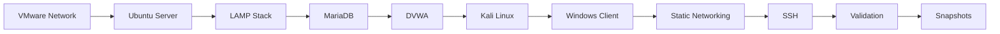
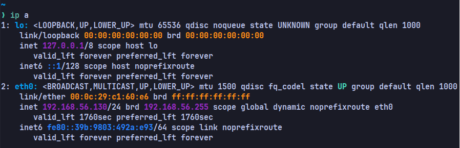
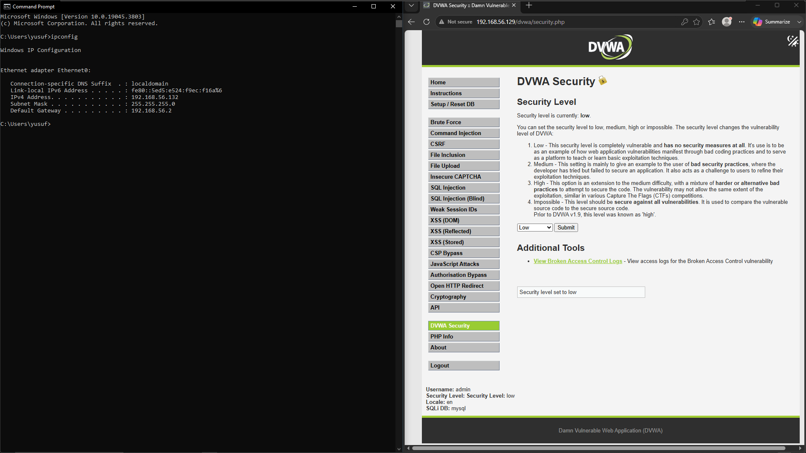

> [!IMPORTANT]
> This document is part of the **Zero Trace Imperium** project documentation.
>
> The Build Phase establishes the baseline infrastructure required for all subsequent offensive and defensive security operations. Every later phase assumes that the environment created here has been completed and validated successfully.

---
<p align="center">  </p>

<div align="center">

# Phase 01 — Build

### Building a Stable, Isolated, and Reproducible Cybersecurity Laboratory


</div>

---

# Document Metadata

| Property                  | Value                                               |
| ------------------------- | --------------------------------------------------- |
| Project                   | Zero Trace Imperium                                 |
| Phase                     | 01                                                  |
| Phase Name                | Build                                               |
| Category                  | Infrastructure                                      |
| Status                    | Completed                                           |
| Difficulty                | Beginner                                            |
| Estimated Completion Time | 45–60 Minutes                                       |
| Hypervisor                | VMware Workstation Pro                              |
| Repository                | Zero Trace Imperium                                 |
| Last Updated              | July 2026                                           |
| License                   | MIT                                                 |
| Target Audience           | Students, Security Researchers, Penetration Testers |


---

# Table of Contents

- [Overview](#overview)
- [Phase Objectives](#phase-objectives)
- [Learning Outcomes](#learning-outcomes)
- [Lab Environment](#lab-environment)
- [Technology Stack](#technology-stack)
- [Virtual Machines](#virtual-machines)
- [Network Addressing](#network-addressing)
- [Laboratory Architecture](#laboratory-architecture)
- [Build Workflow](#build-workflow)
- [Prerequisites](#prerequisites)
- [Expected Deliverables](#expected-deliverables)
- [Evidence Index](#evidence-index)
- [Implementation Roadmap](#implementation-roadmap)

---

# Overview

The Build Phase establishes the technical foundation of the **Zero Trace Imperium** laboratory.

Every offensive and defensive activity performed throughout this project depends on the stability, consistency, and reproducibility of the environment created during this phase.

A realistic enterprise-like infrastructure is deployed using VMware Workstation Pro. The laboratory consists of three interconnected virtual machines representing the attacker, the target server, and a legitimate client workstation.

During this phase, the complete application stack is installed and configured, including Apache, PHP, MariaDB, and the Damn Vulnerable Web Application (DVWA). Network communication is standardized using static IPv4 addressing, remote administration is enabled through OpenSSH, and the environment is validated before any penetration testing activities begin.

The completed infrastructure serves as the baseline for every subsequent phase, including reconnaissance, exploitation, privilege escalation, persistence, defense, monitoring, verification, and recovery.

---

# Phase Objectives

This phase has the following objectives.

- Build an isolated cybersecurity laboratory.
- Configure VMware virtual networking.
- Deploy the Ubuntu Server target.
- Install and configure the LAMP stack.
- Deploy and configure DVWA.
- Prepare the Kali Linux attacker machine.
- Configure the Windows client workstation.
- Assign static IPv4 addresses.
- Enable secure remote administration through SSH.
- Verify communication between all systems.
- Create recovery snapshots before offensive operations begin.

---

# Learning Outcomes

Upon successful completion of this phase, you will be able to:

- Design a reproducible virtual penetration testing laboratory.
- Configure VMware NAT networking.
- Deploy an Ubuntu Server environment.
- Install and configure Apache HTTP Server.
- Configure MariaDB for web applications.
- Deploy DVWA securely.
- Configure Linux networking with static addressing.
- Validate enterprise network connectivity.
- Prepare a laboratory suitable for Red Team and Blue Team exercises.

---

# Lab Environment

| Component | Specification                          |
|-----------|---------------|
| Hypervisor | VMware Workstation Pro                 |
| Attacker | Kali Linux                             |
| Target | Ubuntu Server LTS                      |
| Client | Windows 11                             |
| Web Server | Apache HTTP Server                     |
| Database | MariaDB                                |
| Application | Damn Vulnerable Web Application (DVWA) |
| Remote Administration | OpenSSH                                |
| Virtual Network | VMnet8                                 |
| Network Type | NAT                                    |
| Subnet | 192.168.56.0/24                        |

---

# Technology Stack

## Operating Systems

- Kali Linux
- Ubuntu Server LTS
- Windows 11

---

## Infrastructure

- VMware Workstation Pro
- VMware Virtual Network Editor

---

## Web Technologies

- Apache HTTP Server
- PHP
- MariaDB
- DVWA

---

## Administration

- OpenSSH
- Netplan
- NetworkManager
- Git

---

# Virtual Machines

| Machine       | Role | Operating System  | Primary Responsibility |
|----------|------|------------------|------------------------|
| Kali Linux    | Red Team | Kali Linux        | Offensive Security Operations |
| Ubuntu Server | Target | Ubuntu Server LTS | Web Application Hosting |
| Windows 11    | Client | Windows 11        | Legitimate User Simulation |

---

# Network Addressing

| Device         | Address | Role |
|----------|------------|------------|
| Kali Linux     | 192.168.56.10 | Attacker |
| Ubuntu Server  | 192.168.56.129 | Target |
| Windows 11     | 192.168.56.30 | Client |
| VMware Gateway | 192.168.56.1 | Default Gateway |

---

# Laboratory Architecture

```text
                    VMware Workstation Pro

                           VMnet8 (NAT)

────────────────────────────────────────────────────────────

      Kali Linux
      192.168.56.10

      Red Team Operations

────────────────────────────────────────────────────────────

      Ubuntu Server
      192.168.56.129

      Apache
      PHP
      MariaDB
      DVWA

────────────────────────────────────────────────────────────

      Windows 11
      192.168.56.30

      Enterprise Client

────────────────────────────────────────────────────────────
```

---

# Build Workflow



---

> [!NOTE]
> Every phase documented after this point assumes that the infrastructure described above has been deployed successfully and validated. If any prerequisite fails, the remaining phases of the project should not be executed until the issue has been resolved.

---

# Prerequisites

Before beginning the implementation, verify that the following requirements are satisfied.

| Requirement                                | Status |
|-------------|--------|
| VMware Workstation Pro installed           | ✅ |
| Ubuntu Server installation media available | ✅ |
| Kali Linux installation media available    | ✅ |
| Windows 11 virtual machine available       | ✅ |
| Internet connectivity available            | ✅ |
| Administrative privileges                  | ✅ |
| Minimum 16 GB RAM                          | Recommended |
| Minimum 100 GB Storage                     | Recommended |

---

# Expected Deliverables

The Build Phase is considered successful when all of the following components are operational.

- VMware virtual network configured.
- Ubuntu Server deployed.
- Apache installed and running.
- PHP configured successfully.
- MariaDB operational.
- DVWA deployed successfully.
- Kali Linux configured.
- Windows workstation connected.
- Static IPv4 addresses assigned.
- SSH service enabled.
- Network communication verified.
- VMware recovery snapshots created.

---

# Evidence Index

The following screenshots are referenced throughout this document.

| Figure | Screenshot | Description |
|---------|------------|-------------|
| Figure 1 | vmware-network-editor.png | VMware virtual network configuration |
| Figure 2 | ubuntu-ip-address.png | Ubuntu network configuration |
| Figure 3 | lamp-installation.png | LAMP installation |
| Figure 4 | dvwa-database-setup.png | MariaDB configuration |
| Figure 5 | dvwa-configuration.png | DVWA deployment |
| Figure 6 | kali-ip-address.png | Kali Linux network configuration |
| Figure 7 | kali-connectivity-test.png | Connectivity validation |
| Figure 8 | windows-client.png | Windows client workstation |
| Figure 9 | ssh-service-running.png | SSH service validation |

---

# Implementation Roadmap

The Build Phase is implemented through the following sequence.

1. VMware Network Configuration
2. Ubuntu Server Deployment
3. LAMP Stack Installation
4. MariaDB Configuration
5. DVWA Deployment
6. Kali Linux Preparation
7. Windows Client Preparation
8. Static IP Configuration
9. SSH Configuration
10. Environment Validation
11. VMware Snapshot Creation

---

> [!TIP]
> Complete each implementation stage in the order presented. Every stage builds upon the previous one, ensuring a stable and reproducible laboratory environment for the remaining phases of the Zero Trace Imperium project.

---

# 1. VMware Network Configuration

## Objective

Configure an isolated VMware NAT network that enables secure communication between all virtual machines while maintaining controlled Internet access for software installation, package updates, and repository synchronization.

A dedicated virtual network provides a consistent and reproducible environment, ensuring that every phase of the project can be executed without affecting the host operating system or any external production network.

---

## Background

Virtual networking is the backbone of the Zero Trace Imperium laboratory.

Every system deployed throughout the project communicates through a dedicated VMware virtual network. This architecture provides complete isolation while allowing outbound Internet access whenever required.

Using NAT networking offers several advantages.

- Isolates the laboratory from the physical network.
- Prevents accidental interaction with external systems.
- Allows software installation and package updates.
- Enables communication between every virtual machine.
- Provides a repeatable environment for future testing.

---

## Configuration Summary

| Setting | Value |
|----------|-------|
| Hypervisor | VMware Workstation Pro |
| Virtual Network | VMnet8 |
| Network Type | NAT |
| Address Range | 192.168.56.0/24 |
| Gateway | 192.168.56.1 |
| DHCP | Disabled (Static Addressing Used) |

---

## Implementation Steps

### Step 1 — Open VMware Virtual Network Editor

Launch VMware Workstation Pro.

Navigate to

```text
Edit
└── Virtual Network Editor
```

If prompted, select **Change Settings** to obtain administrative privileges.

---

### Step 2 — Configure VMnet8

Create or modify **VMnet8** using the following configuration.

| Parameter | Value |
|-----------|-------|
| Network Type | NAT |
| Subnet | 192.168.56.0 |
| Subnet Mask | 255.255.255.0 |
| Gateway | 192.168.56.1 |

---

### Step 3 — Apply the Configuration

After verifying the configuration, select

```text
Apply

↓

OK
```

VMware automatically creates the required virtual adapters on the host operating system.

---

## Verification

Confirm that the following conditions are satisfied.

- VMnet8 exists.
- Network Type is NAT.
- The subnet is configured as 192.168.56.0/24.
- The gateway is assigned correctly.
- All virtual machines are attached to VMnet8.

---

## Evidence


**Figure 1.** VMware NAT network configured successfully.

---

> [!TIP]
> Assign every virtual machine to the same virtual network before powering it on. Mixing VMnet adapters can prevent communication between systems and lead to inconsistent laboratory behavior.

---

## Best Practices

- Use a dedicated NAT network for isolated security laboratories.
- Avoid Bridged networking during offensive testing.
- Keep the subnet consistent throughout the entire project.
- Record the network configuration before creating snapshots.
- Validate connectivity before installing applications.

---

## Common Issues

| Issue | Cause | Resolution |
|--------|-------|------------|
| Virtual machines cannot communicate | Different VMnet adapters | Connect every machine to VMnet8 |
| Internet access unavailable | NAT service disabled | Verify VMware NAT Service is running |
| Incorrect IP addresses | DHCP conflict | Use the documented static addresses |
| Gateway unreachable | Invalid subnet configuration | Reconfigure VMnet8 |

---

# 2. Ubuntu Server Deployment

## Objective

Deploy the Ubuntu Server virtual machine that will serve as the primary target throughout the offensive and defensive phases of the project.

The server hosts the complete web application stack and represents a vulnerable enterprise web server exposed to internal users.

---

## System Information

| Property | Value |
|----------|-------|
| Operating System | Ubuntu Server LTS |
| Role | Target |
| Hostname | ubuntu-server |
| Network | VMnet8 |
| Primary Address | 192.168.56.129 |

---

## Initial Configuration

Power on the virtual machine and verify the following.

- The virtual disk is mounted correctly.
- The operating system boots without errors.
- The network adapter is connected.
- Internet connectivity is available.
- SSH can be installed later.

---

## Verify the Network Interface

Display the available interfaces.

```bash
ip address
```

Confirm that the network interface appears correctly.

Example

```text
ens33
```

---

## Update the Package Repository

Refresh the package index.

```bash
sudo apt update
```

Upgrade installed packages.

```bash
sudo apt upgrade -y
```

---

> [!NOTE]
> Updating the operating system before installing any additional software reduces compatibility issues and ensures that the latest security patches are applied.

---

## Validate the System

Verify that the server is operating correctly.

```bash
hostnamectl
```

Expected information includes.

- Hostname
- Operating System
- Kernel Version
- Architecture

---

## Evidence


**Figure 2.** Ubuntu Server successfully deployed and connected to the laboratory network.

---

# 3. Install the LAMP Stack

## Objective

Install the complete software stack required to host DVWA.

The environment follows the traditional LAMP architecture.

- Linux
- Apache
- MariaDB
- PHP

This stack provides the runtime environment for the vulnerable web application used throughout the project.

---

## Install Required Packages

Execute the following command.

```bash
sudo apt install apache2 mariadb-server php php-mysqli php-gd libapache2-mod-php git -y
```

---

## Installed Components

| Component | Purpose |
|-----------|----------|
| Apache HTTP Server | Hosts the web application |
| MariaDB | Database Management System |
| PHP | Server-side scripting engine |
| php-mysqli | Database connectivity |
| php-gd | Image processing |
| libapache2-mod-php | PHP integration with Apache |
| Git | Repository cloning |

---

## Verify Apache

```bash
sudo systemctl status apache2
```

Expected output

```text
active (running)
```

---

## Verify MariaDB

```bash
sudo systemctl status mariadb
```

Expected output

```text
active (running)
```

---

## Evidence


**Figure 3.** Successful installation and activation of the LAMP stack.

---

> [!IMPORTANT]
> The Apache and MariaDB services must both be running before deploying DVWA. Failure to verify these services may result in application initialization errors in subsequent steps.

---

# 4. MariaDB Configuration

## Objective

Create and configure a dedicated database environment for the Damn Vulnerable Web Application (DVWA).

Rather than using the MariaDB root account, a separate application-specific database and user account are created. This approach reflects common deployment practices and simplifies database management throughout the project.

---

## Background

MariaDB is the relational database management system responsible for storing the application's data, user accounts, session information, and configuration.

DVWA requires:

- A dedicated database.
- A database user with sufficient privileges.
- Valid authentication credentials.

Once these requirements are satisfied, DVWA can initialize its database schema and operate correctly.

---

## Access MariaDB

Log in as the database administrator.

```bash
sudo mysql -u root
```

---

## Create the Database

Execute the following SQL statement.

```sql
CREATE DATABASE dvwa;
```

---

## Create the Application User

Create a dedicated database account for DVWA.

```sql
CREATE USER 'dvwa'@'localhost'
IDENTIFIED BY 'password';
```

---

## Grant Required Privileges

Assign the required permissions.

```sql
GRANT ALL PRIVILEGES
ON dvwa.*
TO 'dvwa'@'localhost';
```

---

## Reload the Privilege Tables

```sql
FLUSH PRIVILEGES;
```

---

## Verify the Configuration

Confirm that the database exists.

```sql
SHOW DATABASES;
```

Verify the assigned privileges.

```sql
SHOW GRANTS FOR 'dvwa'@'localhost';
```

List available users.

```sql
SELECT User, Host
FROM mysql.user;
```

---

## Exit MariaDB

```sql
EXIT;
```

---

## Verification Checklist

The configuration is considered successful when:

- The **dvwa** database exists.
- The **dvwa** user appears in the user table.
- Privileges are assigned correctly.
- No SQL errors are returned.

---

## Evidence


**Figure 4.** MariaDB database and application account successfully configured.

---

> [!TIP]
> Avoid using the database administrator account for web applications. Creating dedicated service accounts reduces administrative overhead and follows standard deployment practices.

---

## Common Issues

| Issue | Possible Cause | Resolution |
|--------|----------------|------------|
| Access denied | Invalid credentials | Verify the username and password |
| Database already exists | Previous configuration | Drop the database or reuse it |
| Permission denied | Missing GRANT statement | Reapply privileges and execute `FLUSH PRIVILEGES` |
| Authentication plugin mismatch | Unsupported authentication method | Recreate the user using the default authentication plugin |

---

# 5. Deploy DVWA

## Objective

Deploy the Damn Vulnerable Web Application (DVWA) on the Apache web server.

DVWA serves as the primary attack surface throughout the Zero Trace Imperium project and intentionally contains multiple vulnerabilities for educational and defensive validation purposes.

---

## Background

DVWA is an open-source PHP application designed for security professionals, penetration testers, students, and instructors.

The application includes intentionally vulnerable modules covering common web security weaknesses, including:

- SQL Injection
- Command Injection
- Cross-Site Scripting (XSS)
- File Upload
- Cross-Site Request Forgery (CSRF)
- File Inclusion
- Weak Session Management
- Brute Force Authentication

These vulnerabilities provide a controlled environment for demonstrating offensive techniques and validating defensive controls.

---

## Navigate to the Web Root

```bash
cd /var/www/html
```

---

## Clone the Repository

```bash
sudo git clone https://github.com/digininja/DVWA.git dvwa
```

---

## Configure File Ownership

```bash
sudo chown -R www-data:www-data /var/www/html/dvwa
```

---

## Configure File Permissions

```bash
sudo chmod -R 755 /var/www/html/dvwa
```

---

## Create the Configuration File

Navigate to the configuration directory.

```bash
cd /var/www/html/dvwa/config
```

Create the application configuration.

```bash
sudo cp config.inc.php.dist config.inc.php
```

---

## Configure Database Credentials

Open the configuration file.

```bash
sudo nano config.inc.php
```

Update the following parameters.

```php
$_DVWA['db_user'] = 'dvwa';
$_DVWA['db_password'] = 'password';
```

Save the file.

---

## Restart Apache

```bash
sudo systemctl restart apache2
```

---

## Verification

Open a browser and navigate to

```text
http://192.168.56.129/dvwa
```

The DVWA setup page should appear without errors.

---

## Evidence


**Figure 5.** DVWA successfully deployed and configured.

---

## Best Practices

- Verify file ownership after cloning.
- Store database credentials securely.
- Restart Apache after modifying configuration files.
- Confirm database connectivity before initializing DVWA.

---

> [!NOTE]
> During the Build Phase, DVWA is intentionally deployed in a vulnerable state. Security hardening and mitigation are implemented later during the Defense Phase to demonstrate the effectiveness of protective controls.

---

## Common Issues

| Issue | Possible Cause | Resolution |
|--------|----------------|------------|
| 403 Forbidden | Incorrect permissions | Update ownership and file permissions |
| Database connection failed | Invalid credentials | Verify `config.inc.php` |
| Blank page | PHP module missing | Install the required PHP extensions |
| Apache error | Configuration issue | Review Apache logs and restart the service |

---

# Phase Progress

```text
✓ VMware Network Configuration

✓ Ubuntu Server Deployment

✓ LAMP Stack Installation

✓ MariaDB Configuration

✓ DVWA Deployment

⏳ Kali Linux Preparation

⏳ Windows Client Configuration

⏳ Static Network Configuration

⏳ SSH Configuration

⏳ Environment Validation

⏳ VMware Snapshot Creation
```

---

> [!IMPORTANT]
> At this stage, the target server is fully operational. The remaining tasks focus on preparing the attacker workstation, validating communication between all virtual machines, and establishing a stable baseline before offensive security testing begins.

---
---

# 6. Prepare the Attacker Machine

## Objective

Prepare the Kali Linux virtual machine that will serve as the primary offensive platform throughout the Zero Trace Imperium project.

Kali Linux contains the security tools required for reconnaissance, vulnerability assessment, exploitation, privilege escalation, post-exploitation, persistence, and security verification.

The goal of this step is to ensure that the attacker workstation is correctly connected to the laboratory network and fully operational before offensive testing begins.

---

## Background

Kali Linux is the industry-standard penetration testing distribution maintained by Offensive Security.

It provides hundreds of security assessment tools that support every stage of a penetration test.

Throughout this project, Kali Linux will be used to perform:

- Network reconnaissance
- Service enumeration
- Vulnerability scanning
- Web application testing
- Password attacks
- Exploitation
- Privilege escalation
- Post-exploitation
- Security verification

---

## System Information

| Property | Value |
|----------|-------|
| Machine | Kali Linux |
| Role | Red Team Attacker |
| Operating System | Kali Linux |
| Network | VMnet8 |
| IP Address | 192.168.56.10 |

---

## Verify the Network Adapter

Open the virtual machine settings.

Confirm that the network adapter is configured as:

```text
Custom

↓

VMnet8
```

All virtual machines must use the same VMware virtual network.

---

## Verify the Assigned Address

Display all available interfaces.

```bash
ip address
```

or

```bash
ip a
```

Locate the active network interface.

Expected example:

```text
inet 192.168.56.10/24
```

---

## Verify Network Connectivity

Ping the Ubuntu Server.

```bash
ping -c 4 192.168.56.129
```

Expected result

```text
4 packets transmitted

4 received

0% packet loss
```

---

## Verify Internet Connectivity

```bash
ping -c 4 google.com
```

Successful replies indicate that package installation and repository synchronization are available.

---

## Update Kali Linux

Refresh the package index.

```bash
sudo apt update
```

Upgrade installed packages.

```bash
sudo apt full-upgrade -y
```

---

## Verify Installed Tools

Confirm that the primary offensive tools are available.

```bash
nmap --version
```

```bash
hydra -h
```

```bash
sqlmap --version
```

```bash
burpsuite
```

```bash
msfconsole
```

---

## Validation

The attacker workstation is considered ready when:

- Network connectivity is operational.
- Internet access is available.
- Offensive tools execute correctly.
- The assigned IP address matches the documented network plan.

---

## Evidence



**Figure 6.** Kali Linux successfully connected to the laboratory network.

---


**Figure 7.** Successful communication between Kali Linux and the Ubuntu Server.

---

> [!TIP]
> Always verify connectivity before starting reconnaissance. Most penetration testing failures originate from incorrect network configuration rather than application issues.

---

## Best Practices

- Keep Kali Linux updated before every assessment.
- Verify tool versions regularly.
- Confirm IP addressing before each project phase.
- Avoid installing unnecessary software that may affect reproducibility.

---

## Common Issues

| Issue | Possible Cause | Resolution |
|--------|----------------|------------|
| No network connectivity | Incorrect VMnet assignment | Connect the adapter to VMnet8 |
| Target unreachable | Incorrect IP configuration | Verify the Ubuntu Server address |
| Internet unavailable | VMware NAT service stopped | Restart VMware networking services |
| Missing security tools | Incomplete installation | Update or reinstall the required package |

---

# 7. Prepare the Windows Client

## Objective

Deploy a Windows workstation representing a legitimate enterprise user.

This machine is included to simulate normal user activity and verify communication with the target web application from a client perspective.

---

## Background

Enterprise environments rarely consist of servers alone.

Including a client workstation provides a more realistic laboratory and enables validation of web application accessibility, network connectivity, and user interaction.

Although the Windows workstation is not directly involved in offensive operations during this project, it demonstrates that the target infrastructure remains accessible to legitimate users.

---

## System Information

| Property | Value             |
|----------|-------|
| Machine | Windows 11        |
| Role | Enterprise Client |
| Operating System | Windows 11        |
| Network | VMnet8            |
| IP Address | 192.168.56.30     |

---

## Verify Network Configuration

Open **Command Prompt**.

Execute:

```cmd
ipconfig
```

Confirm that the assigned IPv4 address belongs to the laboratory subnet.

Expected example

```text
192.168.56.30
```

---

## Verify Connectivity

Ping the Ubuntu Server.

```cmd
ping 192.168.56.129
```

Expected output

```text
Reply from 192.168.56.129
```

---

## Verify Web Access

Open a web browser.

Navigate to

```text
http://192.168.56.129/dvwa
```

The DVWA login page should load successfully.

---

## Validation

The Windows workstation is considered operational when:

- The assigned IPv4 address is correct.
- The Ubuntu Server responds to ICMP requests.
- The DVWA login page loads successfully.
- Network communication remains stable.

---

## Evidence



**Figure 8.** Windows workstation successfully connected to the laboratory environment.

---

> [!NOTE]
> The Windows workstation serves as a legitimate enterprise endpoint throughout the project. Its primary purpose is to validate that defensive controls do not disrupt normal user access while protecting the target infrastructure.

---

## Phase Progress

```text
✓ VMware Network Configuration

✓ Ubuntu Server Deployment

✓ LAMP Stack Installation

✓ MariaDB Configuration

✓ DVWA Deployment

✓ Kali Linux Preparation

✓ Windows Client Preparation

⏳ Static Network Configuration

⏳ SSH Configuration

⏳ Environment Validation

⏳ VMware Snapshot Creation
```

---

# 8. Configure Static IP Addressing

## Objective

Assign permanent IPv4 addresses to every virtual machine participating in the Zero Trace Imperium laboratory.

Static addressing guarantees consistent communication between systems and ensures that every command, screenshot, report, and demonstration remains valid throughout the project lifecycle.

Unlike DHCP, static addressing eliminates unexpected IP address changes after system reboots or network reinitialization.

---

## Background

A penetration testing laboratory depends on predictable network communication.

Every offensive and defensive phase references the same IP addresses repeatedly. Changing addresses during the project introduces unnecessary troubleshooting and invalidates screenshots and documentation.

For this reason, all virtual machines use manually assigned IPv4 addresses.

---

## Addressing Plan

| Machine        | Address | Purpose |
|----------|------------|-----------------------------|
| Kali Linux     | 192.168.56.10 | Red Team Attacker |
| Ubuntu Server  | 192.168.56.129 | Target Server |
| Windows 11     | 192.168.56.30 | Enterprise Client |
| VMware Gateway | 192.168.56.1 | Default Gateway |

---

## Ubuntu Server Configuration

Open the Netplan configuration.

```bash
sudo nano /etc/netplan/00-installer-config.yaml
```

Example configuration

```yaml
network:
  version: 2
  ethernets:
    ens33:
      dhcp4: false
      addresses:
        - 192.168.56.129/24
      routes:
        - to: default
          via: 192.168.56.1
      nameservers:
        addresses:
          - 8.8.8.8
```

Apply the configuration.

```bash
sudo netplan apply
```

---

## Kali Linux Configuration

Configure the network using NetworkManager.

```bash
sudo nmcli con mod "Wired connection 1" \
ipv4.addresses 192.168.56.10/24 \
ipv4.gateway 192.168.56.1 \
ipv4.dns 8.8.8.8 \
ipv4.method manual
```

Activate the connection.

```bash
sudo nmcli con up "Wired connection 1"
```

---

## Windows Configuration

Configure the network adapter manually.

| Setting | Value |
|----------|-------|
| IPv4 Address | 192.168.56.30 |
| Subnet Mask | 255.255.255.0 |
| Default Gateway | 192.168.56.1 |
| Preferred DNS | 8.8.8.8 |

---

## Validation

Verify the assigned address on every system.

Ubuntu

```bash
ip a
```

Kali

```bash
ip a
```

Windows

```cmd
ipconfig
```

---

## Evidence


**Figure 9.** Ubuntu Server configured with a static IPv4 address.

---


**Figure 10.** Kali Linux configured with a static IPv4 address.

---


**Figure 11.** Windows workstation configured with a static IPv4 address.

---

> [!TIP]
> Record every static IP address before beginning the Reconnaissance Phase. Most commands executed during the remainder of the project reference these addresses directly.

---

# 9. Enable Secure Remote Administration

## Objective

Enable OpenSSH on the Ubuntu Server to provide secure remote administration and support later phases involving authentication testing and system management.

---

## Background

SSH provides encrypted remote access to Linux systems and is widely used by system administrators.

Throughout this project, SSH will also become part of the offensive and defensive exercises, including password attacks, persistence demonstrations, and security hardening.

---

## Install OpenSSH

```bash
sudo apt install openssh-server -y
```

---

## Enable the Service

```bash
sudo systemctl enable ssh
```

Start the service.

```bash
sudo systemctl start ssh
```

---

## Verify the Service

```bash
sudo systemctl status ssh
```

Expected output

```text
active (running)
```

---

## Verify Port Availability

```bash
sudo ss -tln
```

Expected output

```text
:22
```

---

## Evidence


**Figure 12.** OpenSSH service enabled successfully.

---

## Validation

From Kali Linux

```bash
ssh username@192.168.56.129
```

The Ubuntu login prompt should appear.

---

> [!IMPORTANT]
> SSH is intentionally enabled because it becomes part of the penetration testing workflow during subsequent phases. Security hardening of SSH is performed later in the Defense Phase.

---

# 10. Validate the Laboratory

## Objective

Verify that every component of the environment functions correctly before transitioning to offensive operations.

Validation ensures that infrastructure issues are detected early, reducing troubleshooting during penetration testing.

---

## Connectivity Tests

Verify communication.

Kali → Ubuntu

```bash
ping -c 4 192.168.56.129
```

Ubuntu → Kali

```bash
ping -c 4 192.168.56.10
```

Windows → Ubuntu

```cmd
ping 192.168.56.129
```

---

## Service Validation

Verify Apache.

```bash
sudo systemctl status apache2
```

Verify MariaDB.

```bash
sudo systemctl status mariadb
```

Verify SSH.

```bash
sudo systemctl status ssh
```

---

## Application Validation

Open

```text
http://192.168.56.129/dvwa
```

Verify that

- The login page loads.
- No PHP errors appear.
- The database initializes successfully.

---

## Build Phase Validation Checklist

| Validation Item | Status |
|-----------------|--------|
| VMware NAT configured | ✅ |
| Ubuntu Server operational | ✅ |
| Apache running | ✅ |
| MariaDB running | ✅ |
| PHP configured | ✅ |
| DVWA deployed | ✅ |
| Kali Linux operational | ✅ |
| Windows workstation operational | ✅ |
| Static addressing configured | ✅ |
| SSH enabled | ✅ |
| Network connectivity verified | ✅ |

---

# 11. Create VMware Recovery Snapshots

## Objective

Create recovery checkpoints that preserve the completed laboratory before beginning offensive activities.

Snapshots provide a reliable rollback mechanism, allowing the environment to be restored to a known-good state within minutes.

---

## Snapshot Naming Convention

| Snapshot | Purpose |
|-----------|---------|
| Fresh Build | Initial deployment |
| Pre-Recon | Before reconnaissance |
| Pre-Attack | Before exploitation |
| Pre-Defense | Before hardening |
| Final Clean State | Restored laboratory |

---

## VMware Procedure

Navigate to

```text
VM

↓

Snapshot

↓

Take Snapshot
```

Recommended snapshot name

```text
Fresh Build
```

Repeat this process for

- Kali Linux
- Ubuntu Server
- Windows 11

---

> [!TIP]
> Never perform offensive testing without creating a recovery snapshot. A single configuration error or destructive action can invalidate hours of work.

---

## Phase Progress

```text
████████████████████████████████████████

Build Phase

████████████████████████████████████████

✅ VMware Network

✅ Ubuntu Server

✅ LAMP Stack

✅ MariaDB

✅ DVWA

✅ Kali Linux

✅ Windows Client

✅ Static Networking

✅ SSH

✅ Validation

✅ Recovery Snapshots

████████████████████████████████████████

100% COMPLETE
```

---

# Security Considerations

Although the laboratory is intentionally configured in a vulnerable state during the Build Phase, it is deployed inside a fully isolated virtual environment to eliminate any risk to external systems.

The following security considerations apply throughout the project.

- Never connect the vulnerable laboratory directly to a production network.
- Use VMware NAT networking to isolate the environment.
- Keep all virtual machines within the same virtual subnet.
- Restrict the laboratory to educational and research purposes only.
- Create recovery snapshots before major configuration changes.
- Store exported virtual machines securely.
- Avoid exposing vulnerable services to the Internet.

> [!CAUTION]
> The infrastructure created during this phase intentionally contains vulnerable software that is designed for security education. It must never be deployed in a production environment.

---

# Troubleshooting Guide

The following table summarizes the most common issues encountered during the Build Phase.

| Problem | Possible Cause | Recommended Solution |
|----------|----------------|----------------------|
| Ubuntu cannot access the Internet | Incorrect VMware network configuration | Verify VMnet8 NAT settings |
| Kali cannot communicate with Ubuntu | Different virtual networks | Connect both machines to VMnet8 |
| Apache service fails to start | Port conflict or configuration error | Review Apache configuration and restart the service |
| MariaDB connection failed | Invalid credentials or service stopped | Verify database credentials and restart MariaDB |
| DVWA displays database errors | Incorrect database configuration | Verify `config.inc.php` settings |
| SSH connection refused | SSH service not running | Enable and start the OpenSSH service |
| Static IP configuration not applied | Incorrect Netplan configuration | Validate the YAML syntax and apply the configuration again |

---

# Lessons Learned

The Build Phase establishes the technical foundation of the Zero Trace Imperium laboratory.

During this phase, a complete enterprise-style infrastructure was deployed using VMware Workstation Pro. The environment includes a dedicated attacker workstation, a vulnerable Ubuntu Server hosting DVWA, and a Windows client workstation representing a legitimate enterprise endpoint.

The deployment process demonstrates the importance of:

- Infrastructure planning.
- Network segmentation.
- Standardized addressing.
- Service validation.
- Environment reproducibility.
- Recovery planning through VMware snapshots.

A properly configured laboratory significantly reduces troubleshooting during later offensive and defensive phases and ensures consistent, repeatable results.

---

# Build Phase Summary

The following objectives were completed successfully.

| Objective | Status |
|------------|--------|
| VMware NAT network configured | ✅ |
| Ubuntu Server deployed | ✅ |
| LAMP stack installed | ✅ |
| MariaDB configured | ✅ |
| DVWA deployed | ✅ |
| Kali Linux prepared | ✅ |
| Windows client configured | ✅ |
| Static IP addressing implemented | ✅ |
| OpenSSH enabled | ✅ |
| Laboratory validated | ✅ |
| VMware recovery snapshots created | ✅ |

The laboratory is now fully operational and ready for offensive security activities.

---

# Appendix A — Network Topology

| Machine        | Role | Operating System  | IPv4 Address |
|----------|------|------------------|--------------|
| Kali Linux     | Red Team Attacker | Kali Linux        | 192.168.56.10 |
| Ubuntu Server  | Target Server | Ubuntu Server LTS | 192.168.56.129 |
| Windows 11     | Enterprise Client | Windows 11        | 192.168.56.30 |
| VMware Gateway | NAT Gateway | VMnet8            | 192.168.56.1 |

---

# Appendix B — Installed Software

| Software               | Purpose                      |
| ---------------------- | ---------------------------- |
| VMware Workstation Pro | Virtualization Platform      |
| Ubuntu Server          | Target Operating System      |
| Kali Linux             | Penetration Testing Platform |
| Windows 11             | Enterprise Client            |
| Apache HTTP Server     | Web Server                   |
| PHP                    | Web Application Runtime      |
| MariaDB                | Database Server              |
| DVWA                   | Vulnerable Web Application   |
| OpenSSH                | Remote Administration        |

---

# Appendix C — Screenshot Inventory

| Figure | Screenshot |
|----------|------------|
| Figure 1 | vmware-network-editor.png |
| Figure 2 | ubuntu-ip-address.png |
| Figure 3 | lamp-installation.png |
| Figure 4 | dvwa-database-setup.png |
| Figure 5 | dvwa-configuration.png |
| Figure 6 | kali-ip-address.png |
| Figure 7 | kali-connectivity-test.png |
| Figure 8 | windows-client.png |
| Figure 9 | ubuntu-final-ip.png |
| Figure 10 | kali-final-ip.png |
| Figure 11 | windows-final-ip.png |
| Figure 12 | ssh-service-running.png |

---

# References

The following resources were used during the implementation of the Build Phase.

- VMware Workstation Pro Documentation
- Ubuntu Server Documentation
- Apache HTTP Server Documentation
- MariaDB Documentation
- PHP Documentation
- DVWA Documentation
- OpenSSH Documentation

---

# Revision History

| Version | Date | Description |
|----------|------|-------------|
| 1.0 | July 2026 | Initial release of the Build Phase documentation |

---

# Document Information

| Property | Value |
|----------|-------|
| Project | Zero Trace Imperium |
| Document | Phase 01 – Build |
| Version | 1.0 |
| Status | Complete |
| Author | Yusuf Hussein |
| Language | English |
| Classification | Educational Cybersecurity Laboratory |

---

# Related Documentation

- Project README
- Phase 02 — Reconnaissance
- Final Report
- Presentation

---
# Next Phase

The laboratory infrastructure is now fully operational and validated.

The next phase focuses on **Reconnaissance**, where information gathering techniques are used to identify hosts, discover exposed services, enumerate web resources, analyze network traffic, and establish the attack surface of the target environment.

The following tools will be introduced during the next phase.

- Nmap
- Gobuster
- Nikto
- Burp Suite
- Wireshark

Continue to:

**→ Phase 02 – Reconnaissance**

---

<div align="center">

### End of Phase 01 — Build

**Zero Trace Imperium**

*Enterprise Attack & Defense Cybersecurity Laboratory*

</div>

---