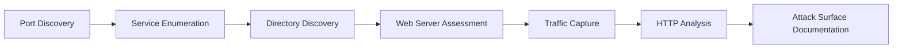

> [!IMPORTANT]
> This document is part of the **Zero Trace Imperium** project documentation.
>
> The Reconnaissance Phase identifies the target's exposed attack surface before any exploitation activities begin. Every finding documented during this phase directly influences the offensive techniques used throughout the remainder of the project.

---

<div align="center">

# Phase 02 — Reconnaissance

### Information Gathering, Service Enumeration, and Attack Surface Discovery


</div>

---

# Document Metadata

| Property | Value |
|-----------|-------|
| Project | Zero Trace Imperium |
| Phase | 02 |
| Phase Name | Reconnaissance |
| Category | Information Gathering |
| Status | Completed |
| Difficulty | Beginner |
| Estimated Completion Time | 60–90 Minutes |
| Primary Platform | Kali Linux |
| Documentation Version | 1.0 |
| Target Audience | Students, Security Researchers, Penetration Testers |

---

# Table of Contents

- [Executive Summary](#executive-summary)
- [Overview](#overview)
- [Phase Objectives](#phase-objectives)
- [Learning Outcomes](#learning-outcomes)
- [Rules of Engagement](#rules-of-engagement)
- [Scope](#scope)
- [Target Information](#target-information)
- [Technology Stack](#technology-stack)
- [Tools Used](#tools-used)
- [MITRE ATT&CK Mapping](#mitre-attck-mapping)
- [Reconnaissance Methodology](#reconnaissance-methodology)
- [Attack Surface Categories](#attack-surface-categories)
- [Evidence Index](#evidence-index)
- [Implementation Roadmap](#implementation-roadmap)

---

# Executive Summary

Reconnaissance is the first operational phase of the Zero Trace Imperium assessment.

Its primary objective is to collect accurate technical information about the target infrastructure without modifying the target system.

Rather than exploiting vulnerabilities immediately, this phase focuses on identifying exposed services, enumerating web resources, fingerprinting technologies, analyzing network traffic, and documenting every observation.

The intelligence collected during reconnaissance forms the foundation of every offensive action performed in later phases. Successful penetration testing depends on the quality and completeness of the information gathered during this stage.

---

# Overview

Following the successful deployment of the laboratory environment, the next objective is to understand the target from an attacker's perspective.

Reconnaissance combines multiple information-gathering techniques to identify exposed services, discover hidden directories, fingerprint web technologies, analyze network communications, and inspect HTTP traffic.

Several industry-standard security tools are used throughout this phase, each contributing a different perspective of the target environment.

The resulting evidence is documented to provide a structured understanding of the attack surface before exploitation begins.

---

# Phase Objectives

This phase aims to achieve the following objectives.

- Discover active TCP services.
- Identify running service versions.
- Enumerate hidden web resources.
- Detect common web server misconfigurations.
- Analyze network traffic generated during scanning.
- Inspect HTTP requests and responses.
- Identify technologies powering the target application.
- Build a complete attack surface inventory.
- Document every finding for future phases.

---

# Learning Outcomes

Upon completing this phase, you will be able to:

- Perform comprehensive network reconnaissance.
- Enumerate TCP services using Nmap.
- Discover hidden directories using Gobuster.
- Assess web server configurations with Nikto.
- Capture reconnaissance traffic using Wireshark.
- Intercept HTTP communications using Burp Suite.
- Analyze exposed attack surfaces.
- Document reconnaissance evidence professionally.

---

# Rules of Engagement

This assessment was performed under the following conditions.

| Rule | Description |
|------|-------------|
| Assessment Type | Authorized Internal Laboratory |
| Target Ownership | Self-Owned Virtual Infrastructure |
| External Systems | Excluded |
| Internet Targets | Not Scanned |
| Objective | Educational Security Assessment |
| Scope | Ubuntu Server Only |

---

> [!NOTE]
> Every activity documented in this phase was performed exclusively inside an isolated VMware laboratory created during Phase 01. No external hosts or production environments were involved.

---

# Scope

## Attacker

| Property | Value |
|----------|-------|
| Machine | Kali Linux |
| Operating System | Kali Linux |
| Address | 192.168.56.10 |

---

## Target

| Property | Value |
|----------|-------|
| Machine | Ubuntu Server |
| Operating System | Ubuntu Server LTS |
| Address | 192.168.56.129 |

---

## Assessment Scope

| Item | Included |
|------|----------|
| TCP Port Discovery | ✅ |
| Service Enumeration | ✅ |
| Version Detection | ✅ |
| Directory Enumeration | ✅ |
| HTTP Inspection | ✅ |
| Packet Capture | ✅ |
| Web Server Assessment | ✅ |
| Vulnerability Exploitation | ❌ |
| Privilege Escalation | ❌ |

---

# Target Information

| Property | Value |
|----------|-------|
| Target Host | Ubuntu Server |
| IPv4 Address | 192.168.56.129 |
| Web Server | Apache HTTP Server |
| Database | MariaDB |
| Web Application | DVWA |
| Assessment Type | Black Box |
| Network | VMware VMnet8 |

---

# Technology Stack

## Infrastructure

- VMware Workstation Pro
- VMware NAT Network

---

## Operating Systems

- Kali Linux
- Ubuntu Server

---

## Network Analysis

- Wireshark

---

## Web Assessment

- Burp Suite Community Edition
- Gobuster
- Nikto

---

## Network Enumeration

- Nmap
- Nmap Scripting Engine (NSE)

---

# Tools Used

| Tool | Purpose |
|------|---------|
| Nmap | Port discovery and service enumeration |
| Gobuster | Directory and file enumeration |
| Nikto | Web server assessment |
| Wireshark | Packet capture and traffic analysis |
| Burp Suite Community | HTTP interception and analysis |

---

# MITRE ATT&CK Mapping

| Tactic | Technique | ID |
|---------|-----------|----|
| Reconnaissance | Active Scanning | T1595 |
| Reconnaissance | Gather Victim Network Information | T1590 |
| Reconnaissance | Gather Victim Host Information | T1592 |
| Reconnaissance | Gather Victim Identity Information | T1589 |

---

# Reconnaissance Methodology

The reconnaissance process follows a structured workflow designed to maximize visibility while minimizing unnecessary activity.



---

# Attack Surface Categories

The reconnaissance activities performed during this phase focus on the following attack surface categories.

- Network Services
- Open TCP Ports
- Web Technologies
- HTTP Headers
- Hidden Directories
- Application Entry Points
- Server Software Versions
- Network Traffic Patterns

---

# Evidence Index

The following screenshots and artifacts are referenced throughout this document.

| Figure | Artifact | Description |
|--------|----------|-------------|
| Figure 1 | nmap-scan.png | Full TCP port scan |
| Figure 2 | gobuster-enumeration.png | Initial directory discovery |
| Figure 3 | gobuster-dvwa-directories.png | DVWA enumeration |
| Figure 4 | nikto-scan.png | Web server assessment |
| Figure 5 | tcp-syn-analysis.png | SYN packet analysis |
| Figure 6 | reconnaissance-traffic.png | HTTP reconnaissance traffic |
| Figure 7 | ubuntu-network-traffic.png | Packet capture |
| Figure 8 | burp-suite-intercept.png | HTTP interception |

---

# Implementation Roadmap

The Reconnaissance Phase consists of the following stages.

1. Network Discovery with Nmap
2. Directory Enumeration with Gobuster
3. Web Server Assessment with Nikto
4. Evidence Collection
5. Network Traffic Analysis with Wireshark
6. HTTP Inspection using Burp Suite
7. Attack Surface Documentation

---

> [!TIP]
> Reconnaissance is the most valuable phase of a penetration test. The quality of the information collected here directly determines the effectiveness of every subsequent offensive operation.

---

# 1. Network Discovery with Nmap

## Objective

Identify exposed TCP services, determine service versions, and establish the initial attack surface of the Ubuntu Server.

Nmap is used as the primary reconnaissance tool because it provides accurate host discovery, service fingerprinting, and version detection while generating reliable evidence for subsequent penetration testing phases.

---

## Background

Before attempting exploitation, an attacker must understand the target environment.

Network reconnaissance provides answers to several critical questions.

- Is the target reachable?
- Which ports are open?
- Which services are exposed?
- Which software versions are running?
- Which services are likely to contain vulnerabilities?

The answers to these questions determine the attack strategy for every subsequent phase.

---

## Tool Overview

| Property | Value |
|-----------|-------|
| Tool | Nmap |
| Version | Latest Stable |
| Category | Network Scanner |
| Platform | Kali Linux |
| Purpose | Port Discovery & Service Enumeration |

---

## Command Used

```bash
nmap -sC -sV -p- -oN nmap_recon.txt 192.168.56.129
```

---

## Command Breakdown

| Option | Description |
|---------|-------------|
| `-sC` | Executes the default Nmap Scripting Engine (NSE) scripts. |
| `-sV` | Detects service versions running on discovered ports. |
| `-p-` | Scans all 65,535 TCP ports. |
| `-oN` | Saves the scan results in normal text format. |
| `192.168.56.129` | Target Ubuntu Server. |

---

## Why These Options?

The selected options provide a complete view of the target.

- Every TCP port is scanned.
- Running services are identified.
- Software versions are detected.
- Default NSE scripts collect additional information.
- Results are saved for documentation and future analysis.

This approach creates a comprehensive baseline of the target before any exploitation activities begin.

---

## Execution Procedure

### Step 1

Open a terminal in Kali Linux.

---

### Step 2

Execute the following command.

```bash
nmap -sC -sV -p- -oN nmap_recon.txt 192.168.56.129
```

---

### Step 3

Wait for the scan to complete.

Depending on the virtual machine performance, this process may require several minutes.

---

### Step 4

Review the discovered services.

Focus on:

- Open ports.
- Running services.
- Service versions.
- Script output.

---

## Expected Output

Typical output includes information similar to the following.

```text
22/tcp   open   ssh
80/tcp   open   http
```

Additional details include:

- SSH version
- Apache version
- HTTP title
- Supported protocols
- NSE script results

---

## Service Enumeration Summary

| Port | Service | Purpose |
|------|----------|---------|
| 22 | SSH | Remote Administration |
| 80 | HTTP | Apache Web Server |

---

## Initial Attack Surface

The Nmap scan identifies the following primary attack vectors.

| Attack Surface | Description |
|----------------|-------------|
| SSH | Remote authentication service. |
| HTTP | Public web application hosting DVWA. |
| Apache | Web server software exposed to the network. |
| PHP Application | Dynamic web application content. |

---

## Verification

Verify that:

- The target responds successfully.
- Open TCP ports are identified.
- Service versions are displayed.
- The output file is created.

Confirm the report exists.

```bash
ls -l nmap_recon.txt
```

---

## Evidence


**Figure 1.** Full TCP port discovery and service enumeration using Nmap.

---

## Security Impact

The scan confirms that the target exposes network services that may become entry points during later phases.

Specifically:

- SSH may be evaluated for authentication weaknesses.
- HTTP hosts the intentionally vulnerable DVWA application.
- Service version information assists vulnerability identification.
- Publicly exposed services increase the observable attack surface.

---

## Best Practices

- Perform reconnaissance before exploitation.
- Save scan results for later comparison.
- Verify service versions using multiple sources when necessary.
- Avoid aggressive scan options unless explicitly required.
- Document every discovered service.

---

## Common Issues

| Issue | Possible Cause | Resolution |
|--------|----------------|------------|
| Host appears down | Incorrect IP address | Verify the target IP configuration. |
| No open ports detected | Target services not running | Confirm Apache and SSH are active. |
| Scan takes too long | Full TCP scan | Allow the scan to complete. |
| Output file missing | Incorrect `-oN` path | Verify the working directory. |

---

> [!IMPORTANT]
> The information gathered during this step defines the initial attack surface and directly influences the exploitation strategy used in the next phases of the assessment.

---

## Findings

The reconnaissance process successfully identified the target host and revealed the exposed services required for continued assessment.

No exploitation was performed during this stage.

Instead, the collected intelligence establishes the baseline required for:

- Web application enumeration.
- Vulnerability identification.
- Service fingerprinting.
- Attack path development.

The next reconnaissance activity focuses on discovering hidden directories and resources within the target web application using Gobuster.

---

# 2. Web Content Enumeration with Gobuster

## Objective

Discover hidden directories and files that are not directly linked from the application's user interface.

Directory enumeration reveals additional attack surfaces that may expose administrative panels, development resources, backup files, or vulnerable application components.

---

## Background

Web servers frequently contain resources that are inaccessible through normal navigation but remain publicly available.

These resources may include:

- Administrative portals
- Backup files
- Development directories
- Configuration pages
- Legacy applications
- Hidden APIs
- Upload locations

Directory enumeration is therefore a critical reconnaissance activity because undiscovered resources often become the initial entry point during real-world penetration tests.

---

## Tool Overview

| Property | Value |
|-----------|-------|
| Tool | Gobuster |
| Category | Directory Enumeration |
| Platform | Kali Linux |
| Wordlist | directory-list-2.3-medium.txt |
| Target | Ubuntu Server |

---

## Why Gobuster?

Gobuster performs fast brute-force discovery of web content by requesting thousands of potential directory and file names against the target server.

Unlike search engine indexing or manual browsing, Gobuster uncovers resources that are not publicly referenced but remain accessible.

---

## Initial Enumeration

### Command

```bash
gobuster dir \
-u http://192.168.56.129 \
-w /usr/share/wordlists/dirbuster/directory-list-2.3-medium.txt \
-o gobuster_recon.txt
```

---

## Command Breakdown

| Option | Description |
|---------|-------------|
| `dir` | Directory enumeration mode |
| `-u` | Target URL |
| `-w` | Wordlist used during enumeration |
| `-o` | Save results to a text file |

---

## Execution Procedure

### Step 1

Open a new terminal in Kali Linux.

---

### Step 2

Execute the Gobuster command.

---

### Step 3

Allow the scan to complete.

---

### Step 4

Review every discovered directory.

Pay particular attention to:

- Administrative pages
- Login portals
- Upload directories
- Backup files

---

## Expected Output

Example

```text
/images

/css

/dvwa

/index.php
```

The exact output depends on the deployed web application.

---

## Verification

Verify that:

- Gobuster completed successfully.
- The output file exists.
- Multiple directories were discovered.

```bash
ls -l gobuster_recon.txt
```

---

## Evidence


**Figure 2.** Initial directory enumeration using Gobuster.

---

# 3. Targeted DVWA Enumeration

## Objective

Perform focused enumeration against the DVWA application to identify accessible directories and application resources.

Unlike the previous scan, this assessment targets the web application's root directory rather than the web server itself.

---

## Command

```bash
gobuster dir \
-u http://192.168.56.129/dvwa \
-w /usr/share/wordlists/dirbuster/directory-list-2.3-medium.txt \
-o gobuster_dvwa_recon.txt
```

---

## Command Breakdown

| Option | Description |
|---------|-------------|
| `dir` | Directory enumeration mode |
| `-u` | DVWA application URL |
| `-w` | Directory wordlist |
| `-o` | Save results |

---

## Expected Discoveries

Typical directories include:

- login
- setup
- config
- docs
- vulnerabilities

The exact results depend on the deployed version of DVWA.

---

## Verification

Confirm that the results have been stored.

```bash
ls -l gobuster_dvwa_recon.txt
```

Review the findings.

```bash
cat gobuster_dvwa_recon.txt
```

---

## Evidence


**Figure 3.** Directory enumeration targeting the DVWA application.

---

## Security Impact

Directory enumeration provides valuable intelligence for future offensive activities.

Potential findings include:

- Administrative interfaces
- File upload locations
- Configuration resources
- Application setup pages
- Documentation files
- Hidden application modules

Every discovered resource should be evaluated during later phases for potential vulnerabilities.

---

## Findings

The Gobuster scans successfully identified accessible resources within both the web server and the DVWA application.

These findings expand the observable attack surface beyond the information obtained through port scanning alone.

The identified directories provide valuable insight into the application's structure and guide the exploitation strategy used in subsequent phases.

---

## Best Practices

- Use appropriate wordlists for the target environment.
- Save every scan result for documentation.
- Validate discovered resources manually.
- Compare results from multiple enumeration tools.
- Document every accessible endpoint.

---

## Common Issues

| Issue | Possible Cause | Resolution |
|--------|----------------|------------|
| HTTP 403 responses | Access restrictions | Record the resource and continue enumeration |
| HTTP 404 responses | Resource not found | Expected during brute-force discovery |
| Slow scan | Large wordlist | Wait for completion or select a smaller list |
| Connection refused | Apache not running | Verify the target web server |

---

> [!TIP]
> Hidden directories frequently expose functionality that is absent from the application's navigation menu. These resources often become high-value targets during penetration testing.

---

## Phase Progress

```text
██████████████████████████████

Reconnaissance Phase

██████████████████████████████

✅ Nmap Discovery

✅ Gobuster Enumeration

⏳ Nikto Assessment

⏳ Wireshark Traffic Analysis

⏳ Burp Suite Inspection

⏳ Attack Surface Documentation

██████████████████████████████
```

---

# 4. Web Server Assessment with Nikto

## Objective

Assess the target web server for common security misconfigurations, outdated software, exposed files, insecure HTTP headers, and publicly known vulnerabilities.

Unlike Nmap, which focuses on identifying exposed network services, Nikto performs an application-layer assessment specifically targeting HTTP services.

The goal is to identify weaknesses that may increase the attack surface before exploitation begins.

---

## Background

Web servers frequently expose information that assists attackers during reconnaissance.

Examples include:

- Server software versions
- Default files
- Insecure HTTP methods
- Missing security headers
- Outdated software
- Default configurations
- Publicly accessible documentation

Nikto automates these checks and produces a detailed report describing potential security issues.

---

## Tool Overview

| Property | Value |
|----------|-------|
| Tool | Nikto |
| Category | Web Server Scanner |
| Platform | Kali Linux |
| Target | Ubuntu Server |
| Protocol | HTTP |

---

## Why Nikto?

Nikto complements Nmap by identifying weaknesses at the application layer.

While Nmap answers:

> Which services are running?

Nikto answers:

> How securely are those services configured?

Using both tools provides a broader understanding of the attack surface.

---

## Command

```bash
nikto -h http://192.168.56.129 -o nikto_recon.txt
```

---

## Command Breakdown

| Option | Description |
|---------|-------------|
| `-h` | Target host or URL |
| `-o` | Save scan results to a text file |

---

## Execution Procedure

### Step 1

Open a terminal in Kali Linux.

---

### Step 2

Execute the Nikto scan.

```bash
nikto -h http://192.168.56.129 -o nikto_recon.txt
```

---

### Step 3

Wait until the assessment completes.

The scan may require several minutes depending on the target configuration.

---

### Step 4

Review the generated findings.

Focus on:

- Server software version
- Missing HTTP security headers
- Default files
- Dangerous HTTP methods
- Configuration issues

---

## Expected Output

Example

```text
Server: Apache/2.4.x

X-Powered-By: PHP

Retrieved x-powered-by header

Missing X-Frame-Options header
```

Actual findings depend on the target configuration.

---

## Verification

Verify that:

- The scan completed successfully.
- The report file was created.
- Findings are displayed without execution errors.

Confirm the report exists.

```bash
ls -l nikto_recon.txt
```

---

## Evidence


**Figure 4.** Web server assessment using Nikto.

---

## Security Impact

Nikto identifies weaknesses that may not appear during traditional port scanning.

Typical findings include:

- Information disclosure
- Missing HTTP security headers
- Default configuration files
- Outdated server software
- Public documentation
- Potential attack vectors

Although these findings do not necessarily indicate exploitable vulnerabilities, they provide valuable intelligence for later phases.

---

## Best Practices

- Combine Nikto findings with Nmap results.
- Review every reported issue manually.
- Document all discovered technologies.
- Record HTTP response headers.
- Preserve the original scan output.

---

## Common Issues

| Issue | Possible Cause | Resolution |
|--------|----------------|------------|
| Connection refused | Apache not running | Verify the web server |
| Timeout | Network connectivity issue | Confirm the target is reachable |
| Empty report | Incorrect URL | Verify the target address |
| SSL warning | HTTPS not configured | Expected when scanning HTTP |

---

> [!NOTE]
> Nikto reports informational findings as well as potential weaknesses. Every reported issue should be manually validated before being considered a confirmed vulnerability.

---

# 5. Reconnaissance Evidence Collection

## Objective

Collect, organize, and preserve all reconnaissance artifacts generated during this phase.

Proper evidence management ensures that every finding remains reproducible and can be referenced throughout later phases of the project.

---

## Background

Reconnaissance generates multiple forms of evidence.

These artifacts document:

- Network discovery
- Service enumeration
- Directory discovery
- Web server assessment
- Packet captures
- HTTP traffic

Maintaining organized evidence simplifies reporting and supports technical validation.

---

## Generated Reports

The following files should be preserved.

| Artifact | Description |
|-----------|-------------|
| nmap_recon.txt | TCP port discovery results |
| gobuster_recon.txt | Initial directory enumeration |
| gobuster_dvwa_recon.txt | DVWA directory enumeration |
| nikto_recon.txt | Web server assessment |

---

## Directory Structure

Store the reports in the project repository.

```text
zero-trace-imperium/
│
├── reports/
│     ├── nmap_recon.txt
│     ├── gobuster_recon.txt
│     ├── gobuster_dvwa_recon.txt
│     └── nikto_recon.txt
│
└── pcaps/
      └── recon_traffic.pcapng
```

---

## Verification

Confirm that every report exists.

```bash
ls -lh
```

Verify the following files are present.

- nmap_recon.txt
- gobuster_recon.txt
- gobuster_dvwa_recon.txt
- nikto_recon.txt

---

## Evidence Integrity

Before proceeding to the next activity, ensure that:

- Every report is readable.
- File sizes are greater than zero bytes.
- Results match the screenshots.
- Reports are stored in the repository.

---

## Evidence Summary

| Evidence | Status |
|-----------|--------|
| Nmap Report | ✅ |
| Gobuster Report | ✅ |
| DVWA Enumeration Report | ✅ |
| Nikto Report | ✅ |

---

## Security Impact

Evidence collected during reconnaissance forms the baseline for the entire assessment.

Later phases reference these reports to:

- Validate discovered services.
- Confirm attack vectors.
- Compare defensive improvements.
- Demonstrate attack progression.

Without structured evidence, findings become difficult to reproduce and verify.

---

> [!IMPORTANT]
> Evidence collected during reconnaissance should never be modified after collection. Preserve the original reports and use copies if additional analysis is required.

---

## Phase Progress

```text
██████████████████████████████████

Reconnaissance Phase

██████████████████████████████████

✅ Nmap Discovery

✅ Gobuster Enumeration

✅ Nikto Assessment

✅ Evidence Collection

⏳ Wireshark Traffic Analysis

⏳ Burp Suite Inspection

⏳ Attack Surface Documentation

██████████████████████████████████
```

---

# 6. Network Traffic Analysis with Wireshark

## Objective

Capture, inspect, and analyze the network traffic generated during reconnaissance activities.

Packet analysis provides visibility into how reconnaissance tools interact with the target system and enables defenders to understand what network-based attacks look like from the perspective of packet captures.

The generated packet capture will also serve as evidence during later detection and monitoring phases.

---

## Background

Reconnaissance tools generate a significant amount of network traffic.

Every packet transmitted between the attacker and the target leaves observable artifacts that can later be detected by intrusion detection systems (IDS), intrusion prevention systems (IPS), security information and event management (SIEM) platforms, or forensic investigators.

Understanding this traffic benefits both offensive and defensive security teams.

---

## Tool Overview

| Property | Value |
|----------|-------|
| Tool | Wireshark |
| Category | Network Protocol Analyzer |
| Platform | Kali Linux |
| Capture Type | Live Packet Capture |
| Output Format | PCAPNG |

---

## Why Wireshark?

Wireshark enables security analysts to observe network activity at the packet level.

During this phase, it is used to:

- Capture reconnaissance traffic.
- Visualize TCP connection attempts.
- Inspect HTTP requests.
- Verify communication between systems.
- Produce evidence for later forensic analysis.

---

## Capture Preparation

Launch Wireshark with administrative privileges.

```bash
sudo wireshark
```

---

## Select the Network Interface

Choose the interface connected to the laboratory network.

Typical examples include:

```text
eth0

ens33
```

The selected interface should correspond to the VMware NAT network used throughout the project.

---

## Start Packet Capture

Select the interface.

Choose

```text
Start Capturing Packets
```

Leave Wireshark running while executing the reconnaissance tools.

---

## Generate Reconnaissance Traffic

While Wireshark is capturing packets, execute the following tools from another terminal.

```bash
nmap -sC -sV -p- 192.168.56.129
```

```bash
gobuster dir \
-u http://192.168.56.129 \
-w /usr/share/wordlists/dirbuster/directory-list-2.3-medium.txt
```

The generated traffic will immediately appear inside Wireshark.

---

# TCP SYN Packet Analysis

## Objective

Visualize the TCP SYN packets generated during the Nmap scan.

These packets represent the first step of the TCP three-way handshake and provide clear evidence of active network reconnaissance.

---

## Display Filter

```text
tcp.flags.syn == 1 and tcp.flags.ack == 0
```

---

## Expected Result

The packet list should display multiple TCP SYN packets directed toward different destination ports on the Ubuntu Server.

Typical observations include:

- Source IP (Kali Linux)
- Destination IP (Ubuntu Server)
- Destination Port
- TCP Flags
- Time Sequence

---

## Evidence


**Figure 5.** TCP SYN packets generated during the Nmap port scan.

---

## Security Impact

Repeated SYN packets targeting multiple ports are characteristic of active port scanning.

Network monitoring systems frequently identify this behavior as reconnaissance activity.

---

# HTTP Request Analysis

## Objective

Inspect HTTP requests generated during directory enumeration and web server assessment.

HTTP analysis provides insight into how automated scanners discover application resources.

---

## Display Filter

```text
http.request.method == "GET"
```

---

## Expected Result

Multiple HTTP GET requests should appear.

Examples include requests targeting:

- login.php
- index.php
- config.php
- setup.php

The exact requests depend on the deployed DVWA version.

---

## Evidence


**Figure 6.** HTTP requests generated during directory enumeration.

---

## Security Impact

Large volumes of sequential HTTP GET requests targeting predictable resources are typical indicators of automated directory enumeration.

Web application firewalls (WAFs) and intrusion detection systems may identify this activity as reconnaissance.

---

# Target-Specific Traffic Analysis

## Objective

Filter packet captures to display only communication involving the Ubuntu Server.

Reducing unrelated traffic simplifies packet inspection and improves forensic analysis.

---

## Display Filter

```text
ip.addr == 192.168.56.129
```

---

## Expected Result

Only packets exchanged between the attacker and the Ubuntu Server should remain visible.

This filtered view highlights:

- TCP Sessions
- HTTP Requests
- HTTP Responses
- Connection Attempts

---

## Evidence


**Figure 7.** Network traffic exchanged with the Ubuntu Server.

---

# Save the Capture

Once packet analysis is complete:

Navigate to

```text
File

↓

Save As
```

Save the capture as

```text
recon_traffic.pcapng
```

Store the file inside:

```text
02-Recon-Phase/

└── recon-files/

      recon_traffic.pcapng
```

---

## Verification

Confirm that:

- Packet capture completed successfully.
- TCP SYN packets are visible.
- HTTP requests are present.
- The capture file was saved.
- The file opens without corruption.

---

## Best Practices

- Begin packet capture before running reconnaissance tools.
- Capture the entire assessment whenever possible.
- Apply display filters instead of stopping the capture repeatedly.
- Preserve the original capture file.
- Store captures with the corresponding reconnaissance reports.

---

## Common Issues

| Issue | Possible Cause | Resolution |
|--------|----------------|------------|
| No packets captured | Wrong interface selected | Choose the VMware network adapter |
| HTTP traffic missing | Apache not running | Verify the target web server |
| Empty capture | Capture started too late | Restart the assessment |
| Missing SYN packets | Incorrect display filter | Verify the filter syntax |

---

> [!TIP]
> Packet captures collected during reconnaissance become valuable evidence during the Detection and Monitoring phase, where defensive controls are validated against real attack traffic.

---

## Phase Progress

```text
██████████████████████████████████████

Reconnaissance Phase

██████████████████████████████████████

✅ Nmap Discovery

✅ Gobuster Enumeration

✅ Nikto Assessment

✅ Evidence Collection

✅ Wireshark Traffic Analysis

⏳ Burp Suite HTTP Inspection

⏳ Attack Surface Documentation

██████████████████████████████████████
```

---

# 7. HTTP Inspection with Burp Suite

## Objective

Inspect and analyze HTTP requests and responses exchanged between the client and the target web application.

Unlike automated reconnaissance tools, Burp Suite provides complete visibility into application-layer communication, allowing security analysts to examine request parameters, response headers, cookies, session identifiers, and server technologies.

This information contributes to a deeper understanding of the application's attack surface before exploitation begins.

---

## Background

Every interaction between a browser and a web application is transmitted using the HTTP protocol.

These requests often reveal valuable information, including:

- Server software
- PHP version
- Session cookies
- Security headers
- Redirect behavior
- Authentication workflow
- Application structure

Analyzing HTTP traffic helps identify technologies and configurations that are not visible through network scanning alone.

---

## Tool Overview

| Property | Value |
|----------|-------|
| Tool | Burp Suite Community Edition |
| Category | Web Application Proxy |
| Platform | Kali Linux |
| Protocol | HTTP |
| Target | DVWA |

---

## Why Burp Suite?

Burp Suite functions as an intercepting proxy positioned between the browser and the target application.

Every request passes through Burp before reaching the server, allowing complete inspection and analysis.

During this phase Burp Suite is used to:

- Capture HTTP requests.
- Inspect HTTP responses.
- Identify application technologies.
- Analyze response headers.
- Document reconnaissance findings.

---

## Launch Burp Suite

Start Burp Suite from the Kali Linux applications menu.

Alternatively launch it from the terminal.

```bash
burpsuite
```

Allow Burp Suite to initialize before continuing.

---

## Configure the Proxy

Navigate to

```text
Proxy

↓

Intercept
```

Verify that interception is enabled.

```text
Intercept is ON
```

---

## Access the Target Application

Using Burp's embedded browser or a configured web browser, navigate to:

```text
http://192.168.56.129/dvwa/login.php
```

The request will pause inside Burp Suite.

---

## Forward the Request

Review the captured HTTP request.

Select

```text
Forward
```

The request is transmitted to the target server.

---

## Review the HTTP History

Navigate to

```text
Proxy

↓

HTTP History
```

Select the intercepted request.

Review both:

- Request
- Response

---

# HTTP Request Analysis

## Objective

Inspect the structure of client requests sent to the target application.

Typical request information includes:

- Request Method
- Target URI
- Host Header
- User-Agent
- Accept Headers
- Cookies

Example

```http
GET /dvwa/login.php HTTP/1.1

Host: 192.168.56.129

User-Agent: Mozilla/5.0
```

---

# HTTP Response Analysis

## Objective

Inspect the server response to identify technologies and configuration details.

Typical response information includes:

- HTTP Status Code
- Server Header
- PHP Header
- Cookies
- Content Type
- Cache Directives

Example

```http
HTTP/1.1 200 OK

Server: Apache/2.4.x

X-Powered-By: PHP

Set-Cookie: PHPSESSID=...
```

---

# Technology Fingerprinting

## Objective

Identify technologies used by the target application.

Typical discoveries include:

| Technology | Purpose |
|------------|----------|
| Apache HTTP Server | Web Server |
| PHP | Server-side Runtime |
| MariaDB | Database Backend |
| DVWA | Vulnerable Web Application |

---

## Security Headers Review

Evaluate the presence of common HTTP security headers.

| Header | Purpose |
|----------|----------|
| X-Frame-Options | Clickjacking Protection |
| X-Content-Type-Options | MIME Protection |
| Content-Security-Policy | XSS Mitigation |
| Strict-Transport-Security | HTTPS Enforcement |

Document missing or insecure headers for future defensive validation.

---

## Verification

Confirm that:

- HTTP requests were intercepted.
- HTTP responses were captured.
- Response headers are visible.
- Server software was identified.
- Application technologies were documented.

---

## Evidence


**Figure 8.** HTTP request and response inspection using Burp Suite Community Edition.

---

## Security Impact

HTTP inspection reveals information that is unavailable through network scanning alone.

Examples include:

- Server software disclosure.
- Application framework identification.
- Session cookie structure.
- Authentication workflow.
- Response header configuration.

These observations contribute directly to attack planning during the Exploitation Phase.

---

## Best Practices

- Capture authentication requests.
- Inspect every response header.
- Document disclosed software versions.
- Record cookie names and attributes.
- Preserve intercepted traffic for later analysis.

---

## Common Issues

| Issue | Possible Cause | Resolution |
|--------|----------------|------------|
| No intercepted requests | Browser not configured | Verify Burp proxy settings |
| Empty HTTP History | Intercept disabled | Enable interception before browsing |
| Target unreachable | Apache not running | Verify the target web server |
| Missing response | Request not forwarded | Forward the intercepted request |

---

> [!IMPORTANT]
> Information disclosure through HTTP headers significantly assists attackers during reconnaissance. Version information and exposed technologies should be minimized in production environments.

---

# 8. Attack Surface Documentation

## Objective

Consolidate all reconnaissance findings into a structured attack surface inventory.

This inventory serves as the foundation for the Exploitation Phase and provides a complete overview of the target's exposed services, applications, and technologies.

---

## Attack Surface Summary

| Category | Finding |
|-----------|---------|
| Network Services | SSH, HTTP |
| Web Server | Apache HTTP Server |
| Programming Language | PHP |
| Database | MariaDB |
| Web Application | DVWA |
| Hidden Directories | Multiple resources discovered |
| HTTP Headers | Technology disclosure observed |
| Network Traffic | Captured successfully |

---

## Reconnaissance Artifacts

| Artifact | Status |
|-----------|--------|
| Nmap Report | ✅ |
| Gobuster Report | ✅ |
| DVWA Enumeration | ✅ |
| Nikto Report | ✅ |
| Packet Capture | ✅ |
| Burp HTTP Analysis | ✅ |

---

## Key Findings

The reconnaissance phase successfully identified:

- Reachable target host.
- Exposed TCP services.
- Running software versions.
- Hidden application resources.
- HTTP request and response structure.
- Server technologies.
- Network communication patterns.

No exploitation was performed during this phase.

The collected intelligence provides sufficient information to begin vulnerability exploitation in the next stage of the project.

---

## Phase Progress

```text
████████████████████████████████████████

Reconnaissance Phase

████████████████████████████████████████

✅ Nmap Discovery

✅ Gobuster Enumeration

✅ Nikto Assessment

✅ Evidence Collection

✅ Wireshark Traffic Analysis

✅ Burp Suite HTTP Inspection

✅ Attack Surface Documentation

████████████████████████████████████████

100% COMPLETE
```

---

# Executive Findings

The Reconnaissance Phase successfully established a comprehensive understanding of the target environment without performing any exploitation.

Through the combined use of multiple reconnaissance tools, the assessment identified exposed network services, web technologies, hidden application resources, HTTP communication patterns, and observable security weaknesses.

The collected intelligence provides a reliable foundation for developing an informed exploitation strategy while maintaining a structured and repeatable penetration testing workflow.

---

# Attack Surface Matrix

The following table summarizes the primary attack surface identified during reconnaissance.

| Category | Discovery | Assessment |
|----------|-----------|------------|
| Target Host | Ubuntu Server | Reachable |
| Operating System | Ubuntu Server LTS | Identified |
| Web Server | Apache HTTP Server | Running |
| Database | MariaDB | Confirmed |
| Programming Language | PHP | Confirmed |
| Web Application | DVWA | Accessible |
| Remote Administration | SSH | Exposed |
| HTTP Service | Port 80 | Open |
| Hidden Resources | Multiple Directories | Discovered |
| HTTP Headers | Technology Disclosure | Observed |
| Network Traffic | Captured Successfully | Verified |

---

# Reconnaissance Results Summary

## Network Discovery

- Target host successfully identified.
- Full TCP scan completed.
- Open services documented.
- Service versions identified.

---

## Directory Enumeration

- Public directories discovered.
- DVWA application structure identified.
- Additional web resources documented.

---

## Web Server Assessment

- Apache web server identified.
- Configuration information collected.
- HTTP security headers reviewed.
- Technology disclosure documented.

---

## Traffic Analysis

- TCP SYN packets captured.
- HTTP requests analyzed.
- HTTP responses documented.
- Packet capture stored successfully.

---

## HTTP Inspection

- Request structure analyzed.
- Response headers documented.
- Session cookies observed.
- Application technologies identified.

---

# Evidence Inventory

The following artifacts were generated during this phase.

| Artifact | Purpose |
|----------|---------|
| nmap_recon.txt | Network discovery |
| gobuster_recon.txt | Initial directory enumeration |
| gobuster_dvwa_recon.txt | DVWA enumeration |
| nikto_recon.txt | Web server assessment |
| recon_traffic.pcapng | Network packet capture |
| Nmap Screenshot | Evidence |
| Gobuster Screenshot | Evidence |
| Nikto Screenshot | Evidence |
| Wireshark Screenshot | Evidence |
| Burp Suite Screenshot | Evidence |

---

# MITRE ATT&CK Summary

The reconnaissance activities performed during this phase align with the following MITRE ATT&CK tactics and techniques.

| Tactic | Technique | ID |
|---------|-----------|----|
| Reconnaissance | Active Scanning | T1595 |
| Reconnaissance | Gather Victim Network Information | T1590 |
| Reconnaissance | Gather Victim Host Information | T1592 |
| Reconnaissance | Gather Victim Identity Information | T1589 |

These techniques establish the information required to support later phases of the penetration testing lifecycle.

---

# Skills Demonstrated

The following technical skills were applied during this phase.

- Network reconnaissance
- TCP service enumeration
- Web directory enumeration
- HTTP protocol analysis
- Packet capture analysis
- Web technology fingerprinting
- Security documentation
- Attack surface analysis
- Evidence collection

---

# Lessons Learned

Several important observations were made throughout the reconnaissance process.

- Comprehensive reconnaissance reduces uncertainty during exploitation.
- Multiple tools provide complementary information.
- Packet analysis validates the behavior of reconnaissance tools.
- HTTP inspection exposes valuable application details.
- Accurate documentation simplifies later analysis and reporting.
- Evidence collected during reconnaissance supports both offensive and defensive activities.

---

# Security Recommendations

Based on the observations made during this phase, the following defensive improvements are recommended for production environments.

- Minimize exposed services.
- Disable unnecessary network ports.
- Remove unnecessary web resources.
- Restrict administrative interfaces.
- Reduce HTTP header information disclosure.
- Enable comprehensive logging and monitoring.
- Deploy a Web Application Firewall (WAF).
- Implement network intrusion detection.

> [!NOTE]
> These recommendations are documented for completeness only. Actual implementation and validation of defensive controls occur during the Defense Phase.

---

# Phase Validation Checklist

| Validation Item | Status |
|-----------------|--------|
| Nmap scan completed | ✅ |
| Service versions identified | ✅ |
| Gobuster enumeration completed | ✅ |
| DVWA enumeration completed | ✅ |
| Nikto assessment completed | ✅ |
| Packet capture saved | ✅ |
| Burp Suite inspection completed | ✅ |
| Evidence documented | ✅ |
| Attack surface documented | ✅ |

---

# Phase Statistics

| Metric | Value |
|---------|------:|
| Reconnaissance Tools Used | 5 |
| Open Services Identified | 2 |
| Reports Generated | 4 |
| Packet Captures | 1 |
| Screenshots | 8 |
| Assessment Scope | Ubuntu Server |
| Assessment Duration | Approximately 60–90 Minutes |

---

# References

The following official resources were referenced during this phase.

- Nmap Documentation
- Gobuster Documentation
- Nikto Documentation
- Wireshark Documentation
- Burp Suite Documentation
- MITRE ATT&CK Framework

---

# Revision History

| Version | Date | Description |
|----------|------|-------------|
| 1.0 | July 2026 | Initial release of the Reconnaissance Phase documentation |

---

# Document Information

| Property | Value |
|----------|-------|
| Project | Zero Trace Imperium |
| Document | Phase 02 – Reconnaissance |
| Version | 1.0 |
| Status | Complete |
| Author | Yusuf Hussein |
| Language | English |
| Classification | Educational Cybersecurity Laboratory |

---

# Transition to the Next Phase

Reconnaissance has successfully established a detailed understanding of the target environment.

The collected intelligence has identified the exposed services, application technologies, hidden resources, and communication patterns required to plan offensive operations.

The next phase focuses on exploiting identified weaknesses to obtain initial access to the target system.

Primary activities include:

- Brute Force Authentication
- SQL Injection
- Cross-Site Scripting (XSS)
- Command Injection
- File Upload Exploitation
- Cross-Site Request Forgery (CSRF)
- Local File Inclusion (LFI)
- Weak Session ID Analysis

Continue to:

**→ Phase 03 — Attack**

---

<div align="center">

## Reconnaissance Phase Completed Successfully

**Zero Trace Imperium**

*Enterprise Attack & Defense Cybersecurity Laboratory*

</div>
