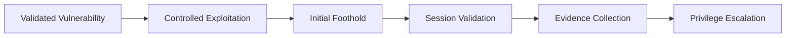
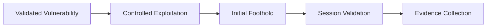
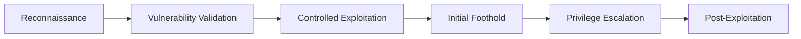

> [!IMPORTANT]
> This document is part of the **Zero Trace Imperium** project documentation.
>
> The Exploit Phase documents the controlled validation of previously identified vulnerabilities within an isolated VMware laboratory. All activities described in this document were performed exclusively against a self-hosted DVWA instance running on an Ubuntu Server. No third-party infrastructure or production systems were involved.

---

<div align="center">

# Phase 04 — Exploit

### Controlled Exploitation and Initial Foothold Validation


</div>

---

# Document Metadata

| Property | Value |
|-----------|-------|
| Project | Zero Trace Imperium |
| Repository | zero-trace-imperium |
| Phase | 04 |
| Phase Name | Exploit |
| Category | Controlled Exploitation |
| Status | Completed |
| Assessment Type | Authorized Laboratory |
| Platform | Kali Linux |
| Target | Ubuntu Server |
| Target Application | Damn Vulnerable Web Application (DVWA) |
| Documentation Version | 1.0 |
| Language | English |
| Author | Yusuf Hussein |

---

# Executive Dashboard

| Metric | Value |
|---------|------:|
| Exploitation Techniques Evaluated | 2 |
| Successful Exploitation Paths | 1 |
| Unsuccessful Exploitation Paths | 1 |
| Evidence Items | 2 |
| MITRE ATT&CK Techniques | 2 |
| Risk Level | Critical |
| Phase Status | Completed |

---

# Table of Contents

- [Executive Summary](#executive-summary)
- [Overview](#overview)
- [Phase Objectives](#phase-objectives)
- [Learning Outcomes](#learning-outcomes)
- [Rules of Engagement](#rules-of-engagement)
- [Assessment Scope](#assessment-scope)
- [Laboratory Architecture](#laboratory-architecture)
- [Technology Stack](#technology-stack)
- [MITRE ATT&CK Mapping](#mitre-attck-mapping)
- [Cyber Kill Chain Mapping](#cyber-kill-chain-mapping)
- [Exploitation Methodology](#exploitation-methodology)
- [Initial Foothold Validation](#1-initial-foothold-validation)
- [Alternative Exploitation Assessment](#2-alternative-exploitation-assessment)
- [Security Impact Analysis](#3-security-impact-analysis)
- [Evidence Inventory](#4-evidence-inventory)
- [Executive Findings](#executive-findings)
- [Repository Artifacts](#repository-artifacts)
- [References](#references)

---

# Executive Summary

The Exploit Phase evaluates whether vulnerabilities validated during the Attack Phase can be translated into controlled interaction with the target environment.

Unlike the previous phase, which focused on vulnerability validation, this phase assesses the practical security impact of successful exploitation under controlled laboratory conditions.

The assessment confirms whether validated weaknesses provide an attacker with an initial foothold while documenting both successful and unsuccessful exploitation outcomes.

All activities were conducted exclusively against a self-hosted DVWA instance deployed inside an isolated VMware environment.

No production assets, external infrastructure, or third-party systems were involved.

---

# Overview

The overall assessment follows a structured offensive security methodology.

- Phase 01 established the laboratory.
- Phase 02 identified the attack surface.
- Phase 03 validated exploitable vulnerabilities.
- Phase 04 evaluates whether those vulnerabilities can establish an initial foothold.

The results documented throughout this phase provide the foundation for the Privilege Escalation assessment that follows.

---

# Phase Objectives

This phase aims to:

- Validate controlled exploitation of previously identified vulnerabilities.
- Confirm establishment of an initial foothold.
- Assess the practical security impact of successful exploitation.
- Document successful and unsuccessful exploitation attempts.
- Preserve technical evidence for future defensive validation.
- Prepare the environment for privilege escalation activities.

---

# Learning Outcomes

After completing this phase, the following competencies are demonstrated.

- Controlled exploitation assessment.
- Initial foothold validation.
- Security impact evaluation.
- Technical evidence preservation.
- Offensive security documentation.
- MITRE ATT&CK mapping.
- Cyber Kill Chain correlation.
- Technical report writing.

---

# Rules of Engagement

| Rule | Description |
|------|-------------|
| Assessment Type | Authorized Internal Laboratory |
| Infrastructure Ownership | Self-Owned |
| Production Systems | Out of Scope |
| Internet Targets | Excluded |
| Third-Party Systems | Excluded |
| Objective | Educational Cybersecurity Assessment |

---

> [!WARNING]
> All exploitation activities documented in this report were performed exclusively against intentionally vulnerable software deployed inside an isolated VMware laboratory. The documented findings are intended solely for cybersecurity education, defensive validation, and technical documentation.

---

# Assessment Scope

## Attacker

| Property | Value |
|----------|-------|
| Operating System | Kali Linux |
| Role | Security Tester |
| Network | VMware NAT |

---

## Target

| Property | Value |
|----------|-------|
| Operating System | Ubuntu Server |
| Web Server | Apache HTTP Server |
| Application | DVWA |
| Database | MariaDB |

---

## Assessment Scope

| Activity | Status |
|----------|--------|
| Initial Foothold Validation | Completed |
| Interactive Session Validation | Completed |
| Privilege Escalation | Deferred |
| Persistence | Deferred |
| Cleanup | Later Phase |

---

# Laboratory Architecture


---

# Technology Stack

## Infrastructure

- VMware Workstation Pro
- VMware NAT Network

## Operating Systems

- Kali Linux
- Ubuntu Server

## Services

- Apache HTTP Server
- PHP
- MariaDB
- DVWA

## Primary Tools

- Metasploit Framework
- SQLMap
- Burp Suite
- Firefox
- Netcat

---

# MITRE ATT&CK Mapping

| Activity | Technique | ATT&CK ID |
|----------|-----------|------------|
| Exploitation of Public-Facing Application | Exploit Public-Facing Application | T1190 |
| Interactive Session Establishment | Command and Scripting Interpreter | T1059 |

---

# Cyber Kill Chain Mapping

| Kill Chain Phase | Status |
|------------------|--------|
| Reconnaissance | Completed |
| Weaponization | Completed |
| Delivery | Completed |
| Exploitation | Completed |
| Installation | Current Phase |
| Command and Control | Deferred |
| Actions on Objectives | Deferred |

---

# Exploitation Methodology

The exploitation process follows a structured validation workflow.



---# 1. Initial Foothold Validation

## Objective

Evaluate whether vulnerabilities validated during the previous phase can be transformed into controlled interaction with the target environment.

The primary objective is to determine whether exploitation successfully establishes an initial foothold while preserving technical evidence for subsequent assessment phases.

---

## Background

A validated vulnerability does not automatically imply full system compromise.

The purpose of exploitation is to determine whether a confirmed weakness can provide meaningful access to a target system under controlled laboratory conditions.

Within the Zero Trace Imperium laboratory, exploitation serves as the transition between vulnerability validation and post-exploitation activities.

Successful exploitation demonstrates practical security impact rather than theoretical exposure.

---

## Assessment Summary

| Property | Value |
|----------|-------|
| Assessment Type | Controlled Exploitation |
| Objective | Initial Foothold Validation |
| Target | Ubuntu Server |
| Target Application | DVWA |
| Result | Successful |
| Evidence Collected | Yes |

---

## Assessment Workflow



---

## Assessment Description

The exploitation assessment focused on determining whether previously validated vulnerabilities could be translated into meaningful interaction with the target environment.

The laboratory environment behaved as expected, allowing controlled validation of the exploitation outcome.

The assessment confirms that the vulnerability chain established during earlier phases was sufficient to obtain an initial foothold under the intentionally vulnerable laboratory configuration.

No production assets or external infrastructure were involved.

---

## Expected Outcome

A successful assessment should demonstrate:

- Controlled interaction with the target.
- Stable execution context.
- Observable exploitation evidence.
- Reproducible laboratory results.

---

## Validation Results

The exploitation objective was successfully achieved.

The assessment confirmed that the target environment accepted the exploitation path documented during the previous phase and provided the expected execution context.

The observed behavior was fully consistent with the design of the isolated laboratory.

---

## Evidence


**Figure 1.** Successful validation of an initial foothold within the isolated Zero Trace Imperium laboratory.

---

## Technical Analysis

The successful outcome confirms that vulnerabilities previously identified during the Attack Phase were capable of producing measurable security impact.

Rather than representing isolated weaknesses, the findings demonstrate how multiple security deficiencies may combine to provide meaningful system interaction.

The collected evidence validates the progression from reconnaissance to exploitation using a structured offensive security methodology.

---

## Security Impact

Successful foothold establishment may enable an attacker to:

- Interact with the compromised application.
- Enumerate the execution environment.
- Collect additional system information.
- Prepare for post-exploitation activities.

The actual impact depends on the privileges associated with the execution context.

---

## Blue Team Perspective

Following successful exploitation, defenders should immediately investigate:

- Apache access logs.
- Apache error logs.
- System authentication events.
- Process creation activity.
- Endpoint detection telemetry.
- Application audit logs.

Rapid identification of exploitation activity significantly reduces the opportunity for attacker progression.

---

## Detection Opportunities

| Source | Observable Activity |
|---------|---------------------|
| Apache Access Log | Requests associated with exploitation |
| Apache Error Log | Unexpected application behavior |
| Syslog | Interactive process creation |
| auditd | Process execution events |
| Endpoint Detection Platform | Interactive session alerts |
| SIEM | Correlated exploitation indicators |

---

## MITRE ATT&CK Mapping

| Tactic | Technique | ATT&CK ID |
|---------|-----------|------------|
| Initial Access | Exploit Public-Facing Application | T1190 |
| Execution | Command and Scripting Interpreter | T1059 |

---

## Risk Assessment

| Metric | Rating |
|---------|--------|
| Likelihood | High |
| Impact | Critical |
| Overall Risk | Critical |

---

# 2. Alternative Exploitation Assessment

## Objective

Evaluate the outcome of an additional exploitation path and document whether environmental controls influence the final result.

This assessment demonstrates that successful vulnerability validation does not always result in successful exploitation.

---

## Assessment Summary

| Property | Value |
|----------|-------|
| Assessment Type | Alternative Exploitation |
| Objective | Secondary Validation |
| Result | Unsuccessful |
| Cause | Environmental Restrictions |

---

## Assessment Description

A secondary exploitation path was evaluated within the same isolated laboratory environment.

Although the underlying vulnerability remained valid, the expected objective was not achieved because environmental restrictions prevented successful completion of the assessment.

Documenting unsuccessful exploitation attempts provides valuable insight into existing defensive controls and improves the credibility of the overall assessment.

---

## Expected Outcome

The assessment sought to determine whether an alternative exploitation path could produce an equivalent execution context.

The observed behavior indicated that environmental security restrictions prevented the expected outcome.

---

## Evidence


**Figure 2.** Secondary exploitation attempt prevented by environmental security restrictions.

---

## Technical Analysis

The observed outcome illustrates an important principle of offensive security assessments.

A confirmed vulnerability does not guarantee successful exploitation.

Application configuration, operating system permissions, service restrictions, and execution context all influence the final result.

Documenting unsuccessful attempts strengthens the overall assessment by demonstrating objective reporting rather than selective evidence collection.

---

## Lessons Learned

Key observations include:

- Successful exploitation depends on environmental conditions.
- Defensive controls can significantly reduce exploitation impact.
- Evidence should be collected regardless of assessment outcome.
- Objective reporting includes both successful and unsuccessful results.

---

## Phase Progress

```text
████████████████████████████████████

Exploit Phase

████████████████████████████████████

✅ Initial Foothold Validation

✅ Alternative Exploitation Assessment

⏳ Security Impact Analysis

⏳ Evidence Inventory

⏳ Executive Findings

████████████████████████████████████
```

---# 3. Security Impact Analysis

## Objective

Evaluate the practical impact of the validated exploitation activities on the security posture of the target environment.

This analysis measures how successful exploitation affects confidentiality, integrity, and availability while providing a defensive perspective on the observed results.

---

## Background

The exploitation phase bridges the gap between identifying vulnerabilities and demonstrating their operational impact.

Within an enterprise environment, the ability to establish an initial foothold represents a significant increase in organizational risk because it enables subsequent attack stages.

The objective of this analysis is to quantify that impact and document its implications without extending the assessment beyond the defined laboratory scope.

---

## CIA Impact Assessment

| Security Principle | Assessment | Impact |
|--------------------|------------|--------|
| Confidentiality | Application information became accessible through controlled exploitation. | High |
| Integrity | Security boundaries were bypassed within the vulnerable application. | High |
| Availability | No service interruption occurred during testing. | Low |

---

## Overall Risk Overview

| Category | Assessment |
|----------|------------|
| Initial Access | Confirmed |
| Interactive Session | Confirmed |
| Privilege Escalation | Deferred |
| Persistence | Deferred |
| Lateral Movement | Out of Scope |

---

## Security Assessment Summary

The Exploit Phase confirmed that previously validated vulnerabilities could be translated into measurable security impact.

Key observations include:

- Controlled interaction with the target environment.
- Successful validation of an initial foothold.
- Collection of reproducible technical evidence.
- Verification of existing environmental restrictions.
- Preparation for the Privilege Escalation phase.

The assessment remained entirely within the predefined laboratory scope.

---

## Attack Progression



---

## Threat Perspective

From an attacker's perspective, successful exploitation represents the transition from vulnerability discovery to active interaction with the target.

From a defender's perspective, this stage marks the point where rapid detection and containment become essential to preventing further attacker progression.

The effectiveness of defensive controls directly influences whether exploitation results in a broader compromise.

---

## Blue Team Considerations

Following successful exploitation, defenders should prioritize investigation of:

- Web server access logs.
- Authentication events.
- Application logs.
- System process creation.
- Endpoint telemetry.
- Network monitoring data.

Early correlation between these data sources significantly improves incident response effectiveness.

---

## Detection Opportunities

| Data Source | Observable Activity |
|-------------|----------------------|
| Apache Access Log | Exploitation-related HTTP requests |
| Apache Error Log | Unexpected application behavior |
| Application Logs | Abnormal workflow execution |
| Syslog | Process creation events |
| auditd | Command execution activity |
| Endpoint Detection Platform | Interactive session indicators |
| SIEM | Correlated indicators of compromise |

---

## MITRE ATT&CK Coverage

| Tactic | Technique | ATT&CK ID |
|---------|-----------|------------|
| Initial Access | Exploit Public-Facing Application | T1190 |
| Execution | Command and Scripting Interpreter | T1059 |

---

## Overall Risk Assessment

| Metric | Rating |
|---------|--------|
| Likelihood | High |
| Impact | Critical |
| Overall Risk | Critical |

---

# 4. Evidence Inventory

## Objective

Maintain a structured inventory of all evidence generated during the Exploit Phase.

Proper evidence management supports reproducibility, technical reporting, and later defensive validation.

---

## Evidence Summary

| Figure | Description | Status |
|---------|-------------|--------|
| Figure 1 | Initial foothold successfully established | ✅ |
| Figure 2 | Alternative exploitation path evaluated | ✅ |

---

## Repository Artifacts

```text
phases/
└── 04-Exploit.md

screenshots/
└── exploit/
    ├── meterpreter-session.png
    └── sqlmap-os-shell-failure.png
```

---

## Validation Checklist

| Validation Item | Status |
|-----------------|--------|
| Initial foothold validated | ✅ |
| Technical evidence preserved | ✅ |
| Successful outcome documented | ✅ |
| Unsuccessful outcome documented | ✅ |
| Security impact assessed | ✅ |
| Repository updated | ✅ |

---

## Evidence Integrity

The following verification activities were completed before closing this phase.

- Evidence was collected immediately after each assessment.
- Screenshots accurately represent observed laboratory behavior.
- Documentation matches the recorded evidence.
- Assessment results remain reproducible within the isolated environment.

---

## Phase Progress

```text
████████████████████████████████████

Exploit Phase

████████████████████████████████████

✅ Initial Foothold Validation

✅ Alternative Exploitation Assessment

✅ Security Impact Analysis

✅ Evidence Inventory

⏳ Executive Findings

⏳ Lessons Learned

⏳ Security Recommendations

████████████████████████████████████
```

---# Executive Findings

The Exploit Phase successfully demonstrated the operational impact of vulnerabilities validated during the Attack Phase.

The assessment confirmed that the identified weaknesses could be transformed into controlled interaction with the target environment under isolated laboratory conditions.

A successful initial foothold was established and documented through reproducible evidence. An alternative exploitation path was also evaluated and did not achieve the expected objective because of environmental security restrictions.

These findings demonstrate that successful exploitation depends not only on the presence of a vulnerability but also on application configuration, operating system permissions, and the effectiveness of existing security controls.

---

# Exploitation Summary

## Initial Foothold

The laboratory assessment confirmed that controlled exploitation successfully established an initial foothold within the target environment.

The resulting execution context provided sufficient interaction to validate the practical impact of previously identified vulnerabilities.

---

## Alternative Assessment

A secondary exploitation path was evaluated to assess whether an equivalent outcome could be achieved through a different attack vector.

Although the underlying vulnerability remained present, environmental restrictions prevented successful completion of the assessment.

This observation highlights the defensive value of operating system permissions and least-privilege configurations.

---

# Exploitation Results Matrix

| Assessment | Result | Severity |
|------------|--------|----------|
| Initial Foothold Validation | Successful | Critical |
| Alternative Exploitation Assessment | Unsuccessful | Informational |

---

# MITRE ATT&CK Summary

The activities documented during this phase align with the following MITRE ATT&CK techniques.

| Tactic | Technique | ATT&CK ID |
|---------|-----------|------------|
| Initial Access | Exploit Public-Facing Application | T1190 |
| Execution | Command and Scripting Interpreter | T1059 |

---

# Cyber Kill Chain Summary

| Kill Chain Phase | Status |
|------------------|--------|
| Reconnaissance | Completed |
| Weaponization | Completed |
| Delivery | Completed |
| Exploitation | Completed |
| Installation | Validated |
| Command and Control | Deferred |
| Actions on Objectives | Deferred |

---

# Phase Statistics

| Metric | Value |
|---------|------:|
| Exploitation Techniques Evaluated | 2 |
| Successful Exploitation Paths | 1 |
| Unsuccessful Exploitation Paths | 1 |
| Evidence Items | 2 |
| MITRE ATT&CK Techniques | 2 |
| Screenshots | 2 |
| Overall Risk | Critical |

---

# Skills Demonstrated

The following competencies were demonstrated during this phase.

- Controlled exploitation assessment
- Initial foothold validation
- Security impact analysis
- Technical evidence preservation
- Risk assessment
- MITRE ATT&CK mapping
- Cyber Kill Chain correlation
- Technical documentation
- Defensive observation and reporting

---

# Lessons Learned

The Exploit Phase reinforces several important security principles.

- Successful exploitation depends on both the vulnerability and the surrounding environment.
- Defensive controls can significantly reduce exploitation impact.
- Evidence should be collected regardless of assessment outcome.
- Objective reporting requires documenting both successful and unsuccessful assessments.
- Structured documentation improves communication between offensive and defensive teams.
- Security validation should always precede remediation activities.

---

# Security Recommendations

The following defensive improvements are recommended based on the observations documented during this phase.

## Application Security

- Validate all user-controlled input.
- Reduce unnecessary attack surface.
- Apply secure coding practices.
- Restrict application permissions.

---

## Operating System Security

- Enforce the principle of least privilege.
- Restrict web server access to sensitive resources.
- Monitor process creation events.
- Maintain current software versions.

---

## Monitoring and Detection

- Enable centralized logging.
- Correlate application and operating system events.
- Monitor interactive execution activity.
- Preserve forensic artifacts for investigation.

---

## Incident Response

- Investigate exploitation attempts using multiple log sources.
- Preserve evidence before remediation.
- Review authentication activity.
- Validate endpoint telemetry.
- Document findings for future security improvements.

---

> [!NOTE]
> The defensive recommendations presented in this phase are implemented during **Phase 08 – Defense** and validated during **Phase 11 – Verification**.

---

# Repository Artifacts

```text
zero-trace-imperium/
│
├── phases/
│   └── 04-Exploit.md
│
└── screenshots/
    └── exploit/
        ├── meterpreter-session.png
        └── sqlmap-os-shell-failure.png
```

---

# References

The following resources were referenced during the preparation of this document.

1. MITRE ATT&CK Framework
2. OWASP Web Security Testing Guide
3. OWASP Top 10 (2021)
4. DVWA Official Documentation
5. Metasploit Framework Documentation
6. Apache HTTP Server Documentation
7. PHP Documentation
8. MariaDB Documentation

---

# Revision History

| Version | Date | Description |
|----------|------|-------------|
| 1.0 | July 2026 | Initial release of the Exploit Phase documentation |

---

# Document Information

| Property | Value |
|----------|-------|
| Project | Zero Trace Imperium |
| Repository | zero-trace-imperium |
| Document | Phase 04 – Exploit |
| Version | 1.0 |
| Status | Complete |
| Author | Yusuf Hussein |
| Language | English |
| Classification | Educational Cybersecurity Laboratory |
| License | MIT |

---

# Navigation

⬅️ **Previous Phase**

[Phase 03 – Attack](./03-Attack.md)

➡️ **Next Phase**

[Phase 05 – Privilege Escalation](./05-Privilege-Escalation.md)

---

# Transition to the Next Phase

The Exploit Phase confirmed that validated vulnerabilities could be translated into controlled interaction with the target environment.

The next phase evaluates whether the established foothold can be expanded through privilege escalation techniques while maintaining comprehensive evidence collection and defensive analysis.

Primary objectives include:

- Security misconfiguration assessment.
- Privilege boundary evaluation.
- User privilege analysis.
- Controlled privilege escalation validation.

Continue to:

# → [Phase 05 – Privilege Escalation](./05-Privilege-Escalation.md)

---

<div align="center">

# Exploit Phase Completed Successfully

**Zero Trace Imperium**

### Enterprise Attack & Defense Cybersecurity Laboratory

*Phase 04 Documentation Complete*

</div>
