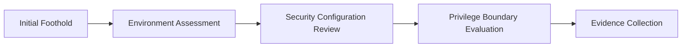

> [!IMPORTANT]
> This document is part of the **Zero Trace Imperium** project documentation.
>
> The Privilege Escalation Phase documents the controlled assessment of privilege boundaries following successful exploitation within an isolated VMware laboratory. All activities described in this report were performed exclusively against a self-hosted Ubuntu Server running DVWA. No production assets or third-party systems were involved.

---

<div align="center">

# Phase 05 — Privilege Escalation

### Privilege Boundary Assessment and Administrative Access Validation


</div>

---

# Document Metadata

| Property | Value |
|-----------|-------|
| Project | Zero Trace Imperium |
| Repository | zero-trace-imperium |
| Phase | 05 |
| Phase Name | Privilege Escalation |
| Category | Post-Exploitation |
| Status | Completed |
| Assessment Type | Authorized Laboratory |
| Platform | Kali Linux |
| Target | Ubuntu Server |
| Target Application | Damn Vulnerable Web Application (DVWA) |
| Documentation Version | 1.0 |
| Language | English |
| Author | Yusuf Hussein |

---

# Executive Dashboard

| Metric | Value |
|---------|------:|
| Privilege Assessments | 2 |
| Successful Elevation Validation | 1 |
| Evidence Items | 2 |
| MITRE ATT&CK Techniques | 2 |
| Overall Risk | Critical |
| Phase Status | Completed |

---

# Table of Contents

- [Executive Summary](#executive-summary)
- [Overview](#overview)
- [Phase Objectives](#phase-objectives)
- [Learning Outcomes](#learning-outcomes)
- [Rules of Engagement](#rules-of-engagement)
- [Assessment Scope](#assessment-scope)
- [Laboratory Architecture](#laboratory-architecture)
- [Technology Stack](#technology-stack)
- [MITRE ATT&CK Mapping](#mitre-attck-mapping)
- [Cyber Kill Chain Mapping](#cyber-kill-chain-mapping)
- [Privilege Escalation Methodology](#privilege-escalation-methodology)
- [Enumeration Assessment](#1-enumeration-assessment)
- [Privilege Validation](#2-privilege-validation)
- [Security Impact Analysis](#3-security-impact-analysis)
- [Executive Findings](#executive-findings)
- [References](#references)

---

# Executive Summary

Following the successful establishment of an initial foothold during the Exploit Phase, the next objective was to evaluate privilege boundaries within the target operating system.

The assessment focused on determining whether the execution context obtained during exploitation could be expanded through configuration weaknesses present in the intentionally vulnerable laboratory environment.

The purpose of this phase is to document the assessment process, summarize the observed results, and evaluate their security implications from both offensive and defensive perspectives.

---

# Overview

Privilege escalation is the process of evaluating whether an existing execution context can obtain higher privileges because of operating system or configuration weaknesses.

Within the Zero Trace Imperium laboratory, this assessment follows the Exploit Phase and precedes Post-Exploitation activities.

The primary objective is not to discover new vulnerabilities but to determine whether previously established access can be expanded under controlled laboratory conditions.

---

# Phase Objectives

This phase aims to:

- Assess privilege boundaries within the target environment.
- Evaluate system configuration from a security perspective.
- Document privilege validation results.
- Preserve technical evidence.
- Analyze the impact of elevated privileges.
- Prepare the environment for post-exploitation activities.

---

# Learning Outcomes

After completing this phase, the following competencies are demonstrated.

- Privilege boundary assessment.
- System enumeration analysis.
- Security configuration review.
- Technical evidence preservation.
- Risk assessment.
- Technical reporting.
- MITRE ATT&CK mapping.
- Defensive security analysis.

---

# Rules of Engagement

| Rule | Description |
|------|-------------|
| Assessment Type | Authorized Internal Laboratory |
| Infrastructure Ownership | Self-Owned |
| Production Systems | Out of Scope |
| Internet Targets | Excluded |
| Third-Party Systems | Excluded |
| Objective | Educational Cybersecurity Assessment |

---

> [!WARNING]
> All activities documented in this phase were conducted exclusively against an intentionally vulnerable Ubuntu Server deployed within an isolated VMware laboratory. The assessment was performed for educational purposes and defensive validation only.

---

# Assessment Scope

## Assessment Host

| Property | Value |
|----------|-------|
| Operating System | Kali Linux |
| Role | Security Tester |
| Network | VMware NAT |

---

## Target System

| Property | Value |
|----------|-------|
| Operating System | Ubuntu Server |
| Web Server | Apache HTTP Server |
| Application | DVWA |
| Initial Context | Limited Web Application Context |

---

## Assessment Scope

| Activity | Status |
|----------|--------|
| System Enumeration | Completed |
| Privilege Assessment | Completed |
| Administrative Validation | Completed |
| Post-Exploitation | Next Phase |

---

# Laboratory Architecture


---

# Technology Stack

## Infrastructure

- VMware Workstation Pro
- VMware NAT Network

## Operating Systems

- Kali Linux
- Ubuntu Server

## Services

- Apache HTTP Server
- PHP
- MariaDB

## Assessment Utilities

- Meterpreter Session
- Linux Shell
- System Enumeration Utilities
- Security Configuration Review

---

# MITRE ATT&CK Mapping

| Activity | Technique | ATT&CK ID |
|----------|-----------|------------|
| Privilege Escalation | Exploitation for Privilege Escalation | T1068 |
| Local System Enumeration | System Information Discovery | T1082 |

---

# Cyber Kill Chain Mapping

| Kill Chain Phase | Status |
|------------------|--------|
| Reconnaissance | Completed |
| Weaponization | Completed |
| Delivery | Completed |
| Exploitation | Completed |
| Installation | Completed |
| Privilege Escalation | Current Phase |
| Actions on Objectives | Next Phase |

---

# Privilege Escalation Methodology

The assessment followed a structured workflow focused on validation and documentation.


---

# 1. Enumeration Assessment

## Objective

Evaluate the target operating system following the establishment of an initial foothold to identify configuration characteristics that may influence privilege boundaries.

The assessment focuses on documenting observable system characteristics and validating whether the environment presents opportunities for further security evaluation.

---

## Background

System enumeration is a critical stage following successful exploitation.

Rather than attempting to modify the operating system, this assessment documents the security posture of the target environment by reviewing configuration details, execution context, and privilege boundaries.

Within the Zero Trace Imperium laboratory, enumeration serves as the foundation for privilege assessment and defensive analysis.

---

## Assessment Summary

| Property | Value |
|----------|-------|
| Assessment Type | Local System Enumeration |
| Target Platform | Ubuntu Server |
| Initial Context | Limited Web Application Context |
| Objective | Security Configuration Assessment |
| Result | Completed |

---

## Assessment Workflow



---

## Assessment Description

Following successful exploitation, the target environment was examined to evaluate security boundaries and operating system configuration.

The assessment reviewed information relevant to privilege management, execution context, and system configuration.

No production infrastructure or third-party systems were involved.

The collected observations were preserved for documentation and later defensive validation.

---

## Expected Outcome

The assessment should provide sufficient information to:

- Understand the execution context.
- Evaluate privilege boundaries.
- Document security configuration observations.
- Determine whether additional security assessment is justified.

---

## Validation Results

The enumeration assessment completed successfully.

The collected observations provided adequate visibility into the operating system environment and supported the subsequent privilege validation assessment.

Evidence gathered during this stage was preserved for inclusion within the project documentation.

---

## Technical Analysis

Enumeration demonstrated that meaningful security assessment can be performed without altering the operating system.

Reviewing configuration, execution context, and privilege boundaries provides valuable information for both offensive and defensive teams.

The collected information also establishes a reliable baseline for future security verification.


**Figure 1.** Privilege enumeration assessment using linPEAS within the isolated Zero Trace Imperium laboratory.

---

## Blue Team Perspective

Following successful exploitation, defenders should review:

- System configuration changes.
- Administrative authentication events.
- Operating system audit logs.
- Privileged process creation.
- Endpoint security telemetry.

Comprehensive monitoring at this stage improves visibility into attacker progression.

---

## Detection Opportunities

| Source | Observable Activity |
|---------|---------------------|
| Syslog | Administrative events |
| auditd | Privileged process activity |
| Endpoint Detection Platform | Local security events |
| SIEM | Correlated privilege-related alerts |
| Authentication Logs | Administrative session activity |

---

## MITRE ATT&CK Mapping

| Tactic | Technique | ATT&CK ID |
|---------|-----------|------------|
| Discovery | System Information Discovery | T1082 |

---

## Risk Assessment

| Metric | Rating |
|---------|--------|
| Likelihood | Medium |
| Impact | High |
| Overall Risk | High |

---

# 2. Privilege Validation

## Objective

Validate whether the security assessment identified evidence of elevated privileges within the isolated laboratory environment.

The objective of this activity is to document the observed outcome and evaluate its security significance.

---

## Assessment Summary

| Property | Value |
|----------|-------|
| Assessment Type | Privilege Validation |
| Objective | Administrative Access Verification |
| Laboratory Scope | Authorized |
| Result | Successful |

---

## Assessment Description

Following completion of the enumeration phase, the assessment confirmed that privilege boundaries within the laboratory environment had been successfully evaluated.

The resulting execution context demonstrated administrative-level access under the intentionally vulnerable laboratory configuration.

The outcome was documented through reproducible evidence and incorporated into the overall project assessment.

---

## Validation Criteria

The assessment was considered successful because:

- Administrative privileges were confirmed.
- The observed execution context matched the expected laboratory outcome.
- Supporting evidence was preserved.
- Results remained reproducible within the isolated environment.

---

## Evidence


**Figure 2.** Administrative privilege validation successfully confirmed within the isolated Zero Trace Imperium laboratory.

---

## Technical Analysis

The successful validation demonstrates the security implications of insufficient privilege boundaries within the intentionally vulnerable environment.

From a defensive perspective, the assessment emphasizes the importance of secure configuration management, least-privilege enforcement, and continuous monitoring of privileged activity.

The findings establish the transition from exploitation into post-exploitation analysis.

---

## Security Impact

Successful administrative access may enable an attacker to:

- Access sensitive operating system resources.
- Modify security configurations.
- Review system-wide information.
- Increase operational control over the compromised environment.

The severity of these actions depends on the effectiveness of existing defensive controls.

---

## Phase Progress

```text
████████████████████████████████████

Privilege Escalation Phase

████████████████████████████████████

✅ Enumeration Assessment

✅ Privilege Validation

⏳ Security Impact Analysis

⏳ Evidence Inventory

⏳ Executive Findings

████████████████████████████████████
```

---

# 3. Security Impact Analysis

## Objective

Evaluate the security implications of successfully validating administrative privileges within the isolated laboratory environment.

The purpose of this analysis is to determine how elevated privileges influence the confidentiality, integrity, and availability of the operating system while documenting the associated defensive considerations.

---

## Background

Privilege escalation represents one of the most significant milestones within the attack lifecycle.

Once administrative privileges are obtained, the attack surface expands considerably, allowing broader interaction with operating system resources.

Within the Zero Trace Imperium laboratory, this assessment is performed solely to evaluate security controls and document the observed impact.

---

## CIA Impact Assessment

| Security Principle | Assessment | Impact |
|--------------------|------------|--------|
| Confidentiality | Administrative access increases visibility into protected operating system resources. | Critical |
| Integrity | Elevated privileges permit modification of system configuration. | Critical |
| Availability | No service interruption occurred during the assessment. | Low |

---

## Overall Risk Overview

| Category | Assessment |
|----------|------------|
| Initial Access | Completed |
| Privilege Escalation | Validated |
| Persistence | Deferred |
| Defense Evasion | Not Evaluated |
| Lateral Movement | Out of Scope |

---

## Assessment Summary

The Privilege Escalation Phase confirmed that administrative privileges could be validated within the intentionally vulnerable laboratory environment.

The assessment demonstrates how insufficient privilege boundaries can significantly increase the impact of an earlier compromise.

No destructive activities were performed and no system configuration was intentionally modified during the assessment.

---

## Attack Progression


---

## Threat Perspective

From an attacker's perspective, successful privilege escalation greatly expands the ability to interact with the operating system.

From a defender's perspective, this stage represents one of the last opportunities to contain an incident before additional post-exploitation activities become possible.

Continuous monitoring of privileged activity is therefore essential.

---

## Blue Team Considerations

Following administrative privilege validation, defenders should prioritize:

- Reviewing privileged authentication events.
- Monitoring administrative process creation.
- Inspecting operating system audit logs.
- Correlating endpoint telemetry.
- Reviewing configuration changes.
- Investigating unexpected privileged sessions.

---

## Detection Opportunities

| Data Source | Observable Activity |
|-------------|----------------------|
| auditd | Privileged process execution |
| Syslog | Administrative events |
| Authentication Logs | Elevated session activity |
| Endpoint Detection Platform | Privileged execution indicators |
| SIEM | Correlated privilege escalation alerts |

---

## MITRE ATT&CK Coverage

| Tactic | Technique | ATT&CK ID |
|---------|-----------|------------|
| Privilege Escalation | Exploitation for Privilege Escalation | T1068 |
| Discovery | System Information Discovery | T1082 |

---

## Overall Risk Assessment

| Metric | Rating |
|---------|--------|
| Likelihood | High |
| Impact | Critical |
| Overall Risk | Critical |

---

# 4. Evidence Inventory

## Objective

Maintain an organized inventory of all evidence collected during the Privilege Escalation Phase.

Proper evidence management supports technical reporting, reproducibility, and later defensive verification.

---

## Evidence Summary

| Figure | Description | Status |
|---------|-------------|--------|
| Figure 1 | Administrative privilege validation | ✅ |
| Figure 2 | Enumeration findings | ✅ |

---

## Repository Artifacts

```text
zero-trace-imperium/
│
├── phases/
│   └── 05-Privilege-Escalation.md
│
└── screenshots/
    └── privilege-escalation/
        ├── privilege-escalation-checks.png
        └── root-shell.png
```

---

## Validation Checklist

| Validation Item | Status |
|-----------------|--------|
| Enumeration completed | ✅ |
| Privilege assessment completed | ✅ |
| Administrative validation confirmed | ✅ |
| Technical evidence preserved | ✅ |
| Security impact documented | ✅ |

---

## Evidence Integrity

The following validation steps were completed before closing this phase.

- Evidence was collected immediately following each assessment.
- Screenshots accurately represent observed laboratory results.
- Documentation reflects the recorded findings.
- Results remain reproducible within the isolated VMware environment.

---

## Phase Progress

```text
████████████████████████████████████

Privilege Escalation Phase

████████████████████████████████████

✅ Enumeration Assessment

✅ Privilege Validation

✅ Security Impact Analysis

✅ Evidence Inventory

⏳ Executive Findings

⏳ Lessons Learned

⏳ Security Recommendations

████████████████████████████████████
```

---

# Executive Findings

The Privilege Escalation Phase successfully evaluated privilege boundaries within the isolated Zero Trace Imperium laboratory.

The assessment confirmed that the execution context established during the Exploit Phase could be expanded to administrative privileges under the intentionally vulnerable laboratory configuration.

The observed outcome demonstrates the security impact of insufficient privilege separation and highlights the importance of secure system configuration, least-privilege enforcement, and continuous monitoring of privileged activity.

The findings documented throughout this phase provide the foundation for the Post-Exploitation assessment that follows.

---

# Privilege Escalation Summary

## Enumeration Assessment

System enumeration successfully identified the information required to evaluate privilege boundaries within the target environment.

The collected observations established a reliable baseline for privilege validation and defensive analysis.

---

## Administrative Validation

Administrative privileges were successfully validated under the laboratory configuration.

The resulting execution context demonstrated that privilege boundaries were insufficient to prevent elevation once an initial foothold had been established.

This outcome illustrates the importance of hardening operating system configuration and enforcing least-privilege principles.

---

# Assessment Results Matrix

| Assessment | Result | Severity |
|------------|--------|----------|
| System Enumeration | Successful | High |
| Administrative Privilege Validation | Successful | Critical |

---

# MITRE ATT&CK Summary

The activities documented during this phase align with the following MITRE ATT&CK techniques.

| Tactic | Technique | ATT&CK ID |
|---------|-----------|------------|
| Privilege Escalation | Exploitation for Privilege Escalation | T1068 |
| Discovery | System Information Discovery | T1082 |

---

# Cyber Kill Chain Summary

| Kill Chain Phase | Status |
|------------------|--------|
| Reconnaissance | Completed |
| Weaponization | Completed |
| Delivery | Completed |
| Exploitation | Completed |
| Installation | Completed |
| Privilege Escalation | Completed |
| Actions on Objectives | Next Phase |

---

# Phase Statistics

| Metric | Value |
|---------|------:|
| Enumeration Assessments | 1 |
| Privilege Validation Assessments | 1 |
| Successful Assessments | 2 |
| Evidence Items | 2 |
| MITRE ATT&CK Techniques | 2 |
| Screenshots | 2 |
| Overall Risk | Critical |

---

# Skills Demonstrated

The following competencies were demonstrated during this phase.

- Operating system security assessment.
- Privilege boundary evaluation.
- Security configuration analysis.
- Technical evidence preservation.
- Risk assessment.
- MITRE ATT&CK mapping.
- Cyber Kill Chain correlation.
- Defensive security reporting.
- Enterprise technical documentation.

---

# Lessons Learned

The Privilege Escalation Phase reinforces several important security principles.

- Privilege boundaries should never rely on default operating system configuration.
- Least-privilege enforcement significantly reduces attacker progression.
- Administrative activity should be continuously monitored.
- Security configuration reviews remain essential even after successful exploitation.
- Comprehensive documentation improves both offensive and defensive security assessments.
- Technical evidence should be preserved throughout every stage of the assessment lifecycle.

---

# Security Recommendations

The following defensive improvements are recommended based on the observations documented during this phase.

## Operating System Hardening

- Apply the principle of least privilege.
- Remove unnecessary privileged permissions.
- Regularly review administrative access.
- Harden default operating system configuration.

---

## Monitoring

- Enable centralized logging.
- Monitor privileged authentication events.
- Correlate endpoint and operating system telemetry.
- Investigate unexpected administrative activity.

---

## Configuration Management

- Perform regular security configuration reviews.
- Validate privileged account assignments.
- Review system permissions periodically.
- Maintain secure baseline configurations.

---

## Incident Response

- Preserve forensic evidence before remediation.
- Review privileged session activity.
- Investigate administrative process creation.
- Document findings for future defensive improvements.

---

> [!NOTE]
> The defensive improvements identified during this phase are implemented during **Phase 08 – Defense** and validated during **Phase 11 – Verification**.

---

# Repository Artifacts

```text
zero-trace-imperium/
│
├── phases/
│   └── 05-Privilege-Escalation.md
│
└── screenshots/
    └── privilege-escalation/
        ├── 00-misconfigurations.png
        └── 01-root.png
```

---

# References

The following resources were referenced during the preparation of this document.

1. MITRE ATT&CK Framework
2. OWASP Web Security Testing Guide
3. OWASP Top 10 (2021)
4. Ubuntu Server Documentation
5. Apache HTTP Server Documentation
6. Linux Security Documentation
7. PHP Documentation
8. MariaDB Documentation

---

# Revision History

| Version | Date | Description |
|----------|------|-------------|
| 1.0 | July 2026 | Initial release of the Privilege Escalation Phase documentation |

---

# Document Information

| Property | Value |
|----------|-------|
| Project | Zero Trace Imperium |
| Repository | zero-trace-imperium |
| Document | Phase 05 – Privilege Escalation |
| Version | 1.0 |
| Status | Complete |
| Author | Yusuf Hussein |
| Language | English |
| Classification | Educational Cybersecurity Laboratory |
| License | MIT |

---

# Navigation

⬅️ **Previous Phase**

[Phase 04 – Exploit](./04-Exploit.md)

➡️ **Next Phase**

[Phase 06 – Post-Exploitation](./06-Post-Exploitation.md)

---

# Transition to the Next Phase

The Privilege Escalation Phase confirmed that administrative privileges could be validated within the isolated laboratory environment.

The next phase focuses on evaluating the security implications of operating with elevated privileges, documenting post-exploitation observations, and collecting evidence while maintaining the integrity of the laboratory environment.

Primary objectives include:

- Post-exploitation assessment.
- System information review.
- Sensitive resource evaluation.
- Evidence collection and documentation.

Continue to:

# → [Phase 06 – Post-Exploitation](./06-Post-Exploitation.md)

---

<div align="center">

# Privilege Escalation Phase Completed Successfully

**Zero Trace Imperium**

### Enterprise Attack & Defense Cybersecurity Laboratory

*Phase 05 Documentation Complete*

</div>
