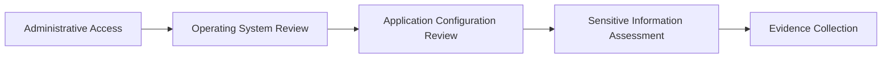

> [!IMPORTANT]
> This document is part of the **Zero Trace Imperium** project documentation.
>
> The Post-Exploitation Phase documents the controlled assessment activities performed after administrative privileges were validated within an isolated VMware laboratory. The purpose of this phase is to evaluate the security implications of elevated privileges, assess the exposure of sensitive information, and preserve technical evidence for subsequent defensive validation.

---

<div align="center">

# Phase 06 — Post-Exploitation

### Post-Compromise Assessment and Security Impact Evaluation


</div>

---

# Document Metadata

| Property | Value |
|-----------|-------|
| Project | Zero Trace Imperium |
| Repository | zero-trace-imperium |
| Phase | 06 |
| Phase Name | Post-Exploitation |
| Category | Post-Compromise Assessment |
| Status | Completed |
| Assessment Type | Authorized Laboratory |
| Platform | Kali Linux |
| Target | Ubuntu Server |
| Target Application | Damn Vulnerable Web Application (DVWA) |
| Documentation Version | 1.0 |
| Language | English |
| Author | Yusuf Hussein |

---

# Executive Dashboard

| Metric                  |     Value |
| ----------------------- | --------: |
| Assessment Areas        |         3 |
| Evidence Items          |         4 |
| MITRE ATT&CK Techniques |         4 |
| Overall Risk            |  Critical |
| Phase Status            | Completed |

---

# Table of Contents

- [Executive Summary](#executive-summary)
- [Overview](#overview)
- [Phase Objectives](#phase-objectives)
- [Learning Outcomes](#learning-outcomes)
- [Rules of Engagement](#rules-of-engagement)
- [Assessment Scope](#assessment-scope)
- [Laboratory Architecture](#laboratory-architecture)
- [Technology Stack](#technology-stack)
- [MITRE ATT&CK Mapping](#mitre-attck-mapping)
- [Cyber Kill Chain Mapping](#cyber-kill-chain-mapping)
- [Post-Exploitation Methodology](#post-exploitation-methodology)
- [Sensitive Information Assessment](#1-sensitive-information-assessment)
- [Internal Environment Assessment](#2-internal-environment-assessment)
- [Defensive Visibility Assessment](#3-defensive-visibility-assessment)
- [Security Impact Analysis](#4-security-impact-analysis)
- [Executive Findings](#executive-findings)
- [References](#references)

---

# Executive Summary

The Post-Exploitation Phase evaluates the security implications of operating with elevated privileges inside the isolated Zero Trace Imperium laboratory.

Following successful administrative privilege validation, the assessment focused on determining what information and system resources became accessible under the obtained execution context.

The objective of this phase is to document the observed findings, evaluate their security significance, and preserve evidence for subsequent defensive validation.

All assessment activities were conducted exclusively within a self-owned VMware laboratory.

---

# Overview

Post-exploitation begins after an attacker has obtained elevated privileges within a target environment.

Rather than identifying additional vulnerabilities, this stage evaluates the practical consequences of a successful compromise by examining accessible resources, security exposure, and system visibility.

Within the Zero Trace Imperium laboratory, this phase bridges Privilege Escalation and Detection & Monitoring.

---

# Phase Objectives

This phase aims to:

- Assess exposure of sensitive system information.
- Evaluate operating system visibility after privilege validation.
- Document observable post-exploitation findings.
- Preserve technical evidence.
- Analyze defensive implications.
- Prepare the environment for detection and monitoring validation.

---

# Learning Outcomes

After completing this phase, the following competencies are demonstrated.

- Post-exploitation assessment.
- Sensitive information analysis.
- Security impact evaluation.
- Technical evidence preservation.
- Defensive reporting.
- MITRE ATT&CK mapping.
- Enterprise documentation.

---

# Rules of Engagement

| Rule | Description |
|------|-------------|
| Assessment Type | Authorized Internal Laboratory |
| Infrastructure Ownership | Self-Owned |
| Production Systems | Out of Scope |
| Internet Targets | Excluded |
| Third-Party Systems | Excluded |
| Objective | Educational Cybersecurity Assessment |

---

> [!WARNING]
> All activities documented in this report were performed exclusively against an intentionally vulnerable Ubuntu Server deployed within an isolated VMware laboratory. The assessment was conducted solely for cybersecurity education, defensive validation, and technical documentation.

---

# Assessment Scope

## Assessment Host

| Property | Value |
|----------|-------|
| Operating System | Kali Linux |
| Role | Security Tester |
| Network | VMware NAT |

---

## Target System

| Property | Value |
|----------|-------|
| Operating System | Ubuntu Server |
| Web Server | Apache HTTP Server |
| Application | DVWA |
| Execution Context | Administrative Privileges |

---

## Assessment Scope

| Activity | Status |
|----------|--------|
| Sensitive Information Assessment | Completed |
| Internal Environment Assessment | Completed |
| Defensive Visibility Assessment | Completed |
| Detection Validation | Next Phase |

---

# Laboratory Architecture


---

# Technology Stack

## Infrastructure

- VMware Workstation Pro
- VMware NAT Network

## Operating Systems

- Kali Linux
- Ubuntu Server

## Services

- Apache HTTP Server
- PHP
- MariaDB

## Assessment Components

- Administrative Session
- Operating System Resources
- Network Configuration
- Authentication Logs
- Application Configuration

---

# MITRE ATT&CK Mapping

| Activity | Technique | ATT&CK ID |
|----------|-----------|------------|
| Credential Access Assessment | OS Credential Dumping | T1003 |
| System Discovery | System Information Discovery | T1082 |
| Network Discovery | System Network Connections Discovery | T1049 |

---

# Cyber Kill Chain Mapping

| Kill Chain Phase      | Status        |
| --------------------- | ------------- |
| Reconnaissance        | Completed     |
| Weaponization         | Completed     |
| Delivery              | Completed     |
| Exploitation          | Completed     |
| Installation          | Completed     |
| Actions on Objectives | Current Phase |

---

# Post-Exploitation Methodology

The assessment followed a structured workflow focused on observation, documentation, and defensive analysis.


---

# 1. Sensitive Information Assessment

## Objective

Evaluate the exposure of sensitive operating system and application information following successful administrative privilege validation.

The objective of this assessment is to determine whether privileged access increases visibility into security-sensitive resources and to document the associated defensive implications.

---

## Background

Administrative privileges significantly expand visibility into operating system resources.

From a defensive perspective, the information accessible after privilege escalation demonstrates the potential impact of a successful compromise and emphasizes the importance of protecting privileged accounts.

Within the Zero Trace Imperium laboratory, this assessment was performed exclusively for documentation and defensive analysis.

---

## Assessment Summary

| Property | Value |
|----------|-------|
| Assessment Type | Sensitive Information Assessment |
| Target | Ubuntu Server |
| Execution Context | Administrative Privileges |
| Objective | Information Exposure Assessment |
| Result | Completed |

---

## Assessment Workflow



---

## Assessment Description

Following successful administrative validation, the assessment evaluated the visibility of operating system and application resources that became accessible through the elevated execution context.

The assessment focused on determining the extent of information exposure while preserving the integrity of the laboratory environment.

No system configuration changes were introduced during this activity.

---

## Assessment Findings

The assessment confirmed that elevated privileges substantially increased visibility into security-sensitive operating system and application resources.

Information accessible during this phase illustrates the security impact of administrative compromise and provides valuable context for defensive analysis.

---

## Evidence


**Figure 1.** Security-sensitive operating system information observed during the controlled laboratory assessment.

---


**Figure 2.** Application configuration assessment illustrating exposure of sensitive configuration data within the laboratory environment.

---

## Technical Analysis

The observations collected during this assessment demonstrate that administrative privileges extend visibility far beyond the original application context.

The exposure of operating system information and application configuration data highlights the importance of secure credential management, configuration hardening, and privilege separation.

---

## Security Impact

Administrative visibility may expose:

- Operating system security information.
- Application configuration details.
- Authentication-related data.
- Sensitive configuration files.

The availability of this information depends entirely on privilege boundaries and operating system configuration.

---

## Blue Team Perspective

Following confirmation of administrative access, defenders should prioritize:

- Protecting sensitive configuration files.
- Restricting privileged account usage.
- Monitoring access to protected resources.
- Reviewing privileged file access events.
- Auditing configuration changes.

---

## Detection Opportunities

| Source | Observable Activity |
|---------|---------------------|
| auditd | Access to protected resources |
| Syslog | Administrative activity |
| Endpoint Detection Platform | Sensitive file access |
| SIEM | Correlated privileged operations |

---

## MITRE ATT&CK Mapping

| Tactic | Technique | ATT&CK ID |
|---------|-----------|------------|
| Credential Access | OS Credential Dumping | T1003 |

---

## Risk Assessment

| Metric | Rating |
|---------|--------|
| Likelihood | High |
| Impact | Critical |
| Overall Risk | Critical |

---

# 2. Internal Environment Assessment

## Objective

Evaluate the visibility of the internal operating environment following successful privilege validation.

The assessment focuses on understanding the information available through administrative access and documenting its security implications.

---

## Assessment Summary

| Property | Value |
|----------|-------|
| Assessment Type | Internal Environment Assessment |
| Objective | Internal Visibility Review |
| Laboratory Scope | Authorized |
| Result | Completed |

---

## Assessment Description

Following review of sensitive operating system information, the assessment examined the internal operating environment from the perspective of an administrative execution context.

The objective was to evaluate system visibility while maintaining the integrity of the isolated laboratory.

The assessment remained entirely within the predefined scope.

---

## Assessment Findings

The internal environment assessment demonstrated that elevated privileges provide substantially greater visibility into operating system activity and network configuration.

The collected observations establish the baseline required for subsequent defensive validation.

---

## Evidence


**Figure 3.** Internal operating environment assessment performed within the isolated Zero Trace Imperium laboratory.

---

## Technical Analysis

Administrative visibility enables comprehensive understanding of the operating environment.

From a defensive perspective, continuous monitoring of privileged activity is essential because the available information significantly increases an attacker's situational awareness.

This assessment establishes the transition toward the Detection and Monitoring phase.

---

## Security Considerations

Administrative visibility may provide access to:

- Active operating system services.
- Internal network information.
- Running processes.
- Communication endpoints.
- System configuration details.

Proper monitoring significantly reduces the operational value of this information.

---

## Phase Progress

```text
████████████████████████████████████

Post-Exploitation Phase

████████████████████████████████████

✅ Sensitive Information Assessment

✅ Internal Environment Assessment

⏳ Defensive Visibility Assessment

⏳ Security Impact Analysis

⏳ Executive Findings

████████████████████████████████████
```

---

# 3. Defensive Visibility Assessment

## Objective

Evaluate the extent to which post-exploitation activity remains observable by defensive monitoring systems within the isolated laboratory environment.

The purpose of this assessment is to determine whether privileged activity generates sufficient telemetry to support incident detection, forensic analysis, and future defensive validation.

---

## Background

Administrative privileges increase system visibility for an attacker, but they also increase the number of security events generated throughout the operating system.

Authentication events, privileged process execution, operating system logs, and web server activity collectively provide defenders with valuable forensic evidence.

Within the Zero Trace Imperium laboratory, this assessment documents the defensive visibility of post-exploitation activities rather than attempting to avoid detection.

---

## Assessment Summary

| Property | Value |
|----------|-------|
| Assessment Type | Defensive Visibility Assessment |
| Objective | Detection Readiness Evaluation |
| Laboratory Scope | Authorized |
| Result | Completed |

---

## Assessment Description

Following the post-exploitation assessment, system activity was reviewed from a defensive perspective.

The objective was to determine whether privileged operations remained observable through operating system logging, application logging, and endpoint telemetry.

The assessment confirmed that meaningful evidence remained available for later investigation.

---

## Assessment Findings

The laboratory environment continued to generate observable security events throughout the assessment.

Authentication activity, operating system logs, and application events collectively provided sufficient information to reconstruct significant portions of the assessment timeline.

These observations establish the foundation for the Detection and Monitoring phase.

---

## Evidence


**Figure 4.** Example demonstrating that defensive artifacts remained available despite attempts to reduce command history visibility within the laboratory environment.

---

## Technical Analysis

The assessment demonstrates that privileged activity frequently leaves observable traces across multiple data sources.

Even when individual artifacts become unavailable, correlated evidence from authentication logs, web server logs, audit frameworks, and endpoint telemetry may still provide investigators with sufficient visibility.

From a defensive perspective, centralized log collection significantly improves incident reconstruction.

---

## Blue Team Perspective

Defenders should correlate information from multiple sources rather than relying on a single artifact.

Priority data sources include:

- Authentication logs.
- Apache access logs.
- Apache error logs.
- auditd events.
- Syslog.
- Endpoint detection telemetry.
- SIEM correlation rules.

Layered monitoring greatly improves the likelihood of identifying post-exploitation activity.

---

## Detection Opportunities

| Data Source | Defensive Value |
|-------------|-----------------|
| Authentication Logs | Administrative session visibility |
| Apache Access Log | Application interaction timeline |
| Apache Error Log | Unexpected application behavior |
| auditd | Privileged process execution |
| Syslog | Operating system events |
| Endpoint Detection Platform | Behavioral indicators |
| SIEM | Cross-source event correlation |

---

## MITRE ATT&CK Coverage

| Tactic | Technique | ATT&CK ID |
|---------|-----------|------------|
| Defense Evasion | Indicator Removal on Host | T1070 |
| Discovery | System Information Discovery | T1082 |
| Credential Access | OS Credential Dumping | T1003 |

---

## Overall Risk Assessment

| Metric | Rating |
|---------|--------|
| Likelihood | High |
| Impact | Critical |
| Overall Risk | Critical |

---

# 4. Security Impact Analysis

## Objective

Evaluate the overall security implications of post-exploitation activity following successful administrative privilege validation.

The analysis focuses on understanding how elevated privileges influence confidentiality, integrity, and availability while identifying opportunities for defensive improvement.

---

## CIA Impact Assessment

| Security Principle | Assessment | Impact |
|--------------------|------------|--------|
| Confidentiality | Sensitive operating system and application information became accessible. | Critical |
| Integrity | Administrative privileges increased the ability to influence system configuration. | Critical |
| Availability | No intentional disruption occurred during the assessment. | Low |

---

## Overall Risk Overview

| Category | Assessment |
|----------|------------|
| Sensitive Information Exposure | Confirmed |
| Administrative Visibility | Confirmed |
| Detection Opportunities | Confirmed |
| Persistence | Deferred |
| Defense Validation | Next Phase |

---

## Assessment Summary

The Post-Exploitation Phase confirmed that successful administrative access substantially increases visibility into operating system resources and application configuration.

The assessment also demonstrated that defensive telemetry remained available throughout the evaluation, supporting future incident detection and forensic analysis.

These findings reinforce the importance of continuous monitoring, secure configuration management, and centralized logging.

---

## Attack Lifecycle Progression


---

## Phase Progress

```text
████████████████████████████████████

Post-Exploitation Phase

████████████████████████████████████

✅ Sensitive Information Assessment

✅ Internal Environment Assessment

✅ Defensive Visibility Assessment

✅ Security Impact Analysis

⏳ Evidence Inventory

⏳ Executive Findings

⏳ Security Recommendations

████████████████████████████████████
```

---

# 5. Evidence Inventory

## Objective

Maintain a structured inventory of all evidence collected during the Post-Exploitation Phase.

Proper evidence management ensures reproducibility, supports technical reporting, and provides a reliable foundation for defensive validation during subsequent phases.

---

## Evidence Summary

| Figure | Description | Status |
|---------|-------------|--------|
| Figure 1 | Sensitive operating system information assessment | ✅ |
| Figure 2 | Application configuration assessment | ✅ |
| Figure 3 | Internal environment assessment | ✅ |
| Figure 4 | Defensive visibility observation | ✅ |

---

## Repository Artifacts

```text
zero-trace-imperium/
│
├── phases/
│   └── 06-Post-Exploitation.md
│
└── screenshots/
    └── post-exploitation/
        ├── shadow-password-hashes.png
        ├── dvwa-database-credentials.png
        ├── internal-network-recon.png
        └── anti-forensics-attempt.png
```

---

## Validation Checklist

| Validation Item | Status |
|-----------------|--------|
| Sensitive information assessment completed | ✅ |
| Internal environment assessment completed | ✅ |
| Defensive visibility assessment completed | ✅ |
| Technical evidence preserved | ✅ |
| Security impact documented | ✅ |

---

## Evidence Integrity

The following verification activities were completed before closing this phase.

- Evidence was collected immediately after each assessment activity.
- Screenshots accurately represent observed laboratory behavior.
- Documentation reflects the recorded findings.
- Results remain reproducible within the isolated VMware laboratory.

---

# Executive Findings

The Post-Exploitation Phase evaluated the security implications of operating with administrative privileges inside the Zero Trace Imperium laboratory.

The assessment confirmed that elevated privileges significantly increase visibility into operating system resources, application configuration, and internal environment information.

The observations also demonstrate that privileged activity continues to generate meaningful defensive telemetry, enabling incident reconstruction through operating system logs, application logs, and endpoint monitoring.

These findings establish the foundation for the Detection and Monitoring phase.

---

# Assessment Results Matrix

| Assessment | Result | Severity |
|------------|--------|----------|
| Sensitive Information Assessment | Successful | Critical |
| Internal Environment Assessment | Successful | High |
| Defensive Visibility Assessment | Successful | High |

---

# MITRE ATT&CK Summary

The activities documented during this phase align with the following MITRE ATT&CK techniques.

| Tactic | Technique | ATT&CK ID |
|---------|-----------|------------|
| Credential Access | OS Credential Dumping | T1003 |
| Discovery | System Information Discovery | T1082 |
| Discovery | System Network Connections Discovery | T1049 |
| Defense Evasion | Indicator Removal on Host | T1070 |

---

# Cyber Kill Chain Summary

| Kill Chain Phase | Status |
|------------------|--------|
| Reconnaissance | Completed |
| Weaponization | Completed |
| Delivery | Completed |
| Exploitation | Completed |
| Installation | Completed |
| Actions on Objectives | Completed |
| Detection | Next Phase |

---

# Phase Statistics

| Metric | Value |
|---------|------:|
| Assessment Areas | 3 |
| Evidence Items | 4 |
| MITRE ATT&CK Techniques | 4 |
| Screenshots | 4 |
| Overall Risk | Critical |

---

# Skills Demonstrated

The following competencies were demonstrated during this phase.

- Post-exploitation assessment.
- Sensitive information analysis.
- Internal environment assessment.
- Defensive visibility analysis.
- Security impact evaluation.
- Evidence preservation.
- MITRE ATT&CK mapping.
- Enterprise technical reporting.

---

# Lessons Learned

The Post-Exploitation Phase reinforces several important security principles.

- Administrative privileges substantially increase access to sensitive information.
- Secure configuration management limits unnecessary exposure.
- Defensive telemetry remains valuable even after privilege escalation.
- Multiple log sources improve incident reconstruction.
- Continuous monitoring strengthens organizational resilience.
- Comprehensive documentation supports both offensive and defensive security operations.

---

# Security Recommendations

The following defensive improvements are recommended based on the observations documented during this phase.

## Operating System Security

- Enforce least-privilege principles.
- Restrict access to sensitive configuration files.
- Protect privileged credentials.
- Review administrative account usage regularly.

---

## Monitoring

- Enable centralized logging.
- Correlate operating system and application events.
- Monitor privileged authentication activity.
- Investigate unexpected administrative sessions.

---

## Configuration Management

- Secure application configuration files.
- Protect authentication-related information.
- Review system permissions periodically.
- Maintain secure baseline configurations.

---

## Incident Response

- Preserve forensic evidence before remediation.
- Correlate events across multiple log sources.
- Validate endpoint telemetry.
- Document findings for future defensive improvements.

---

> [!NOTE]
> The observations documented during this phase are validated through defensive monitoring during **Phase 09 – Detection and Monitoring**.

---

# References

The following resources were referenced during the preparation of this document.

1. MITRE ATT&CK Framework
2. OWASP Web Security Testing Guide
3. OWASP Top 10 (2021)
4. Ubuntu Server Documentation
5. Apache HTTP Server Documentation
6. PHP Documentation
7. MariaDB Documentation
8. Linux Security Documentation

---

# Revision History

| Version | Date | Description |
|----------|------|-------------|
| 1.0 | July 2026 | Initial release of the Post-Exploitation Phase documentation |

---

# Document Information

| Property | Value |
|----------|-------|
| Project | Zero Trace Imperium |
| Repository | zero-trace-imperium |
| Document | Phase 06 – Post-Exploitation |
| Version | 1.0 |
| Status | Complete |
| Author | Yusuf Hussein |
| Language | English |
| Classification | Educational Cybersecurity Laboratory |
| License | MIT |

---

# Navigation

⬅️ **Previous Phase**

[Phase 05 – Privilege Escalation](./05-Privilege-Escalation.md)

➡️ **Next Phase**

[Phase 07 – Persistence](./07-Persistence.md)

---

# Transition to the Next Phase

The Post-Exploitation Phase evaluated the security implications of operating with administrative privileges and documented the resulting security observations.

The next phase focuses on validating the effectiveness of defensive monitoring capabilities, identifying observable security events, and demonstrating how security teams can detect and investigate activity within the isolated laboratory environment.

Primary objectives include:

- Detection capability assessment.
- Security event correlation.
- Log analysis.
- Defensive monitoring validation.

Continue to:

# → [Phase 07 – Persistence](./07-Persistence.md)

---

<div align="center">

# Post-Exploitation Phase Completed Successfully

**Zero Trace Imperium**

### Enterprise Attack & Defense Cybersecurity Laboratory

*Phase 06 Documentation Complete*

</div>

