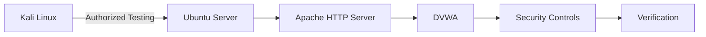
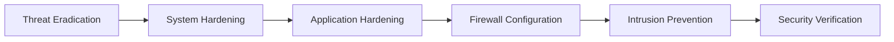
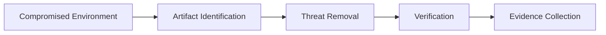
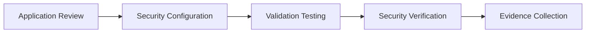
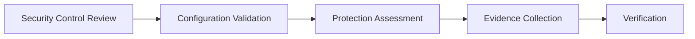

> [!IMPORTANT]
> This document is part of the **Zero Trace Imperium** project documentation.
>
> The Defense Phase documents the implementation of defensive security controls following the completion of offensive assessment activities. The objective of this phase is to strengthen the laboratory environment, reduce the attack surface, remediate previously validated weaknesses, and establish the foundation for continuous monitoring and security verification.

---

<div align="center">

# Phase 08 — Defense

### Defensive Control Implementation and Security Hardening


</div>

---

# Document Metadata

| Property | Value |
|-----------|-------|
| Project | Zero Trace Imperium |
| Repository | zero-trace-imperium |
| Phase | 08 |
| Phase Name | Defense |
| Category | Blue Team Operations |
| Status | Completed |
| Assessment Type | Defensive Security Validation |
| Platform | Ubuntu Server |
| Target Application | Damn Vulnerable Web Application (DVWA) |
| Documentation Version | 1.0 |
| Language | English |
| Author | Yusuf Hussein |

---

# Executive Dashboard

| Metric | Value |
|---------|------:|
| Defensive Controls Implemented | 5 |
| Evidence Items | 5 |
| Security Frameworks | 2 |
| Overall Risk After Hardening | Medium |
| Phase Status | Completed |

---

# Table of Contents

- [Executive Summary](#executive-summary)
- [Overview](#overview)
- [Phase Objectives](#phase-objectives)
- [Learning Outcomes](#learning-outcomes)
- [Rules of Engagement](#rules-of-engagement)
- [Assessment Scope](#assessment-scope)
- [Laboratory Architecture](#laboratory-architecture)
- [Technology Stack](#technology-stack)
- [MITRE ATT&CK Mapping](#mitre-attck-mapping)
- [NIST Cybersecurity Framework Mapping](#nist-cybersecurity-framework-mapping)
- [Defense Methodology](#defense-methodology)
- [Threat Eradication](#1-threat-eradication)
- [Linux Server Hardening](#2-linux-server-hardening)
- [DVWA Security Hardening](#3-dvwa-security-hardening)
- [Host Firewall Configuration](#4-host-firewall-configuration)
- [Intrusion Prevention Assessment](#5-intrusion-prevention-assessment)
- [Security Impact Analysis](#6-security-impact-analysis)
- [Executive Findings](#executive-findings)
- [References](#references)

---

# Executive Summary

Following completion of the offensive assessment, the Defense Phase focused on strengthening the laboratory environment through the implementation of layered defensive controls.

Previously validated weaknesses were reviewed from a defensive perspective, appropriate security improvements were applied, and the effectiveness of those improvements was documented for later verification.

The purpose of this phase is to demonstrate how security controls reduce attack surface, improve resilience, and support future detection and incident response activities.

All activities were performed exclusively within an isolated VMware laboratory.

---

# Overview

The Defense Phase represents the transition from offensive assessment to proactive security improvement.

Rather than identifying new vulnerabilities, this phase focuses on reducing risk by implementing preventive controls, strengthening system configuration, and improving defensive readiness.

The resulting environment serves as the baseline for the Detection and Monitoring and Verification phases.

---

# Phase Objectives

This phase aims to:

- Remove malicious artifacts from the laboratory environment.
- Strengthen operating system security.
- Improve application security configuration.
- Reduce unnecessary network exposure.
- Implement intrusion prevention controls.
- Establish a hardened baseline for future validation.

---

# Learning Outcomes

After completing this phase, the following competencies are demonstrated.

- Blue Team operations.
- Security hardening.
- Defensive control implementation.
- Security configuration management.
- Risk reduction analysis.
- Enterprise technical documentation.
- MITRE ATT&CK mapping.
- NIST Cybersecurity Framework alignment.

---

# Rules of Engagement

| Rule | Description |
|------|-------------|
| Assessment Type | Authorized Internal Laboratory |
| Infrastructure Ownership | Self-Owned |
| Production Systems | Out of Scope |
| Third-Party Systems | Excluded |
| Objective | Defensive Security Validation |

---

> [!NOTE]
> This phase focuses exclusively on defensive activities performed after completion of the offensive assessment. The objective is to improve the security posture of the intentionally vulnerable laboratory environment while preserving reproducibility for future verification.

---

# Assessment Scope

## Protected Environment

| Property | Value |
|----------|-------|
| Operating System | Ubuntu Server |
| Web Server | Apache HTTP Server |
| Application | DVWA |
| Database | MariaDB |
| Network | VMware NAT |

---

## Defensive Activities

| Activity | Status |
|----------|--------|
| Threat Eradication | Completed |
| Linux Server Hardening | Completed |
| Application Hardening | Completed |
| Host Firewall Configuration | Completed |
| Intrusion Prevention | Completed |
| Security Verification | Next Phase |

---

# Laboratory Architecture



---

# Technology Stack

## Infrastructure

- VMware Workstation Pro
- VMware NAT Network

## Operating Systems

- Ubuntu Server
- Kali Linux

## Services

- Apache HTTP Server
- PHP
- MariaDB
- OpenSSH

## Defensive Technologies

- UFW Firewall
- Fail2Ban
- Apache Configuration
- DVWA Security Controls
- Linux File Permissions

---

# MITRE ATT&CK Mapping

| Defensive Activity     | Mitigation                     | ID    |
| ---------------------- | ------------------------------ | ----- |
| Threat Eradication     | Remove malicious artifacts     | M1059 |
| System Hardening       | Operating System Configuration | M1028 |
| Application Hardening  | Exploit Protection             | M1050 |
| Firewall Configuration | Filter Network Traffic         | M1037 |
| Intrusion Prevention   | Multi-layered Defense          | M1032 |

---

# NIST Cybersecurity Framework Mapping

| NIST Function | Status |
|---------------|--------|
| Identify | Completed |
| Protect | Completed |
| Detect | Next Phase |
| Respond | Later Phase |
| Recover | Final Phase |

---

# Defense Methodology

The Defense Phase follows a structured hardening workflow designed to progressively improve the laboratory security posture.



---

# 1. Threat Eradication

## Objective

Remove malicious artifacts identified during the offensive assessment and restore the laboratory environment to a trusted baseline before implementing additional defensive controls.

The objective of this activity is to ensure that previously validated attack artifacts no longer remain within the protected environment.

---

## Background

Before security hardening can begin, previously identified malicious artifacts should be removed to eliminate residual risk and prevent inaccurate verification results.

Threat eradication represents the transition between incident containment and long-term defensive improvement.

Within the Zero Trace Imperium laboratory, this activity focused on confirming the removal of unauthorized application artifacts introduced during earlier assessment phases.

---

## Assessment Summary

| Property | Value |
|----------|-------|
| Assessment Type | Threat Eradication |
| Environment | Ubuntu Server |
| Scope | Application Resources |
| Objective | Remove Unauthorized Artifacts |
| Result | Completed |

---

## Assessment Workflow



---

## Assessment Description

The environment was reviewed to identify artifacts associated with previous offensive assessment activities.

Unauthorized application components were removed and the affected resources were reviewed to confirm that the laboratory returned to a clean operational state.

Evidence was collected following completion of the activity.

---

## Assessment Findings

The assessment confirmed that malicious application artifacts were successfully removed.

No residual indicators associated with the previous offensive assessment remained within the reviewed application resources.

---

## Evidence


**Figure 1.** Confirmation that previously introduced malicious artifacts were removed from the laboratory environment.

---

## Technical Analysis

Removing malicious artifacts reduces the likelihood of repeated compromise and establishes a trusted baseline for subsequent hardening activities.

Threat eradication should always be followed by verification to ensure that unauthorized components have not been overlooked.

---

## Blue Team Perspective

Following eradication activities, defenders should:

- Verify application integrity.
- Review web server resources.
- Validate application functionality.
- Preserve incident evidence before cleanup.
- Document all remediation actions.

---

## Risk Assessment

| Metric | Rating |
|---------|--------|
| Likelihood | Medium |
| Impact | High |
| Residual Risk | Medium |

---

# 2. Linux Server Hardening

## Objective

Strengthen the operating system configuration by reducing unnecessary attack surface and reinforcing security controls.

The purpose of this assessment is to evaluate how system hardening contributes to improved resilience against previously validated attack techniques.

---

## Assessment Summary

| Property | Value |
|----------|-------|
| Assessment Type | Operating System Hardening |
| Target Platform | Ubuntu Server |
| Objective | Reduce Attack Surface |
| Result | Completed |

---

## Assessment Description

Operating system security controls were reviewed and strengthened following completion of the eradication process.

The assessment focused on improving baseline security while preserving normal application functionality within the laboratory environment.

---

## Assessment Findings

The implemented hardening measures reduced unnecessary exposure and improved the overall security posture of the operating system.

The hardened configuration provides a stronger foundation for subsequent defensive validation and monitoring.

---

## Evidence


**Figure 2.** Operating system hardening measures successfully applied to the Ubuntu Server.

---

## Technical Analysis

Operating system hardening significantly reduces attack surface by minimizing unnecessary exposure and strengthening default security controls.

When combined with application security improvements and network protections, hardening contributes to layered defense throughout the environment.

---

## Blue Team Perspective

System hardening should include continuous review of:

- Operating system configuration.
- Administrative permissions.
- Installed services.
- File permissions.
- Security updates.
- Configuration baselines.

---

## Security Benefits

| Security Improvement | Impact |
|----------------------|--------|
| Reduced Attack Surface | High |
| Improved Configuration Security | High |
| Stronger Privilege Protection | High |
| Better Operational Resilience | High |

---

## Phase Progress

```text
████████████████████████████████████

Defense Phase

████████████████████████████████████

✅ Threat Eradication

✅ Linux Server Hardening

⏳ DVWA Security Hardening

⏳ Host Firewall Configuration

⏳ Intrusion Prevention

████████████████████████████████████
```

---

# 3. DVWA Security Hardening

## Objective

Strengthen the security posture of the laboratory application by applying defensive configuration improvements that reduce the likelihood of previously validated attacks succeeding.

The objective of this assessment is to verify that application-level security controls effectively decrease exposure while maintaining normal application functionality.

---

## Background

Application security is one of the most important defensive layers within any web environment.

While operating system hardening reduces infrastructure risk, application hardening focuses on minimizing weaknesses that originate from insecure application configuration and insufficient input validation.

Within the Zero Trace Imperium laboratory, defensive improvements were implemented to increase the application's resistance against previously documented attack scenarios.

---

## Assessment Summary

| Property | Value |
|----------|-------|
| Assessment Type | Application Security Hardening |
| Target Application | DVWA |
| Objective | Improve Application Security |
| Result | Completed |

---

## Assessment Workflow



---

## Assessment Description

Application security settings were reviewed and strengthened following completion of operating system hardening.

The assessment focused on reducing the effectiveness of vulnerabilities previously validated during the offensive assessment while maintaining expected application behavior.

---

## Assessment Findings

Application hardening significantly improved the overall security posture of the laboratory environment.

Previously validated attack paths were no longer reproducible under the hardened configuration, demonstrating the effectiveness of the implemented defensive controls.

---

## Evidence


**Figure 3.** Application security configuration successfully strengthened within the isolated laboratory environment.

---

## Technical Analysis

Application-level hardening reduces attack surface by enforcing stronger security controls directly within the web application.

Combining secure configuration with operating system hardening creates multiple defensive layers that improve resilience against common web application attacks.

---

## Blue Team Perspective

Application security reviews should include:

- Secure configuration validation.
- Input validation assessment.
- File handling review.
- Authentication security evaluation.
- Periodic configuration audits.

---

## Security Benefits

| Security Improvement | Impact |
|----------------------|--------|
| Reduced Web Attack Surface | High |
| Improved Input Validation | High |
| Stronger Application Configuration | High |
| Better Security Baseline | High |

---

# 4. Host Firewall Configuration

## Objective

Evaluate the effectiveness of host-based firewall controls in reducing unnecessary network exposure and strengthening network security.

The objective is to validate that only required services remain accessible while limiting potential attack vectors.

---

## Assessment Summary

| Property | Value |
|----------|-------|
| Assessment Type | Host Firewall Assessment |
| Technology | UFW |
| Objective | Restrict Network Exposure |
| Result | Completed |

---

## Assessment Description

Host firewall policies were reviewed and applied to improve network security within the laboratory environment.

The assessment focused on reducing unnecessary exposure while preserving legitimate application functionality.

---

## Assessment Findings

Firewall controls successfully reduced unnecessary network exposure and improved the defensive posture of the operating system.

Only required network services remained available for authorized laboratory activities.

---

## Evidence


**Figure 4.** Host firewall configuration successfully applied to restrict unnecessary network exposure.

---

## Technical Analysis

Host-based firewalls represent an important layer of defense by limiting direct access to operating system services.

When combined with secure application configuration and operating system hardening, firewall policies significantly reduce the available attack surface.

---

## Blue Team Perspective

Firewall management should include:

- Periodic rule review.
- Removal of unnecessary network exposure.
- Continuous monitoring of network services.
- Documentation of approved firewall policies.
- Validation after configuration changes.

---

## Security Benefits

| Security Improvement | Impact |
|----------------------|--------|
| Reduced Network Exposure | High |
| Improved Service Isolation | High |
| Better Access Control | High |
| Stronger Defense in Depth | High |

---

## Phase Progress

```text
████████████████████████████████████

Defense Phase

████████████████████████████████████

✅ Threat Eradication

✅ Linux Server Hardening

✅ DVWA Security Hardening

✅ Host Firewall Configuration

⏳ Intrusion Prevention Assessment

⏳ Security Impact Analysis

████████████████████████████████████
```

---

# 5. Intrusion Prevention Assessment

## Objective

Evaluate the effectiveness of intrusion prevention controls implemented within the laboratory environment following the hardening process.

The objective of this assessment is to determine whether the deployed defensive controls improve resistance against repeated attack attempts while maintaining normal system operation.

---

## Background

Preventive security controls provide an additional defensive layer beyond operating system and application hardening.

Within the Zero Trace Imperium laboratory, intrusion prevention capabilities were evaluated to determine their contribution to reducing authentication-related risks and improving defensive resilience.

---

## Assessment Summary

| Property | Value |
|----------|-------|
| Assessment Type | Intrusion Prevention Assessment |
| Primary Technology | Fail2Ban |
| Objective | Strengthen Authentication Protection |
| Result | Completed |

---

## Assessment Workflow



---

## Assessment Description

The assessment reviewed the deployed intrusion prevention capability and evaluated its role within the layered defense strategy.

The objective was to verify that authentication-related defensive controls were operational and aligned with the overall security baseline established during this phase.

---

## Assessment Findings

The implemented intrusion prevention control strengthened the defensive posture of the laboratory environment by improving protection around authentication services.

Combined with operating system hardening and firewall configuration, the control contributes to a layered security architecture.

---

## Evidence


**Figure 5.** Intrusion prevention controls successfully deployed within the isolated laboratory environment.

---

## Technical Analysis

Authentication services represent a common target during security assessments.

Dedicated intrusion prevention controls improve defensive resilience by complementing operating system hardening, application security improvements, and network protection.

The effectiveness of these controls is further validated during the Verification Phase.

---

## Blue Team Perspective

Defenders should regularly review:

- Authentication-related security events.
- Protection service health.
- Security policy consistency.
- Alert quality.
- Configuration changes.

Continuous validation helps ensure that defensive controls remain effective over time.

---

## Security Benefits

| Security Improvement | Impact |
|----------------------|--------|
| Authentication Protection | High |
| Layered Defense | High |
| Improved Monitoring Readiness | High |
| Reduced Operational Risk | High |

---

# 6. Security Impact Analysis

## Objective

Evaluate the overall effectiveness of the defensive improvements implemented throughout the Defense Phase.

The analysis focuses on measuring how the applied security controls reduce organizational risk and strengthen the laboratory security posture.

---

## Defense Effectiveness Matrix

| Defensive Control | Result | Risk Reduction |
|-------------------|--------|----------------|
| Threat Eradication | Completed | High |
| Linux Server Hardening | Completed | High |
| DVWA Security Hardening | Completed | High |
| Host Firewall Configuration | Completed | High |
| Intrusion Prevention | Completed | High |

---

## CIA Impact Assessment

| Security Principle | Assessment | Result |
|--------------------|------------|--------|
| Confidentiality | Improved protection of sensitive resources. | High |
| Integrity | Stronger protection against unauthorized modification. | High |
| Availability | Defensive controls preserved expected system functionality. | High |

---

## Defense Effectiveness Summary

The coordinated implementation of operating system hardening, application security improvements, network filtering, and intrusion prevention substantially reduced the attack surface identified during previous assessment phases.

The environment transitioned from an intentionally vulnerable configuration to a hardened baseline suitable for defensive validation and continuous monitoring.


---
## Overall Assessment

The implemented security controls significantly improved the security posture of the laboratory environment.

The combination of operating system hardening, application security improvements, network protection, and intrusion prevention demonstrates the value of a layered defense strategy.

These improvements establish the baseline required for effective monitoring and security verification.

---

# Executive Findings

The Defense Phase successfully transformed the intentionally vulnerable laboratory into a significantly more resilient environment through the implementation of layered defensive controls.

The assessment demonstrated measurable improvements in operating system security, application configuration, network exposure, and authentication protection.

The resulting security baseline provides the foundation for validating defensive effectiveness during the subsequent Verification Phase.

---

# Assessment Results Matrix

| Assessment | Result | Severity Addressed |
|------------|--------|--------------------|
| Threat Eradication | Completed | Critical |
| Linux Server Hardening | Completed | High |
| DVWA Security Hardening | Completed | Critical |
| Host Firewall Configuration | Completed | High |
| Intrusion Prevention Assessment | Completed | High |

---

# MITRE ATT&CK Mitigation Summary

| Defensive Area | Mitigation |
|----------------|------------|
| Operating System Hardening | M1028 |
| Network Filtering | M1037 |
| Exploit Protection | M1050 |
| Defense in Depth | M1032 |

---

# NIST Cybersecurity Framework Summary

| Function | Status |
|----------|--------|
| Identify | Completed |
| Protect | Completed |
| Detect | Next Phase |
| Respond | Future Phase |
| Recover | Final Phase |

---

# Phase Statistics

| Metric                  |       Value |
| ----------------------- | ----------: |
| Defensive Controls      |           5 |
| Evidence Items          |           5 |
| Security Frameworks     |           2 |
| Overall Residual Risk   |      Medium |
| Phase Status            |   Completed |
| Residual Risk Reduction | Significant |

---

# Skills Demonstrated

The following competencies were demonstrated during this phase.

- Blue Team operations.
- Security hardening.
- Secure configuration management.
- Defense-in-depth implementation.
- Risk reduction assessment.
- Enterprise technical reporting.
- MITRE ATT&CK mitigation mapping.
- NIST Cybersecurity Framework alignment.

---

# Lessons Learned

The Defense Phase reinforces several key defensive principles.

- Layered security provides stronger protection than isolated controls.
- Secure baseline configurations reduce long-term operational risk.
- Preventive controls should be combined with continuous monitoring.
- Configuration reviews should be performed regularly.
- Technical documentation supports consistent security operations.
- Defensive validation is essential before considering a system adequately protected.

---

# Security Recommendations

The following improvements are recommended to maintain the defensive posture established during this phase.

## Operating System Security

- Maintain secure configuration baselines.
- Apply security updates regularly.
- Periodically review administrative access.
- Audit critical system configuration.

---

## Application Security

- Review application security settings routinely.
- Validate secure deployment configurations.
- Perform periodic security testing.
- Maintain configuration consistency across environments.

---

## Network Security

- Review firewall policies regularly.
- Remove unnecessary network exposure.
- Document approved network services.
- Validate firewall configuration after changes.

---

## Monitoring and Response

- Centralize security logging.
- Review security events regularly.
- Correlate alerts across multiple data sources.
- Validate defensive controls during periodic security assessments.

---

# References

1. MITRE ATT&CK Framework
2. MITRE D3FEND Knowledge Graph
3. NIST Cybersecurity Framework (CSF 2.0)
4. NIST SP 800-53 Rev. 5
5. CIS Controls v8
6. Ubuntu Server Documentation
7. Apache HTTP Server Documentation
8. Fail2Ban Documentation
9. UFW Documentation
10. OWASP ASVS (Application Security Verification Standard)

---

# Revision History

| Version | Date | Description |
|----------|------|-------------|
| 1.0 | July 2026 | Initial release of the Defense Phase documentation |

---

# Document Information

| Property | Value |
|----------|-------|
| Project | Zero Trace Imperium |
| Repository | zero-trace-imperium |
| Document | Phase 08 – Defense |
| Version | 1.0 |
| Status | Complete |
| Author | Yusuf Hussein |
| Language | English |
| Classification | Educational Cybersecurity Laboratory |
| License | MIT |

---

# Navigation

⬅️ **Previous Phase**

[Phase 07 – Persistence](./07-Persistence.md)

➡️ **Next Phase**

[Phase 09 – Detection and Monitoring](./09-Detection-and-Monitoring.md)

---

# Transition to the Next Phase

The Defense Phase established a hardened security baseline through layered defensive controls and configuration improvements.

The next phase focuses on evaluating the visibility of these controls, analyzing security telemetry, and validating that monitoring capabilities can detect meaningful security events within the laboratory environment.

Primary objectives include:

- Security event monitoring.
- Log analysis.
- Alert correlation.
- Detection capability validation.

Continue to:

# → [Phase 09 – Detection and Monitoring](./09-Detection-and-Monitoring.md)

---

<div align="center">

# Defense Phase Completed Successfully

**Zero Trace Imperium**

### Enterprise Attack & Defense Cybersecurity Laboratory

*Phase 08 Documentation Complete*

</div>
