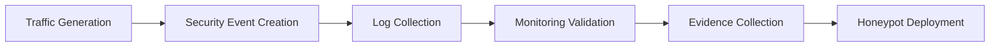

 > [!IMPORTANT]
> This document is part of the **Zero Trace Imperium** project documentation.
>
> The Detection and Monitoring Phase validates the effectiveness of the defensive controls implemented during the previous phase by assessing real-time visibility into security events. The objective is to demonstrate that security monitoring capabilities can identify suspicious activity, provide actionable telemetry, and support timely incident investigation within an isolated VMware laboratory.

---

<div align="center">

# Phase 09 — Detection and Monitoring

### Security Visibility Assessment and Detection Validation


</div>

---

# Document Metadata

| Property | Value |
|-----------|-------|
| Project | Zero Trace Imperium |
| Repository | zero-trace-imperium |
| Phase | 09 |
| Phase Name | Detection and Monitoring |
| Category | Blue Team Operations |
| Status | Completed |
| Assessment Type | Defensive Monitoring Validation |
| Platform | Ubuntu Server |
| Monitoring Scope | Web Server and Network Activity |
| Documentation Version | 1.0 |
| Language | English |
| Author | Yusuf Hussein |

---

# Executive Dashboard

| Metric                         |     Value |
| ------------------------------ | --------: |
| Monitoring Sources             |         2 |
| Evidence Items                 |         2 |
| Security Frameworks Referenced |         2 |
| MITRE ATT&CK Techniques        |         3 |
| Detection Coverage             |      High |
| Phase Status                   | Completed |

---

# Table of Contents

- [Executive Summary](#executive-summary)
- [Overview](#overview)
- [Phase Objectives](#phase-objectives)
- [Learning Outcomes](#learning-outcomes)
- [Rules of Engagement](#rules-of-engagement)
- [Assessment Scope](#assessment-scope)
- [Laboratory Architecture](#laboratory-architecture)
- [Technology Stack](#technology-stack)
- [MITRE ATT&CK Mapping](#mitre-attck-mapping)
- [NIST Cybersecurity Framework Mapping](#nist-cybersecurity-framework-mapping)
- [Detection and Monitoring Methodology](#detection-and-monitoring-methodology)
- [Web Log Monitoring Assessment](#1-web-log-monitoring-assessment)
- [Security Event Generation](#2-security-event-generation)
- [Detection Validation](#3-detection-validation)
- [Network Connection Monitoring](#4-network-connection-monitoring)
- [Security Visibility Assessment](#5-security-visibility-assessment)
- [Security Impact Analysis](#6-security-impact-analysis)
- [Executive Findings](#executive-findings)
- [References](#references)

---

# Executive Summary

Following implementation of the defensive controls during the Defense Phase, the Detection and Monitoring Phase evaluates whether security events generated within the laboratory environment can be observed, correlated, and investigated in real time.

The assessment focuses on validating monitoring visibility rather than introducing new security controls.

Collected telemetry demonstrates that the hardened environment provides sufficient visibility to support incident detection and subsequent forensic analysis.

All activities were performed exclusively within the isolated Zero Trace Imperium laboratory.

---

# Overview

Security controls are effective only when defenders can verify their operation through continuous monitoring.

This phase evaluates the visibility provided by operating system logs, web server activity, and active network connections following the implementation of defensive improvements.

The resulting observations establish confidence that meaningful security events can be detected and investigated throughout the environment.

---

# Phase Objectives

This phase aims to:

- Validate web server monitoring capabilities.
- Evaluate real-time detection visibility.
- Assess network connection monitoring.
- Document observable security events.
- Preserve monitoring evidence.
- Prepare the environment for deception technologies.

---

# Learning Outcomes

After completing this phase, the following competencies are demonstrated.

- Security monitoring.
- Log analysis.
- Network visibility assessment.
- Security event correlation.
- Detection validation.
- Enterprise technical reporting.
- MITRE ATT&CK mapping.
- NIST Cybersecurity Framework alignment.

---

# Rules of Engagement

| Rule | Description |
|------|-------------|
| Assessment Type | Authorized Internal Laboratory |
| Infrastructure Ownership | Self-Owned |
| Production Systems | Out of Scope |
| Third-Party Systems | Excluded |
| Objective | Defensive Monitoring Validation |

---

> [!NOTE]
> This phase validates the visibility of previously implemented defensive controls. The objective is to confirm that security-relevant events can be observed, correlated, and documented without modifying the protected environment.

---

# Assessment Scope

## Monitoring Platform

| Property | Value |
|----------|-------|
| Operating System | Ubuntu Server |
| Web Server | Apache HTTP Server |
| Application | DVWA |
| Network | VMware NAT |

---

## Assessment Activities

| Activity | Status |
|----------|--------|
| Web Log Monitoring | Completed |
| Event Generation | Completed |
| Detection Validation | Completed |
| Network Visibility Assessment | Completed |
| Honeypot Deployment | Next Phase |

---

# Laboratory Architecture


---

# Technology Stack

## Infrastructure

- VMware Workstation Pro
- VMware NAT Network

## Operating Systems

- Ubuntu Server
- Kali Linux

## Monitoring Components

- Apache Access Logs
- Linux System Logs
- Network Connection Monitoring

## Assessment Utilities

- Apache HTTP Server
- DIRB
- Linux Networking Utilities

---

# MITRE ATT&CK Mapping

| Monitoring Activity      | ATT&CK Technique                     | ATT&CK ID |
| ------------------------ | ------------------------------------ | --------- |
| Web Activity Monitoring  | Application Layer Protocol           | T1071     |
| Network Visibility       | System Network Connections Discovery | T1049     |
| Reconnaissance Detection | Network Service Discovery            | T1046     |

---

# NIST Cybersecurity Framework Mapping

| Function | Status |
|----------|--------|
| Identify | Completed |
| Protect | Completed |
| Detect | Completed |
| Respond | Next Phase |
| Recover | Final Phase |

---

# Detection and Monitoring Methodology

The assessment followed a structured workflow to validate the visibility of security-relevant events across the protected laboratory environment.



---

# 1. Web Log Monitoring Assessment

## Objective

Evaluate the effectiveness of web server logging in providing visibility into security-relevant activity within the laboratory environment.

The objective of this assessment is to determine whether HTTP requests generated during the assessment are consistently recorded and available for defensive analysis.

---

## Background

Web server access logs provide one of the primary sources of evidence during web application investigations.

Accurate request logging enables defenders to reconstruct activity timelines, identify unusual behavior, and support forensic analysis following a security event.

Within the Zero Trace Imperium laboratory, web log monitoring was evaluated to validate defensive visibility after completion of the Defense Phase.

---

## Assessment Summary

| Property | Value |
|----------|-------|
| Assessment Type | Web Log Monitoring |
| Log Source | Apache HTTP Server |
| Objective | HTTP Activity Visibility |
| Result | Completed |

---

## Assessment Workflow


---

## Assessment Description

The assessment evaluated whether web server activity generated during the laboratory exercise was successfully recorded within the available logging infrastructure.

Collected telemetry was reviewed to determine its usefulness for incident investigation and defensive validation.

---

## Assessment Findings

The monitoring solution successfully captured web application activity throughout the assessment.

Recorded events provided sufficient visibility to reconstruct the observed interaction timeline and supported subsequent defensive analysis.

---

## Evidence


**Figure 1.** Web server monitoring successfully captured reconnaissance-related HTTP activity during the laboratory assessment.

---

## Technical Analysis

Web server logging represents an essential source of defensive telemetry.

When combined with operating system logs and endpoint monitoring, HTTP request logs provide valuable context for identifying abnormal application activity and supporting incident investigations.

---

## Blue Team Perspective

Defenders should routinely:

- Review web server access logs.
- Correlate web requests with authentication events.
- Investigate abnormal request patterns.
- Preserve logs for forensic analysis.
- Validate log retention policies.

---

## Detection Opportunities

| Data Source | Defensive Value |
|-------------|-----------------|
| Apache Access Log | Request visibility |
| Apache Error Log | Application anomalies |
| Syslog | Operating system events |
| SIEM | Cross-source event correlation |

---

## Risk Assessment

| Metric | Rating |
|---------|--------|
| Visibility | High |
| Detection Capability | High |
| Overall Effectiveness | High |

---

# 2. Security Event Generation

## Objective

Validate that monitoring infrastructure correctly records security-relevant activity produced during an authorized laboratory assessment.

The purpose of this assessment is to confirm the effectiveness of event collection and establish confidence in the monitoring baseline.

---

## Assessment Summary

| Property | Value |
|----------|-------|
| Assessment Type | Security Event Validation |
| Event Source | Authorized Assessment Traffic |
| Objective | Monitoring Verification |
| Result | Completed |

---

## Assessment Description

The monitoring environment was evaluated by observing security-relevant activity generated within the isolated laboratory.

The assessment focused on confirming that defensive telemetry remained complete, consistent, and suitable for subsequent investigation.

---

## Assessment Findings

The monitoring infrastructure successfully recorded assessment-related activity and maintained sufficient visibility throughout the observation period.

Collected telemetry demonstrated that defensive controls implemented during the previous phase were operating as expected.

---

## Technical Analysis

Reliable event collection is fundamental to effective incident detection.

The availability of complete telemetry improves investigation quality, reduces uncertainty during analysis, and strengthens confidence in the defensive posture of the environment.

---

## Security Control Matrix

| Control | Objective | Result |
|----------|-----------|--------|
| Apache Access Logging | Web Activity Visibility | Successful |
| Operating System Logging | Event Collection | Successful |
| Network Monitoring | Connection Visibility | Successful |
| Event Correlation | Investigation Support | Successful |

---

## Phase Progress

```text
████████████████████████████████████

Detection and Monitoring Phase

████████████████████████████████████

✅ Web Log Monitoring Assessment

✅ Security Event Generation

⏳ Detection Validation

⏳ Network Connection Monitoring

⏳ Security Visibility Assessment

████████████████████████████████████
```

---

# 3. Detection Validation

## Objective

Validate that the deployed monitoring infrastructure successfully detects and records security-relevant activity generated during the authorized laboratory assessment.

The objective is to confirm that the defensive controls implemented during the previous phase provide sufficient visibility to support incident detection and investigation.

---

## Background

Effective monitoring extends beyond collecting logs.

Security teams must verify that recorded events accurately represent system activity and provide enough context for investigation and incident response.

Within the Zero Trace Imperium laboratory, this assessment validates the operational readiness of the monitoring environment.

---

## Assessment Summary

| Property | Value |
|----------|-------|
| Assessment Type | Detection Validation |
| Objective | Monitoring Effectiveness Verification |
| Result | Completed |

---

## Assessment Description

Monitoring telemetry collected throughout the laboratory assessment was reviewed to determine whether significant security events remained visible across available monitoring sources.

The assessment confirmed that the implemented monitoring controls consistently recorded meaningful activity without affecting normal system operation.

---

## Assessment Findings

Security-relevant events remained observable throughout the assessment.

The available telemetry demonstrated that monitoring controls successfully preserved the information required for event reconstruction and defensive investigation.

---

## Technical Analysis

Detection validation confirms that defensive controls operate as expected under realistic laboratory conditions.

Accurate event collection, combined with centralized analysis, improves investigation quality and reduces the time required to identify suspicious activity.

---

## Blue Team Perspective

Detection validation should include regular review of:

- Log completeness.
- Event timestamps.
- Monitoring consistency.
- Alert quality.
- Correlation accuracy.

Routine validation ensures continued confidence in defensive monitoring capabilities.

---

## Monitoring Benefits

| Capability | Result |
|------------|--------|
| Event Visibility | High |
| Investigation Support | High |
| Log Consistency | High |
| Detection Confidence | High |

---

# 4. Network Connection Monitoring

## Objective

Evaluate the visibility of active network connections within the protected laboratory environment.

The assessment focuses on determining whether active communication sessions remain observable through operating system monitoring and can support defensive investigation.

---

## Assessment Summary

| Property | Value |
|----------|-------|
| Assessment Type | Network Connection Monitoring |
| Monitoring Source | Ubuntu Server |
| Objective | Active Session Visibility |
| Result | Completed |

---

## Assessment Description

Network activity generated during the assessment was observed to validate the visibility provided by operating system monitoring.

The collected information was reviewed to determine whether active communication sessions could be identified and correlated with other monitoring sources.

---

## Assessment Findings

The assessment confirmed that active network connections remained visible throughout the monitoring process.

This visibility provides valuable context for identifying ongoing activity and strengthens the overall effectiveness of incident investigation.

---

## Evidence


**Figure 2.** Active network connections successfully observed during the defensive monitoring assessment.

---

## Technical Analysis

Network connection monitoring complements application and operating system logging by providing real-time visibility into communication sessions.

Combining these data sources improves situational awareness and supports comprehensive investigation of security events.

---

## Blue Team Perspective

Defenders should routinely review:

- Active communication sessions.
- Unexpected external connections.
- Long-lived network sessions.
- Service exposure.
- Network telemetry consistency.

---

## Detection Opportunities

| Data Source | Defensive Purpose |
|-------------|-------------------|
| Network Connections | Session visibility |
| Apache Access Logs | Web activity correlation |
| Syslog | Operating system events |
| Endpoint Telemetry | Host activity |
| SIEM | Cross-source investigation |

---

## Security Benefits

| Improvement | Impact |
|-------------|--------|
| Real-Time Visibility | High |
| Network Awareness | High |
| Investigation Accuracy | High |
| Incident Context | High |

---

## Phase Progress

```text
████████████████████████████████████

Detection and Monitoring Phase

████████████████████████████████████

✅ Web Log Monitoring Assessment

✅ Security Event Generation

✅ Detection Validation

✅ Network Connection Monitoring

⏳ Security Visibility Assessment

⏳ Security Impact Analysis

████████████████████████████████████
```

---

 # 5. Security Visibility Assessment

## Objective

Evaluate the overall visibility provided by the deployed monitoring infrastructure following the implementation of defensive controls.

The objective is to determine whether security telemetry generated throughout the laboratory environment provides sufficient coverage for detection, investigation, and forensic analysis.

---

## Background

Security visibility is a fundamental requirement for effective cyber defense.

Without reliable telemetry, defenders cannot accurately identify malicious activity, reconstruct attack timelines, or validate the effectiveness of implemented security controls.

Within the Zero Trace Imperium laboratory, this assessment measures the quality and completeness of the monitoring capabilities established during the previous phases.

---

## Assessment Summary

| Property | Value |
|----------|-------|
| Assessment Type | Security Visibility Assessment |
| Objective | Monitoring Coverage Evaluation |
| Result | Completed |

---

## Assessment Description

Monitoring data collected throughout the assessment was reviewed to evaluate overall visibility across the laboratory environment.

The review considered application logs, operating system events, and network activity to determine whether meaningful security telemetry was consistently available.

---

## Assessment Findings

The implemented monitoring controls provided comprehensive visibility into assessment activity.

Correlated telemetry from multiple monitoring sources enabled effective event reconstruction and strengthened confidence in the laboratory's defensive readiness.

---

## Technical Analysis

Effective monitoring relies on multiple complementary telemetry sources rather than a single logging mechanism.

Correlating web server activity, operating system events, and network visibility significantly improves investigative capability and reduces uncertainty during incident analysis.

---

## Blue Team Perspective

Defenders should continuously evaluate:

- Monitoring coverage.
- Event correlation quality.
- Log retention policies.
- Alert fidelity.
- Visibility gaps.
- Telemetry health.

Regular validation ensures monitoring remains effective as the environment evolves.

---

## Monitoring Coverage Matrix

| Monitoring Source | Coverage |
|-------------------|----------|
| Apache Access Logs | High |
| Operating System Logs | High |
| Network Monitoring | High |
| Event Correlation | High |

---

# 6. Security Impact Analysis

## Objective

Evaluate the effectiveness of the monitoring infrastructure in supporting defensive operations following implementation of the hardened security baseline.

The assessment measures how continuous monitoring contributes to detection readiness, investigation capability, and overall defensive resilience.

---

## Detection Effectiveness Matrix

| Monitoring Capability | Result | Operational Value |
|-----------------------|--------|-------------------|
| Web Log Monitoring | Successful | High |
| Event Collection | Successful | High |
| Network Monitoring | Successful | High |
| Event Correlation | Successful | High |

---
## Defense Effectiveness Summary

The monitoring capabilities evaluated during this phase demonstrate that the defensive controls implemented previously provide meaningful operational visibility.

The availability of correlated telemetry significantly improves detection readiness and strengthens the organization's ability to investigate security events efficiently.

---
## CIA Impact Assessment

| Security Principle | Assessment | Result |
|--------------------|------------|--------|
| Confidentiality | Monitoring improves visibility into unauthorized access attempts. | High |
| Integrity | Security events support detection of unauthorized changes. | High |
| Availability | Monitoring remained operational without affecting system functionality. | High |

---

## Overall Assessment

The Detection and Monitoring Phase confirmed that the laboratory environment provides comprehensive visibility across multiple telemetry sources.

The implemented monitoring capabilities successfully support event identification, investigation, and defensive validation while establishing a reliable foundation for future deception technologies.

---

# Evidence Inventory

## Evidence Summary

| Figure | Description | Status |
|---------|-------------|--------|
| Figure 1 | Web log monitoring assessment | ✅ |
| Figure 2 | Network connection monitoring | ✅ |

---

## Repository Artifacts

```text
zero-trace-imperium/
│
├── phases/
│   └── 09-Detection-and-Monitoring.md
│
└── screenshots/
    └── detection-monitoring/
        ├── dirb-detection-test.png
        └── network-monitoring.png
```

---

# Executive Findings

The Detection and Monitoring Phase successfully validated the effectiveness of the monitoring infrastructure implemented within the Zero Trace Imperium laboratory.

The assessment demonstrated that security-relevant activity remained observable across web server logs, operating system telemetry, and network monitoring sources.

The availability of correlated telemetry significantly improves investigation quality and provides a strong foundation for subsequent defensive capabilities.

---

# Assessment Results Matrix

| Assessment | Result | Operational Impact |
|------------|--------|--------------------|
| Web Log Monitoring | Completed | High |
| Security Event Generation | Completed | High |
| Detection Validation | Completed | High |
| Network Connection Monitoring | Completed | High |
| Security Visibility Assessment | Completed | High |

---

# MITRE ATT&CK Summary

| Monitoring Activity | Technique | ATT&CK ID |
|---------------------|-----------|------------|
| Web Activity Monitoring | Application Layer Protocol | T1071 |
| Network Visibility | System Network Connections Discovery | T1049 |
| Reconnaissance Detection | Network Service Discovery | T1046 |

---

# NIST Cybersecurity Framework Summary

| Function | Status |
|----------|--------|
| Identify | Completed |
| Protect | Completed |
| Detect | Completed |
| Respond | Next Phase |
| Recover | Later Phase |

---

# Phase Statistics

| Metric                  |     Value |
| ----------------------- | --------: |
| Monitoring Sources      |         2 |
| Evidence Items          |         2 |
| Security Frameworks     |         2 |
| MITRE ATT&CK Techniques |         3 |
| Detection Coverage      |      High |
| Phase Status            | Completed |
| Telemetry Quality       |      High |

---

# Skills Demonstrated

The following competencies were demonstrated during this phase.

- Security monitoring.
- Log analysis.
- Network visibility assessment.
- Event correlation.
- Detection validation.
- Enterprise technical reporting.
- MITRE ATT&CK mapping.
- NIST Cybersecurity Framework alignment.

---

# Lessons Learned

The Detection and Monitoring Phase reinforces several important defensive principles.

- Continuous monitoring provides better security awareness than periodic inspection.
- Correlated telemetry improves incident investigation.
- Centralized logging strengthens defensive visibility.
- Network monitoring complements application logging.
- Monitoring validation should follow every major security improvement.
- Consistent documentation improves long-term operational readiness.

---

# Security Recommendations

The following improvements are recommended to maintain and enhance monitoring capabilities.

## Log Management

- Centralize log collection.
- Protect log integrity.
- Maintain appropriate retention policies.
- Review log quality regularly.

---

## Monitoring

- Validate monitoring coverage periodically.
- Review active network visibility.
- Correlate telemetry across multiple sources.
- Continuously assess monitoring effectiveness.

---

## Incident Response

- Preserve monitoring evidence before remediation.
- Correlate events across available telemetry.
- Validate detection accuracy after security changes.
- Document monitoring improvements.

---

# References

1. MITRE ATT&CK Framework
2. MITRE D3FEND Knowledge Graph
3. NIST Cybersecurity Framework (CSF 2.0)
4. NIST SP 800-61 Rev. 2
5. NIST SP 800-53 Rev. 5
6. CIS Controls v8
7. Apache HTTP Server Documentation
8. Ubuntu Server Documentation
9. OWASP Logging Cheat Sheet
10. OWASP Monitoring Cheat Sheet

---

# Revision History

| Version | Date | Description |
|----------|------|-------------|
| 1.0 | July 2026 | Initial release of the Detection and Monitoring Phase documentation |

---

# Document Information

| Property | Value |
|----------|-------|
| Project | Zero Trace Imperium |
| Repository | zero-trace-imperium |
| Document | Phase 09 – Detection and Monitoring |
| Version | 1.0 |
| Status | Complete |
| Author | Yusuf Hussein |
| Language | English |
| Classification | Educational Cybersecurity Laboratory |
| License | MIT |

---

# Navigation

⬅️ **Previous Phase**

[Phase 08 – Defense](./08-Defense.md)

➡️ **Next Phase**

[Phase 10 – Honeypot](./10-Honeypot.md)

---

# Transition to the Next Phase

The Detection and Monitoring Phase confirmed that the laboratory environment provides effective visibility into security-relevant activity through multiple monitoring sources.

The next phase introduces deception technology to complement existing monitoring capabilities by attracting, observing, and analyzing unauthorized interaction within a controlled environment.

Primary objectives include:

- Honeypot deployment.
- Attacker interaction analysis.
- Threat intelligence collection.
- Defensive visibility enhancement.

Continue to:

# → [Phase 10 – Honeypot](./10-Honeypot.md)

---

<div align="center">

# Detection and Monitoring Phase Completed Successfully

**Zero Trace Imperium**

### Enterprise Attack & Defense Cybersecurity Laboratory

*Phase 09 Documentation Complete*

</div>
