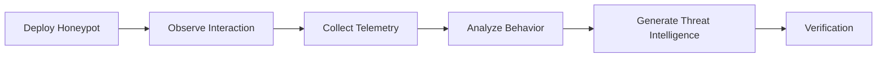
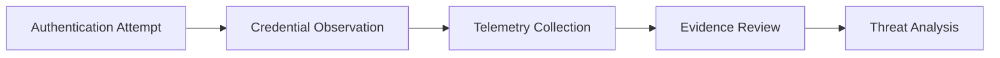

> [!IMPORTANT]
> This document is part of the **Zero Trace Imperium** project documentation.
>
> The Honeypot Phase evaluates the effectiveness of deception technology within an isolated VMware laboratory. The objective is to observe unauthorized interaction with a controlled decoy service, collect security-relevant telemetry, and strengthen defensive visibility without exposing production systems.

---

<div align="center">

# Phase 10 — Honeypot

### Deception Technology Assessment and Threat Intelligence Collection


</div>

---

# Document Metadata

| Property | Value |
|-----------|-------|
| Project | Zero Trace Imperium |
| Repository | zero-trace-imperium |
| Phase | 10 |
| Phase Name | Honeypot |
| Category | Deception Technology |
| Status | Completed |
| Assessment Type | Defensive Security Assessment |
| Platform | Ubuntu Server |
| Technology | Cowrie SSH Honeypot |
| Documentation Version | 1.0 |
| Language | English |
| Author | Yusuf Hussein |

---

# Executive Dashboard

| Metric                         |     Value |
| ------------------------------ | --------: |
| Honeypot Services              |         1 |
| Evidence Items                 |         5 |
| Security Frameworks Referenced |         3 |
| MITRE ATT&CK Techniques        |         3 |
| MITRE D3FEND Techniques        |         4 |
| Threat Visibility Coverage     |      High |
| Phase Status                   | Completed |

---

# Table of Contents

- [Executive Summary](#executive-summary)
- [Overview](#overview)
- [Phase Objectives](#phase-objectives)
- [Learning Outcomes](#learning-outcomes)
- [Rules of Engagement](#rules-of-engagement)
- [Assessment Scope](#assessment-scope)
- [Laboratory Architecture](#laboratory-architecture)
- [Technology Stack](#technology-stack)
- [MITRE ATT&CK Mapping](#mitre-attck-mapping)
- [MITRE D3FEND Mapping](#mitre-d3fend-mapping)
- [NIST Cybersecurity Framework Mapping](#nist-cybersecurity-framework-mapping)
- [Honeypot Assessment Methodology](#honeypot-assessment-methodology)
- [Honeypot Deployment Assessment](#1-honeypot-deployment-assessment)
- [Attacker Interaction Assessment](#2-attacker-interaction-assessment)
- [Credential Observation Assessment](#3-credential-observation-assessment)
- [Threat Intelligence Assessment](#4-threat-intelligence-assessment)
- [Security Impact Analysis](#5-security-impact-analysis)
- [Executive Findings](#executive-findings)
- [References](#references)

---

# Executive Summary

The Honeypot Phase evaluates the effectiveness of deception technology as an additional defensive capability within the Zero Trace Imperium laboratory.

A dedicated SSH honeypot was deployed to observe unauthorized interaction, collect behavioral telemetry, and improve visibility into attacker activity.

Rather than preventing attacks, the deployed deception service provides defenders with valuable intelligence regarding authentication attempts, session behavior, and command execution patterns.

All activities were performed exclusively within an isolated VMware laboratory.

---

# Overview

Traditional monitoring detects activity occurring against production services.

A honeypot complements those capabilities by intentionally exposing a controlled decoy service designed to attract unauthorized interaction while safely recording attacker behavior.

Within the Zero Trace Imperium laboratory, the honeypot provides an additional source of defensive telemetry and supports behavioral analysis without affecting operational services.

---

# Phase Objectives

This phase aims to:

- Evaluate deception technology.
- Observe unauthorized interaction.
- Collect threat intelligence.
- Assess credential exposure attempts.
- Document attacker behavior.
- Strengthen defensive visibility.

---

# Learning Outcomes

After completing this phase, the following competencies are demonstrated.

- Honeypot assessment.
- Threat observation.
- Behavioral analysis.
- Session monitoring.
- Threat intelligence collection.
- Enterprise technical reporting.
- MITRE ATT&CK mapping.
- MITRE D3FEND mapping.
- NIST Cybersecurity Framework alignment.

---

# Rules of Engagement

| Rule | Description |
|------|-------------|
| Assessment Type | Authorized Internal Laboratory |
| Infrastructure Ownership | Self-Owned |
| Production Systems | Out of Scope |
| Third-Party Systems | Excluded |
| Objective | Defensive Deception Assessment |

---

> [!NOTE]
> The deployed honeypot operated exclusively within the isolated laboratory environment. Its purpose was to observe and document interaction with a controlled decoy service for defensive analysis and educational research.

---

# Assessment Scope

## Honeypot Environment

| Property | Value |
|----------|-------|
| Operating System | Ubuntu Server |
| Honeypot Platform | Cowrie |
| Emulated Service | SSH |
| Network | VMware NAT |

---

## Assessment Activities

| Activity | Status |
|----------|--------|
| Honeypot Deployment | Completed |
| Attacker Interaction Observation | Completed |
| Credential Observation | Completed |
| Threat Intelligence Collection | Completed |
| Verification | Next Phase |

---

# Laboratory Architecture


---

# Technology Stack

## Infrastructure

- VMware Workstation Pro
- VMware NAT Network

## Operating Systems

- Ubuntu Server
- Kali Linux

## Deception Technology

- Cowrie SSH Honeypot

## Monitoring Components

- Cowrie Logs
- Session Recording
- Credential Logging
- Command Activity Logging

---

# MITRE ATT&CK Mapping

| Assessment Area | ATT&CK Technique | ATT&CK ID |
|-----------------|------------------|------------|
| Credential Observation | Brute Force | T1110 |
| Session Observation | Valid Accounts | T1078 |
| Command Observation | Command and Scripting Interpreter | T1059 |

---

# MITRE D3FEND Mapping

| Defensive Capability | D3FEND Technique |
|----------------------|------------------|
| Honeypot Deployment | Decoy System |
| Credential Observation | Credential Monitoring |
| Session Recording | Event Collection |
| Command Logging | Command Monitoring |

---

# NIST Cybersecurity Framework Mapping

| Function | Status |
|----------|--------|
| Identify | Completed |
| Protect | Completed |
| Detect | Completed |
| Respond | Next Phase |
| Recover | Final Phase |

---

# Honeypot Assessment Methodology

The assessment followed a structured workflow to evaluate deception technology and document attacker interaction within the isolated laboratory environment.



---

# 1. Honeypot Deployment Assessment

## Objective

Evaluate the operational readiness of the deployed deception service within the isolated laboratory environment.

The objective of this assessment is to verify that the honeypot is available for observation, generates meaningful security telemetry, and integrates with the overall defensive monitoring strategy.

---

## Background

Deception technologies extend defensive visibility by presenting controlled services that attract unauthorized interaction without exposing production resources.

Unlike traditional security controls, a honeypot is designed primarily to observe attacker behavior and collect intelligence rather than prevent access.

Within the Zero Trace Imperium laboratory, the deployed honeypot was evaluated exclusively as a defensive monitoring component.

---

## Assessment Summary

| Property | Value |
|----------|-------|
| Assessment Type | Honeypot Deployment Assessment |
| Technology | Cowrie |
| Emulated Service | SSH |
| Objective | Operational Readiness Validation |
| Result | Completed |

---

## Assessment Workflow


---

## Assessment Description

The deployed deception service was evaluated to confirm its availability and its ability to generate security-relevant telemetry during authorized laboratory testing.

The review focused on service readiness, logging capability, and consistency with the laboratory's defensive architecture.

---

## Assessment Findings

The honeypot operated as expected throughout the assessment period.

Security telemetry generated by the service provided meaningful visibility into interaction attempts while remaining isolated from production workloads.

---

## Evidence


**Figure 1.** Honeypot host successfully deployed within the isolated laboratory environment.

---


**Figure 2.** Deception service operational and ready for defensive observation.

---

## Technical Analysis

The deployed deception service increased defensive visibility by creating an additional telemetry source dedicated to observing unauthorized interaction.

The collected information complements operating system logs and network monitoring, improving the overall quality of security investigations.

---

## Blue Team Perspective

Security teams should periodically review:

- Honeypot service availability.
- Telemetry completeness.
- Log integrity.
- Time synchronization.
- Isolation from production resources.

---

## Security Benefits

| Defensive Capability | Impact |
|----------------------|--------|
| Deception Technology | High |
| Threat Observation | High |
| Telemetry Collection | High |
| Investigation Support | High |

---

# 2. Attacker Interaction Assessment

## Objective

Evaluate the defensive visibility gained when unauthorized interaction is directed toward the deployed deception service.

The objective is to determine whether interaction with the honeypot generates useful security information that supports behavioral analysis and incident investigation.

---

## Assessment Summary

| Property | Value |
|----------|-------|
| Assessment Type | Interaction Assessment |
| Observation Scope | Deception Service |
| Objective | Behavioral Visibility |
| Result | Completed |

---

## Assessment Description

Authorized assessment activity was directed toward the honeypot to validate that interaction events were observable and recorded for defensive analysis.

The assessment focused on the quality and completeness of the resulting telemetry rather than the interaction itself.

---

## Assessment Findings

The honeypot successfully captured interaction events and produced consistent telemetry suitable for later review.

The resulting observations improved visibility into session behavior and supported subsequent threat intelligence analysis.

---

## Evidence


**Figure 3.** Authorized assessment traffic observed by the deception service.

---


**Figure 4.** Controlled interaction successfully recorded for defensive analysis.

---

## Technical Analysis

Observed interaction events provided valuable behavioral context that complemented existing monitoring capabilities.

Correlating deception telemetry with operating system and network monitoring improves situational awareness and supports more accurate incident reconstruction.

---

## Blue Team Perspective

Defenders should evaluate:

- Session timelines.
- Source consistency.
- Behavioral patterns.
- Log correlation quality.
- Detection coverage across monitoring platforms.

---

## Threat Intelligence Value

| Observation | Defensive Value |
|-------------|-----------------|
| Session Activity | High |
| Source Information | High |
| Behavioral Indicators | High |
| Correlation Opportunities | High |

---

## Phase Progress

```text
████████████████████████████████████

Honeypot Phase

████████████████████████████████████

✅ Honeypot Deployment Assessment

✅ Attacker Interaction Assessment

⏳ Credential Observation Assessment

⏳ Threat Intelligence Assessment

⏳ Security Impact Analysis

████████████████████████████████████
```

---

# 3. Credential Observation Assessment

## Objective

Evaluate the effectiveness of the deployed deception service in recording authentication attempts for defensive analysis.

The objective of this assessment is to determine whether authentication-related telemetry provides sufficient visibility to support incident investigation, behavioral analysis, and threat intelligence collection.

---

## Background

Authentication events provide valuable insight into unauthorized access attempts.

Within a controlled deception environment, credential observation enables defenders to understand authentication behavior, evaluate attack patterns, and enrich incident investigations without exposing operational services.

In the Zero Trace Imperium laboratory, credential observation was assessed exclusively from a defensive monitoring perspective.

---

## Assessment Summary

| Property | Value |
|----------|-------|
| Assessment Type | Credential Observation Assessment |
| Observation Source | Cowrie Authentication Logs |
| Objective | Authentication Visibility |
| Result | Completed |

---

## Assessment Workflow



---

## Assessment Description

Authentication-related telemetry generated during the laboratory assessment was reviewed to evaluate its usefulness for defensive investigation.

The assessment focused on visibility, consistency, and the quality of the collected information.

---

## Assessment Findings

Authentication events were successfully recorded throughout the assessment.

The collected telemetry improved visibility into interaction patterns and provided useful context for subsequent threat analysis.

---

## Evidence


**Figure 5.** Authentication and session telemetry successfully collected by the deployed deception platform.

---

## Technical Analysis

Authentication telemetry provides one of the earliest indicators of unauthorized interaction.

When combined with session activity, operating system monitoring, and network visibility, authentication events significantly improve the quality of forensic investigations.

---

## Blue Team Perspective

Security teams should routinely evaluate:

- Authentication event consistency.
- Source identification.
- Event timestamps.
- Session correlation.
- Log integrity.

---

## Threat Intelligence Value

| Observation | Defensive Value |
|-------------|-----------------|
| Authentication Activity | High |
| Session Context | High |
| Behavioral Indicators | High |
| Investigation Support | High |

---

# 4. Threat Intelligence Assessment

## Objective

Evaluate the defensive value of telemetry collected by the deployed deception service.

The objective is to determine how collected observations contribute to improved situational awareness and support future defensive decision-making.

---

## Assessment Summary

| Property | Value |
|----------|-------|
| Assessment Type | Threat Intelligence Assessment |
| Intelligence Source | Honeypot Telemetry |
| Objective | Defensive Intelligence Collection |
| Result | Completed |

---

## Assessment Description

Telemetry generated throughout the laboratory assessment was analyzed to evaluate its usefulness for defensive operations.

The assessment focused on identifying information that improves understanding of observed behavior while supporting future monitoring and investigation activities.

---

## Assessment Findings

The collected telemetry provided valuable insight into interaction patterns and significantly enhanced defensive visibility.

Correlated observations strengthened situational awareness and demonstrated the value of deception technology as a complementary monitoring capability.

---

## Technical Analysis

Threat intelligence collected through deception technology complements conventional monitoring by providing behavioral context that may not be available from production systems alone.

The combination of honeypot telemetry, operating system logs, and network monitoring establishes a richer investigative dataset for security teams.

---

## Blue Team Perspective

Threat intelligence reviews should include:

- Behavioral trend analysis.
- Session correlation.
- Authentication observations.
- Telemetry quality validation.
- Continuous intelligence collection.

---

## Intelligence Benefits

| Capability | Result |
|------------|--------|
| Behavioral Visibility | High |
| Investigation Support | High |
| Situational Awareness | High |
| Defensive Readiness | High |

---

## Phase Progress

```text
████████████████████████████████████

Honeypot Phase

████████████████████████████████████

✅ Honeypot Deployment Assessment

✅ Attacker Interaction Assessment

✅ Credential Observation Assessment

✅ Threat Intelligence Assessment

⏳ Security Impact Analysis

⏳ Executive Findings

████████████████████████████████████
```

---

# 5. Security Impact Analysis

## Objective

Evaluate the overall contribution of deception technology to the laboratory's defensive posture following the implementation of monitoring and hardening controls.

The objective is to determine how the deployed honeypot enhances security visibility, supports incident investigation, and complements existing defensive capabilities.

---

## Deception Effectiveness Matrix

| Defensive Capability | Result | Operational Value |
|----------------------|--------|-------------------|
| Honeypot Deployment | Successful | High |
| Interaction Observation | Successful | High |
| Credential Observation | Successful | High |
| Threat Intelligence Collection | Successful | High |

---

## Deception Effectiveness Summary

The deployment of deception technology expanded defensive visibility by introducing an isolated telemetry source dedicated to behavioral observation.

When integrated with existing monitoring capabilities, the honeypot improved investigation quality, enriched threat intelligence, and strengthened overall detection readiness.

---
## CIA Impact Assessment

| Security Principle | Assessment | Result |
|--------------------|------------|--------|
| Confidentiality | Improves visibility into unauthorized authentication attempts. | High |
| Integrity | Supports investigation of suspicious interaction without affecting protected systems. | High |
| Availability | Deception service operated independently without disrupting laboratory services. | High |

---

## Overall Assessment

The Honeypot Phase demonstrated that deception technology significantly improves defensive visibility by providing an isolated source of behavioral telemetry.

Rather than replacing traditional monitoring, the honeypot complements existing security controls by supplying additional context for investigations and enriching threat intelligence.

---

# Evidence Inventory

## Evidence Summary

| Figure | Description | Status |
|---------|-------------|--------|
| Figure 1 | Honeypot deployment | ✅ |
| Figure 2 | Honeypot operational status | ✅ |
| Figure 3 | Authorized interaction observed | ✅ |
| Figure 4 | Interaction recording | ✅ |
| Figure 5 | Honeypot monitoring dashboard | ✅ |

---

## Repository Artifacts

```text
zero-trace-imperium/
│
├── phases/
│   └── 10-Honeypot.md
│
└── screenshots/
    └── honeypot/
        ├── honeypot-server-ip.png
        ├── attacker-ip.png
        ├── cowrie-service-start.png
        ├── attacker-connected-to-honeypot.png
        └── cowrie-honeypot-dashboard.png
```

---

# Executive Findings

The Honeypot Phase successfully validated the effectiveness of deception technology as a complementary defensive capability within the Zero Trace Imperium laboratory.

The assessment confirmed that the deployed honeypot generated valuable security telemetry, improved visibility into interaction events, and enhanced the quality of defensive investigations.

Behavioral observations collected throughout the assessment demonstrated the value of controlled deception in supporting continuous monitoring and threat intelligence activities.

---

# Assessment Results Matrix

| Assessment | Result | Operational Impact |
|------------|--------|--------------------|
| Honeypot Deployment Assessment | Completed | High |
| Attacker Interaction Assessment | Completed | High |
| Credential Observation Assessment | Completed | High |
| Threat Intelligence Assessment | Completed | High |
| Security Impact Analysis | Completed | High |

---

# MITRE ATT&CK Summary

| Assessment Area | ATT&CK Technique | ATT&CK ID |
|-----------------|------------------|-----------|
| Credential Observation | Brute Force | T1110 |
| Session Observation | Valid Accounts | T1078 |
| Command Observation | Command and Scripting Interpreter | T1059 |

---

# MITRE D3FEND Summary

| Defensive Capability | D3FEND Technique |
|----------------------|------------------|
| Honeypot Deployment | Decoy System |
| Credential Observation | Credential Monitoring |
| Session Recording | Event Collection |
| Command Observation | Command Monitoring |

---

# NIST Cybersecurity Framework Summary

| Function | Status |
|----------|--------|
| Identify | Completed |
| Protect | Completed |
| Detect | Completed |
| Respond | Next Phase |
| Recover | Final Phase |

---

# Phase Statistics

| Metric                         |     Value |
| ------------------------------ | --------: |
| Honeypot Services              |         1 |
| Evidence Items                 |         5 |
| Security Frameworks Referenced |         3 |
| MITRE ATT&CK Techniques        |         3 |
| MITRE D3FEND Techniques        |         4 |
| Threat Visibility              |      High |
| Phase Status                   | Completed |
| Intelligence Value             |      High |

---

# Skills Demonstrated

The following competencies were demonstrated during this phase.

- Deception technology assessment.
- Honeypot monitoring.
- Behavioral observation.
- Security telemetry analysis.
- Threat intelligence evaluation.
- Enterprise technical reporting.
- MITRE ATT&CK mapping.
- MITRE D3FEND mapping.
- NIST Cybersecurity Framework alignment.

---

# Lessons Learned

The Honeypot Phase reinforces several important defensive principles.

- Deception technology expands defensive visibility beyond production systems.
- Dedicated telemetry improves behavioral analysis.
- Session observation enhances incident investigations.
- Threat intelligence becomes more valuable when correlated with multiple telemetry sources.
- Honeypots complement traditional monitoring rather than replace it.
- Regular review of deception telemetry strengthens defensive readiness.

---

# Security Recommendations

The following improvements are recommended to maximize the long-term value of deception technology.

## Deception Management

- Periodically review honeypot health and availability.
- Validate isolation from production infrastructure.
- Keep deception telemetry synchronized with centralized monitoring.

---

## Monitoring

- Correlate honeypot telemetry with operating system and network logs.
- Review interaction trends regularly.
- Validate telemetry quality after infrastructure changes.
- Preserve collected evidence for future investigations.

---

## Threat Intelligence

- Analyze recurring behavioral patterns.
- Compare observations across multiple assessments.
- Use collected telemetry to improve defensive awareness.
- Document intelligence findings for future security reviews.

---

# References

1. MITRE ATT&CK Framework
2. MITRE D3FEND Knowledge Graph
3. NIST Cybersecurity Framework (CSF 2.0)
4. NIST SP 800-61 Rev. 2
5. NIST SP 800-53 Rev. 5
6. CIS Controls v8
7. Cowrie Documentation
8. Ubuntu Server Documentation
9. OWASP Logging Cheat Sheet
10. NIST SP 800-94, Guide to Intrusion Detection and Prevention Systems (IDPS)

---

# Revision History

| Version | Date | Description |
|----------|------|-------------|
| 1.0 | July 2026 | Initial release of the Honeypot Phase documentation |

---

# Document Information

| Property | Value |
|----------|-------|
| Project | Zero Trace Imperium |
| Repository | zero-trace-imperium |
| Document | Phase 10 – Honeypot |
| Version | 1.0 |
| Status | Complete |
| Author | Yusuf Hussein |
| Language | English |
| Classification | Educational Cybersecurity Laboratory |
| License | MIT |

---

# Navigation

⬅️ **Previous Phase**

[Phase 09 – Detection and Monitoring](./09-Detection-and-Monitoring.md)

➡️ **Next Phase**

[Phase 11 – Verification](./11-Verification.md)

---

# Transition to the Next Phase

The Honeypot Phase demonstrated that deception technology enhances defensive visibility by providing additional behavioral telemetry and supporting threat intelligence collection.

The next phase focuses on verifying the effectiveness of the defensive controls implemented throughout the project. Verification activities evaluate whether previously identified weaknesses have been successfully mitigated and whether the hardened laboratory environment consistently resists the attack scenarios assessed in earlier phases.

Primary objectives include:

- Defensive control verification.
- Security posture validation.
- Mitigation effectiveness assessment.
- Residual risk evaluation.

Continue to:

# → [Phase 11 – Verification](./11-Verification.md)

---

<div align="center">

# Honeypot Phase Completed Successfully

**Zero Trace Imperium**

### Enterprise Attack & Defense Cybersecurity Laboratory

*Phase 10 Documentation Complete*

</div>
