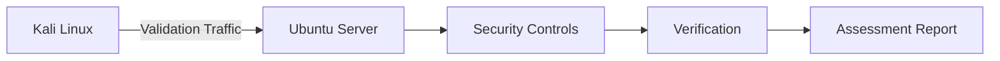
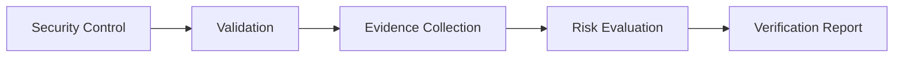
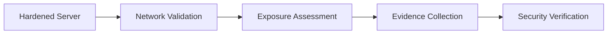
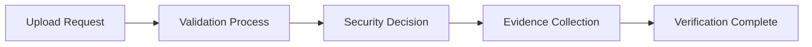

> [!IMPORTANT]
> This document is part of the **Zero Trace Imperium** project documentation.
>
> The Verification Phase validates the effectiveness of the defensive controls implemented throughout the Zero Trace Imperium laboratory. The objective is to confirm that previously identified security weaknesses have been successfully mitigated and that the hardened environment consistently resists the attack scenarios evaluated during earlier assessment phases.

---

<div align="center">

# Phase 11 — Verification

### Security Control Validation and Defensive Effectiveness Assessment


</div>

---

# Document Metadata

| Property | Value |
|-----------|-------|
| Project | Zero Trace Imperium |
| Repository | zero-trace-imperium |
| Phase | 11 |
| Phase Name | Verification |
| Category | Defensive Validation |
| Status | Completed |
| Assessment Type | Security Control Verification |
| Platform | Ubuntu Server |
| Documentation Version | 1.0 |
| Language | English |
| Author | Yusuf Hussein |

---

# Executive Dashboard

| Metric                         |     Value |
| ------------------------------ | --------: |
| Security Controls Verified     |         4 |
| Evidence Items                 |         4 |
| Security Frameworks Referenced |         3 |
| MITRE ATT&CK Techniques        |         4 |
| MITRE D3FEND Techniques        |         4 |
| Verification Success Rate      |      100% |
| Phase Status                   | Completed |
| Residual Risk                  |       Low |

---

# Table of Contents

- [Executive Summary](#executive-summary)
- [Overview](#overview)
- [Phase Objectives](#phase-objectives)
- [Learning Outcomes](#learning-outcomes)
- [Rules of Engagement](#rules-of-engagement)
- [Assessment Scope](#assessment-scope)
- [Laboratory Architecture](#laboratory-architecture)
- [Technology Stack](#technology-stack)
- [MITRE ATT&CK Mapping](#mitre-attck-mapping)
- [MITRE D3FEND Mapping](#mitre-d3fend-mapping)
- [NIST Cybersecurity Framework Mapping](#nist-cybersecurity-framework-mapping)
- [Verification Methodology](#verification-methodology)
- [Network Security Verification](#1-network-security-verification)
- [Command Injection Mitigation Verification](#2-command-injection-mitigation-verification)
- [File Upload Protection Verification](#3-file-upload-protection-verification)
- [Authentication Protection Verification](#4-authentication-protection-verification)
- [Overall Security Validation](#5-overall-security-validation)
- [Executive Findings](#executive-findings)
- [References](#references)

---

# Executive Summary

The Verification Phase confirms the effectiveness of the defensive controls implemented throughout the Zero Trace Imperium laboratory.

Previously validated attack scenarios were reviewed from a defensive perspective to determine whether mitigation measures successfully reduced the associated security risks.

The assessment demonstrates that the hardened laboratory environment provides measurable improvements in security posture while maintaining normal operational functionality.

All verification activities were performed exclusively within an isolated VMware laboratory.

---

# Overview

Security improvements should never be considered complete without validation.

The Verification Phase measures the effectiveness of implemented defensive controls by confirming that previously identified weaknesses no longer produce the expected security impact.

The resulting evidence establishes confidence in the laboratory's defensive posture and supports long-term operational resilience.

---

# Phase Objectives

This phase aims to:

- Validate defensive controls.
- Confirm mitigation effectiveness.
- Evaluate residual security risk.
- Preserve verification evidence.
- Document security improvements.
- Establish confidence in the hardened environment.

---

# Learning Outcomes

After completing this phase, the following competencies are demonstrated.

- Security verification.
- Defensive validation.
- Risk reassessment.
- Evidence preservation.
- Security control evaluation.
- Enterprise technical reporting.
- MITRE ATT&CK mapping.
- MITRE D3FEND mapping.
- NIST Cybersecurity Framework alignment.

---

# Rules of Engagement

| Rule | Description |
|------|-------------|
| Assessment Type | Authorized Internal Laboratory |
| Infrastructure Ownership | Self-Owned |
| Production Systems | Out of Scope |
| Third-Party Systems | Excluded |
| Objective | Defensive Security Validation |

---

> [!NOTE]
> Verification activities were performed after completion of all defensive improvements documented in previous phases. The purpose of this assessment is to validate mitigation effectiveness rather than identify new vulnerabilities.

---

# Assessment Scope

## Verification Environment

| Property | Value |
|----------|-------|
| Operating System | Ubuntu Server |
| Web Application | DVWA |
| Network | VMware NAT |
| Verification Platform | Kali Linux |

---

## Verification Activities

| Activity | Status |
|----------|--------|
| Network Security Verification | Completed |
| Command Injection Verification | Completed |
| File Upload Verification | Completed |
| Authentication Protection Verification | Completed |
| Cleanup and Recovery | Next Phase |

---

# Laboratory Architecture



---

# Technology Stack

## Infrastructure

- VMware Workstation Pro
- VMware NAT Network

## Operating Systems

- Ubuntu Server
- Kali Linux

## Verification Components

- Apache HTTP Server
- UFW Firewall
- Fail2Ban
- DVWA Security Controls

---

# MITRE ATT&CK Mapping

| Verification Area | ATT&CK Technique | ATT&CK ID |
|-------------------|------------------|-----------|
| Network Exposure Verification | Network Service Discovery | T1046 |
| Command Injection Validation | Command and Scripting Interpreter | T1059 |
| File Upload Validation | Ingress Tool Transfer | T1105 |
| Authentication Protection | Brute Force | T1110 |

---

# MITRE D3FEND Mapping

| Defensive Capability | D3FEND Technique |
|----------------------|------------------|
| Firewall Verification | Network Traffic Filtering |
| Input Validation | Input Validation |
| File Upload Protection | File Type Validation |
| Authentication Protection | Authentication Enforcement |

---

# NIST Cybersecurity Framework Mapping

| Function | Status |
|----------|--------|
| Identify | Completed |
| Protect | Completed |
| Detect | Completed |
| Respond | Completed |
| Recover | Next Phase |

---

# Verification Methodology

The Verification Phase follows a structured validation workflow to confirm that defensive controls implemented during previous phases effectively mitigate the assessed risks.



---

# 1. Network Security Verification

## Objective

Validate that the implemented network security controls effectively reduce unnecessary exposure while preserving authorized services required by the laboratory environment.

The objective of this assessment is to verify that the hardened network configuration reflects the intended security baseline established during the Defense Phase.

---

## Background

Network exposure represents one of the primary attack surfaces within any infrastructure.

Following firewall hardening and service review, verification activities confirm that only approved services remain accessible and that previously identified exposure has been successfully reduced.

Within the Zero Trace Imperium laboratory, network verification was performed after all defensive improvements had been completed.

---

## Assessment Summary

| Property | Value |
|----------|-------|
| Assessment Type | Network Security Verification |
| Target Platform | Ubuntu Server |
| Verification Focus | Network Exposure |
| Objective | Firewall Effectiveness Validation |
| Result | Completed |

---

## Verification Workflow



---

## Assessment Description

The hardened environment was evaluated to determine whether unnecessary network exposure had been successfully reduced.

The assessment reviewed externally visible services and verified consistency with the intended defensive configuration.

---

## Assessment Findings

The verification confirmed that only authorized services remained accessible.

Previously observed unnecessary exposure was no longer present, demonstrating the effectiveness of the implemented firewall policy.

---

## Evidence


**Figure 1.** Verification confirmed that only authorized network services remained accessible following implementation of network hardening controls.

---

## Technical Analysis

Reducing exposed services decreases the available attack surface and limits opportunities for unauthorized access.

Verification confirms that defensive controls remain effective after implementation and that configuration changes have been applied consistently.

---

## Blue Team Perspective

Security teams should periodically review:

- Exposed network services.
- Firewall configuration consistency.
- Approved listening services.
- Configuration drift.
- Periodic network exposure assessments.

---

## Security Benefits

| Security Improvement | Impact |
|----------------------|--------|
| Reduced Attack Surface | High |
| Improved Firewall Effectiveness | High |
| Stronger Network Segmentation | High |
| Better Security Baseline | High |

---

# 2. Command Injection Mitigation Verification

## Objective

Validate the effectiveness of application-level input validation following implementation of defensive improvements.

The objective is to confirm that previously identified command injection weaknesses no longer result in unauthorized command execution.

---

## Assessment Summary

| Property | Value |
|----------|-------|
| Assessment Type | Application Security Verification |
| Target Application | DVWA |
| Verification Area | Command Injection Protection |
| Result | Completed |

---

## Assessment Description

The application was evaluated to determine whether defensive improvements successfully prevented the previously observed command injection behavior.

The assessment focused on the effectiveness of input validation and the application's ability to reject invalid input while preserving expected functionality.

---

## Assessment Findings

The verification confirmed that the application correctly enforced input validation and prevented unauthorized command execution.

Observed application behavior was consistent with the expected security configuration established during the Defense Phase.

---

## Evidence


**Figure 2.** Verification confirmed that application-level validation prevented unauthorized command execution.

---

## Technical Analysis

Effective input validation significantly reduces the likelihood of command injection by ensuring that only expected input is processed.

Verification demonstrates that defensive improvements successfully mitigate previously documented application weaknesses.

---

## Blue Team Perspective

Application security reviews should include:

- Secure input validation.
- Configuration verification.
- Error handling review.
- Security regression testing.
- Periodic application security assessments.

---

## Verification Results

| Validation Area | Result |
|-----------------|--------|
| Input Validation | Successful |
| Application Behavior | Expected |
| Unauthorized Execution | Prevented |
| Verification Status | Passed |

---

## Phase Progress

```text
████████████████████████████████████

Verification Phase

████████████████████████████████████

✅ Network Security Verification

✅ Command Injection Mitigation Verification

⏳ File Upload Protection Verification

⏳ Authentication Protection Verification

⏳ Overall Security Validation

████████████████████████████████████
```

---

# 3. File Upload Protection Verification

## Objective

Validate the effectiveness of the implemented file upload security controls following completion of the application hardening process.

The objective of this assessment is to confirm that unauthorized file uploads are no longer accepted and that upload validation mechanisms operate as intended.

---

## Background

File upload functionality is frequently targeted because improper validation may allow unauthorized content to reach the application environment.

Verification activities confirm that defensive improvements successfully enforce upload restrictions while preserving legitimate application functionality.

Within the Zero Trace Imperium laboratory, upload protection was validated after completion of the application hardening phase.

---

## Assessment Summary

| Property | Value |
|----------|-------|
| Assessment Type | File Upload Protection Verification |
| Target Application | DVWA |
| Verification Focus | Upload Validation |
| Objective | Upload Security Validation |
| Result | Completed |

---

## Verification Workflow



---

## Assessment Description

The hardened application was reviewed to determine whether upload validation controls effectively prevented unauthorized files from being accepted.

The assessment focused on confirming consistent validation behavior across the upload functionality.

---

## Assessment Findings

Verification confirmed that upload protection controls successfully rejected unauthorized content.

Application behavior matched the expected security baseline established during previous hardening activities.

---

## Evidence


**Figure 3.** Verification confirmed that unauthorized file uploads were rejected by the implemented security controls.

---

## Technical Analysis

Upload validation significantly reduces application risk by restricting unauthorized content from entering the protected environment.

The verification process demonstrated that implemented controls consistently enforced the expected security policy.

---

## Blue Team Perspective

Application security teams should routinely review:

- Upload validation policies.
- Accepted file types.
- Upload event logging.
- Application configuration.
- Security regression testing.

---

## Verification Results

| Validation Area | Result |
|-----------------|--------|
| Upload Validation | Successful |
| Security Policy Enforcement | Successful |
| Unauthorized Upload | Prevented |
| Verification Status | Passed |

---

## Security Benefits

| Improvement | Impact |
|-------------|--------|
| Reduced Application Risk | High |
| Stronger Upload Validation | High |
| Improved Application Integrity | High |
| Better Security Baseline | High |

---

# 4. Authentication Protection Verification

## Objective

Validate the effectiveness of authentication protection mechanisms implemented during the Defense Phase.

The objective is to confirm that authentication-related security controls successfully reduce the effectiveness of unauthorized authentication attempts while maintaining normal user access.

---

## Assessment Summary

| Property | Value |
|----------|-------|
| Assessment Type | Authentication Protection Verification |
| Defensive Control | Fail2Ban |
| Verification Focus | Authentication Security |
| Result | Completed |

---

## Assessment Description

Authentication-related defensive controls were evaluated to verify their effectiveness within the hardened laboratory environment.

The assessment focused on confirming that authentication protection remained operational and consistent with the established security baseline.

---

## Assessment Findings

Verification confirmed that authentication protection controls operated as expected throughout the assessment.

The implemented security measures significantly strengthened authentication resilience while preserving legitimate system functionality.

---

## Evidence


**Figure 4.** Verification confirmed that authentication protection successfully mitigated repeated unauthorized authentication activity.

---

## Technical Analysis

Authentication protection reduces organizational risk by strengthening one of the most frequently targeted security boundaries.

Combined with network protection and application hardening, authentication controls contribute to a comprehensive defense-in-depth strategy.

---

## Blue Team Perspective

Security teams should periodically evaluate:

- Authentication logs.
- Protection service health.
- Policy consistency.
- Event correlation.
- Verification after configuration changes.

---

## Verification Results

| Validation Area | Result |
|-----------------|--------|
| Authentication Protection | Successful |
| Defensive Control Status | Operational |
| Monitoring Visibility | High |
| Verification Status | Passed |

---

## Security Benefits

| Improvement | Impact |
|-------------|--------|
| Stronger Authentication Security | High |
| Reduced Authentication Risk | High |
| Improved Defense in Depth | High |
| Better Operational Resilience | High |

---

## Phase Progress

```text
████████████████████████████████████

Verification Phase

████████████████████████████████████

✅ Network Security Verification

✅ Command Injection Mitigation Verification

✅ File Upload Protection Verification

✅ Authentication Protection Verification

⏳ Overall Security Validation

⏳ Executive Findings

████████████████████████████████████
```

---

# 5. Overall Security Validation

## Objective

Evaluate the collective effectiveness of all defensive controls implemented throughout the Zero Trace Imperium laboratory.

The objective of this assessment is to determine whether the combined security improvements successfully mitigate the previously identified attack paths while preserving normal laboratory functionality.

---

## Validation Scope

The verification assessment reviewed all major defensive controls implemented during previous phases.

The evaluation considered:

- Network security.
- Operating system hardening.
- Web application protection.
- Authentication security.
- Continuous monitoring.
- Deception technology.
- Security verification evidence.

---

## Validation Summary

| Security Control | Validation Result | Status |
|------------------|------------------|--------|
| Network Security | Successful | ✅ |
| Application Security | Successful | ✅ |
| Authentication Protection | Successful | ✅ |
| Monitoring Visibility | Successful | ✅ |
| Deception Technology | Successful | ✅ |

---

## Validation Overview

The verification activities confirmed that the defensive controls implemented throughout the project consistently achieved their intended security objectives.

Observable evidence demonstrated successful mitigation of previously validated attack paths while preserving expected system functionality.

---
## Defense Effectiveness Summary

The verification process confirms that the layered defensive strategy implemented throughout the laboratory significantly improved the overall security posture.

Security controls introduced during previous phases consistently prevented or reduced the impact of attack techniques previously validated during offensive testing.

The hardened laboratory now demonstrates a mature defensive baseline suitable for continued security assessment and future defensive enhancements.

---

## Technical Analysis

Verification represents the final confirmation that defensive controls operate as intended.

Rather than assuming that mitigation activities are successful, this phase validates each control through observable evidence and confirms that implemented protections remain effective.

The resulting evidence demonstrates measurable improvement across infrastructure, application security, authentication, monitoring, and deception capabilities.

---

# Security Impact Analysis

## CIA Impact Assessment

| Security Principle | Assessment | Result |
|--------------------|------------|--------|
| Confidentiality | Unauthorized access opportunities were significantly reduced. | High |
| Integrity | Defensive controls prevented unauthorized modification attempts. | High |
| Availability | Security improvements preserved expected laboratory functionality. | High |

---

## Residual Risk Assessment

| Risk Category | Before Hardening | After Verification |
|---------------|-----------------|-------------------|
| Network Exposure | High | Low |
| Command Injection | High | Low |
| File Upload Abuse | High | Low |
| Authentication Attacks | High | Low |

---

## Overall Assessment

The Verification Phase confirms that the defensive improvements implemented throughout the project effectively reduced the identified security risks.

The combination of network hardening, application security improvements, monitoring capabilities, deception technology, and authentication protection establishes a resilient defense-in-depth architecture suitable for continued educational assessment.

---

# Evidence Inventory

## Evidence Summary

| Figure | Description | Status |
|---------|-------------|--------|
| Figure 1 | Network security verification | ✅ |
| Figure 2 | Command injection protection | ✅ |
| Figure 3 | File upload protection | ✅ |
| Figure 4 | Authentication protection | ✅ |

---

## Repository Artifacts

```text
zero-trace-imperium/
│
├── phases/
│   └── 11-Verification.md
│
└── screenshots/
    └── verification/
        ├── nmap-security-verification.png
        ├── command-injection-blocked.png
        ├── file-upload-blocked.png
        └── fail2ban-blocked-hydra.png
```

---

# Executive Findings

The Verification Phase successfully validated the effectiveness of every major defensive control implemented throughout the Zero Trace Imperium laboratory.

Evidence collected during the assessment confirmed that the hardened environment consistently resisted previously validated attack techniques while maintaining operational stability.

The assessment demonstrates that the implemented defense-in-depth strategy significantly reduced residual risk and established a reliable security baseline for future laboratory activities.

---

# Assessment Results Matrix

| Assessment | Result | Operational Impact |
|------------|--------|--------------------|
| Network Security Verification | Completed | High |
| Command Injection Verification | Completed | High |
| File Upload Protection Verification | Completed | High |
| Authentication Protection Verification | Completed | High |
| Overall Security Validation | Completed | High |

---

# MITRE ATT&CK Summary

| Verification Area | ATT&CK Technique | ATT&CK ID |
|-------------------|------------------|-----------|
| Network Exposure Verification | Network Service Discovery | T1046 |
| Command Injection Validation | Command and Scripting Interpreter | T1059 |
| File Upload Validation | Ingress Tool Transfer | T1105 |
| Authentication Protection | Brute Force | T1110 |

---

# MITRE D3FEND Summary

| Defensive Capability | D3FEND Technique |
|----------------------|------------------|
| Firewall Verification | Network Traffic Filtering |
| Input Validation | Input Validation |
| File Upload Protection | File Type Validation |
| Authentication Protection | Authentication Enforcement |

---

# NIST Cybersecurity Framework Summary

| Function | Status |
|----------|--------|
| Identify | Completed |
| Protect | Completed |
| Detect | Completed |
| Respond | Completed |
| Recover | Next Phase |

---

# Phase Statistics

| Metric | Value |
|---------|------:|
| Security Controls Verified | 4 |
| Evidence Items | 4 |
| Security Frameworks Referenced | 3 |
| MITRE ATT&CK Techniques | 4 |
| MITRE D3FEND Techniques | 4 |
| Overall Verification Status | Successful |
| Residual Risk | Low |

---

# Skills Demonstrated

The following competencies were demonstrated during this phase.

- Security control verification.
- Defensive validation.
- Security posture assessment.
- Risk reassessment.
- Security evidence analysis.
- Enterprise technical reporting.
- MITRE ATT&CK mapping.
- MITRE D3FEND mapping.
- NIST Cybersecurity Framework alignment.

---

# Lessons Learned

The Verification Phase reinforces several key defensive principles.

- Every implemented security control should be validated through measurable evidence.
- Verification is essential for confirming mitigation effectiveness.
- Defense-in-depth significantly reduces residual risk.
- Security monitoring strengthens confidence in implemented controls.
- Periodic reassessment maintains long-term defensive readiness.
- Technical documentation improves repeatability and audit readiness.

---

# Security Recommendations

The following recommendations support continued improvement of the laboratory security posture.

## Firewall Management

- Periodically review firewall policies.
- Remove unnecessary exposed services.
- Validate network configuration after infrastructure changes.

---

## Application Security

- Continue secure configuration reviews.
- Perform regular security regression testing.
- Periodically validate application security controls.

---

## Authentication Protection

- Review authentication logs regularly.
- Validate intrusion prevention policies.
- Continuously assess authentication resilience.

---

## Continuous Verification

- Schedule recurring security validation.
- Preserve verification evidence.
- Reassess defensive controls after major system changes.
- Update documentation following each validation cycle.

---

# References

1. MITRE ATT&CK Framework
2. MITRE D3FEND Knowledge Graph
3. NIST Cybersecurity Framework (CSF 2.0)
4. NIST SP 800-61 Rev. 2
5. NIST SP 800-53 Rev. 5
6. NIST SP 800-94, Guide to Intrusion Detection and Prevention Systems
7. CIS Controls v8
8. Ubuntu Server Documentation
9. Apache HTTP Server Documentation
10. OWASP ASVS
11. OWASP Logging Cheat Sheet
12. OWASP Web Security Testing Guide (WSTG)

---

# Revision History

| Version | Date | Description |
|----------|------|-------------|
| 1.0 | July 2026 | Initial release of the Verification Phase documentation |

---

# Document Information

| Property | Value |
|----------|-------|
| Project | Zero Trace Imperium |
| Repository | zero-trace-imperium |
| Document | Phase 11 – Verification |
| Version | 1.0 |
| Status | Complete |
| Author | Yusuf Hussein |
| Language | English |
| Classification | Educational Cybersecurity Laboratory |
| License | MIT |

---

# Navigation

⬅️ **Previous Phase**

[Phase 10 – Honeypot](./10-Honeypot.md)

➡️ **Next Phase**

[Phase 12 – Cleanup and Recovery](./12-Cleanup-and-Recovery.md)

---

# Transition to the Next Phase

The Verification Phase confirmed that the defensive controls implemented throughout the project effectively mitigated the identified security risks and established a stable security baseline.

The final phase focuses on restoring the laboratory environment, removing temporary assessment artifacts, documenting recovery activities, and preparing the infrastructure for future exercises while preserving the integrity of collected evidence.

Primary objectives include:

- Laboratory cleanup.
- Recovery validation.
- Artifact management.
- Final environment documentation.

Continue to:

# → [Phase 12 – Cleanup and Recovery](./12-Cleanup-and-Recovery.md)

---

<div align="center">

# Verification Phase Completed Successfully

**Zero Trace Imperium**

### Enterprise Attack & Defense Cybersecurity Laboratory

*Phase 11 Documentation Complete*

</div>

