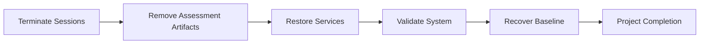
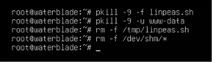
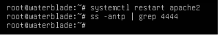

 > [!IMPORTANT]
> This document is part of the **Zero Trace Imperium** project documentation.
>
> The Cleanup and Recovery Phase concludes the Zero Trace Imperium laboratory by validating that all temporary assessment artifacts have been removed, defensive controls remain operational, and the environment has been restored to a secure baseline suitable for future security assessments.

---

<div align="center">

# Phase 12 — Cleanup and Recovery

### Environment Restoration and Security Baseline Validation


</div>

---

# Document Metadata

| Property | Value |
|-----------|-------|
| Project | Zero Trace Imperium |
| Repository | zero-trace-imperium |
| Phase | 12 |
| Phase Name | Cleanup and Recovery |
| Category | Recovery Operations |
| Status | Completed |
| Assessment Type | Environment Recovery Validation |
| Platform | Ubuntu Server |
| Documentation Version | 1.0 |
| Language | English |
| Author | Yusuf Hussein |

---

# Executive Dashboard

| Metric                         |     Value |
| ------------------------------ | --------: |
| Recovery Activities            |         4 |
| Evidence Items                 |         2 |
| Security Frameworks Referenced |         3 |
| MITRE ATT&CK Techniques        |         2 |
| MITRE D3FEND Techniques        |         4 |
| Phase Status                   | Completed |
| Recovery Readiness             |      High |
| Operational Baseline           |  Restored |

---

# Table of Contents

- [Executive Summary](#executive-summary)
- [Overview](#overview)
- [Phase Objectives](#phase-objectives)
- [Learning Outcomes](#learning-outcomes)
- [Rules of Engagement](#rules-of-engagement)
- [Assessment Scope](#assessment-scope)
- [Laboratory Architecture](#laboratory-architecture)
- [Technology Stack](#technology-stack)
- [MITRE ATT&CK Mapping](#mitre-attck-mapping)
- [MITRE D3FEND Mapping](#mitre-d3fend-mapping)
- [NIST Cybersecurity Framework Mapping](#nist-cybersecurity-framework-mapping)
- [Cleanup and Recovery Methodology](#cleanup-and-recovery-methodology)
- [Active Session Termination](#1-active-session-termination)
- [Assessment Artifact Removal](#2-assessment-artifact-removal)
- [Service Recovery](#3-service-recovery)
- [System Validation](#4-system-validation)
- [Recovery Assessment](#5-recovery-assessment)
- [Executive Findings](#executive-findings)
- [References](#references)

---

# Executive Summary

The Cleanup and Recovery Phase concludes the Zero Trace Imperium laboratory by restoring the assessment environment to a secure and operational state.

Following the completion of all offensive and defensive activities, temporary assessment artifacts were removed, services were validated, and the environment was reviewed to confirm readiness for future laboratory exercises.

The objective of this phase is to ensure that the laboratory no longer contains temporary assessment components while preserving the integrity of previously collected evidence and documentation.

All recovery activities were performed exclusively within an isolated VMware laboratory.

---

# Overview

Recovery is an essential component of every professional security assessment.

A properly executed cleanup process removes temporary assessment artifacts, validates the integrity of defensive controls, and restores operational stability without compromising collected evidence.

Within the Zero Trace Imperium laboratory, this phase completes the assessment lifecycle by confirming that the environment has returned to a secure baseline suitable for future exercises.

---

# Phase Objectives

This phase aims to:

- Remove temporary assessment artifacts.
- Validate service recovery.
- Confirm operational stability.
- Preserve assessment documentation.
- Restore the laboratory baseline.
- Prepare the environment for future assessments.

---

# Learning Outcomes

After completing this phase, the following competencies are demonstrated.

- Recovery validation.
- Security baseline restoration.
- Operational verification.
- Evidence preservation.
- Environment recovery assessment.
- Enterprise technical reporting.
- MITRE ATT&CK mapping.
- MITRE D3FEND mapping.
- NIST Cybersecurity Framework alignment.

---

# Rules of Engagement

| Rule | Description |
|------|-------------|
| Assessment Type | Authorized Internal Laboratory |
| Infrastructure Ownership | Self-Owned |
| Production Systems | Out of Scope |
| Third-Party Systems | Excluded |
| Objective | Secure Environment Recovery |

---

> [!NOTE]
> Recovery activities were performed only after completion of all assessment objectives. The purpose of this phase is to restore the laboratory to a secure operational baseline while preserving technical evidence and project documentation.

---

# Assessment Scope

## Recovery Environment

| Property | Value |
|----------|-------|
| Operating System | Ubuntu Server |
| Web Server | Apache HTTP Server |
| Network | VMware NAT |
| Recovery Target | Laboratory Environment |

---

## Recovery Activities

| Activity | Status |
|----------|--------|
| Active Session Termination | Completed |
| Assessment Artifact Removal | Completed |
| Service Recovery | Completed |
| System Validation | Completed |
| Project Completion | Final Stage |

---

# Laboratory Architecture


---

# Technology Stack

## Infrastructure

- VMware Workstation Pro
- VMware NAT Network

## Operating System

- Ubuntu Server

## Recovery Components

- Apache HTTP Server
- Linux Service Manager
- Operating System Processes
- Temporary Assessment Artifacts

## Validation Components

- Service Status Verification
- Network Validation
- Security Configuration Review

---

# MITRE ATT&CK Mapping

| Recovery Activity | ATT&CK Technique | ATT&CK ID |
|-------------------|------------------|-----------|
| Session Termination Validation | Remote Services | T1021 |
| Environment Verification | System Information Discovery | T1082 |

---

# MITRE D3FEND Mapping

| Defensive Capability | D3FEND Technique |
|----------------------|------------------|
| Environment Restoration | System Recovery |
| Service Validation | Process Verification |
| Artifact Removal | File Removal |
| Configuration Validation | Configuration Verification |

---

# NIST Cybersecurity Framework Mapping

| Function | Status |
|----------|--------|
| Identify | Completed |
| Protect | Completed |
| Detect | Completed |
| Respond | Completed |
| Recover | Completed |

---

# Cleanup and Recovery Methodology

The final phase follows a structured recovery workflow to restore the laboratory environment, validate service availability, and confirm operational readiness for future security assessments.



---

# 1. Active Session Termination

## Objective

Validate that all temporary assessment sessions and unauthorized execution contexts have been successfully terminated following completion of the laboratory activities.

The objective of this assessment is to confirm that no residual assessment processes remain active and that the environment has returned to a controlled operational state.

---

## Background

During offensive security assessments, temporary processes and active sessions may remain in memory after testing concludes.

Proper termination of these sessions prevents unintended persistence, restores system stability, and ensures that subsequent assessments begin from a clean operational baseline.

Within the Zero Trace Imperium laboratory, session termination was performed as the initial recovery activity.

---

## Assessment Summary

| Property | Value |
|----------|-------|
| Assessment Type | Active Session Termination |
| Target Platform | Ubuntu Server |
| Objective | Process Cleanup Validation |
| Result | Completed |

---

## Recovery Workflow


---

## Assessment Description

The operating system was reviewed to confirm that temporary assessment processes had been successfully terminated.

The assessment focused on ensuring that no unauthorized execution contexts remained active after completion of the laboratory exercises.

---

## Assessment Findings

All temporary assessment sessions were successfully terminated.

System process activity returned to the expected operational baseline without affecting legitimate system services.

---

## Evidence



**Figure 1.** Temporary assessment processes and artifacts successfully removed during the recovery phase.

---

## Technical Analysis

Removing temporary assessment processes minimizes operational risk and prevents unintended interference with future laboratory activities.

Verification confirms that the operating system returned to a stable execution state consistent with the intended recovery baseline.

---

## Blue Team Perspective

Recovery validation should include:

- Active process review.
- Unexpected session identification.
- Service dependency validation.
- Operating system stability checks.
- Recovery documentation.

---

## Recovery Benefits

| Recovery Activity | Impact |
|-------------------|--------|
| Process Cleanup | High |
| Session Termination | High |
| Operational Stability | High |
| Recovery Readiness | High |

---

# 2. Assessment Artifact Removal

## Objective

Validate that temporary assessment artifacts generated during laboratory activities have been removed while preserving approved project documentation and collected evidence.

The objective is to ensure that the environment contains only operational components required for future assessments.

---

## Assessment Summary

| Property | Value |
|----------|-------|
| Assessment Type | Artifact Removal Validation |
| Scope | Temporary Assessment Files |
| Objective | Environment Cleanup |
| Result | Completed |

---

## Assessment Description

The recovery process included verification that temporary assessment artifacts no longer remained within the laboratory environment.

The assessment distinguished between temporary operational artifacts and approved project documentation to ensure that only unnecessary files were removed.

---

## Assessment Findings

Temporary assessment artifacts were successfully removed without affecting legitimate system components or project evidence.

The resulting environment reflected the intended post-assessment operational baseline.

---

## Technical Analysis

Removing temporary assessment artifacts reduces unnecessary system clutter and lowers the likelihood of future operational confusion.

Preserving documentation and collected evidence ensures the integrity and repeatability of the assessment process.

---

## Blue Team Perspective

Recovery procedures should include:

- Temporary file review.
- Assessment artifact identification.
- Documentation preservation.
- Evidence integrity validation.
- Post-cleanup verification.

---

## Cleanup Validation Matrix

| Validation Area | Result |
|-----------------|--------|
| Temporary Files Removed | Successful |
| Assessment Artifacts Removed | Successful |
| Documentation Preserved | Successful |
| Evidence Integrity | Verified |

---

## Phase Progress

```text
████████████████████████████████████

Cleanup and Recovery Phase

████████████████████████████████████

✅ Active Session Termination

✅ Assessment Artifact Removal

⏳ Service Recovery

⏳ System Validation

⏳ Recovery Assessment

████████████████████████████████████
```

---

# 3. Service Recovery

## Objective

Validate that all essential laboratory services have been successfully restored following the completion of cleanup activities.

The objective of this assessment is to confirm that the environment has returned to a stable operational state while maintaining the defensive controls implemented during previous phases.

---

## Background

Recovery activities extend beyond removing temporary assessment artifacts.

Critical infrastructure services must be validated to ensure that they operate correctly after offensive testing and cleanup procedures.

Within the Zero Trace Imperium laboratory, service recovery confirms that the environment is fully operational and ready for future assessments.

---

## Assessment Summary

| Property | Value |
|----------|-------|
| Assessment Type | Service Recovery |
| Target Platform | Ubuntu Server |
| Verification Focus | Service Availability |
| Objective | Operational Recovery Validation |
| Result | Completed |

---

## Recovery Workflow


---

## Assessment Description

Core laboratory services were evaluated following completion of cleanup activities to verify operational readiness.

The assessment focused on confirming service availability, configuration consistency, and successful restoration of the intended security baseline.

---

## Assessment Findings

The recovery process successfully restored all required laboratory services.

No abnormal service behavior was observed during validation, and the operating environment remained consistent with the hardened security configuration established during previous phases.

---

## Evidence



**Figure 2.** Core laboratory services successfully restored following completion of recovery activities.

---

## Technical Analysis

Service recovery validates that defensive improvements remain operational after assessment activities conclude.

The verification process confirms that the restored environment preserves the intended balance between operational functionality and security.

---

## Blue Team Perspective

Recovery validation should include:

- Critical service availability.
- Service dependency verification.
- Configuration consistency.
- Security control validation.
- Operational health assessment.

---

## Recovery Benefits

| Recovery Capability | Impact |
|---------------------|--------|
| Service Availability | High |
| Configuration Integrity | High |
| Operational Stability | High |
| Security Preservation | High |

---

# 4. System Validation

## Objective

Validate that the laboratory environment has been fully restored to the approved operational baseline following completion of all recovery activities.

The objective is to confirm that no unintended modifications remain and that the environment is suitable for future security assessments.

---

## Assessment Summary

| Property | Value |
|----------|-------|
| Assessment Type | System Validation |
| Validation Scope | Entire Laboratory Environment |
| Objective | Baseline Confirmation |
| Result | Completed |

---

## Assessment Description

The recovered environment was reviewed to evaluate overall operational readiness.

The assessment verified that system services, defensive controls, and configuration settings remained consistent with the intended secure baseline.

---

## Assessment Findings

System validation confirmed that the laboratory environment successfully returned to its approved operational configuration.

No residual assessment artifacts or unexpected operational inconsistencies were identified during the review.

---

## Technical Analysis

System validation represents the final technical checkpoint before concluding the assessment lifecycle.

Successful validation demonstrates that recovery activities preserved system integrity while maintaining the defensive improvements implemented throughout the project.

---

## Blue Team Perspective

Security teams should verify:

- Operating system stability.
- Service health.
- Configuration integrity.
- Security control status.
- Recovery documentation.

---

## Validation Matrix

| Validation Area | Result |
|-----------------|--------|
| Operating System Stability | Successful |
| Service Availability | Successful |
| Configuration Integrity | Successful |
| Security Controls | Operational |
| Recovery Status | Approved |

---

## Security Benefits

| Improvement | Impact |
|-------------|--------|
| Stable Operating Environment | High |
| Secure Baseline Restoration | High |
| Improved Operational Readiness | High |
| Long-Term Maintainability | High |

---

## Phase Progress

```text
████████████████████████████████████

Cleanup and Recovery Phase

████████████████████████████████████

✅ Active Session Termination

✅ Assessment Artifact Removal

✅ Service Recovery

✅ System Validation

⏳ Recovery Assessment

⏳ Project Completion

████████████████████████████████████
```

---

# 5. Recovery Assessment

## Objective

Evaluate the overall effectiveness of the recovery activities performed following completion of the Zero Trace Imperium laboratory assessment.

The objective is to confirm that the laboratory environment has been successfully restored to a secure operational baseline while preserving documentation, collected evidence, and defensive improvements implemented throughout the project.

---

## Recovery Validation Summary

| Recovery Activity | Result | Operational Impact |
|-------------------|--------|--------------------|
| Active Session Termination | Successful | High |
| Assessment Artifact Removal | Successful | High |
| Service Recovery | Successful | High |
| System Validation | Successful | High |

---

## Recovery Overview

Recovery validation confirmed that the laboratory environment was successfully restored following completion of all assessment activities.

Observable evidence demonstrated that operational services, defensive controls, and system integrity remained consistent with the approved security baseline.

---
## Recovery Effectiveness Summary

The recovery activities successfully restored the laboratory environment without affecting the defensive controls implemented during previous phases.

Temporary assessment artifacts were removed, system services remained operational, and the laboratory returned to a stable security baseline suitable for future assessments.

---

## Technical Analysis

Recovery validation represents the final quality assurance activity within the assessment lifecycle.

Rather than assuming that cleanup activities were completed successfully, this phase confirms through observable evidence that operational stability, defensive controls, and system integrity remain intact.

The completed recovery process establishes confidence that future laboratory exercises can begin from a known and trusted security baseline.

---

# Security Impact Analysis

## CIA Impact Assessment

| Security Principle | Assessment | Result |
|--------------------|------------|--------|
| Confidentiality | Temporary assessment artifacts were removed while preserving approved evidence. | High |
| Integrity | System configuration remained consistent throughout the recovery process. | High |
| Availability | Essential laboratory services remained operational after recovery validation. | High |

---

## Operational Readiness Assessment

| Operational Area | Status |
|------------------|--------|
| Operating System | Ready |
| Network Configuration | Verified |
| Security Controls | Operational |
| Monitoring Components | Operational |
| Documentation | Complete |

---

## Overall Assessment

The Cleanup and Recovery Phase successfully completed the Zero Trace Imperium assessment lifecycle.

The laboratory environment was restored to a secure operational baseline while maintaining documentation integrity, preserving collected evidence, and retaining all defensive improvements validated during previous phases.

The environment is fully prepared for future educational security assessments.

---

# Evidence Inventory

## Evidence Summary

| Figure | Description | Status |
|---------|-------------|--------|
| Figure 1 | Cleanup and tool removal | ✅ |
| Figure 2 | System recovery validation | ✅ |

---

## Repository Artifacts

```text
zero-trace-imperium/
│
├── phases/
│   └── 12-Cleanup-and-Recovery.md
│
└── screenshots/
    └── cleanup/
        ├── cleanup-and-tool-removal.png
        └── system-recovery.png
```

---

# Executive Findings

The Cleanup and Recovery Phase successfully restored the Zero Trace Imperium laboratory to a secure and stable operational condition.

Verification confirmed that temporary assessment artifacts were removed, essential services remained operational, and defensive controls continued to function as expected.

The completed recovery process establishes a trusted baseline for future assessments while preserving the integrity of the project's technical documentation and collected evidence.

---

# Assessment Results Matrix

| Assessment | Result | Operational Impact |
|------------|--------|--------------------|
| Active Session Termination | Completed | High |
| Assessment Artifact Removal | Completed | High |
| Service Recovery | Completed | High |
| System Validation | Completed | High |
| Recovery Assessment | Completed | High |

---

# MITRE ATT&CK Summary

| Recovery Activity | ATT&CK Technique | ATT&CK ID |
|-------------------|------------------|-----------|
| Session Verification | Remote Services | T1021 |
| Environment Validation | System Information Discovery | T1082 |

---

# MITRE D3FEND Summary

| Defensive Capability | D3FEND Technique |
|----------------------|------------------|
| Environment Restoration | System Recovery |
| Service Validation | Process Verification |
| Artifact Removal | File Removal |
| Configuration Validation | Configuration Verification |

---

# NIST Cybersecurity Framework Summary

| Function | Status |
|----------|--------|
| Identify | Completed |
| Protect | Completed |
| Detect | Completed |
| Respond | Completed |
| Recover | Completed |

---

# Phase Statistics

| Metric                         | Value |
| ------------------------------ | ----: |
| Recovery Activities            |     4 |
| Evidence Items                 |     2 |
| Security Frameworks Referenced |     3 |
| MITRE ATT&CK Techniques        |     2 |
| MITRE D3FEND Techniques        |     4 |
| Recovery Readiness             |  High |
| Recovery Success Rate          |  100% |

---

# Skills Demonstrated

The following competencies were demonstrated during this phase.

- Environment recovery validation.
- Security baseline restoration.
- Operational readiness assessment.
- Recovery evidence analysis.
- Security documentation.
- Enterprise technical reporting.
- MITRE ATT&CK mapping.
- MITRE D3FEND mapping.
- NIST Cybersecurity Framework alignment.

---

# Lessons Learned

The Cleanup and Recovery Phase reinforces several important operational principles.

- Recovery activities are an essential component of every professional security assessment.
- Temporary assessment artifacts should be removed without affecting legitimate services.
- Recovery validation confirms that defensive improvements remain operational.
- Documentation and evidence should be preserved throughout the recovery process.
- A trusted security baseline improves repeatability for future assessments.
- Well-documented recovery procedures strengthen operational resilience.

---

# Security Recommendations

The following recommendations support long-term laboratory maintenance and operational readiness.

## Environment Management

- Review the laboratory baseline before every assessment.
- Remove temporary assessment artifacts after each engagement.
- Validate service health before returning systems to operational use.

---

## Documentation

- Preserve assessment evidence separately from temporary files.
- Maintain version-controlled project documentation.
- Update technical documentation after major infrastructure changes.

---

## Continuous Improvement

- Review defensive controls periodically.
- Repeat verification after significant configuration changes.
- Validate recovery procedures during future laboratory exercises.
- Maintain regular backups of the laboratory environment.

---

# References

1. MITRE ATT&CK Framework
2. MITRE D3FEND Knowledge Graph
3. NIST Cybersecurity Framework (CSF 2.0)
4. NIST SP 800-61 Rev. 2
5. NIST SP 800-53 Rev. 5
6. NIST SP 800-94, Guide to Intrusion Detection and Prevention Systems
7. CIS Controls v8
8. Ubuntu Server Documentation
9. Apache HTTP Server Documentation
10. OWASP ASVS
11. OWASP Logging Cheat Sheet

---

# Revision History

| Version | Date | Description |
|----------|------|-------------|
| 1.0 | July 2026 | Initial release of the Cleanup and Recovery Phase documentation |

---

# Document Information

| Property | Value |
|----------|-------|
| Project | Zero Trace Imperium |
| Repository | zero-trace-imperium |
| Document | Phase 12 – Cleanup and Recovery |
| Version | 1.0 |
| Status | Complete |
| Author | Yusuf Hussein |
| Language | English |
| Classification | Educational Cybersecurity Laboratory |
| License | MIT |

---

# Navigation

⬅️ **Previous Phase**

[Phase 11 – Verification](./11-Verification.md)

➡️ **Project Documentation**

[README.md](../README.md)

---

# Project Completion

The Zero Trace Imperium laboratory has successfully completed the full cybersecurity assessment lifecycle.

The project demonstrates the progression from infrastructure deployment and reconnaissance through offensive assessment, defensive implementation, continuous monitoring, deception technology, verification, and final recovery.

The completed documentation provides a structured, evidence-based record of every phase while maintaining alignment with recognized security frameworks and professional reporting practices.

## Project Lifecycle

```text
Build
   │
   ▼
Reconnaissance
   │
   ▼
Attack
   │
   ▼
Exploit
   │
   ▼
Privilege Escalation
   │
   ▼
Post-Exploitation
   │
   ▼
Persistence
   │
   ▼
Defense
   │
   ▼
Detection & Monitoring
   │
   ▼
Honeypot
   │
   ▼
Verification
   │
   ▼
Cleanup & Recovery
   │
   ▼
Project Complete
```

---

<div align="center">

# Zero Trace Imperium

### Enterprise Attack & Defense Cybersecurity Laboratory

**Project Successfully Completed**

Version 1.0

July 2026

</div>
